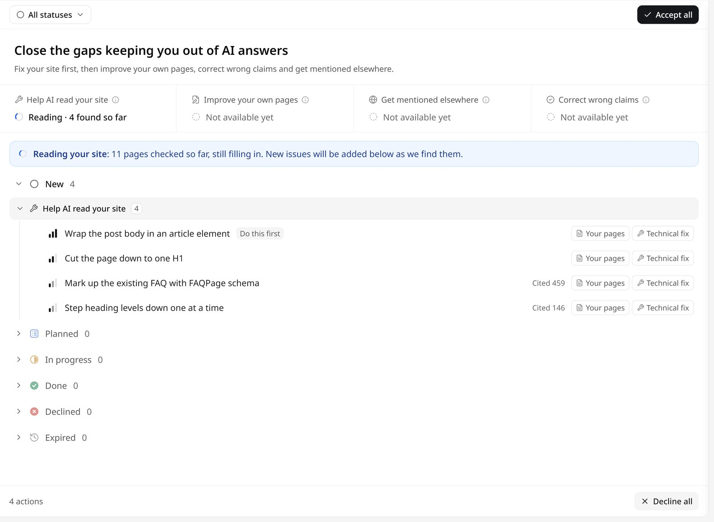
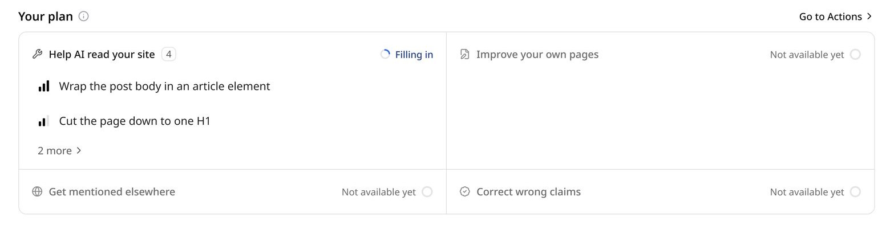

**Actions** is a to-do list for closing the gaps that keep your brand out of AI answers. GEOly reads your website, finds what makes it harder for AI to read and understand, and turns each problem into an action with the affected pages, the evidence, and what to change. You decide what to do with each one, or hand it to the [GEOly Agent](/agent/overview).

Open **Actions** in the icon rail on the left, or go to `app.geoly.ai/actions`.

## Four goals

Actions are organized into four goals, shown across the top of the page:

| Goal | What it covers |
| --- | --- |
| **Help AI read your site** | Technical fixes that help AI crawlers read and understand your site. |
| **Improve your own pages** | Places you publish yourself: your own pages and your social and community accounts. |
| **Get mentioned elsewhere** | Spots to win on other people's sites, such as media and reference sites AI already trusts. |
| **Correct wrong claims** | Claims on your pages and other sites that conflict with confirmed facts. |

<Note>
Today, actions come from **Help AI read your site**. The other three goals show **Not available yet**: they are still being built and will appear on this page when ready.
</Note>

## How GEOly finds site fixes

GEOly reads your website (your main site and the countries you monitor) and checks each page. Checks include, for example:

- `robots.txt` rules that stop AI crawlers from reading the site.
- Pages in your sitemap or navigation that don't open.
- Pages whose HTML has almost no body text without JavaScript.
- Structured data (JSON-LD) that fails to parse, or has characters escaped twice.
- Existing FAQs, ratings, or breadcrumbs that aren't marked up as structured data.
- Missing or duplicated meta descriptions, missing or repeated H1 headings, and skipped heading levels.
- Images without alt text or captions, and dates that are only plain text.

The first read starts automatically when a brand with an active subscription is created. You don't have to wait for it to finish: while GEOly is reading, the page shows how many pages it has checked, and new actions are added as they are found. After that, GEOly reads the site again every week.

## Read the list

Actions are grouped by status, then by goal. In each row:

- The **bars** show the severity, from **Very low** to **Very high**. Severity is how serious the issue is in itself; it doesn't change with your other actions.
- **Do this first** marks the top new action in each goal.
- **Cited N** is how often AI answers to the prompts you track in GEOly cited the affected pages in the last 30 days. The more often, the more fixing them may change how AI describes you.
- Labels such as **Your pages** and **Technical fix** say where the fix happens and what kind of work it is.

Use **All statuses** at the top to filter by status.

Click an action to open its details:

- **Overview**: what's wrong and why it matters.
- **What to do**: the fix, with evidence from the affected pages: the page source GEOly read, quoted as it was, and what to change it to where that applies. Tick the step when you've done it.
- **Affected pages**: how many of the checked pages have the issue, with the list of pages.
- **Severity and citations**: the severity, and how often AI answers cited the affected pages.

## Statuses

| Status | Meaning |
| --- | --- |
| **New** | A new suggestion you haven't handled yet. |
| **Planned** | Planned work. Nothing on this page moves an action here yet. |
| **In progress** | You accepted it and are working on it. |
| **Done** | You fixed it. |
| **Declined** | You decided not to do it. |
| **Expired** | A new suggestion nobody handled for 30 days. GEOly closes it automatically. |

What you can do depends on the status:

- **New**: **Accept** moves it to **In progress**. **Decline** moves it to **Declined**.
- **In progress**: **Done** marks it done today; use the arrow next to it to **Pick an earlier date**. **Drop** moves it to **Declined**.
- **Declined** and **Expired**: **Accept** moves it to **In progress**. **Restore** moves a declined action back to **New**.
- Ticking every step in **What to do** also marks the action **Done**. Unticking a step on a done action moves it back to **In progress**.

Select several rows to change them at once, or use **Accept all** and **Decline all** for everything shown. GEOly never overrides your decisions: an action you have accepted, finished, or declined stays that way when the site is read again.

### When an issue goes away or comes back

- If the latest read no longer finds an issue, the action says so (for example **Not found in the latest check**). Mark it done if you've confirmed the fix, or decline it if you no longer care.
- If an issue that was confirmed fixed shows up again, the action is marked **Back again**.

## Hand an action to the Agent

In the action details, click **Hand to Agent**. A new [Agent](/agent/overview) chat starts with the action's description, fix, evidence, affected pages, and its action ID, so the agent can read the saved evidence and help you make the change. If you have connected a tool such as GitHub, Webflow, or Wix as a [connector](/agent/connectors), you can ask the agent to prepare the change there; by default it asks before it uses the tool.

To use another tool instead, click **Copy as prompt**. It copies the same description, fix, evidence, and affected pages (without the action ID).

## Your plan on the Overview page

The **Overview** page has a **Your plan** section with the four goals and their open actions. Click an action to see its details, or click **Go to Actions** to open the full list.

## If GEOly can't read your site

If a read fails, the page shows the results from the last successful read, and your action statuses are not affected. The most common cause is a site that blocks GEOly's crawler. To allow it:

- Allow the user agent that contains `GeolyBot`.
- Allow the egress IP address shown on the Actions page.
- Don't disallow `GeolyBot` in `robots.txt`.

GEOly reads the site again on the next weekly read. To speed it up, or if your site moved to a new domain or your home page redirects to another site, tell us through the live chat.

## Use actions outside GEOly

The same list is available to AI assistants through [GEOly MCP](/developers/mcp/introduction) and the [GEOly CLI](/developers/cli): `list_actions` lists the actions and `get_action` returns one in full. See the [tools reference](/developers/mcp/tools).
