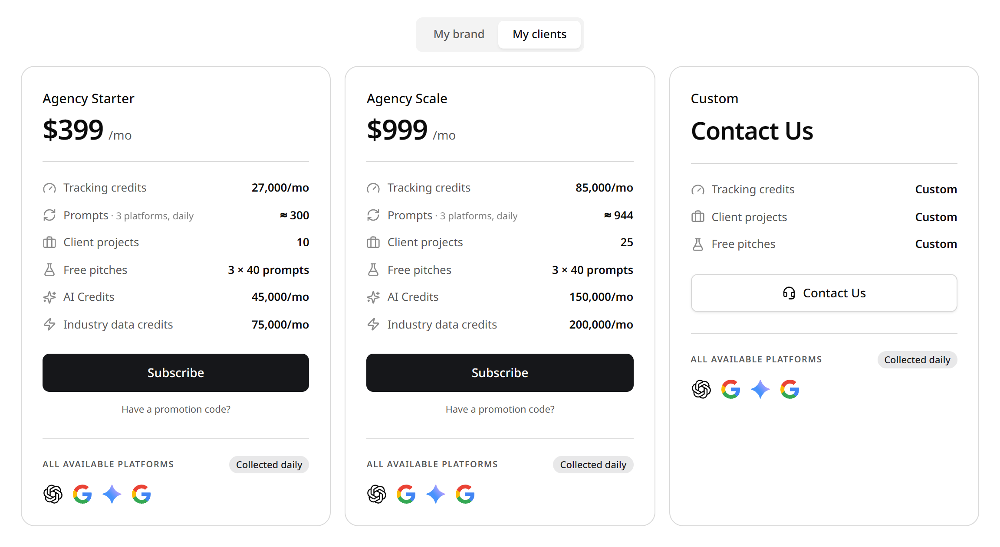

Only organization owners and admins can buy, change, or cancel a plan. The billing page isn't shown to other members.

## Buy an agency plan

1. Open **Settings → Organization → Billing**. The page is titled **Plans & Billing**.
2. Under **Who are you tracking?**, choose **My clients**. The agency plans appear: **Agency Starter**, **Agency Scale**, and a **Custom** card.
3. On the plan you want, click **Subscribe** and pay at checkout. If you have a promotion code, click **Have a promotion code?** and enter it.

Each agency card shows the plan's **Tracking credits**, about how many **Prompts** that covers on 3 platforms every day, **Client projects**, **Free pitches**, **All available platforms**, and **Collected daily**. For more than Agency Scale, click **Contact Us** on the **Custom** card.

Agency plans are billed monthly. They have no free trial and can't be bought as a one-time purchase.

<Note>
**My brand** and **My clients** only appear when your organization has no active subscription. If you already pay for a brand plan, you see "Managing multiple clients? Contact us for agency plans" under the plan cards instead. See [Switch between a brand plan and an agency plan](#switch-between-a-brand-plan-and-an-agency-plan).
</Note>

## Your projects must fit the plan

Before checkout, GEOly checks that your organization's existing projects fit into the plan you picked. If they don't, it tells you what to cut:

- **Tracking credits.** For example: "This plan holds 27,000 tracking credits; you need 30,000 (paused projects count)." Lower prompts or remove projects on **Settings → Projects**, then buy.
- **Client projects.** For example: "This plan allows 10 client projects; you have 12." Delete the extra projects, then buy.

How GEOly counts:

- Credits are counted the same way as on the plan: max prompts × platforms × 30 for each project. See [Tracking credits](/agencies/tracking-credits).
- A project without max prompts, or with max prompts below its active prompts, counts its active prompts.
- Paused projects count, because you can resume them at any time.
- The project count includes expired and paused client projects, but not pitch projects.
- Being exactly at the limit is fine.

## What happens to your existing projects

When your organization moves to an agency plan, GEOly sets up each existing project for you:

- A project with active prompts but no max prompts gets max prompts equal to its active prompts.
- A project whose max prompts are below its active prompts is raised to its active prompts. Higher max prompts stay as they are.
- A project with no active prompts and no max prompts uses no credits.
- Each project's platforms are set to the platforms your organization was tracking at that moment. You can change them per project afterwards.

Some of these projects may end up below the 900-credit minimum. They keep running. The minimum applies the next time you change that project's max prompts or platforms.

## Upgrade from Agency Starter to Agency Scale

1. On the billing page, click **Upgrade** on the **Agency Scale** card.
2. The **Upgrade to Agency Scale** dialog shows how much you'll be charged today.
3. Click **Confirm and pay**.

You're charged the prorated difference right away, and the new limits apply at once. If the payment doesn't go through, nothing changes: you stay on Agency Starter. If the amount changes before you confirm, the dialog shows "The amount has been updated. Please confirm again."

## Downgrade from Agency Scale to Agency Starter

Downgrades aren't self-serve. On the **Agency Starter** card, click **Contact us to downgrade**, and we'll help you switch.

## Switch between a brand plan and an agency plan

You can't switch between a brand plan (Basic, Grow, Advanced, Plus) and an agency plan yourself, in either direction. If you try, GEOly stops the change and charges nothing. You have two options:

- contact us, and we'll help you switch; or
- cancel your current subscription, wait until it ends and your organization is back on Free, then buy the other plan on the billing page.

If your organization is on a custom plan, contact us to change it.

## When you need more

- **More tracking credits**: upgrade to Agency Scale, or click **Contact us to raise the pool** on **Settings → Projects**.
- **More client projects**: the number comes with the plan, so more credits won't add slots. Upgrade to Agency Scale for 25. Beyond that, contact us for a custom plan.

## Payment methods, invoices, and canceling

Payment methods and invoices are managed in the Stripe billing portal. Open it with **Manage Subscription** on the billing page.

To cancel, open **Manage Subscription** and cancel your subscription there. When the subscription ends:

- your organization goes back to Free;
- data collection stops, but your data and your projects' max prompts are kept;
- pitch projects still running end at once, and their data is kept.

To pick up where you left off, subscribe again.
