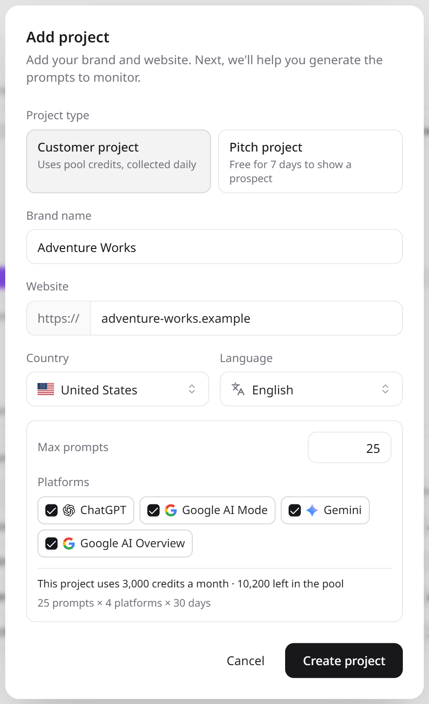
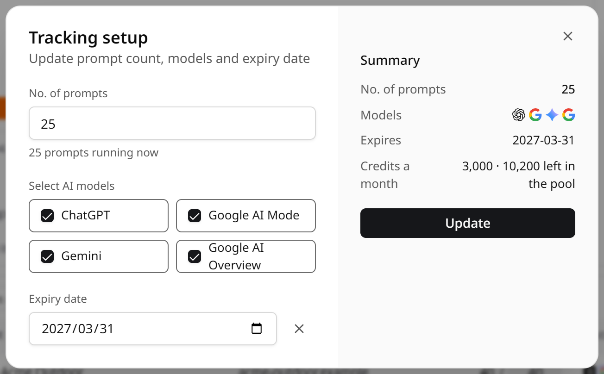

Everything on this page happens on **Settings → Organization → Projects**, and only organization owners and admins can do it. Each project row has a **⋯** menu with the actions that fit that project: **Edit details**, **Tracking setup**, **Convert to customer project** (pitch projects only), **Pause tracking** or **Resume tracking**, **Restore project** (expired projects only), and **Delete**.

## Add a client project

1. On **Settings → Projects**, click **Add project**.
2. Enter the client's details.
3. Under **Project type**, choose **Customer project**. It uses pool credits and is collected daily.
4. Under **Allocation**, enter **Max prompts** and choose the **Platforms** to track.
5. Check the line under the form. It shows what the project will cost and what's left, for example "This project uses 900 credits a month · 17,700 left in the pool". If it says the project is over the pool, lower the prompts or pick fewer platforms.
6. Finish adding the project.

A new client project needs at least 900 credits, enough credits left in the pool, and a free client project slot. Expired and paused client projects take up slots too; pitch projects don't.

When every slot is used, GEOly suggests a larger plan. Buying more credits won't help, because the number of client projects comes with the plan. On Agency Scale, contact us for a custom plan.

## Change prompts, platforms and expiry date

1. In the project's row, open **⋯** and choose **Tracking setup**.
2. In **No. of prompts**, set the project's max prompts. The dialog shows how many prompts are running now. You can't go below that number.
3. Under **Select AI models**, tick the platforms to track. Pick at least one.
4. Under **Expiry date**, pick a date, or choose **No expiry**. **Clear** removes the date you picked.
5. Check the **Summary**: **No. of prompts**, **Models**, **Expires**, and **Credits a month**, with what's left in the pool.
6. Click **Update**. Prompts, platforms, and the expiry date are saved together.

New prompt and platform settings take effect from the next day's runs.

For quick changes you can also edit the list directly:

- In **Used / allocated prompts**, type a new max prompts in the box and press Enter.
- In **Platforms**, click **+**, tick or untick platforms, check the credit change shown below them, and click **Update**.

### Expiry dates

Set an expiry date when a client's contract ends on a known date, so the project stops on its own.

- The earliest date you can pick is tomorrow, counted in UTC or in your local time, whichever is later. If you pick an earlier date, the dialog shows the earliest date allowed.
- The project stops at 00:00 UTC on the date you pick.
- **No expiry** means the project runs for as long as your organization's subscription does.
- The list shows **Expires** with the date, and **Expired** once it has passed.

### What happens when a project expires

- Monitoring and data updates stop. All of the project's data is kept.
- The project's routines stop running, and GEOly notifies you that a routine didn't run because the project expired.
- Other projects in the organization aren't affected.
- The project no longer counts toward the pool.
- You can't edit its details or its tracking setup until you restore it.

<Warning>
An expired client project still takes up a client project slot. To free the slot, delete the project.
</Warning>

## Restore an expired project

1. Open the **Expired** tab. In the project's row, open **⋯** and choose **Restore project**.
2. The tracking setup dialog opens. Set a new expiry date in the future, or choose **No expiry**.
3. Set max prompts and platforms. GEOly suggests at least what the project had before.
4. Click **Restore project**. Collection restarts from the next run.

The project counts toward the pool again, so the pool needs enough credits left. If it doesn't, lower another project first, or contact us to raise the pool. A project that was paused when it expired goes back to collecting when you restore it.

Pitch projects can't be restored. To keep collecting a pitch project, [convert it](/agencies/pitch-projects#convert-a-pitch-project-to-a-client-project).

## Pause and resume a project

Pause a project when you stop working on a client for a while, but want to keep the project and its data.

**To pause:**

1. In the project's row, open **⋯** and choose **Pause tracking**.
2. Read the dialog. From now on the project collects no new data, and data missed while it's paused can't be filled in later. All history stays, and you can still view and edit the project. Its credits go back to the pool.
3. Click **Pause project**.

The project moves to the **Paused** tab and shows **Paused · not counted in the pool**. You can still change its max prompts and platforms while it's paused.

**To resume:**

1. On the **Paused** tab, open the project's **⋯** menu and choose **Resume tracking**.
2. The dialog shows how many credits the project needs and how many are left in the pool.
3. Click **Resume project**. Collection restarts from the next run.

If the pool doesn't have enough credits, lower this project's or another project's allocation first. If your allocations are already over the pool when you pause a project, you'll need to bring them back under the pool before you can resume it.

A paused project still takes up a client project slot. Expired projects and pitch projects can't be paused or resumed.

## Delete a project

1. In the project's row, open **⋯** and choose **Delete**.
2. Type the project's name to confirm, then click **Delete permanently**.

Deleting permanently removes the project's prompts, AI answers, citations, competitors, integrations, and member access. It can't be undone, and API keys bound to the project stop working. While the data is cleaned up in the background, the project shows **Deleting**. Its client project slot and its credits are freed right away.

A few projects can't be deleted here, and you need to contact support instead: projects moved in by an organization merge, projects with a lot of history, and preview projects created before your organization was activated.

## Organize projects with folders

In the toolbar above the list, open **Folders** and choose **Create folder** to group projects, for example by account manager or market. Folders only change how this page lists projects. They don't affect collection or who can see what.

## When to rebalance credits

Check the **Allocated credits / pool** card when:

- **a client leaves**: pause the project, let it expire, or delete it to get its credits back;
- **a key client needs more**: raise its max prompts or add a platform;
- **a new client signs**: make sure the pool has room before you add or convert their project.
