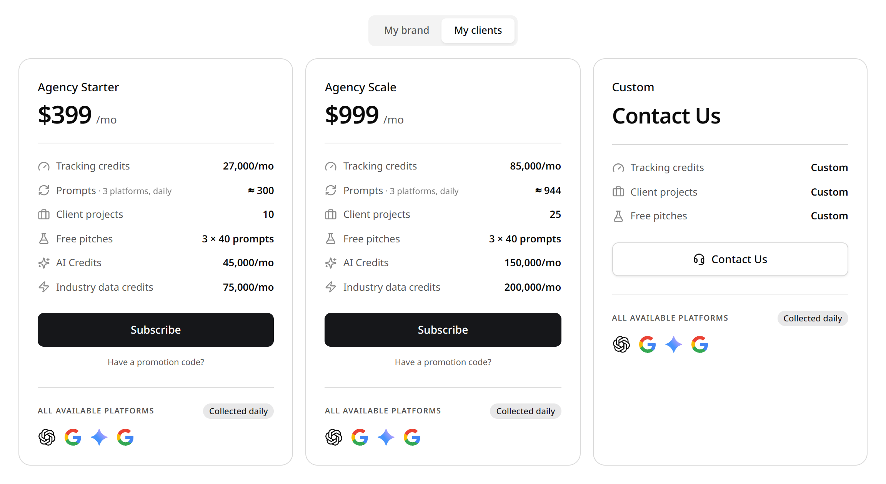

Agency plans are for agencies that run GEO for several client brands from one GEOly organization. Each client gets its own project. Instead of one prompt limit for the whole organization, your plan gives you a pool of **tracking credits**. You decide how much of the pool each client project gets, and which AI platforms it tracks. You can also run free 7-day **pitch projects** to show prospects real data before they sign.

## How agency plans differ from brand plans

| | Brand plans (Basic, Grow, Advanced, Plus) | Agency plans |
| --- | --- | --- |
| What the plan limits | One prompt limit shared by the organization, plus a number of projects | A pool of tracking credits, plus a number of client projects |
| AI platforms | Chosen once for the whole organization: any 1 on Basic, any 2 on Grow, all 4 on Advanced and Plus | Chosen per project, from all 4 available platforms |
| Pitch projects | Not included | 3 at a time, free |
| Pausing a project | Not available | Available. A paused project's credits go back to the pool |
| Billing | Monthly or yearly | Monthly only |
| Free trial | 3 days on Basic and Grow | None |

The 4 available platforms are ChatGPT, Google AI Mode, Gemini, and Google AI Overviews.

## The two plans

| | Agency Starter | Agency Scale |
| --- | --: | --: |
| Price | $399 / month | $999 / month |
| Tracking credits a month | 27,000 | 85,000 |
| About how many prompts that covers (3 platforms, daily) | ≈ 300 | ≈ 944 |
| Client projects | 10 | 25 |
| Pitch projects | 3 at a time, up to 40 prompts each | 3 at a time, up to 40 prompts each |
| AI Credits a month | 45,000 | 150,000 |
| Industry data credits a month | 75,000 | 200,000 |
| AI platforms | All 4, chosen per project | All 4, chosen per project |
| Collection | Daily | Daily |
| Team seats | Unlimited | Unlimited |
| Product features | Unlocked at the Advanced level | Unlocked at the Plus level |

- Both plans are billed monthly. There is no free trial. You can enter a promotion code at checkout.
- Product features unlocked on both plans include ChatGPT Ads analysis, industry data tools, public report PDF export, and 90-day date ranges. GEO Audit samples up to 10 pages per page type on Agency Starter and up to 50 on Agency Scale.
- If you need more than Agency Scale offers, the billing page also shows a **Custom** card. Click **Contact Us** on it.

## How it works

1. **Buy a plan.** Open **Settings → Organization → Billing**, choose **My clients**, and subscribe. See [Buy and manage your plan](/agencies/billing).
2. **Add a project for each client.** Set how many prompts it can run and which platforms it tracks. The project reserves that many credits from your pool. See [Tracking credits](/agencies/tracking-credits) and [Manage client projects](/agencies/manage-projects).
3. **Pitch new clients.** Start a free pitch project for a prospect. When they sign, convert it to a client project and keep all its data. See [Pitch projects](/agencies/pitch-projects).
4. **Bring in your team and your clients.** Seats are unlimited. Give each client access to their own project only. See [Members and client access](/agencies/members-and-access).

Buying the plan, splitting credits, pitch projects, pausing, expiry dates, and deleting projects are all done by organization owners and admins.

## Words used in these pages

- **Client project**: a project for a client you work for. It uses credits from your pool and is collected daily. The plan card and the usage card call these **Client projects**. The **Add project** dialog and the conversion menu call the same thing a **Customer project**.
- **Pitch project**: a free 7-day project you run for a prospect. The plan card calls these **Free pitches**.
- **Tracking credits**: what your plan gives you to spend on monitoring. 1 credit is 1 prompt on 1 platform for 1 day.
- **Pool**: all the tracking credits your plan includes.
- **Allocation**: the part of the pool that one project reserves.

## In this section

<Columns cols={2}>
  <Card title="Tracking credits" icon="gauge" href="/agencies/tracking-credits">
    How credits are counted, how to split the pool, and where to see usage.
  </Card>
  <Card title="Manage client projects" icon="folder-kanban" href="/agencies/manage-projects">
    Add projects, change prompts and platforms, set expiry dates, pause, restore, and delete.
  </Card>
  <Card title="Pitch projects" icon="flask-conical" href="/agencies/pitch-projects">
    Run a free 7-day project for a prospect, then convert it.
  </Card>
  <Card title="Members and client access" icon="users" href="/agencies/members-and-access">
    Roles for your team, and how to let clients see only their project.
  </Card>
  <Card title="Buy and manage your plan" icon="credit-card" href="/agencies/billing">
    Buying, upgrading, downgrading, switching from a brand plan, and canceling.
  </Card>
  <Card title="FAQ" icon="circle-help" href="/agencies/faq">
    Short answers to the questions agencies ask most.
  </Card>
</Columns>
