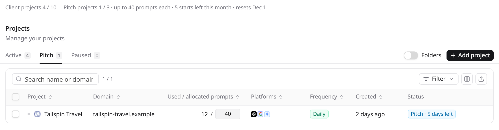

A pitch project lets you show a prospect how AI answers treat their brand before they sign. It's free: it uses no tracking credits and doesn't take up a client project slot. When the prospect signs, convert it to a client project and keep everything it collected.

Pitch projects are available on agency plans. Only organization owners and admins can start and convert them.

## Rules

| | Agency Starter and Agency Scale |
| --- | --- |
| Running at the same time | Up to 3 |
| Prompts per pitch project | Up to 40. This limit can't be changed. |
| How long it runs | 7 days. Then it stops on its own and keeps its data. |
| Starts per month | Up to 6 per calendar month (UTC). The **Add project** dialog shows how many starts are left this month and when they reset. |
| AI platforms | Your organization's default platforms, up to 3. You can't choose them per pitch project; the dialog shows which ones it will use. |
| Credits | None. Pitch projects don't count toward the pool or the client project limit. |

- Deleting or converting a pitch project frees a slot for a new one, but doesn't give back a start. Starts reset on the 1st of each month (UTC).
- While a project is a pitch project, you can't change its prompt limit or platforms, pause it, or resume it. To change any of these, convert it first.

## Start a pitch project

1. Open **Settings → Organization → Projects** and click **Add project**.
2. Enter the prospect's details.
3. Under **Project type**, choose **Pitch project**.
   - If it shows **Pitch slots full**, delete a pitch project or convert one first.
   - If this month's starts are used up, the dialog shows the date they reset.
4. Check the platforms the pitch project will use, then finish adding the project.

The project appears on the **Pitch** tab with the days left, for example **Pitch · 7 days left**. Add up to 40 prompts the same way as in any project; see [Prompts](/analytics/geoly-prompts). After 7 days the status changes to **Pitch ended** and collection stops.

## Convert a pitch project to a client project

You can convert a pitch project while it's running or after it has ended.

1. On the **Pitch** tab, open the project's **⋯** menu and choose **Convert to customer project**.
2. Set max prompts and choose platforms. The dialog shows how many prompts are running now.
3. Click **Convert to customer project**.

From the next run, the project is collected daily like any client project. Everything collected during the pitch stays. From now on it uses credits from your pool and takes up a client project slot.

GEOly doesn't convert the project when:

- **every client project slot is used**: delete a client project, or contact us to raise the limit;
- **the pool doesn't have enough credits**: lower another project's allocation first, or contact us to raise the pool.

If a pitch project shows **Expired** rather than **Pitch ended**, contact support before converting it.

## When your subscription ends

If your subscription ends, or your organization moves off an agency plan, any pitch projects still running end at once. Their data stays. If you come back to an agency plan later, you can still convert them.
