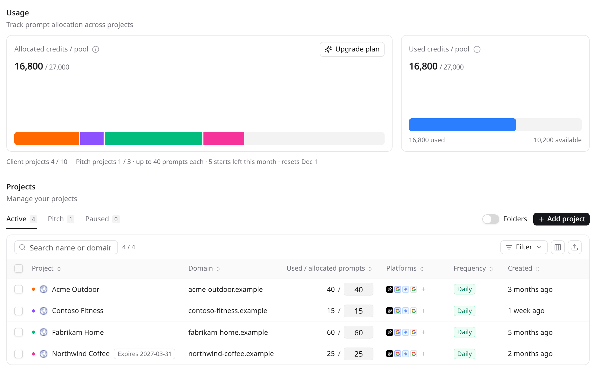

Your agency plan gives you a pool of tracking credits: 27,000 a month on Agency Starter and 85,000 on Agency Scale. Each client project reserves part of the pool. How much it reserves depends on two things you choose: how many prompts the project can run, and on how many platforms.

## How credits are counted

<Note>
**1 tracking credit = 1 prompt × 1 platform × 1 day.** A month always counts as 30 days, whatever the calendar says.
</Note>

A project reserves **max prompts × platforms × 30** credits a month. For example:

- 10 prompts on 3 platforms: 10 × 3 × 30 = **900** credits a month.
- 50 prompts on 4 platforms: 50 × 4 × 30 = **6,000** credits a month.
- Agency Starter's 27,000 credits cover about 300 prompts on 3 platforms every day, or 225 prompts on all 4.
- Agency Scale's 85,000 credits cover about 944 prompts on 3 platforms, or 708 on all 4.

### Example: three clients on Agency Starter

| Client | Max prompts | Platforms | Credits a month |
| --- | --: | --: | --: |
| Client A | 50 | 3 | 4,500 |
| Client B | 30 | 4 | 3,600 |
| Client C | 20 | 2 | 1,200 |
| **Total** | | | **9,300** |

That leaves 17,700 of the 27,000 credits for new clients, or for giving these three more prompts or platforms.

## Credits count what you allocate, not what runs

<Note>
A project holds its full allocation whether or not it uses it. A project set to 50 prompts on 3 platforms holds 4,500 credits even if only 40 prompts are running. To free credits, lower its max prompts, remove a platform, pause it, or delete it.
</Note>

These projects don't count toward the pool:

- paused projects;
- pitch projects, whether running or ended;
- expired projects;
- projects being deleted.

## Rules for allocations

- **At least 900 credits per project.** For example 10 prompts × 3 platforms, or 30 prompts × 1 platform.
- **Not below what's running.** You can't set max prompts lower than the number of active prompts. Archive some prompts first, then lower it. GEOly never stops or archives prompts for you.
- **Each project has its own limit.** Agency plans have no organization-wide prompt limit. A project can add prompts up to its own max prompts.
- **Platforms are chosen per project.** Pick at least 1 of the 4 available platforms. Changing platforms recalculates that project's credits, and there's no waiting period between changes. The organization-wide platform picker on the billing page isn't used on agency plans.
- **Changes apply from the next day.** A new allocation or platform choice takes effect when the next day's runs are created. Manual runs, re-runs, and backfills don't use extra credits.
- **One change at a time.** If a teammate is changing allocations at the same moment, you'll see "Someone else is changing this organization's allocations. Try again in a moment."

## When the pool runs short

If a change needs more credits than are left, GEOly doesn't save it and tells you how many are left and how many you need. You can:

- lower another project's max prompts or platforms;
- pause a project you're not working on right now;
- [upgrade](/agencies/billing#upgrade-from-agency-starter-to-agency-scale) from Agency Starter to Agency Scale; or
- click **Contact us to raise the pool** on the projects page.

If your allocations ever add up to more than the pool, for example after the pool is lowered, existing allocations keep collecting as usual. Until you lower some, you can't raise an allocation, add a platform, or add a project. Lowering always works.

## Projects without an allocation

A project created another way, for example by the Agent or during onboarding, may show **Unallocated**. It keeps collecting its active prompts, and those count toward the pool. You can't add prompts to it until an organization owner or admin sets its max prompts on the projects page.

## See allocation and usage

Open **Settings**, then **Projects** under **Organization**. Messages in the app call this page **Settings → Projects**, and so do these pages.

The **Usage** section at the top shows:

- **Allocated credits / pool**: how much of the pool you've given to projects. Paused, pitch, and expired projects aren't counted.
- **Used credits / pool**: how many credits your active prompts actually take up across all projects. The pool includes credits you haven't allocated yet.
- **Client projects**, for example `4 / 10`: client projects you have, out of your plan's limit.
- **Pitch projects**, for example `1 / 3 · up to 40 prompts each`: pitch projects running now, out of 3.
- **Contact us to raise the pool**.

The project list below has the tabs **Active**, **Pitch**, **Paused**, **Expired**, and **All**. For each project you see:

- **Project** and **Domain**.
- **Used / allocated prompts**, such as `40 / 50`: active prompts, then max prompts. Hover over it to see what the project costs, for example "4,500 credits a month (50 prompts × 3 platforms × 30 days)".
- **Platforms**: the platforms this project tracks.
- **Frequency**: **Daily**, or **Not collecting**.
- **Created**.
- **Status**: **Active**, **Expires** with a date, **Paused**, **Pitch** with the days left, **Pitch ended**, **Expired**, or **Deleting**.

To change a project's max prompts or platforms, see [Manage client projects](/agencies/manage-projects#change-prompts-platforms-and-expiry-date).
