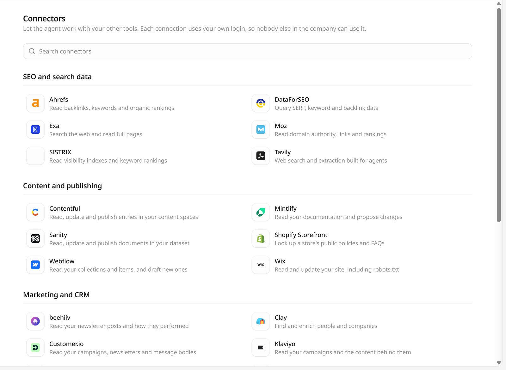
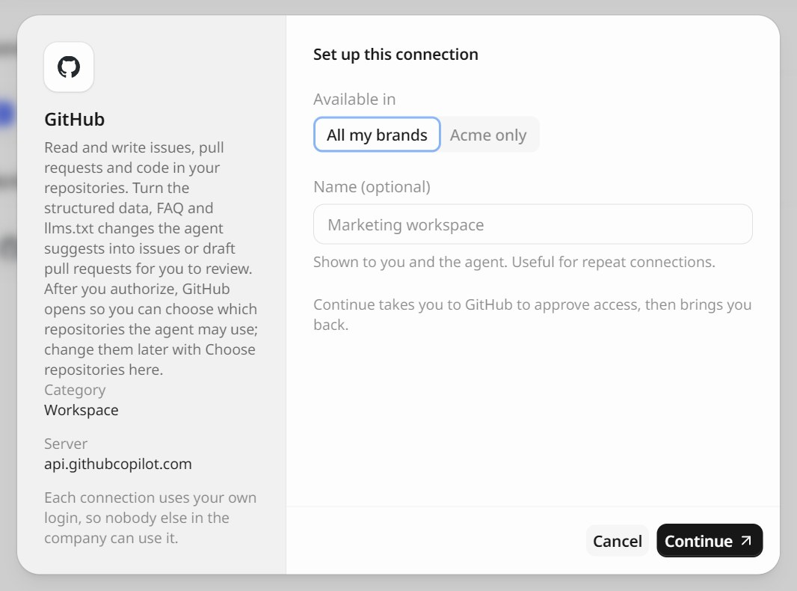
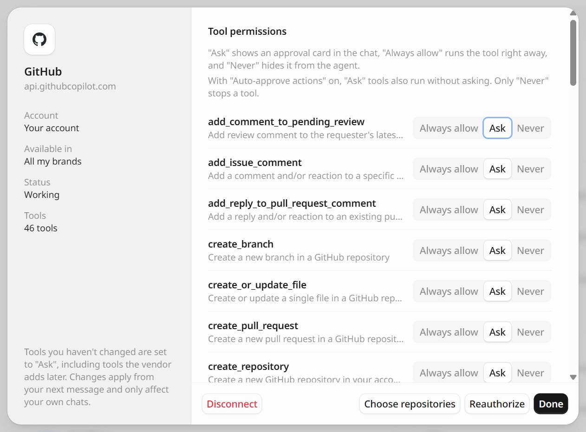

Connectors let the GEOly Agent work with the other tools your team uses. With a connector, the agent can compare GEOly data with your SEO tools, read and update your CMS, file an issue for a fix, or send a summary by email.

Each connector is the vendor's own MCP server. When you connect, the vendor tells GEOly which tools it offers, and you choose what the agent may do with each one.

Open **Connectors** in the Agent sidebar, or go to `app.geoly.ai/agent/connectors`.

## Connections are personal

- **Only you can use your connection.** Each connection uses your own login or key, so nobody else in the company can use it, and it only acts in your own chats and the scheduled tasks you create.
- **Per organization.** A connection belongs to you in the current organization. You can keep up to 10 connections per organization.
- **Choose where it's available.** When you connect, **Available in** lets you pick **All my brands** or only the current brand.
- **Name it** (optional). The name is shown to you and the agent, which helps when you connect the same tool twice, for example two Notion workspaces.

To connect, you need a brand selected in GEOly.

## Catalog

The connectors are grouped as on the page. The **Connect with** column shows how each one signs in (see [Connect a tool](#connect-a-tool)).

### SEO and search data

| Connector | What the agent can do | Connect with |
| --- | --- | --- |
| Ahrefs | Read backlinks, keywords and organic rankings | Sign in |
| DataForSEO | Query SERP, keyword and backlink data | Sign in |
| Exa | Search the web and read full pages | API key |
| Moz | Read domain authority, links and rankings | Sign in |
| SISTRIX | Read visibility indexes and keyword rankings | Sign in |
| Tavily | Web search and extraction built for agents | API key |

### Content and publishing

| Connector | What the agent can do | Connect with |
| --- | --- | --- |
| Contentful | Read, update and publish entries in your content spaces | Sign in |
| Mintlify | Read your documentation and propose changes | Sign in |
| Sanity | Read, update and publish documents in your dataset | Sign in |
| Shopify Storefront | Look up a store's public policies and FAQs | Store domain |
| Webflow | Read your collections and items, and draft new ones | Sign in |
| Wix | Read and update your site, including `robots.txt` | Sign in |

### Marketing and CRM

| Connector | What the agent can do | Connect with |
| --- | --- | --- |
| beehiiv | Read your newsletter posts and how they performed | Sign in |
| Clay | Find and enrich people and companies | Sign in |
| Customer.io | Read your campaigns, newsletters and message bodies | Sign in |
| Klaviyo | Read your campaigns and the content behind them | Sign in |
| lemlist | Read campaign performance and draft sequences | Sign in |
| Octolens | Read social mentions and manage your tracked keywords | Sign in |
| Resend | Send emails, and read and update contacts and broadcasts | Sign in |

### Workspace

| Connector | What the agent can do | Connect with |
| --- | --- | --- |
| Atlassian | Search your Confluence pages and Jira issues | Sign in |
| GitHub | Read and write issues, pull requests and code. See [Connect GitHub](/integrations/github-connector). | Sign in, then choose repositories |
| Granola | Read your meeting notes and transcripts | Sign in |
| Linear | Read and file issues | Sign in |
| Notion | Search your pages and databases | Sign in |
| Superhuman | Draft and send emails from your account | Sign in |

### Data and infrastructure

| Connector | What the agent can do | Connect with |
| --- | --- | --- |
| Apify | Run actors and read their datasets | Sign in |
| PostHog | Read your funnels, insights and events | Sign in |

Type in **Search connectors** to find one by name.

## Connect a tool

Click a connector to open **Set up this connection**. The left side says what the connector does and which server it connects to. Then:

<Tabs>
  <Tab title="Sign in">
    Most connectors use the vendor's own sign-in (OAuth).

    1. Choose **Available in** and, optionally, a **Name**.
    2. Click **Continue**. GEOly takes you to the vendor to approve access, then brings you back.

    The connector then appears under **Connected**. GEOly never sees your password for the other tool.

    
  </Tab>
  <Tab title="API key">
    Exa and Tavily use an API key.

    1. Click **Get one** to open the vendor's dashboard and create a key.
    2. Paste it into **API key**, choose **Available in** and, optionally, a **Name**.
    3. Click **Connect**.

    GEOly stores the key encrypted and only shows it masked.
  </Tab>
  <Tab title="Store domain">
    Shopify Storefront needs no sign-in. The agent only reads the store's public policies and FAQs, such as returns, shipping, and warranty, so it can check whether what AI answers say about them matches the store.

    1. In **Store domain**, enter the store name (like `my-store`, which becomes `my-store.myshopify.com`) or its full domain (like `my-brand.com`).
    2. Click **Connect**.

    Connect each store once. No credentials are stored for this connection.
  </Tab>
</Tabs>

## Use connectors in a chat

Once connected, just ask. The agent picks the right connector tool for the task, for example:

- "Compare the domains AI cites for our top prompts with their Ahrefs backlink data."
- "File a Linear issue for each page that is missing an FAQ schema."
- "Save this week's visibility summary as a page in Notion."

Type `@` in the input box and pick a connector under **Connectors** to point the agent at it directly.

Connectors also work in [skills](/agent/skills) and in [scheduled tasks](/agent/overview#scheduled-tasks). A scheduled task only uses tools set to **Always allow**, with the connections of the person who created the task.

## Tool permissions

Click a connection under **Connected** to manage it. Under **Tool permissions**, set each tool:

| Permission | What happens |
| --- | --- |
| **Ask** | The agent shows an approval card in the chat before it uses the tool. |
| **Always allow** | The tool runs right away. |
| **Never** | The tool is hidden from the agent. |

Tools you haven't changed are set to **Ask**, including tools the vendor adds later. Changes apply from your next message and only affect your own chats. With **Auto-approve actions** on, **Ask** tools also run without asking; only **Never** stops a tool.

The same dialog shows the **Account**, where it's **Available in**, the **Status**, and how many **Tools** the connection has.

## Reauthorize or disconnect

- **Needs reauthorization**: the vendor no longer accepts GEOly's access, for example because it expired or you revoked it on the vendor's side. Open the connection and click **Reauthorize**.
- **Disconnect** removes the connection from GEOly, and the agent can no longer use it. For a sign-in connection, revoke the app on the vendor's side as well if you want to remove access there. An API key keeps working at the vendor until you delete it in the vendor's settings.

## Sharing chats that used connectors

When you share a chat publicly, content that came from your connectors is not included in the shared page. GEOly also reminds you to check the chat before you share it, because the agent's own answers may quote that content.
