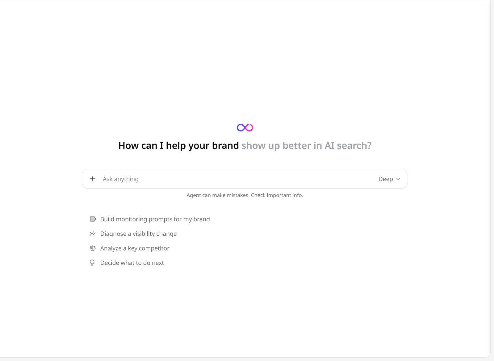

The GEOly Agent is a chat assistant that works on your project's data in GEOly. Ask it why visibility moved, how a competitor wins, or what to fix first. It picks the data it needs, shows each step it takes, and answers with the numbers it used. It reads the same data you see in GEOly, through the same tools as [GEOly MCP](/developers/mcp/introduction).

<Note>
Agent is available when your organization's plan includes AI Credits. If the plan has none, Agent doesn't appear in the menu.
</Note>

## Open the Agent

- Click **Agent** in the icon rail on the left, or open `app.geoly.ai/agent`.
- On other pages, click **Agent** in the top bar, or press **⌘I** (Mac) / **Ctrl+I** (Windows). The agent opens in a panel on the right, so you can keep looking at the page while you ask. In the panel's header you can switch to another conversation, click **Open in Agent** to move the chat to the full Agent page, or **Close** the panel.

The Agent sidebar has **New chat**, [**Skills**](/agent/skills), [**Routines**](/agent/routines), [**Connectors**](/agent/connectors), [**Context**](#ai-context), [**Usage**](#ai-usage), and your chat history.

## Start a chat

Type a question in **Ask anything** and press Enter, or pick one of the starter suggestions under the box. Each one starts a [skill](/agent/skills):

| Suggestion | Skill it starts |
| --- | --- |
| **Build monitoring prompts for my brand** | `/brand-prompt-setup` |
| **Diagnose a visibility change** | `/visibility-change` |
| **Analyze a key competitor** | `/analyze-competitor` |
| **Decide what to do next** | `/next-actions` |

To point the agent at something specific:

- Type `@` to mention one of your prompts, a competitor, an industry, or one of your [connectors](/agent/connectors).
- Type `/` to run a [skill](/agent/skills) by its command, such as `/visibility-change`.
- Click **+** to **Add file** or pick from **Skills**. The same panel shows how many Agent credits are left. You can attach up to 3 files per message, up to 10 MB each: `.txt`, `.md`, `.csv`, `.xlsx`, `.docx`, `.pptx`, `.pdf`, `.png`, `.jpg`, or `.jpeg`. Attached files are sent again with every turn of the chat, so they count toward your credits each time.

<Tip>
Say what you want back: the period, the platforms, and the format. For example, "Compare our visibility on ChatGPT and Perplexity over the last 30 days and give me a table by topic."
</Tip>

## Choose Fast or Deep

Click the mode menu at the right of the input box. **Deep** is the default.

| Mode | What it does |
| --- | --- |
| **Fast** | Skips thinking. Faster, good for quick lookups. |
| **Deep** | Thinks first. More accurate, but slower and uses more credits. |

Turns that run a skill always use **Deep**, whatever you picked. If the agent picks a skill on its own in the middle of a reply, Deep starts from your next message. The same menu has the **Ask before acting** switch (see [Approvals](#approvals)).

## Follow the agent's work

While the agent works, you can see what it is doing:

- **Plan.** For a multi-step analysis, it lists its steps in a plan card and ticks them off as it goes. The card ends as **Plan complete** or **Plan unfinished**.
- **Steps.** Each data lookup appears as a step. Expand the steps to see what the agent asked for and what came back.
- **Reasoning.** In **Deep** mode, expand **Reasoning** to read how it worked toward the answer.
- **Questions.** When it needs a decision from you, it asks a **Question** with choices. Pick an answer, type your own, or click **Skip**.
- **Charts and tables.** The agent can answer with a chart or a table. Use **Export** on a chart to **Save as image**, **Copy image**, or **Export CSV**. Expand a table to see all of it, or export it as CSV.
- **Follow-ups.** After an answer, a suggested next question appears in the input box. Press **Tab** to use it.

The agent can also search the web and read pages you link to. Answers can be wrong: check important numbers against the pages they came from.

## Approvals

The agent asks before it changes anything. With **Ask before acting** on, it waits for your approval before it adds or changes prompts, topics, or competitors, starts a monitoring run, or uses a connected tool. A card in the chat shows what it wants to do and the parameters it will use:

- **Approve** runs it once.
- **Approve ▾ → Always allow** runs it and approves the same tool for the rest of this chat.
- **Deny** stops it.

Turn **Ask before acting** off in the mode menu to let the agent act without asking in the current chat. To make that the default for new chats, turn on **Auto-approve actions** in [Agent behavior](#agent-behavior). It only affects new chats.

For connectors, each tool also has its own permission. A tool set to **Never** is never used, even with auto-approve on. See [Connectors](/agent/connectors#tool-permissions). Saving a [routine](/agent/routines) and sending you an email always wait for your approval, even with auto-approve on.

## Agent behavior

Click **Agent behavior** (the sliders icon in the icon rail, shown while you're in the Agent workspace). Its three settings are saved in your current browser.

| Setting | What it does |
| --- | --- |
| **Auto-approve actions** | The agent acts without asking first. Only affects new chats. |
| **Browser notifications** | Get a browser notification when the agent finishes a reply or needs your input while you're on another tab. |
| **Email from chats** | When you ask the agent to email you something, such as a summary, it sends it to your account email after you approve each email. On by default. |

You can also turn on notifications when the agent offers it in a chat (**Turn on notifications**). If your browser blocks notifications for GEOly, allow them in the browser's site settings first.

## Manage chats

Your chats are listed in the Agent sidebar, grouped by **Today**, **Yesterday**, **Last 7 days**, and **Older**. Hover over a chat and open its menu to:

- **Rename** it.
- **Archive** it. Archived chats move to **Archived**, where you can **Unarchive** them.
- **Delete permanently** an archived chat. This can't be undone, and its share link stops working.

To share a chat, click **Share**:

- **Export as Markdown** downloads the chat as a Markdown file.
- **Share Chat** creates a public link to the chat. **Revoke Link** turns it off. Content that came from your connectors is not included in the shared page; GEOly reminds you to check the chat before you share it.

## AI context

**Context** in the Agent sidebar (`app.geoly.ai/agent/context`) holds what the agent should know about you, this project, and your company. The agent reads it in every chat.

| Section | What it holds | Who can edit |
| --- | --- | --- |
| **User context** | Notes that follow you into every project, such as your role. Up to 100 notes; each has a name (up to 60 characters) and content (up to 500 characters). | Only you |
| **Project context** | Notes for this project only, up to 4,000 characters. Turn off **Use project context** to leave it out of chats. | Project admins and organization admins |
| **Company context** | Facts about your company that everyone in it shares, up to 4,000 characters. Turn off **Use company context** to leave it out of chats. | Organization owners and admins |

The agent also keeps your user context up to date as you chat: it can save a note when it learns something about you that will help later, and update or remove the notes it saved. You can edit or delete any note on the Context page. Before the agent adds something to the project or company context, it asks for your approval.

## AI usage

Agent chats use your organization's **AI Credits**. All projects in the organization share one credit pool, which resets at the start of each billing period. **Deep** mode, attached files, and longer analyses use more credits.

Open **Usage** in the Agent sidebar (`app.geoly.ai/agent/usage`) to see:

- **Agent credits**: how much the organization has used this billing period, what is left, and when it resets.
- **Credits used per day** in a chart.
- **Usage this period** **By project** or **By member**, with credits, chats, messages, and each one's share. Pick an earlier **Billing period** to look back.

The pool also covers [routines](/agent/routines), the [GEOly CLI](/developers/cli) (`geoly run`), and the [Agent API](/developers/agent-api). CLI and API credits are counted under the member who owns the sign-in or key, but chats and messages only count conversations in the GEOly app, so the columns aren't proportional.

Once 75% of the pool is used, a notice above the input box shows how much is used and when it resets. When it runs out, the agent can't start a new turn until the next period, or until you upgrade the plan.

## Related

- [Skills](/agent/skills): saved workflows the agent runs on your project's data.
- [Routines](/agent/routines): have the agent do recurring work on a schedule.
- [Connectors](/agent/connectors): let the agent use your other tools.
- [Actions](/actions/overview): fixes you can track and hand to the agent.
