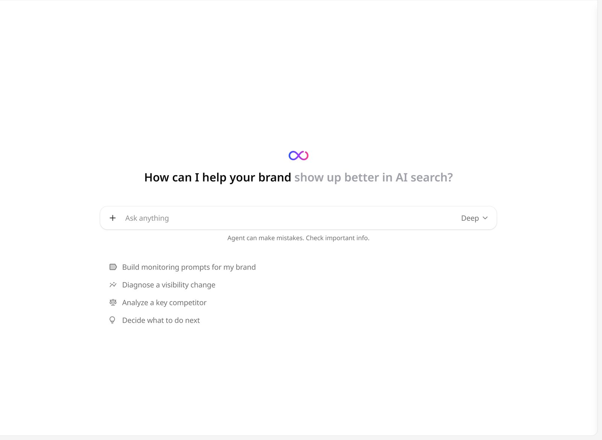

The GEOly Agent is a chat assistant that works on your brand's data in GEOly. Ask it why visibility moved, how a competitor wins, or what to fix first. It picks the data it needs, shows each step it takes, and answers with the numbers it used. It reads the same data you see in GEOly, through the same tools as [GEOly MCP](/developers/mcp/introduction).

<Note>
Agent is available when your organization's plan includes AI Credits. If the plan has none, Agent doesn't appear in the menu.
</Note>

## Open the Agent

- Click **Agent** in the icon rail on the left, or open `app.geoly.ai/agent`.
- On other pages, click **Agent** in the top bar. The agent opens in a side panel, so you can keep looking at the page while you ask. **Open in Agent** moves that chat to the full Agent page.

The Agent sidebar has **New chat**, [**Skills**](/agent/skills), [**Connectors**](/agent/connectors), [**Usage**](#ai-usage), and your **Recent chats**.

## Start a chat

Type a question in **Ask anything** and press Enter, or pick one of the starter suggestions under the box:

- **Build monitoring prompts for my brand**
- **Diagnose a visibility change**
- **Analyze a key competitor**
- **Decide what to do next**

The last three start the matching [skill](/agent/skills). If you turn that skill off, its suggestion is hidden.

To point the agent at something specific:

- Type `@` to mention one of your prompts, a competitor, an industry, or one of your [connectors](/agent/connectors).
- Type `/` to run a [skill](/agent/skills) by its command, such as `/visibility-change`.
- Click **+** to **Add file** or pick a skill. You can attach up to 3 files per message, up to 10 MB each: `.txt`, `.md`, `.csv`, `.xlsx`, `.docx`, `.pptx`, `.pdf`, `.png`, `.jpg`, or `.jpeg`. Attached files are sent again with every turn of the chat, so they count toward your credits each time.

<Tip>
Say what you want back: the period, the platforms, and the format. For example, "Compare our visibility on ChatGPT and Perplexity over the last 30 days and give me a table by topic."
</Tip>

## Choose Fast or Deep

Click the mode menu at the right of the input box. **Deep** is the default.

| Mode | What it does |
| --- | --- |
| **Fast** | Skips thinking. Faster, good for quick lookups. |
| **Deep** | Thinks first. More accurate, but slower and uses more credits. |

Turns that run a skill always use **Deep**, whatever you picked. If the agent picks a skill on its own in the middle of a reply, Deep starts from your next message. The same menu has the **Ask before acting** switch (see [Approvals](#approvals)).

## Follow the agent's work

While the agent works, you can see what it is doing:

- **Plan.** For a multi-step analysis, it lists its steps in a plan card and ticks them off as it goes. The card ends as **Plan complete** or **Plan unfinished**.
- **Steps.** Each data lookup appears as a step. Expand the steps to see what the agent asked for and what came back.
- **Reasoning.** In **Deep** mode, expand **Reasoning** to read how it worked toward the answer.
- **Questions.** When it needs a decision from you, it asks a **Question** with choices. Pick an answer, type your own, or click **Skip**.
- **Follow-ups.** After an answer, a suggested next question appears in the input box. Press **Tab** to use it.

The agent can also search the web and read pages you link to. Answers can be wrong: check important numbers against the pages they came from.

## Approvals

The agent asks before it changes anything. With **Ask before acting** on, it waits for your approval before it adds or changes prompts, topics, or competitors, starts a monitoring run, or uses a connected tool. A card in the chat shows what it wants to do and the parameters it will use:

- **Approve** runs it once.
- **Approve ▾ → Always allow** runs it and approves the same tool for the rest of this chat.
- **Deny** stops it.

Turn **Ask before acting** off in the mode menu to let the agent act without asking in the current chat. To make that the default for new chats, click **Agent behavior** in the icon rail (shown while you're in the Agent workspace) and turn on **Auto-approve actions**. This setting is saved in your current browser and only affects new chats.

For connectors, each tool also has its own permission. A tool set to **Never** is never used, even with auto-approve on. See [Connectors](/agent/connectors#tool-permissions).

## Notifications

Long analyses can take a few minutes. To get a browser notification when the agent finishes a reply or needs your input while you're on another tab, click **Turn on notifications** when the agent offers it, or click **Agent behavior** in the icon rail (shown while you're in the Agent workspace) and turn on **Browser notifications**. If your browser blocks notifications for GEOly, allow them in the browser's site settings first.

## Manage chats

Your chats are listed under **Recent chats**. Hover over a chat and open its menu to:

- **Rename** it.
- **Archive** it. Archived chats move to **Archived**, where you can **Unarchive** them.
- **Delete permanently** an archived chat. This can't be undone, and its share link stops working.

To share a chat, click **Share**:

- **Export as Markdown** downloads the chat as a Markdown file.
- **Share Chat** creates a public link to the chat. **Revoke Link** turns it off. Content that came from your connectors is not included in the shared page; GEOly reminds you to check the chat before you share it.

## Scheduled tasks

You can have the agent run instructions on a schedule, such as a weekly summary of what changed. Scheduled tasks are set up from the side panel:

1. On any page outside the Agent workspace, click **Agent** in the top bar.
2. In the side panel, click the settings icon and open **Triggers**.
3. Click **Add trigger**. Write the **Run Instructions**, for example "Analyze this week's brand visibility across all platforms and summarize the key changes."
4. Set the schedule: **Every** N hours, days, weeks, or months, the time, the **Timezone**, a **Start** date, and an **End** date (or **Never**).
5. Optionally turn on **Use connectors**. A scheduled run only uses connector tools that are set to **Always allow**, and it uses the connections of the person who created the task. If someone else edits the instructions, connectors stop until the creator saves the task again.

The trigger shows its **Next run**. Switch it off to pause it. When a run finishes, GEOly sends a notification that opens the conversation with the result.

## AI usage

Agent chats use your organization's **AI Credits**. All brands in the organization share one credit pool, which resets at the start of each billing period. **Deep** mode, attached files, and longer analyses use more credits.

Open **Usage** in the Agent sidebar (`app.geoly.ai/agent/usage`) to see:

- **Agent credits**: how much the organization has used this billing period, what is left, and when it resets.
- **Credits used per day** in a chart.
- **Usage this period** **By brand** or **By member**, with credits, chats, messages, and each one's share. Pick an earlier **Billing period** to look back.

The pool also covers the [GEOly CLI](/developers/cli) (`geoly run`) and the [Agent API](/developers/agent-api). Their credits are counted under the member who owns the sign-in or key, but chats and messages only count conversations in the GEOly app, so the columns aren't proportional.

Once 75% of the pool is used, a notice above the input box shows how much is used and when it resets. When it runs out, the agent can't start a new turn until the next period, or until you upgrade the plan.

## Related

- [Skills](/agent/skills): saved workflows the agent runs on your brand data.
- [Connectors](/agent/connectors): let the agent use your other tools.
- [Actions](/actions/overview): site fixes you can hand to the agent.
