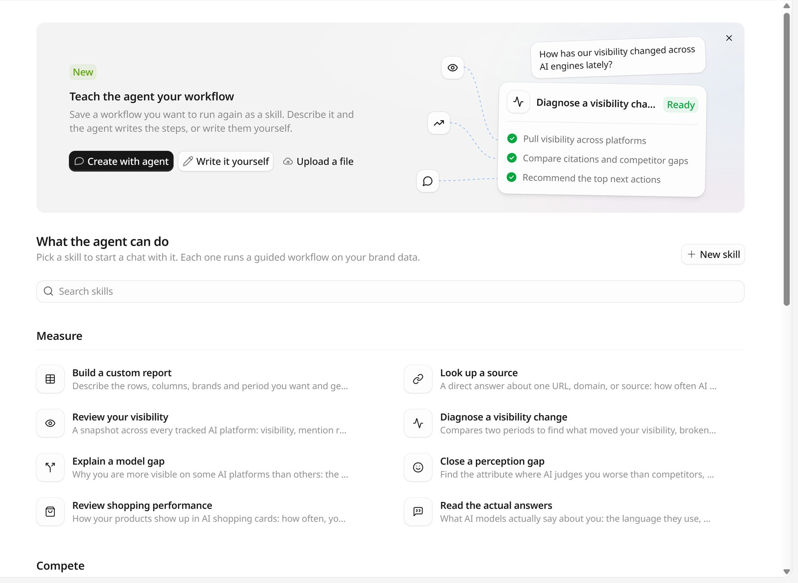

A skill is a saved workflow: what data the agent pulls, how it compares it, and what it hands back. GEOly comes with a set of built-in skills, and you can add your own. When you use a skill, the agent follows its steps on your brand's data instead of working out an approach from scratch.

Open **Skills** in the Agent sidebar, or go to `app.geoly.ai/agent/skills`.

## Use a skill

There are three ways to run a skill:

- On the **Skills** page, click a skill to see **About this skill** and **What happens**, then click **Use skill**. A new chat starts with that skill.
- In the chat input, type `/` and the skill's command, such as `/visibility-change`. You can add your question after the command.
- Click **+** in the input box, then pick a skill.

You don't always have to name a skill. The agent can also choose a skill on its own when your question matches the skill's description, and keeps using it for follow-up questions in the same chat.

Turns that run a skill always use **Deep** mode, because skills are multi-step analyses. When the agent picks a skill on its own in the middle of a reply, Deep starts from your next message. See [Fast and Deep](/agent/overview#choose-fast-or-deep).

## Built-in skills

The built-in skills are grouped the same way as on the Skills page. Each one shows its command.

### Measure

| Skill | Command | What it does |
| --- | --- | --- |
| Build a custom report | `/custom-report` | Describe the rows, columns, brands, and period you want and get the table built, with exclusions named. |
| Look up a source | `/look-up-source` | A direct answer about one URL, domain, or source: how often AI cites it, whether ChatGPT pulled it in search, and which prompts and platforms it feeds. Also checks a list of URLs from a file. |
| Review your visibility | `/visibility-review` | A snapshot across every tracked AI platform: visibility, mention rate, citations, sentiment, share of voice, and your best and worst channels. |
| Diagnose a visibility change | `/visibility-change` | Compares two periods to find what moved your visibility, broken down by platform, prompt, competitor, and the sources and listicles driving it. |
| Explain a model gap | `/model-gaps` | Why you are more visible on some AI platforms than others: the prompts behind the gap and the sources each platform reads. |
| Close a perception gap | `/perception-gap` | Finds the attribute where AI judges you worse than competitors, shows why with quotes and sources, and says what to change. |
| Review shopping performance | `/shopping-performance` | How your products show up in AI shopping cards: how often, your shelf share, top products, sellers, and prices. |
| Read the actual answers | `/read-answers` | What AI models actually say about you: the language they use, who they name alongside you, and which claims come back wrong. |

### Compete

| Skill | Command | What it does |
| --- | --- | --- |
| Analyze a competitor | `/analyze-competitor` | Breaks down a competitor's winning topics, growth inflection points, where AI prefers it, and the sources behind it. |
| Benchmark your pages | `/benchmark-pages` | Finds the sources AI cites for competitors but not for you, by source category. |

### Improve

| Skill | Command | What it does |
| --- | --- | --- |
| Find what to fix first | `/next-actions` | Ranks what to fix first from site actions, missed prompts, unverified searches, and source gaps, then expands your pick. |
| Find your content gaps | `/content-gaps` | Compares a page or your topics against the searches AI runs and the prompts that skip you, and lists missing sub-topics. |
| Draft the content | `/draft-content` | Writes the page itself in the language it ships in, from your brief or AI searches: a full draft, an FAQ block, or a patch. |
| Optimize your content | `/optimize-page` | Scores whether AI will cite a page as written, returns the wording and structure to fix, and rechecks after you edit. |
| Audit ChatGPT's site queries | `/site-queries` | The `site:` searches ChatGPT runs against your website, turned into an audit of what it expects to find there. |
| Correct a wrong claim | `/correct-claim` | Traces a wrong claim to the pages behind it, then drafts an edit for your page and an outreach note for the rest. |
| Check how you describe yourself | `/self-description` | Compares how your own pages describe you for consistency, and checks whether key pages have a passage a model can lift. |

### Set up

| Skill | Command | What it does |
| --- | --- | --- |
| Audit your prompts | `/prompt-audit` | Grades your tracked prompts, topics, and tags on coverage, balance, and hygiene, then returns a prioritized fix list. |
| Check crawlers and referrals | `/check-crawlers` | Which AI bots fetch your pages, what `robots.txt` lets them reach, and what AI referral visits your data supports. |

### Help

| Skill | Command | What it does |
| --- | --- | --- |
| Ask how GEOly works | `/how-geoly-works` | Answers questions about GEOly settings, metrics, and features from the GEOly documentation, read live. |
| Find out why data is missing | `/why-data-missing` | Works out which cause applies: still collecting or computing, filtered out, monitoring stopped, plan limit, or broken. |

## Create your own skill

Save a workflow you want to run again as a skill. On the Skills page, use the **Teach the agent your workflow** banner, or click **New skill**. There are three ways:

<Tabs>
  <Tab title="Create with agent">
    Click **Create with agent**. A chat opens where the agent asks what the workflow should do, then writes the instructions for you. Before it saves the skill, it shows a card with the name, command, description, and instructions for you to approve.
  </Tab>
  <Tab title="Write it yourself">
    Click **Write it yourself** (or **New skill → Write skill instructions**) and fill in:

    - **Name**, for example `Weekly visibility digest`.
    - **Slash command**: lowercase letters, numbers, and hyphens, for example `weekly-visibility-digest`.
    - **Description**: one line. It is shown on the skill card, and the agent uses it to decide when the skill applies.
    - **Instructions**: what the agent should do, step by step: which data to pull, how to compare it, and what to hand back.

    Then click **Create skill**.
  </Tab>
  <Tab title="Upload a file">
    Click **Upload a file** (or **New skill → Upload a skill**) and drop in a `.md` or `.txt` file of up to 64 KB, such as a `SKILL.md`. GEOly reads the name, description, and instructions from the file. Check them, then click **Upload skill**.
  </Tab>
</Tabs>

Your skills appear under **My skills** at the top of the Skills page. Each person can keep up to 20 skills of their own; delete one you no longer use to make room. Your skills belong to your account, so other members don't see them.

## Edit, duplicate, or delete a skill

Click a skill, then open **More actions**:

- **Edit with agent** opens a chat where the agent asks what you want to change and edits the skill. For a built-in skill, GEOly first copies it to **My skills**, and the agent edits the copy.
- **Edit manually** opens the form for one of your own skills.
- **Duplicate** copies a skill to **My skills** so you can adapt it.
- **Delete** removes one of your skills. It can no longer be used in chats.

## Skills and connectors

Skills can use your [connectors](/agent/connectors) the same way a normal chat can. A connector tool that is set to **Ask** still shows an approval card before it runs, even inside a skill that otherwise only reads data.

## Related

- [GEOly Agent](/agent/overview)
- [Connectors](/agent/connectors)
