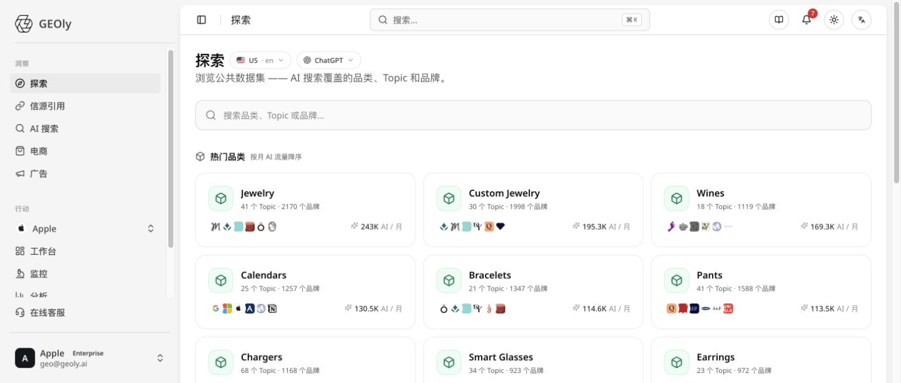

**Where to find it:** **Explore** in the icon rail on the far left. Its sidebar has five pages: **Explore**, **Sources**, **Fanouts**, **Shopping**, and **Ads**.

Explore is GEOly’s starting point for public AI market research. Use it when you need to understand how an industry is represented in AI answers before deciding what to monitor, what content to build, or which competitors to investigate.

## What Explore is for

Explore helps growth, content, and research teams answer questions such as:

- Which categories and user questions are active in AI discovery?
- Which brands are repeatedly recommended or compared?
- What sources does AI rely on when it explains a category?
- Where could a brand earn more coverage, evidence, or product visibility?

Explore uses GEOly’s public industry dataset. It is not a replacement for your brand’s monitored Prompt data, web analytics, sales reporting, or ad reporting.

## Before you start: lock the scope

Every result is tied to a specific research scope. Record these choices before comparing anything:

- **Market and language:** category behavior and source patterns can change by country and language.
- **AI platform:** compare only platforms included in the current dataset.
- **Object and date range:** decide whether you are researching a category, Topic, or brand, and keep the time window consistent.

A change in scope can change the result. Do not treat two rankings as comparable just because they use the same brand name.

## Start with the Explore homepage

The homepage is designed for discovery. Browse a category, search for a public entity, or open a popular Topic.

### Categories

Category cards can include Topic counts, brand counts, and estimated AI traffic per month. These are prioritization signals for public research—not market size, web sessions, orders, or revenue.

Choose a category when it is relevant to your audience, contains enough Topics to investigate, and has enough observations to support a useful comparison.

### Topics

A Topic represents a recurring question or need in a category. Topics are useful for moving from a broad market view to the specific language and situations that appear in AI answers.

### Brands

A public brand page shows how AI positions a brand across the available category and Topic data. Use it to find recurring associations, competing brands, and areas where the brand appears—or does not appear—in the current sample.

## Read a category like a researcher

When you open a category, use this sequence:

1. **Check the overview** to understand coverage and the selected scope.
2. **Scan the brand leaderboard and SoM** to see relative public presence.
3. **Review the trend** only after confirming that the comparison window and platform are consistent.
4. **Open the Topic ranking** to find questions that matter to your business.
5. **Inspect citations and recent mentions** to see which sources and answer contexts influence the result.

### How to read SoM

SoM (Share of Mention) is a relative measure inside the selected public category scope. It is not total market share, sales share, traffic share, or your monitored AIGVR or Mention Rate.

## Use brand pages to understand AI positioning

A brand page is most useful when you want to understand the language AI uses around a brand:

- Which Topics and use cases bring the brand into answers?
- Which attributes or audiences appear repeatedly?
- Is visibility broad or concentrated in a small number of Topics?
- Which brands share the same answer contexts?

Treat AI descriptions as market evidence to investigate, not as a customer survey. For important positioning decisions, review the original answers and validate the finding against official product information and first-party data.

## Turn a Topic into a research brief

For each Topic, assess:

- business relevance;
- demand and sample size;
- brand concentration;
- recurring competitors;
- frequently cited domains; and
- the answer context behind recent mentions.

High difficulty usually means that mentions are concentrated among a few leading brands. It does not mean entry is impossible. Low difficulty means the public landscape is more distributed; it does not guarantee that new content will be recommended.

## A practical Explore workflow

1. Pick a category or search term that matches your business.
2. Set the market, language, platform, and date range.
3. Shortlist Topics using relevance, demand, difficulty, and sample quality.
4. Compare leading brands and note repeated positioning language.
5. Open citations and recent mentions to collect evidence and context.
6. Write one testable hypothesis—for example, a comparison page, product detail improvement, or third-party evidence project.
7. Validate the hypothesis in the Workspace (for example **Prompts → All prompts** and **Home → Overview**) using your own brand’s data.

## How the other Explore pages fit

Explore is the discovery layer. Continue the investigation in the view that answers the next question:

- **Fanouts:** break down the retrieval queries AI used while answering.
- **Sources:** identify source types, domains, positions, and Topic coverage.
- **Shopping:** understand products, prices, retailers, and AI shelf visibility.
- **Ads:** inspect competitive paid exposure surfaces.

Keep the scope consistent as you move between views. The goal is a connected research trail: demand → evidence → product visibility → competitive action.

## Reading the main signals

### AI traffic per month and estimated AI revenue

These are directional public-data estimates. They are not a brand’s analytics, order volume, advertising return, or finance data.

### Trends and brand momentum

A trend can show a change in relative public position across comparable periods. Empty dates may mean that no comparable observations were available. Always check the Topics and recent mentions behind a movement.

### Citations and recent mentions

Citation counts and positions describe how sources appear in the current AI-answer sample. They do not prove that a cited domain is authoritative, that it drove referral traffic, or that it equals your monitored Citation Rate.

### AI perception

AI perception groups recurring attributes and evidence statements. Use it to generate questions for content and positioning work, then verify the underlying answers. It is not a substitute for customer research or sentiment surveys.

### Topic whitespace

Whitespace highlights Topics where competitors appear more often than the target brand. Before acting, confirm the Topic fits the business, understand why competitors are present, and check that the sample is stable enough to support a hypothesis.

## Common mistakes

- Treating public AI estimates as first-party business metrics.
- Comparing markets, languages, platforms, or periods without matching the scope.
- Treating public citation data as your own Citation Rate.
- Reading a brand mention or product card as proof of an ad, click, sale, or causal effect.
- Concluding that a brand is absent when the result may reflect coverage, access, date range, or data availability.

Explore is where you frame the question. Use the Workspace pages to test whether a change is visible in your own brand data, and use first-party analytics or business reporting for traffic, conversion, and revenue decisions.
