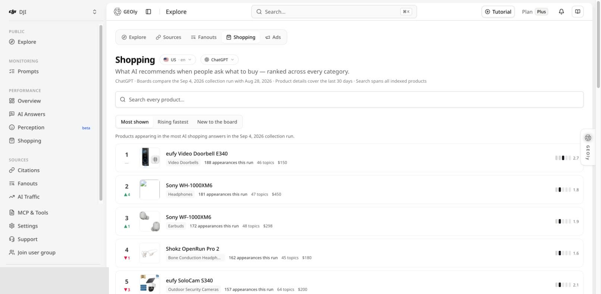
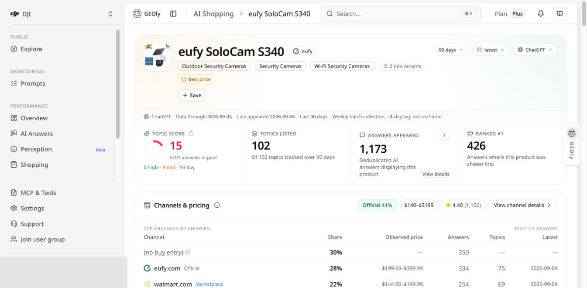
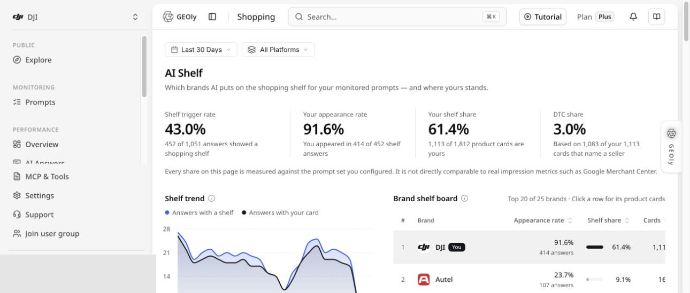

GEOly has two different Shopping surfaces. They answer different questions and must not be combined.

| Surface | Entry | Scope |
| --- | --- | --- |
| **Public Shopping** | Public → Explore → Shopping | Products observed across GEOly's public AI-shopping dataset |
| **AI Shelf** | Performance → Shopping | Product shelves returned for your own monitored Prompts |

Neither surface measures orders, inventory, revenue, or complete ecommerce market share.

## Public → Explore → Shopping

The Public Shopping page is labeled **Shopping**. Select the country/language and platform before reading the board.

The current board provides three views:

- **Most shown:** products appearing in the most AI shopping answers in the current collection run.
- **Rising fastest:** products with the strongest board movement versus the comparison run.
- **New to the board:** products that newly entered the board.

Each row can show the rank and movement, product, category, appearances in the current run, Topic count, an observed price, and an average shelf-position value.

The board compares collection runs shown on the page. It is not real-time and it is not a universal product ranking.

## Search and compare products

Use **Search every product** to find a product across the indexed public Shopping dataset. Keep the locale and platform fixed when comparing products.

Use the board to form research questions such as:

- Which products repeatedly appear for many Topics?
- Which products are entering or leaving the public AI shelf?
- Which categories produce consistent shopping-card activity?
- Which observed prices and positions should be checked in the underlying evidence?

Do not infer sales, advertising impressions, inventory, or conversion from an appearance count.

## Product detail

Open a product row to review its detailed Shopping evidence. Choose a time window, data snapshot, and platform that contain observations.

The current product detail can include:

- **Topic Score:** a position-weighted score across the anchored answer pool; absence contributes zero, so a product cannot improve simply by disappearing.
- **Topics listed:** how many tracked Topics include the product.
- **Answers appeared:** deduplicated AI answers displaying the product.
- **Ranked #1:** answers where the product appeared first among shopping cards.
- **Channels & pricing:** observed merchant domains, answer share, price ranges, Topic counts, and latest observation.
- **Weekly position heatmap:** answer counts by position band and absence for each collection week.
- **Product Topic performance:** listing rate and median position inside each Topic.
- **Competition and retrieval evidence:** products shown together, supporting queries, and source evidence where available.

### Price and rating boundary

The page explicitly treats price, rating, review count, seller, and channel data as **AI-card observations**. They can vary by market, date, retailer, bundle, and data availability. Verify commercial decisions against the retailer or brand's first-party systems.

## Recommended Public Shopping workflow

1. Set country/language and platform.
2. Note the current and comparison collection runs.
3. Review Most shown, Rising fastest, and New to the board.
4. Open a relevant product and choose a window with data.
5. Read Topic Score together with the answer-pool denominator.
6. Review first-position counts, the weekly heatmap, and Topic performance.
7. Check channels, observed prices, competitors, and source evidence.
8. Turn the result into a research or content hypothesis.
9. Validate the hypothesis with first-party product, traffic, and sales data.

## Performance → Shopping: AI Shelf

Open **Performance → Shopping**. The page title is **AI Shelf**.

AI Shelf studies the shopping shelves returned for the current project's monitored Prompts. The current implementation supports ChatGPT and Google AI Mode data where available.

The headline metrics use different denominators:

| Metric | Meaning |
| --- | --- |
| **Shelf trigger rate** | Share of monitored answers that produced a shopping shelf |
| **Your appearance rate** | Share of shelf answers where the monitored brand appeared |
| **Your shelf share** | Share of observed product cards belonging to the monitored brand |
| **DTC share** | Share of the brand's cards that name a direct-to-consumer seller under the page's classification |

Read the counts displayed below each percentage. These figures are not directly comparable to ad impressions, Google Merchant Center metrics, or the public Shopping board.

Below the headline metrics, use the shelf trend and brand shelf board to inspect which brands and product cards appear in the monitored Prompt set. Open the underlying answers before turning a shelf pattern into a claim.

## Data boundaries and common mistakes

- Public Shopping and AI Shelf use different datasets and denominators.
- An appearance is not a sale, click, conversion, impression, or endorsement.
- Rank movement compares the collection runs shown on the page, not the whole market.
- An observed price is not a guaranteed current retail price.
- A missing product can reflect the selected window, platform, locale, or collection coverage.
- Topic Score must be read with its answer pool and anchored Topic set.
- DTC share depends on observed seller naming and classification; it is not total direct sales share.

Use Shopping to discover patterns and evidence. Validate operational decisions with original AI answers, retailer pages, and first-party analytics.
