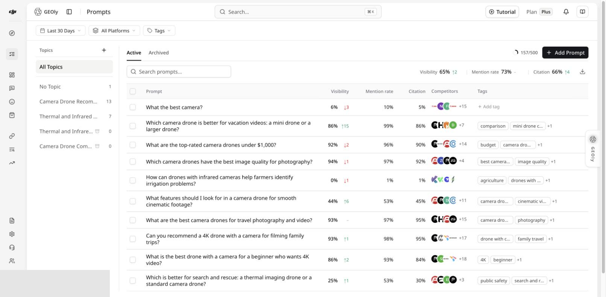
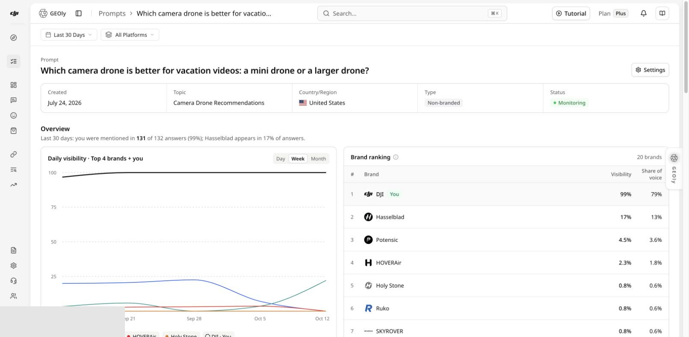
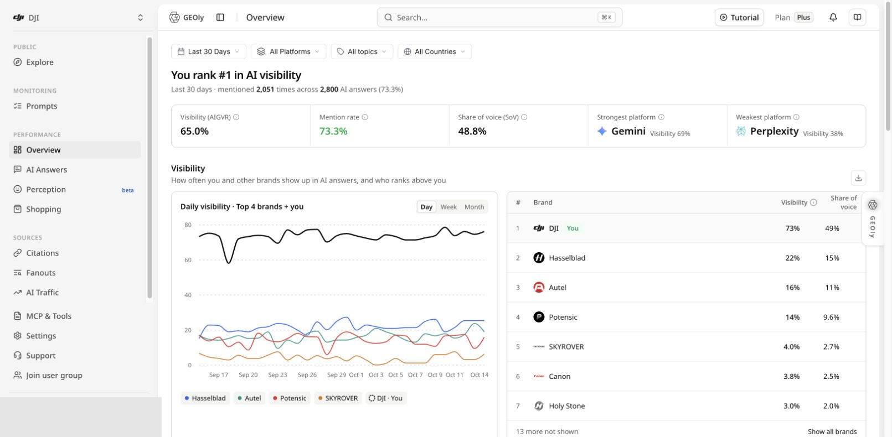

**Entry: Monitoring → Prompts.** Select a Topic from the left rail to filter Prompts, then use the Topic menu to open its detail view. Compare platforms with the **All Platforms** filter and continue the investigation in Performance → Overview, Topic detail, and Prompt detail.

There is no separate Topic Analysis or Platform Analysis item in the current main navigation. This article connects Prompt grouping, Topic-level summaries, platform comparison, and original answers into one workflow.

## Distinguish two kinds of Topic

- A **monitoring Topic** is created for your current brand and groups your own Prompts by use case, intent, product line, or project.
- A **public Topic** under Public → Explore is an industry research object in GEOly's public dataset.

They use different scopes, samples, and purposes and must not be added together. Before analysis, confirm the organization, brand, date range, platform, Prompts in the Topic, and number of completed answer records.

## Move from a Topic to a specific issue

1. In Prompts, select a Topic or **No Topic** and verify membership.
2. Review visibility, mention rate, citation rate, competitors, and tags in the list to find weak or unusual Prompts.
3. Open Topic detail to inspect Topic KPIs, trends, platform comparison, competitors, brand contexts, citation pages, and related Prompts.
4. Read Prompt count and completed-record count alongside percentages. Small samples can produce large swings.
5. Open a weak Prompt, then inspect a specific answer record and its citation evidence.
6. Decide whether the issue is a missed mention, weak visibility, missing citation, inaccurate brand description, or insufficient completed evidence on a platform.

## Interpret the metrics correctly

| Metric | What it supports | What it does not represent |
| --- | --- | --- |
| **Visibility (AIGVR)** | A combined view of how visibly a brand appears in AI answers | Traditional search rank or recommendation position |
| **Mention rate** | The share of completed answers in scope that mention the brand | Total market awareness |
| **Citation rate** | The share of answers with qualifying brand-related citation evidence | Quality or causal impact of every external link |
| **Share of Voice** | Relative mention share inside the current sample | Total market share |
| **Average visibility level/position** | A summary of where the brand appears in answers | Product-board rank or revenue performance |

Use the aggregation defined by the page. Do not average daily percentages and present the result as the headline KPI. No completed records, a failed run, or an unavailable platform must not be interpreted as zero performance.

## Compare platforms with a consistent scope

1. In Performance → Overview, keep the same date range, Topic, country/region, and platform scope.
2. Start with All Platforms, then examine the strongest and weakest platform and differences in the trend.
3. Return to the same Topic or Prompt, select the target platform, and verify completed records and original answers.
4. Keep the Prompt set and dates constant. If one platform has materially fewer records, label the sample difference.

Available platforms depend on the current plan, organization configuration, and page capability; use the options shown in the live selector. Shopping, Fanouts, and other modules have their own data sources and platform scope. A platform visible in Overview is not automatically supported by every page.

## Turn a finding into a testable action

Build a reviewable evidence chain:

**Topic → Prompt → platform → original answer → citation URL → page to improve**

Use the evidence to improve FAQs, use-case explanations, product facts, comparisons, or authoritative sources. Preserve the original Prompt, date range, and platform; after the content change has accumulated new completed records, compare again in the same scope. If you edit or replace the Prompt, treat it as a new test version instead of mixing the before-and-after samples.

## Common boundaries

- Movement in a monitoring Topic is not movement in the whole industry.
- Public Topic traffic or revenue estimates are not measured GA4 visits or sales.
- Configured competitors and brands co-occurring in an answer are different objects.
- Prompt quota, Prompt count, and completed-answer count must be reported separately.
- Aggregate metrics locate a problem; original answers and specific citations provide evidence about its cause.
