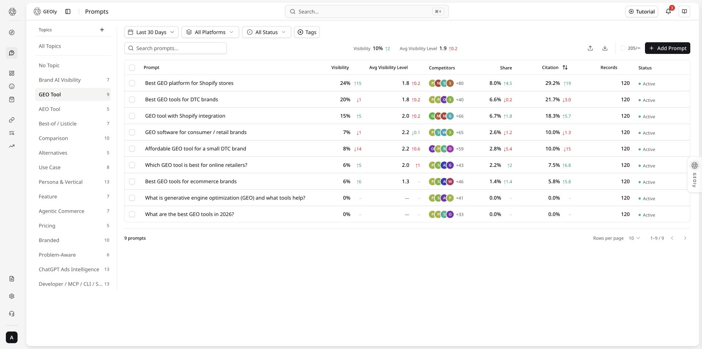
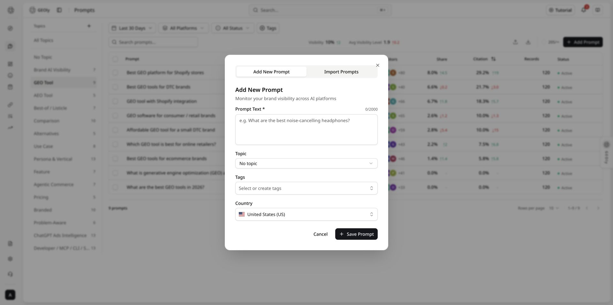
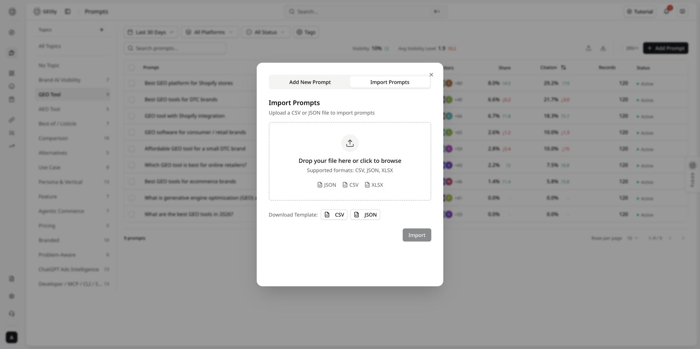
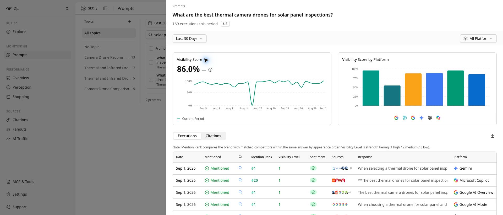

## Entry and purpose

After signing in to GEOly, open **Monitoring → Prompts**. Prompts are the complete, natural-language questions that your brand should be monitored against. The page shows brand visibility in AI answers, competitor co-occurrence, Share of Model, citation sources, and the original responses.

A Prompt is not a single SEO keyword. It should look like a question a potential customer may ask an AI assistant. Select the **DJI** brand and use the real Prompt shown in the screenshot as the running example:

> What are the best thermal camera drones for solar panel inspections?

This is an unbranded category Prompt: it tests DJI's visibility when a buyer asks about thermal-camera drones for solar-panel inspections. To test branded positioning separately, create a branded Prompt such as:

> Which DJI drone is best for solar panel inspections, and what evidence supports the recommendation?

The complete workflow is: **create a question → wait for monitoring to run → review the list with fixed filters → open details → read executions and citations → define an action → review again with the same conditions**.

The screenshots use the DJI example brand and workspace to explain the interface and analysis method; metrics vary by account, time range, and platform and are not results for the reader's account.

## Why keep checking Prompts

Customers usually want to know three things: **Will AI recommend my brand? Why do competitors appear? Which pages does AI use?** With DJI's solar-panel-inspection Prompt:

- **DJI is not mentioned**: check whether the site explains the inspection use case, product specifications, and target users;
- **DJI is mentioned but the site is rarely cited**: add clear specification, case-study, and product pages that AI can find;
- **Competitors appear often**: see which criteria AI uses, then explain how DJI differs;
- **After a site update**: use the same Prompt and filters to check again.

A Prompt is therefore more than a saved question. It helps the team find content gaps and choose what to change. It does not directly prove traffic, conversions, or revenue.

### Not sure what to ask? Let AI generate the set

In [AI Research](https://www.geoly.ai/features/prompts-reasearch), enter your website and a few keywords. GEOly generates related questions, groups them by Topic, and labels their intent. Review the set and import it into monitoring. Remove irrelevant questions first and confirm the country/region, brand, and organization quota.

Future releases will continue to improve AI-generated Prompt rules and capabilities. This guide will be updated with the latest interface and steps when new functionality launches.

### Choose a plan for your team

| Your situation | Start with | Consider upgrading when |
| --- | --- | --- |
| One brand, checking AI visibility | Basic | You need more platforms or more users |
| More platforms or team collaboration | Grow | You need longer history or more automation |
| Ongoing multi-platform optimization | Advanced | You need GEO Agent and more data |
| Agency or multi-brand team | Plus | You need multiple brands, all platforms, and API access |

If you only want to check one result, start with the trial or Basic. If you need to track many questions, save citation evidence, and keep improving content, choose based on brands, platforms, and users. Use the [current pricing page](https://www.geoly.ai/pricing) and account page for exact limits and benefits.

### What GEOly helps you do

GEOly puts three things in one place: **what to ask, how AI answered, and which pages AI used**:

- Generate useful questions from your website and keywords;
- View results by brand, Topic, country/region, platform, and time;
- Read the original AI response, competitor mentions, and citation links;
- Export the results for your content or marketing team.

GEOly does not only tell you whether the brand was mentioned today. It helps you see **why, what to change, and whether the result changed after the update**. Platforms, Agent, reports, and API access depend on the plan.

## Core: how to judge Prompt quality

GEOly does not replace judgment with a single “Prompt quality score.” Quality means that a Prompt sounds like a real customer question, isolates one AI decision scenario, can be monitored under stable conditions, and produces answer and citation evidence that someone can act on. It is different from DJI's Visibility: a high-quality Prompt can still have low visibility.

### Prompt quality checklist

| Check | High-quality standard | DJI example | Common problem |
| --- | --- | --- | --- |
| Customer intent | A realistic buying, comparison, or usage question | `What are the best thermal camera drones for solar panel inspections?` | Only `drone` or `DJI` |
| One purpose | One Prompt answers one decision question | Thermal-camera drones for solar inspections | Mixing price, after-sales service, and travel filming |
| Concrete context | State the task, user, or environment | `solar panel inspections` | “Best for every industry” without a use case |
| Decision criteria | Use interpretable criteria such as best, compare, under $X, or for beginners | `best` + inspection use case | Adjectives with no testable meaning |
| Reproducibility | Country/region, platform, and time window can stay fixed | US + All Platforms + Last 30 Days | Rewriting the question or mixing countries between checks |
| Actionability | The answer and citations can point to product facts, specifications, or cases | Check whether DJI is mentioned, where, and with which URLs | Optimizing only for brand appearance without evidence |

### Build Prompt types around DJI

Do not put the brand name in every Prompt. Split the same product market by intent:

1. **Category discovery**: `What are the best thermal camera drones for solar panel inspections?` Tests whether DJI enters the answer when the buyer does not name a brand.
2. **Branded capability**: `Which DJI drone is best for solar panel inspections, and what evidence supports the recommendation?` Tests how AI describes DJI and whether it provides verifiable support.
3. **Comparison/alternative**: `How does DJI compare with other thermal camera drones for solar panel inspections?` Tests decision criteria, competitor co-occurrence, and differences.
4. **Specific use case**: Ask separately about flight time, thermal specifications, outdoor conditions, or compliance; keep one primary constraint per Prompt.

### Use Prompts correctly

- Build a balanced set of intents before judging the overall picture; one Prompt cannot represent DJI's full AI visibility.
- Fix country/region, platform, and time window first. Do not treat “enough” as a fixed number; at minimum, confirm that completed Records exist, then read original answers and citations in light of the record count.
- After a content change, keep the Prompt text stable and record the publication date. If the question must change, mark it as a new version; otherwise the before/after trend is no longer comparable.
- Do not force DJI into every category Prompt just to increase mentions; that changes the customer intent being measured.
- Judge quality by whether the question is valid, reproducible, and evidence-ready—not by Visibility, Mention Rank, or Citation Rate alone.

## What Prompt monitoring is for

Prompt monitoring answers a practical question: **when a customer asks AI this question, is the brand visible, how is it described, and which sources support the answer?** It is useful for category discovery, “best choice” questions, comparisons and alternatives, constrained use cases, and direct questions about brand capabilities.

### Build a useful Prompt set

A strong monitoring setup is a set of questions, not one isolated Prompt. Start with 3–5 category-discovery questions, 3–5 best-choice or list questions, 3–5 comparison/alternative questions, 3–5 core use-case questions, and 2–3 direct brand-capability questions. Use Topics and Tags for intent, market, industry, and project batch.

## Before you start

1. Confirm the current workspace and brand. Do not mix data from different brands.
2. Use a real buying, comparison, usage, or information question rather than a broad keyword.
3. Select the correct country or region. AI platforms search from that regional perspective; keep it consistent when comparing results.
4. Choose the observation window. The list defaults to the most recent 30 days; the toolbar can change the time range and platform.

## A complete workflow with DJI

1. Select **DJI** in the brand switcher at the top left. Confirm the current brand, workspace, and plan before reading any results.
2. Open **Monitoring → Prompts** and set the country/region, time range, platform, and status. A first pass can start with **Last 30 Days, All Platforms, and All Status**, then narrow the scope.
3. Click **Add Prompt** and enter the category Prompt shown in the screenshot: `What are the best thermal camera drones for solar panel inspections?` Choose the correct country and use Topics or Tags such as solar inspection and thermal camera.
4. Click **Save Prompt**. This creates the Prompt and a pending monitoring task; it does not mean a completed Record exists. Wait for the task, then refresh the list.
5. In the list, confirm the Prompt text, country, status, and Records. A counter such as `71/500` means Prompt quota used / plan Prompt limit—not Responses, completed Records, or Visibility.
6. Open the row or choose **View**. Check country, time range, and platform at the top of the drawer, then read Visibility, Executions, Citations, and AI real search queries.
7. Open at least one original response and record whether DJI was mentioned, Mention Rank, Visibility Level, sentiment, and the actual citation URLs. Treat missing, in-progress, or failed records as data gaps.
8. Write the observation, evidence, action, and recheck conditions. After new content has had time to generate records, recheck with the same Prompt, country, platform, and time window.

## Create or import Prompts

### Add one Prompt

On the Prompts page, click **Add Prompt**. The fields are:

- **Prompt Text**: required, up to 2,000 characters. Include the product category, audience, use case, and decision intent where useful.
- **Topic**: optional grouping for related questions and topic-level filtering.
- **Tags**: optional labels for use case, intent, market, or project batch. Existing tags can be selected or a new tag can be created while typing.
- **Country**: the observation scope. It defaults to `US`; search for another country or region when needed.

Click **Save Prompt**. GEOly automatically creates a pending monitoring task for the new Prompt. A successful save does not mean a completed record already exists; return to the list and check the record count.

### Batch import

Click the upload icon in the toolbar and switch to **Import Prompts**. Supported formats are **CSV, JSON, and XLSX**. The file must contain a `text` or `prompt` column. Common optional columns are `topic`, `topic_id`, `tags`, and `country`.

For CSV, separate multiple tags with commas. JSON must be an array of objects. Topic names are matched case-insensitively; a missing topic is created automatically. Check the preview and shared organization Prompt quota before importing. A successful import automatically triggers monitoring for the brand's pending Prompts.

Before importing, use the preview to check empty text, country codes, Topic matching, tag splitting, and expected quota usage. Do not put customer personal data, passwords, API keys, or other sensitive information in a Prompt file.

### Plans, quotas, and data boundaries

The figures below are the default limits shown on the [current pricing page](https://www.geoly.ai/pricing). Prices, available platforms, organization overrides, and add-on benefits can change; use the **current pricing page and account page** as the source of truth.

| Plan | Prompt total | AI platforms | Responses/month | AI Credits/month | Data retention |
| --- | ---: | --- | ---: | ---: | --- |
| Basic | 30 | 1 (ChatGPT) | 900 | 3,000 | Up to 30 days |
| Grow | 50 | 2 (ChatGPT, Google AI Mode) | 3,000 | 10,000 | Up to 30 days |
| Advanced | 100 | 4 (ChatGPT, Gemini, Perplexity, Google AI Mode) | 12,000 | 30,000 | Up to 90 days |
| Plus | 500 | All 6 | 90,000 | 100,000 | 365 days |
| Enterprise | Custom | Custom | Custom | Custom | Custom |

Interpret these limits carefully:

- **Prompt total is an organization-level monitoring quota**, not a separate allowance per brand or platform. Check the organization's remaining quota before importing.
- **Responses/month is monitoring response capacity, not a guarantee of completed Records**. Provider availability, failed or in-progress tasks, and narrow filters can make actual Records lower than the quota.
- **AI Credits are for in-product AI analysis or generation**, separate from Responses and Prompt execution count; **MCP Credits are a separate organization-shared pool for paid public industry intelligence through MCP, the CLI, and eligible future APIs**. Reading your own monitored data normally does not consume MCP Credits; paid public-industry analysis does. Neither pool converts directly into an executable Prompt count; use the account page and usage receipt for consumption and reset details.
- Current AI Credit validity is 30 days for Basic, Grow, and Advanced, and 90 days for Plus; Enterprise is custom. This is separate from monitoring-data retention. Current MCP Credits are 0 (Basic), 25,000 (Grow), 75,000 (Advanced), 200,000 (Plus), and custom by plan (Enterprise); the organization shares the pool and unused credits do not roll over.
- Add-on capabilities such as sentiment analysis, Shopping product-card analysis, Agent, and reports have their own plan gates or quotas. Do not infer their availability from Prompt total or Responses/month; verify the plan comparison and current account state.
- The detail drawer's **Last 30 Days** and custom ranges cannot exceed the plan's retention window. **AI real search queries** may show up to 90 days when available, but are still limited by the history actually retained for the account.
- **All platforms** means all platforms allowed by the current workspace and plan, not every AI platform in the product. The platform selector can therefore differ by plan.
- Lists, details, citations, and exports cover only the selected brand, Prompt, country/region, platform, date range, and available completed records. They are not user search logs, total market share, or a complete set of AI answers.
- A counter such as `71/500` in the screenshot is only Prompt quota usage. Its denominator can change with the plan, brand, or platform permissions; it cannot estimate monitoring coverage.

When reporting results, state the plan, filters, retention window, and completed Record count. Do not present a quota ceiling, completed-record count, and AI Credits balance as the same metric.

## Topics, filters, and search

The desktop layout has a topic rail on the left and the Prompt list on the right. On narrow screens, the topic rail becomes horizontal chips.

- **Topics**: view all topics, no topic, or a custom topic. Custom topics can be created, renamed, opened, or deleted. Deleting a topic does not delete its Prompts; they become uncategorized.
- **Time and platform**: global toolbar filters. Keep both unchanged when comparing periods.
- **Status**: All, Active, or Inactive. Deactivating a Prompt does not delete historical executions.
- **Tags**: filter by one or more tags; the tag manager can rename or delete tags.
- **Search**: search Prompt text in the second toolbar row. Results update after a short debounce (about 700 ms).
- **Clear**: clear text, status, and tag filters from the toolbar. Topic selection is controlled by the topic rail.

Filtering and sorting are server-side and paginated. Page sizes are 10, 25, 50, or 100. Do not treat the current page as the complete result set.

## Reading the list

| Column | Meaning | How to use it |
| --- | --- | --- |
| Prompt | The full question is clamped to two lines; hover to read long text. Country and topic may appear below it. | Confirm that the question matches the target scenario. |
| Visibility | AIGVR visibility percentage and change for the current filters. | Compare only with the same scope. |
| Avg Visibility Level | Average of levels 1, 2, and 3. Level 1 is high, 2 medium, and 3 low; a smaller number means stronger presentation. | It is not a recommendation rank; read the original responses. |
| Competitors | Configured competitors that co-occur with the brand in the same answers. | Co-occurrence is not market share and competitors are not auto-discovered. |
| Share | SoM (Share of Model) and change. | Share within monitored answers, not sales share. |
| Citation | Citation rate for brand sources in the current scope and change. | Open details to verify URLs and source types. |
| Records | Number of executions in the current scope. | Record the completed count before interpreting a score. |
| Status | Active or Inactive. | It affects future monitoring, not historical data. |

The summary bar is calculated over all filtered results, not only the current page. “Change” compares the current filtered result with the previous window of equal length; changing the time range or platform also changes the comparison baseline.

### Row and batch actions

The row menu provides **View, Edit, Activate/Deactivate, and Delete**. Before deletion, GEOly cancels monitoring tasks that are currently running. A deleted Prompt cannot be restored from the list, so export evidence before deleting.

Select multiple rows to **activate, deactivate, set a topic, set or clear tags, or delete**. Batch actions affect only selected Prompts. The toolbar upload icon imports Prompts; the download icon exports the current Prompt list as **CSV or JSON**.

## Prompt details

Click a row or choose **View** to open the detail drawer. It supports **Last 2 Days, Last 7 Days, Last 30 Days, or a custom date range**, plus all platforms or one platform.

The charts show the overall Visibility Score trend and Visibility Score by platform. They describe only the selected Prompt, time range, country, and platform scope. No records or very few records do not prove that the brand was absent from AI answers.

### Recommended reading order

1. Confirm country, time range, and platform at the top of the drawer.
2. Read the overall score, then compare platforms.
3. Open at least one original response in **Executions**.
4. Check Mention Rank, Visibility Level, sentiment, and competitor co-occurrence.
5. Review the exact citation URLs and source types.
6. Use AI real search queries to find additional concepts and evidence opportunities.

### Executions

The **Executions** tab lists completed or in-progress monitoring records: date, whether the brand was mentioned, web-search status, mention rank, visibility level, sentiment, sources, response, and platform.

An execution may include the raw response with brand and competitor highlights, the rules behind mention count/rank/visibility level, AI analysis when available, AI-triggered search queries and sources, and shopping results when returned. Prompt echoes or simple rewrites in search queries are removed or collapsed. The list supports loading more, collapsing, and sorting.

**Mentioned** means the brand appeared in that answer; **Not Mentioned** is not a statement about every answer. **Mention Rank** orders the brand against configured competitors in that answer, not in the market. **Visibility Level** is presentation strength (1 high, 2 medium, 3 low), not Mention Rank. **Response** is the primary evidence for claims about AI narrative and positioning. In-progress, failed, or unavailable records should be treated as data gaps, not negative results.

### Citations

The **Citations** tab shows source pages deduplicated by URL for the selected Prompt and filters. It can show rank, URL, source type, brand-source status, share, and appearance count.

Source types distinguish inline citations, source lists, attached links, and search sources. A brand-source match is based on the URL, title, description, brand name, or domain; it does not mean that every part of the page was verified. Details can be exported as compact AI JSON, full JSON, executions CSV, or citations CSV. Confirm the Prompt, filters, and date range before exporting. Store exports according to your organization's data-access rules.

### AI real search queries

When available, the **AI real search queries** section shows independent queries actually triggered while answering the Prompt during the most recent 90 days, the number of answers they covered, and brands present. It describes AI retrieval behavior, not user search volume, query logs, or market share.

Group these queries into product definitions, comparison criteria, use-case constraints, and brand evidence. They can guide FAQs, comparison pages, use-case pages, and citable facts, but they are not user-level search logs.

## Turn results into action

Record each review in four lines: **observation, evidence, action, and recheck conditions**. Always state the time range, country/region, platforms, and record volume.

- No mention: first rule out too few records, a narrow window, or a single-platform view.
- Mentioned but few citations: improve clear, verifiable, citable facts on relevant pages.
- Frequent competitor co-occurrence: study the answer's decision criteria and clarify fit, differences, and limitations.
- Large platform differences: read that platform's original answers and citations rather than using one platform to represent all platforms.

## Metric boundaries

- AIGVR/Visibility describes relative visibility in the selected scope; it does not prove traffic, clicks, conversions, revenue, or causality.
- Average Visibility Level describes presentation strength; it is not a recommendation rank or market-wide ranking.
- Mention rate and count describe frequency in completed records; they are not user search volume or market share.
- SoM and competitor co-occurrence describe competition inside monitored answers; they are not sales share or an overall competitor ranking.
- Citation rate and URLs describe sources used in monitored answers; they are not traffic, link equity, or conversion.
- No record means no completed record is available under the current filters; it does not prove that the brand was never mentioned.

## Troubleshooting

### No record after saving

Saving creates the Prompt and a pending monitoring task. Wait for monitoring to complete, refresh the list, and check Records. Confirm that the Prompt is Active, the country/region is correct, and the organization has quota.

### Records exist but the chart is empty

Make the drawer's time range and platform match the list. The drawer counts completed records only for the selected Prompt, country, platform, and period; in-progress or failed tasks may not contribute chart data.

### Competitor avatars look unexpected

Competitors are matched from configured brand names and aliases. GEOly does not auto-discover or verify new competitors; add them in competitor management first.

### Citation rate is high but visibility is low

Citation rate and visibility measure different signals. AI may cite a brand page without naming the brand in the answer, or mention it only weakly. Read both the original response and the citation URL.

### Platforms differ substantially

AI platforms have different search, response, and citation behavior. Review each platform separately while keeping the Prompt, country, and time range consistent.

## Suggested operating cadence

- **Initial setup**: create a balanced Prompt set, then verify market, tags, Topics, and quota.
- **Weekly review**: use a fixed 7- or 30-day window to inspect new answers, competitor co-occurrence, and citation changes by platform.
- **After content changes**: record the publication date, wait for new records, and recheck with the same conditions.
- **Monthly summary**: export representative responses and citation evidence instead of copying scores alone.

## First-use checklist

- [ ] Correct brand and workspace.
- [ ] Prompt is a complete, realistic customer question.
- [ ] Country/region and platform scope are correct.
- [ ] Completed Records exist, and the current count is recorded.
- [ ] At least one original AI response has been read.
- [ ] Citations and AI real search queries (when available) have been reviewed.
- [ ] Observation, evidence, action, and recheck conditions are recorded.
