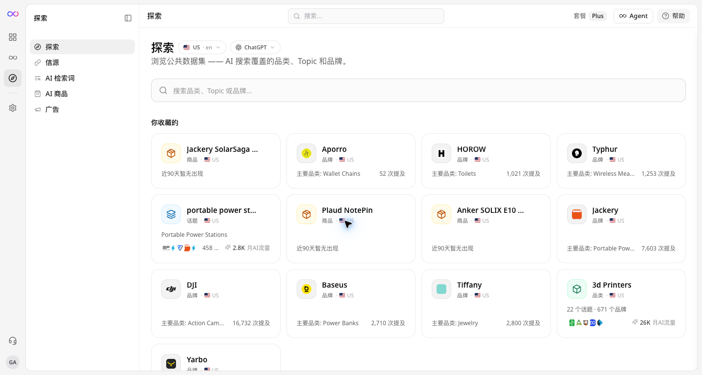
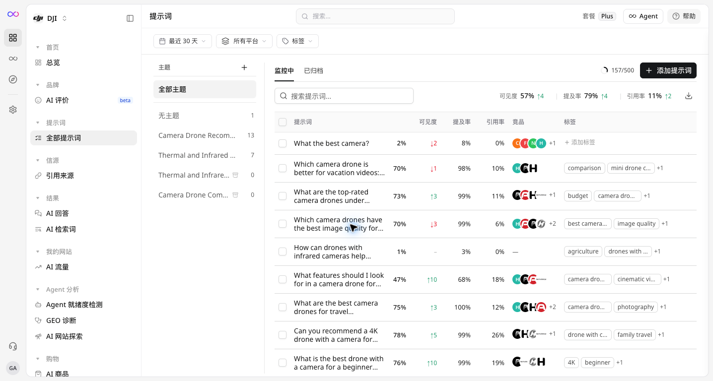
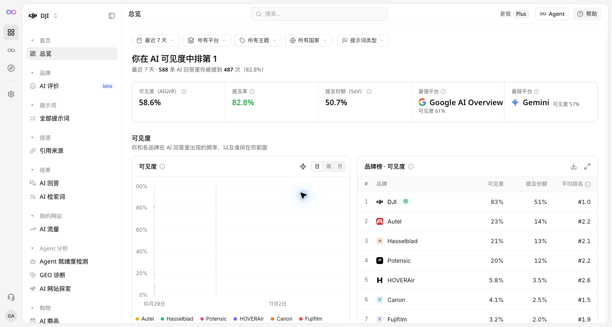
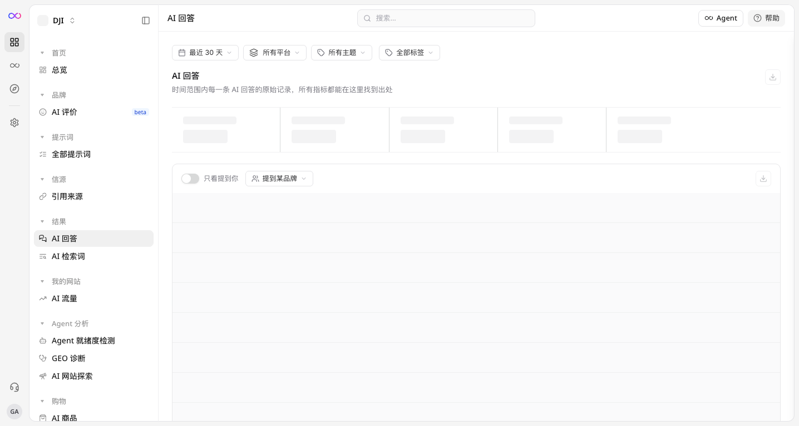
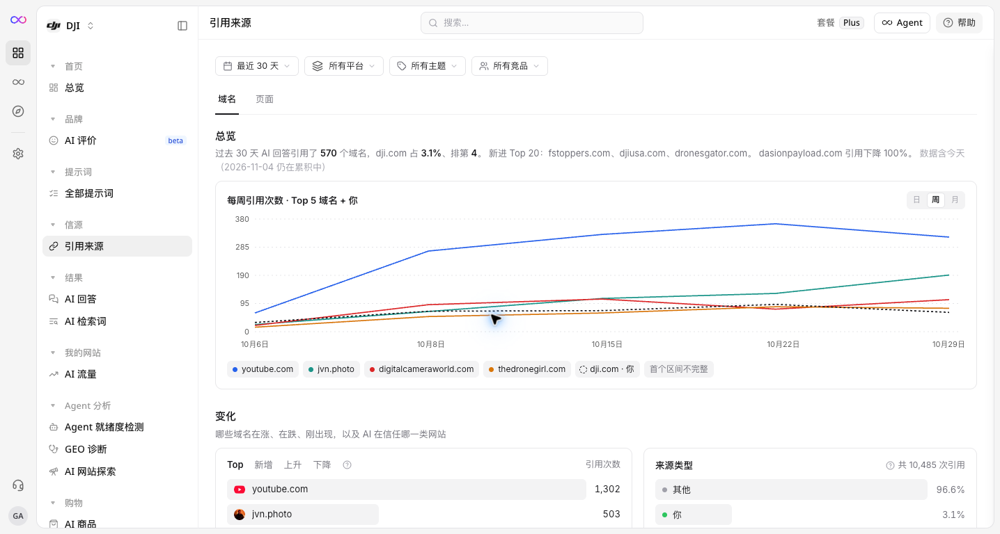
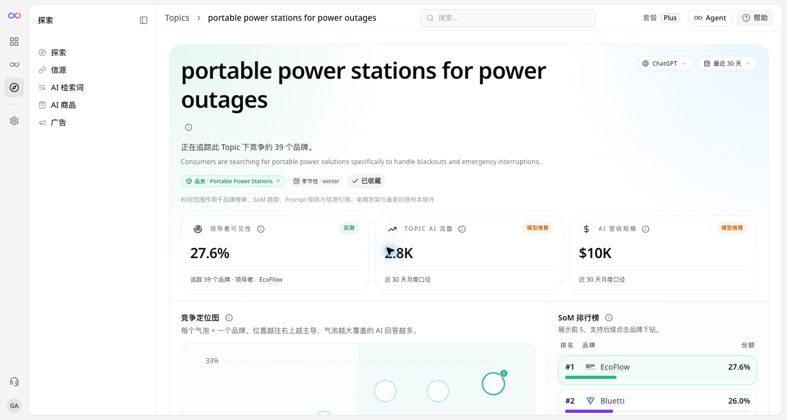

GEOly helps you see how AI platforms describe, mention, cite, and recommend your brand.

This guide explains what each part of GEOly is for, where to find it, and how to read the results without confusing an observation with a business outcome.

## Start here: the GEOly workflow

If you are new to GEOly, use this order:

1. **Explore** public data to understand a category, Topic, brand, product, or source.
2. **Create Prompts** that represent the questions your customers may ask an AI platform.
3. **Wait for completed records**, then review your brand's results in **Overview** and **AI Answers**.
4. **Open AI Answers and Citations first**, then use Perception, Fanouts, or Shopping when those screens are available and you need more context.
5. **Record the next action** and repeat the same check after you make a change.

The exact screens, filters, platforms, and actions available to you depend on your organization and account access.

Two terms used in this guide:

- A **completed record** is one finished AI response generated for a monitored Prompt.
- **Scope** means the filters and Prompt set used for a result, such as the date range, platform, country, language, and selected brand.

## Find the right screen

| If you want to… | Start here | What you will learn |
| --- | --- | --- |
| Research a market, category, Topic, or product | **Public → Explore** | What appears in GEOly's public dataset |
| See how your brand appears in monitored AI answers | **Performance → Overview** | Visibility and mention signals for your selected scope |
| Read the actual AI answers | **Performance → AI Answers** | What the AI said, which brands it mentioned, and how it described them |
| Check which pages AI used | **Sources → Citations** | Which domains and pages appeared in the monitored answers |
| Add or manage questions | **Monitoring → Prompts** | Which questions GEOly will run for your brand |
| Compare brands within a Topic | Open a Topic from **Explore** | The competitive signals available for that Topic |
| Connect a supported client or manage access | **MCP & Tools** or **Settings** | Available integrations and workspace settings |

Public research and monitored brand results are different types of data. **Explore** uses GEOly's public or industry dataset. **Monitoring**, **Performance**, and **Sources** use the selected brand's Prompts and completed records.

## 1. Explore public data

Open **Public → Explore** when you want to research a market before creating Prompts or compare what is visible across categories, Topics, brands, and products.

You can use the tabs available in Explore to:

- Browse categories, Topics, brands, and products.
- Inspect public sources and pages cited by AI.
- Review AI retrieval queries and Query Fan-out.
- See products observed in public AI shopping results.
- Review available public AI-ad observations.

Select the country or language and AI platform before searching. The same Topic can look different when the scope changes.

### What Explore can and cannot tell you

Explore can help you find patterns and decide what to investigate next. It is not a complete market report, a log of every user's search, or your first-party analytics.

Numbers such as modeled monthly AI traffic are estimates. Use them to compare opportunities directionally, then validate important decisions with your own analytics and research.

## 2. Create and monitor Prompts

A **Prompt** is a natural-language question that GEOly sends to an AI platform for monitoring. Good Prompts sound like real questions a customer might ask, such as a product comparison, recommendation request, or use-case question.

Open **Monitoring → Prompts** to:

- Add a new question.
- Import or organize questions when those actions are available.
- Filter by status, Topic, or tags.
- Run the configured monitoring set with **Run All**.
- Check whether records have been completed.

The tracking table may show visibility, average visibility level, citation, records, country, status, and tracking state.

Saving a Prompt does not create a completed answer immediately. Wait until records are available before reading its metrics. If a result is missing, check the date range, platform, country, language, Prompt status, and record availability before drawing a conclusion.

## 3. Review your brand overview

Open **Performance → Overview** after your Prompts have completed. This page gives you a summary of how your selected brand appeared in the selected monitoring scope.

Before comparing two results, keep these settings the same:

- Date range
- AI platform
- Country and language
- Selected brand and competitors
- Prompt set
- Number of completed answers

The overview may include:

- **Prompts:** how many questions are included in the selected monitoring set.
- **Visibility (AIGVR):** the visibility metric shown for the selected scope.
- **Mention Rate:** how often the brand was mentioned in completed answers.
- **Visibility Level:** the average visibility signal shown for the selected scope.
- **Mentions:** the number of detected brand mentions.
- **Share of Voice:** the brand's share of mentions among the selected brand set.

Read these as signals from the selected GEOly dataset. They do not directly equal website traffic, sales, conversion rate, market share, or revenue. A higher visibility signal can tell you what happened in the monitored answers; it does not by itself explain why it happened.

## 4. Read the original AI answers

Open **Performance → AI Answers** when you need to see the evidence behind a summary number.

Depending on the available data, an answer record can show:

- When the answer was generated
- Whether your brand was mentioned
- The brand's mention rank
- Visibility level
- Sentiment
- Other mentioned brands
- The original response text

Start with the original response instead of relying only on a score. Ask:

- Did the AI answer the customer's question?
- Was the brand mentioned in the right context?
- Which competitors were mentioned?
- Was the recommendation supported by a source?
- Is the answer accurate and useful?

AI responses can change between runs. Treat each record as an observation within a particular Prompt, platform, date, country, and language scope.

## 5. Check citations and sources

A **citation** is a page or domain that appeared as a source in an AI answer. Open **Sources → Citations** to see which pages were used in your monitored answers.

Use this view to ask:

- Are your own pages being cited?
- Which third-party sources appear most often?
- Which topics cite competitors instead?
- Is the cited page accurate, current, and useful?

A citation is evidence of what appeared in an answer. It is not proof that the source is endorsed, accurate, receives high traffic, or caused a conversion. Open the original answer and the source page before changing content.

## 6. Understand Topics and shopping results

### Topics

Open a Topic from the public dataset when you want to compare the brands and signals available for one subject area.

A Topic view may include:

- **Leader Visibility:** the observed visibility of the leading brand.
- **Topic AI Traffic:** a modeled estimate of monthly AI query volume.
- **AI Revenue Scale:** a modeled estimate associated with the Topic.
- **Competitive Landscape:** the relative position of brands in that Topic.
- **Share-of-Model leaderboard:** a comparison preview for leading brands.

These are directional signals, not guaranteed traffic, revenue, rankings, or market share. Confirm the Topic, country, language, platform, and date range before using the result in a business decision.

### Shopping

GEOly can show shopping results in two different places:

- **Public → Explore → AI Shopping** studies products observed in the public dataset.
- **Performance → AI Shopping** uses the selected brand's monitored Prompts and completed records.

Do not compare these two views as if they measured the same population or used the same data source.

## 7. Use tools and manage your workspace

Open **MCP & Tools** to connect supported clients and use the GEOly tools available to your organization.

Open **Settings** to manage the workspace areas available to your account, such as:

- Brand and organization details
- Account access and members
- Competitors
- Developer or integration settings

The available actions depend on your organization and permissions. If you cannot find a screen or action, check your account access and the current workspace before assuming that the feature is unavailable.

## A simple example

Suppose you want to know whether AI recommends your brand for a product category:

1. Use **Public → Explore** to understand the category and identify common Topics.
2. Turn a customer-style question into a Prompt in **Monitoring → Prompts**.
3. Wait for completed records.
4. Review **Performance → Overview** to see the summary signal.
5. Open **Performance → AI Answers** to read what the AI actually said.
6. Open **Sources → Citations** to see which pages supported the answer.
7. Improve the relevant content, then rerun the same Prompt and compare the same scope.

This workflow helps you move from “What happened?” to “Why might it have happened?” and then to “What should we check next?”

## Common mistakes to avoid

- Comparing different date ranges or Prompt sets.
- Mixing public Explore data with monitored brand data.
- Treating modeled AI traffic or revenue estimates as first-party measurements.
- Treating a mention as a recommendation or a citation as an endorsement.
- Assuming that no result means an object does not exist; coverage, filters, access, and record availability can affect what appears.
- Making a major business decision from one answer or one run.

## What's next?

- [Create your GEOly account](/get-started/register-account) if you are new to the platform.
- Read [Explore: AI Market & Brand Research](/analytics/ai-engine-explore) to learn more about public research.
- Read [Prompts](/analytics/geoly-prompts) before expanding your monitoring set.
- Review [Topic and Platform Analysis](/analytics/ai-engine-topic) when you need to compare Topics or platforms.

GEOly helps you observe how AI systems understand your brand and decide what to investigate next. It does not guarantee that any AI platform will mention, cite, recommend, or rank a brand.
