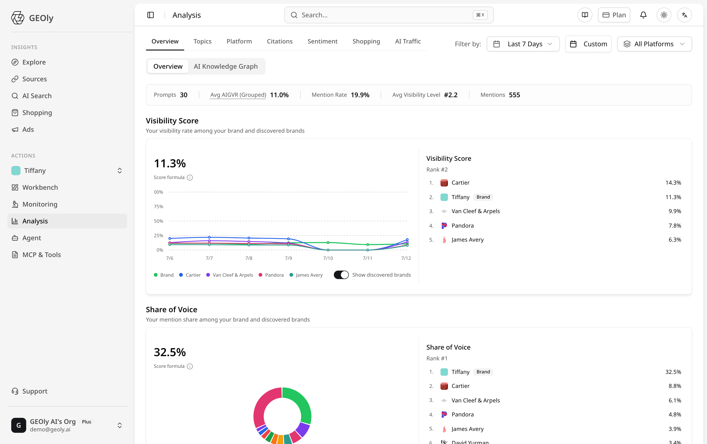
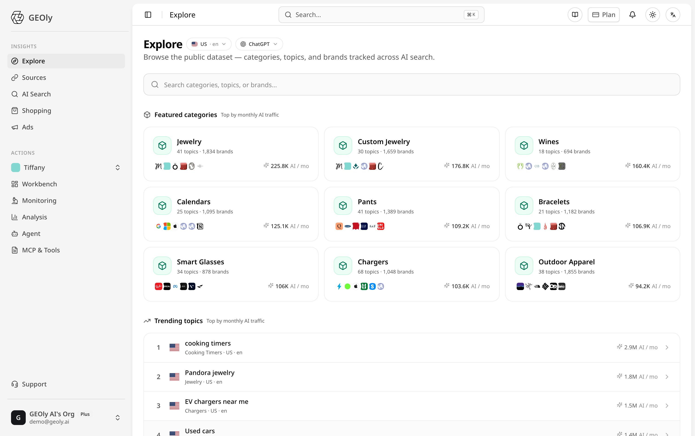
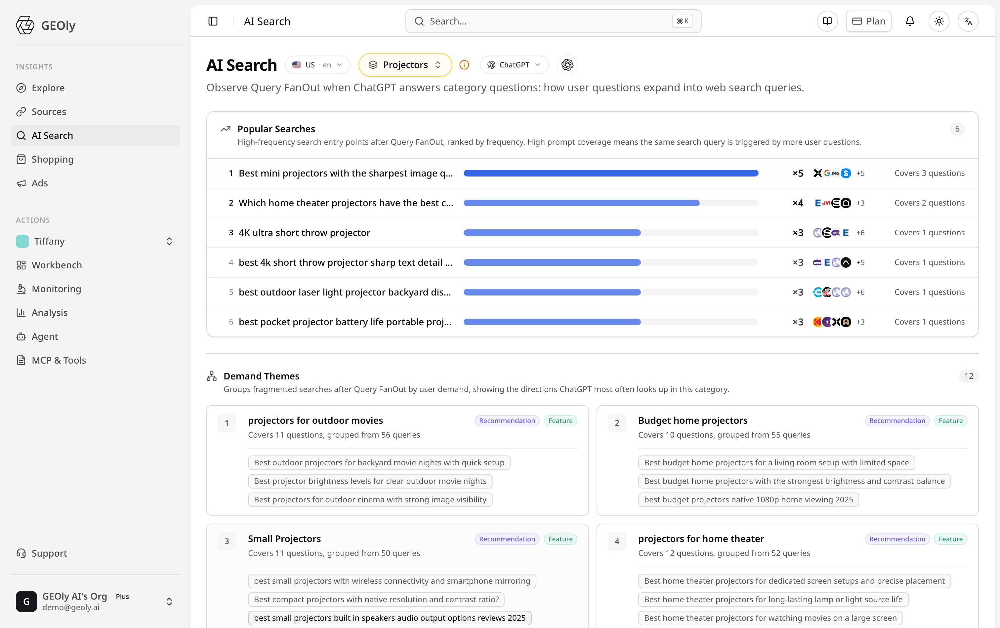
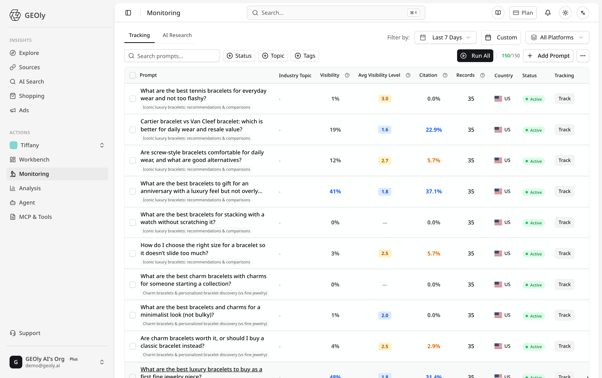
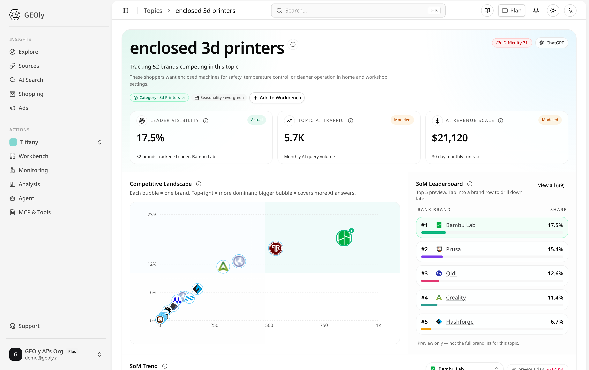
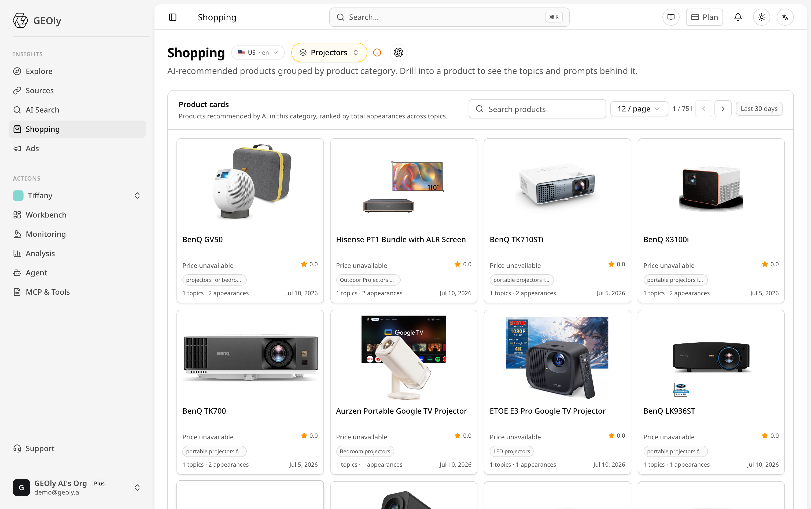
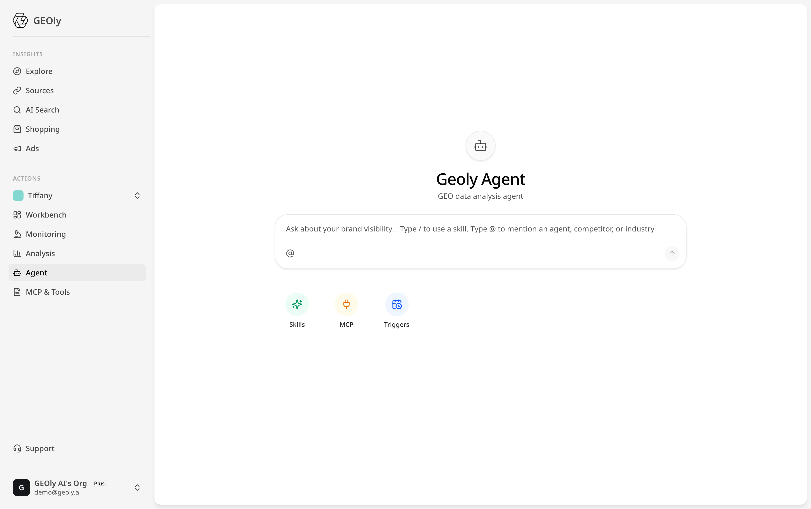

GEOly is a Generative Engine Optimization platform for understanding how AI systems discover, describe, cite, and recommend brands and products. The current workspace separates public research in **Insights** from monitored brand work in **Actions**.

Use this guide to find the right screen, understand the main signals, and move from an AI-search observation to a concrete follow-up.

**The visible data, filters, engines, and actions depend on your organization and account access.**

## Step 1: Understand the current workspace

The left navigation is organized into two areas:

| Area | Screens | Use it to |
| --- | --- | --- |
| **Insights** | Explore, Sources, AI Search, Shopping, Ads | Research public AI-search demand, sources, products, and ads by country, language, platform, category, Topic, brand, or product. |
| **Actions** | Your brand workspace, Workbench, Monitoring, Analysis, Agent, MCP & Tools | Monitor your configured Prompts, analyze brand visibility, investigate competitors, and use GEOly's operational tools. |

The top bar keeps search, plan, notifications, appearance, and language controls available across the workspace. Your selected brand appears in the Actions section.

## Step 2: Research public AI demand

Use **Insights → Explore** to browse public categories, Topics, and brands. Choose the market and AI platform, then search or open an entity to see the available public dataset.

Use **Insights → AI Search** to inspect Query Fan-out: how an AI platform expands a category question into web-search queries and groups them into demand themes.

Public results describe GEOly's collected dataset for the selected scope. They are not complete market coverage, user search logs, first-party analytics, or proof of traffic or conversion.

## Step 3: Set up monitoring and read brand visibility

Use **Actions → Monitoring** to manage the questions GEOly runs for the current brand. A Prompt should be a complete natural-language question that reflects a real discovery, comparison, purchase, or use-case scenario.

The Monitoring table lets you search and filter Prompts, review visibility, average visibility level, citation, records, country, status, and tracking state. Use **Add Prompt** to create a question, and use **Run All** only when you intend to run the configured monitoring set.

Use **Actions → Analysis** to review the selected brand's monitored results. The dashboard includes:

- **AIGVR:** the visibility score shown for the selected monitored scope.
- **Mention Rate:** how often the brand is mentioned in the completed answer set.
- **Visibility Level:** the average position or level shown for the selected scope.
- **Mentions:** the number of brand mentions in the selected result set.
- **Share of Voice:** the brand's relative share among brands detected in the monitored answers.

Keep the date range, AI platform, and other filters visible when comparing periods. These signals describe the selected monitored dataset; they are not traffic, revenue, conversion, or causal-impact metrics.

## Step 4: Compare category competition and AI shopping

Use category and Topic views to understand where competing brands appear and which questions create the largest opportunities.

A competitive landscape shows the category leader, modeled AI traffic, modeled revenue scale, brand positions, and the Share-of-Model leaderboard when those values are available. Treat modeled values as directional estimates and check the selected Topic and date range before using them.

Use **Insights → Shopping** to inspect AI-recommended product cards by category. Open a product to review the Topics and Prompts behind its appearances when those records are available.

Product appearances, positions, prices, ratings, and card shares are observations from the selected AI-shopping scope. They are not authoritative catalog facts, inventory, orders, revenue, or guaranteed rankings.

## Step 5: Turn findings into action

Use **Actions → Agent** to ask questions about brand visibility and use available GEOly skills, MCP connections, and triggers. The Agent is a workspace for investigation; verify important claims against the original answer, filters, source, and data scope before taking action.

A practical workflow is:

1. Start in **Explore** or **AI Search** to identify a category, Topic, source, product, or demand theme.
2. Turn a high-value scenario into a stable Prompt in **Monitoring**.
3. Read the completed records in **Analysis** with a consistent date range and platform filter.
4. Compare the brand with competitors using Share of Voice, Share of Model, citations, and the underlying answers.
5. Record the observation, evidence, next action, and filter scope so the result can be checked again.

## What's next?

- [Create your GEOly account](/get-started/register-account) if you are new to the platform.
- Start with [Explore](/analytics/ai-engine-explore) to learn the public dataset.
- Add a small set of high-value Prompts before expanding monitoring coverage.
- Review source pages and original AI answers before changing content, product information, or distribution.
- Recheck the same scope after a change; AI visibility can vary by platform, country, language, Topic, and date range.

GEOly helps you observe and improve how AI systems understand your brand. It does not guarantee that any AI platform will mention, cite, recommend, or rank a brand.
