**Quantify the brand's visibility in AI search and drive enterprise growth in the generative ecosystem.**

## Why do brands need GEOly?

In the era of AI-driven search, traditional SEO rankings are no longer the sole indicator of success. Brands are facing a brand-new challenge:

- **Black Box Challenge:** How do AI assistants such as ChatGPT, Gemini, Grok, Perplexity, and Google AI describe your brand to users?
- **Visibility Maze:** How can teams quantify brand mentions, citations, ranking position, and platform-level performance in AI-generated answers?
- **Cognitive Bias:** Is AI answering with outdated, incomplete, or competitor-led information when users ask about your brand?

> **GEOly** transforms these vague AI evaluations into clear, quantifiable, and actionable business growth drivers.

## 1. Register Account

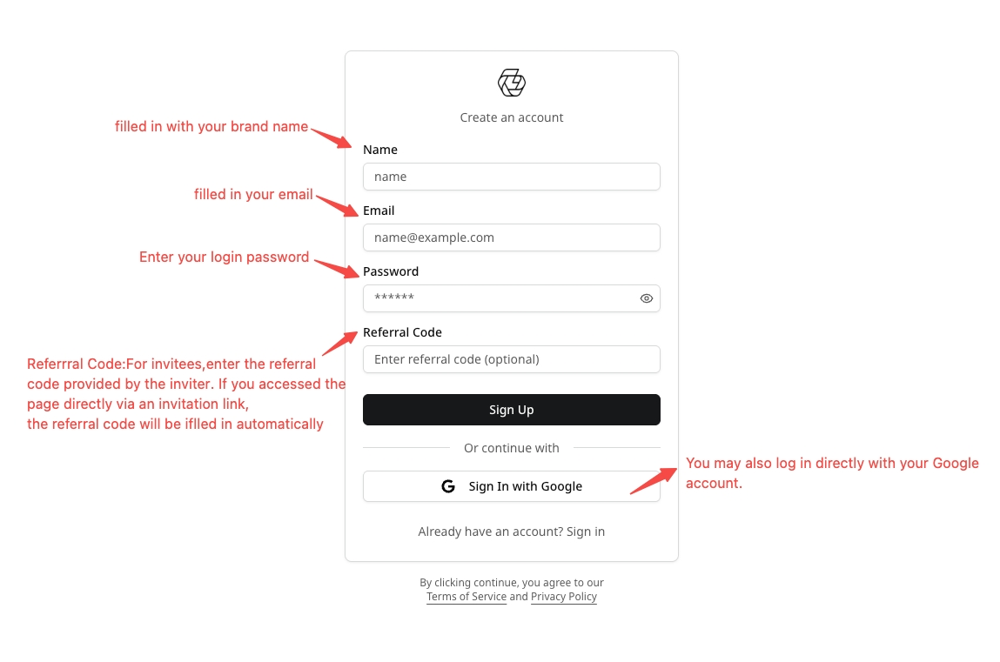

**Referral Code Source**: Provided by an existing **GEOly** user. You can find your referral details by clicking the icon in the bottom-left corner.

## 2. Core Functional Module: Comprehensive Control of the AI Ecosystem

### 1. Full-dimensional Visualization Dashboard

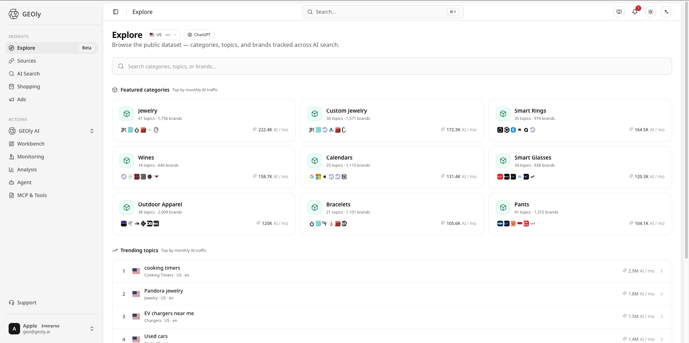

- **AIGVR (AI-Generated Visibility Rating):** GEOly's headline 0-100 visibility score. It combines whether the brand is mentioned, where it appears in the AI answer, how frequently it appears, and whether the answer cites a brand-owned URL. Sentiment is analyzed separately.
- **Mention Rate:** The share of completed AI monitoring records in which the brand is mentioned. It represents the brand's presence in AI-generated answers.
- **Citation Rate:** The share of completed monitoring records in which AI cites a brand-owned URL, such as the official website or other owned content. This should not be confused with general mentions or third-party citation URL counts.
- **Mainstream AI platform coverage:** Supports monitoring and comparison across platforms such as ChatGPT, Gemini, Perplexity, Grok, and Google AI.
- **AI visibility map:** Organizes brand visibility, competitor performance, topic coverage, and citation sources so teams can see where the brand is strong or underrepresented.

### 2. Industry Intelligence

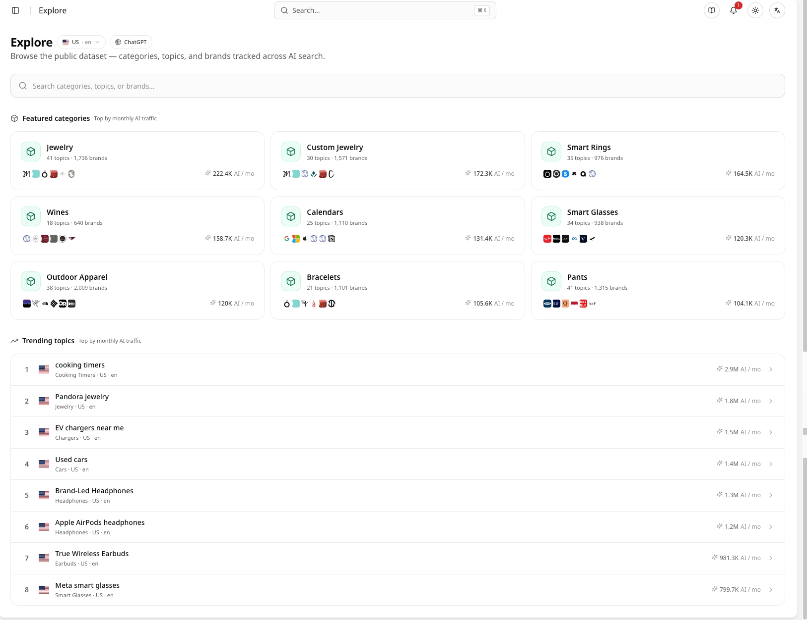

### Industry Benchmark and Performance

This module presents the macro benchmark data of this vertical industry in the AI environment.

- **AI Visibility:** Compare brand/category visibility in public AI-search datasets where industry data is available.
- **Industry AI query signals:** Analyze public topic and search-query data to understand what users ask AI in a category.
- **Commercial-intent signals:** For shopping-related topics, review shopping activation, price ranges, retail channels, and recurring product cards where data is available.

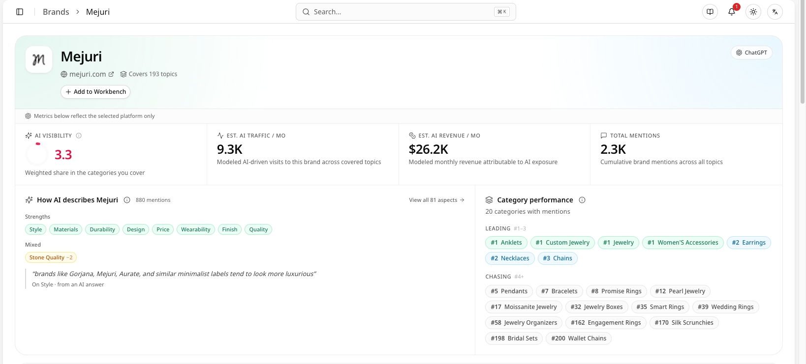

### Competition Landscape and Market Share

This module compares a brand with tracked competitors and public category leaders using the same measurement window and platform filters.

- **Competitive comparison:** Compare visibility, mention rate, citation performance, and per-platform performance across brands.
- **SoM (Share of Model):** Shows a brand's relative share of visibility compared with tracked competitors. It is a competitor-comparison metric, not the same as the headline AIGVR score.
- **Visibility trend:** Track how brand and competitor visibility changes over selected time ranges and AI platforms.

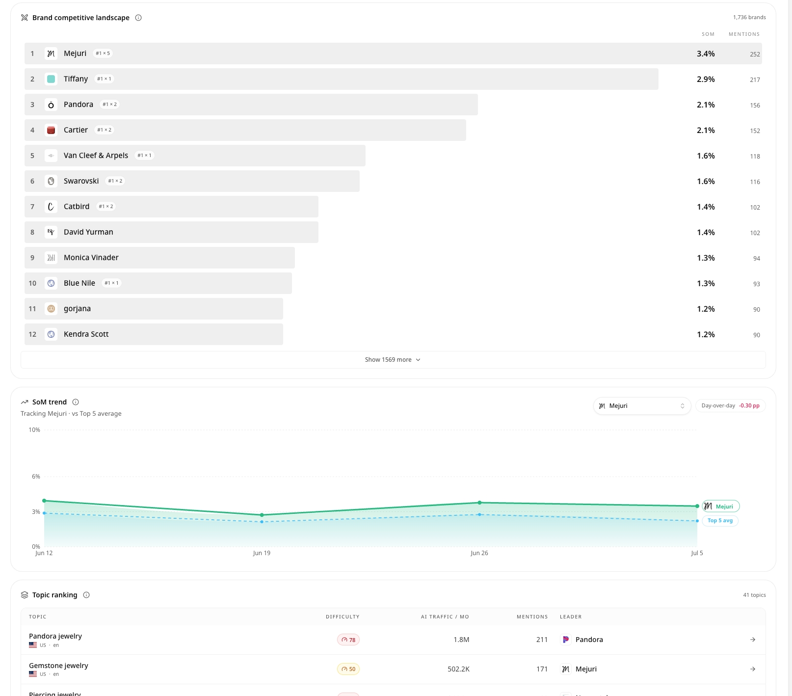

### Topic Coverage Matrix

Specific business sub-topics under this module identify the penetration depth of brands in different battlefields.

- **Topic analytics:** Review each monitored topic's visibility, sentiment, competitor presence, response types, platform distribution, and trend changes.
- **Strength topics:** Identify topics where the brand already has strong AI visibility or favorable sentiment.
- **Opportunity topics:** Identify high-value topics where the brand is underrepresented or competitors are stronger.

### 3. AI Business Insights

This module focuses on the analysis of conversion intention of AI in the shopping process.

- **Shopping Activation Rate:** Measures how often AI responses in a public topic show shopping or product-recommendation intent where commerce data is available.
- **Price statistics:** Tracks median price and price-band distribution in recurring AI shopping or product recommendations.
- **Retail channel distribution:** Identifies the domains or channels AI most often points users to for shopping-related answers.
- **Recurring product cards:** Surfaces products that repeatedly appear in AI shopping results, with product/card details where available.

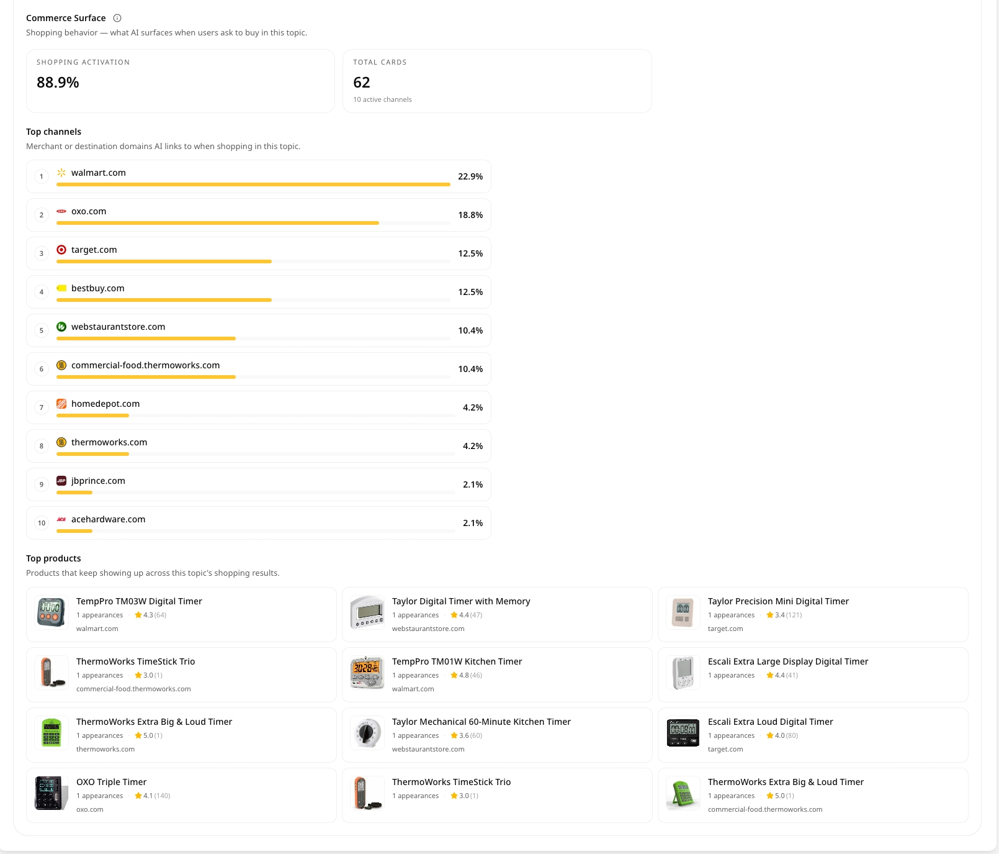

### 4. Prompt Monitoring

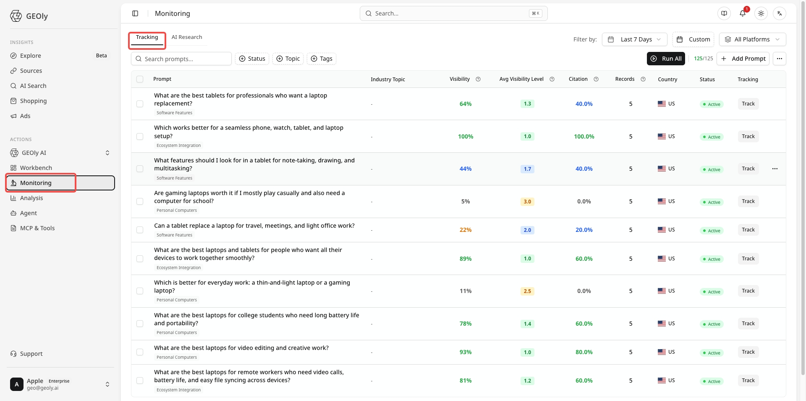

Explore users' real AI-search scenarios and track how a brand performs in monitored AI responses across configured prompts, platforms, and time ranges.

### Refined prompt monitoring

- **Multi-dimensional scenario coverage:** Track AI responses for prompts such as brand definitions, core functions, competitor comparisons, and user pain points.
- **Execution record tracking:** Record completed monitoring runs by prompt and platform so teams can interpret trends using the right data volume.

### Real-time execution logs and rankings

- **Multi-platform response comparison:** Compare answer content, ranking position, mentions, and citations across ChatGPT, Grok, Google AI, Perplexity, and Gemini for the same prompt.
- **Answer summary preview:** Retrieve monitored answer snippets so teams can check whether the AI narrative matches the intended brand positioning.

### Visibility Score and Trend Analysis (Visibility Analysis)

- **Prompt visibility score:** For each prompt, GEOly reports prompt-level visibility using mention, ranking position, frequency, and citation signals.
- **Platform performance trend:** Track prompt or brand visibility changes across selected time ranges.
- **Platform breakdown:** Compare how different AI platforms mention, cite, and rank the brand to identify platform-specific blind spots.

### Reference Source

- **Traceability Analysis:** Track the information sources (such as Reddit, Amazon, or official websites) when AI answers, and display the distribution of cited sources in the form of icons.
- **Optimization Intervention Basis:** By analyzing third-party platforms frequently referenced by AI, identify and optimize key external content that influences AI decision-making.

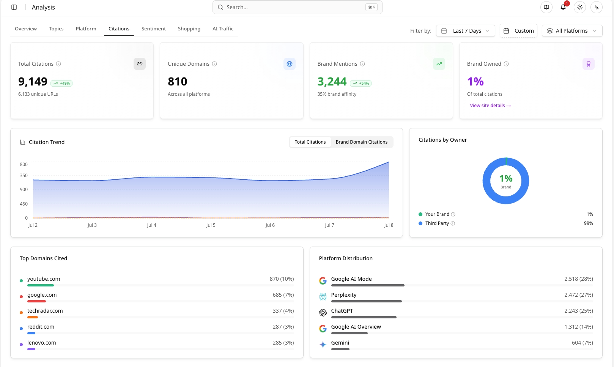

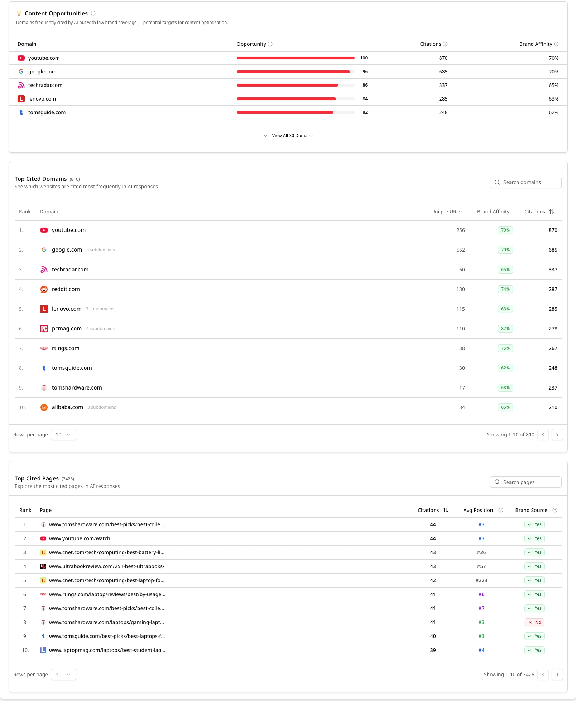

## 3. AI Prompt Research & Configuration
### 1. Domain-driven Automatic Research Configuration

- **Domain and brand setup:** Configure the brand domain and monitoring scope so prompts match the business being measured.
- **Prompt and topic organization:** Organize monitoring around topics, categories, priority, tags, and market/country settings where available.

### 2. Globalization Monitoring Environment Preset

- **Cross-language coverage support:** Configure country and language context where supported so monitoring reflects the target market.
- **Multi-region monitoring:** Use monitoring country/locale settings to compare how AI answers differ across markets.

### 3. Intelligent Seed Word Mining and Expansion

- **AI recommendation assistance:** Use recommendation flows to expand seed terms into practical prompt ideas.
- **Long-tail prompt expansion:** Build monitoring prompts around related terms, comparison questions, and user-intent variants.

### 4. Prompt Strategies

- **Brand visibility monitoring:** Create prompts that measure how often and how prominently AI mentions the brand.
- **Evaluation & comparison:** Use comparison prompts to understand decision-stage answers and competitor positioning.
- **Citations & reporting:** Use citation-focused prompts and reports to trace sources and quantify GEO performance.

## 4. Citation Monitoring (Citations)

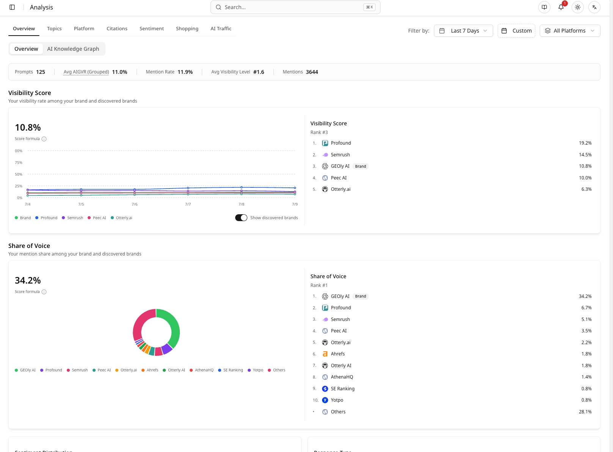
This module tracks and analyzes the underlying data sources referenced when large language models generate responses.

### Core Scale and Brand Voice

- **Citation scale:** Monitor total cited URLs and distinct cited domains over a selected time range.
- **Owned-source share:** Separate brand-owned citations from third-party and competitor sources. Citation analytics count referenced URLs/domains and should not be confused with mention rate.
- **Reference trend chart:** Monitor citation changes over time and by platform.

### Analysis of Source Attributes and Distribution

- **Source classification:** Classify citation sources as brand-owned domains, third-party platforms, competitors, or other source types where available.
- **Multi-platform citation preferences:** Compare which domains and pages different AI platforms cite.
- **Information source distribution:** Show the balance between owned sources and third-party sources.

### Page-level deep penetration

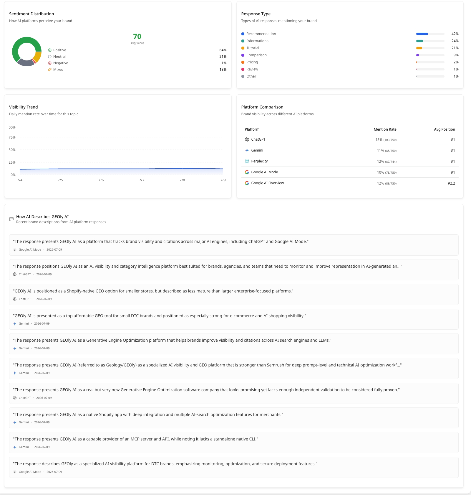

- **Referenced domain ranking:** Lists the domains with the highest citation counts.
- **Precise URL audit:** Analyzes specific pages most often cited by AI and shows trend, prompt distribution, and supporting snippets.
- **Page-level follow-up:** Use page and domain detail views to identify which pages are cited, where citations are missing, and what content gaps to address.

## 5. Sentiment Analysis (Sentiment)

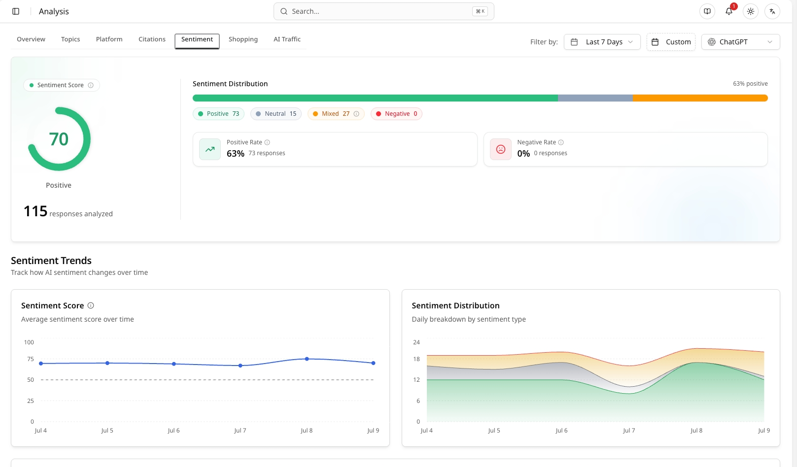

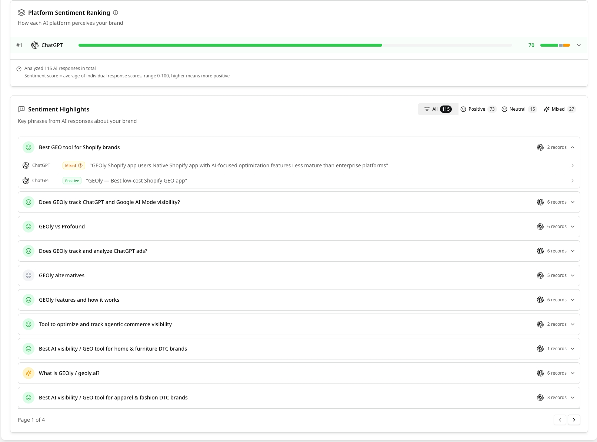

### Brand Reputation Overview (Sentiment Overview)

- **Sentiment overview:** Shows average sentiment and the distribution of positive, neutral, mixed, negative, and unknown responses.
- **Scored response analysis:** Uses scored AI answers to summarize how positively or negatively the brand is described.

### Dynamic Trend Monitoring (Sentiment Trends)

- **Average score trend:** Track how sentiment changes after public-relations events, product updates, or content changes.
- **Daily sentiment distribution:** Monitor the mix of positive, neutral, mixed, and negative answers over time.

### Cross-platform sentiment comparison

- **Model sentiment comparison:** Compare sentiment performance across AI platforms.
- **Platform segmentation:** Identify platform-specific differences in how AI describes the brand.

## 6. Explore, AI Search, and Sources: turn public AI activity into a researchable market map

The **Insights** routes use GEOly's public industry dataset. Use them to study categories, topics, brands, AI-search behavior, and commerce signals in the selected market. They are different from **Monitoring** and **Analysis**, which use the prompts and records configured for your own brand workspace.

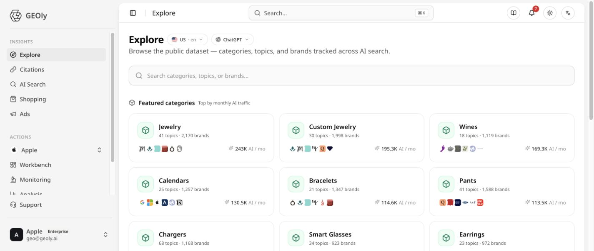

### 1. Explore: start with a category, topic, or public brand

Explore is the entry point for public AI-search research. Select the market and AI platform, then browse categories, trending topics, and public brands tracked in the dataset.

Use it to answer questions such as:

- Which categories and topics have the most AI-search activity in this market?
- Which brands appear most often for a topic?
- Which topic should be investigated before building a campaign, content brief, or competitor review?

The figures on this surface describe the currently available public dataset for the selected scope. They are directional research signals, not first-party traffic, revenue, or conversion reporting.

### 2. AI Search: inspect Query FanOut, demand themes, and competitive presence

The **AI Search** page shows how ChatGPT expands category questions into web-search queries. It groups high-frequency search entry points and related demand themes, and shows the brands that appear around those queries.

This helps a team move from a broad category to concrete research hypotheses:

1. Select the market, category, and available AI platform.
2. Review **Popular Searches** to find frequent Query FanOut search entry points and their question coverage.
3. Open **Demand Themes** to see fragmented searches grouped by user need, such as recommendation, feature, or comparison intent.
4. Compare the brands that appear in a query or theme, then turn the finding into a content, product, or competitive research task.

A frequent query or a visible brand is evidence of activity in this public AI-search scope. It does not by itself prove ranking, paid spend, clicks, or commercial impact.

### 3. Sources and citations: inspect the evidence behind AI answers

The **Citations** route helps researchers review the pages and domains AI answers reference. Use it alongside Explore and AI Search to distinguish a brand's appearance from the sources supporting that appearance.

A practical workflow is to identify a topic in Explore, study its search expansion in AI Search, then review cited domains and URLs in Citations. This can reveal candidate source gaps, but it should be validated against first-party analytics and the brand's own monitoring before making an operational decision.

## 7. Shopping: product detail, competitive shelves, and retail channels

The **Shopping** page groups AI-recommended products by category. Product cards show the item, observed price when available, related topic, appearance count, and recency. Opening a product lets you trace it back to the topics and prompts behind the recommendation.

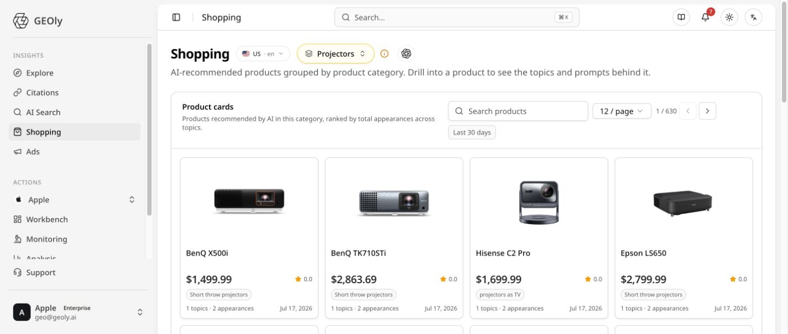

Use Shopping to investigate:

- **Product cards:** Which products recur in AI recommendations for a category?
- **Recommendation context:** Which topics and prompts contribute to a product's observed appearances?
- **Competitive shelf:** Which brands and product types are visible together in the same category?
- **Retail channels:** Which retail domains AI most frequently links to in the selected scope?
- **Price signals:** What price points or price availability are observed on recommended product cards?

Shopping data is an observation of the selected public dataset and time window. An appearance count or channel share is not an ad impression, sales count, conversion rate, inventory signal, or proof that a retailer controls a recommendation.

## 8. Agent

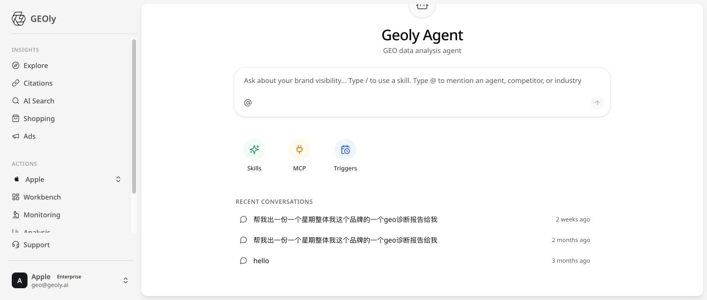

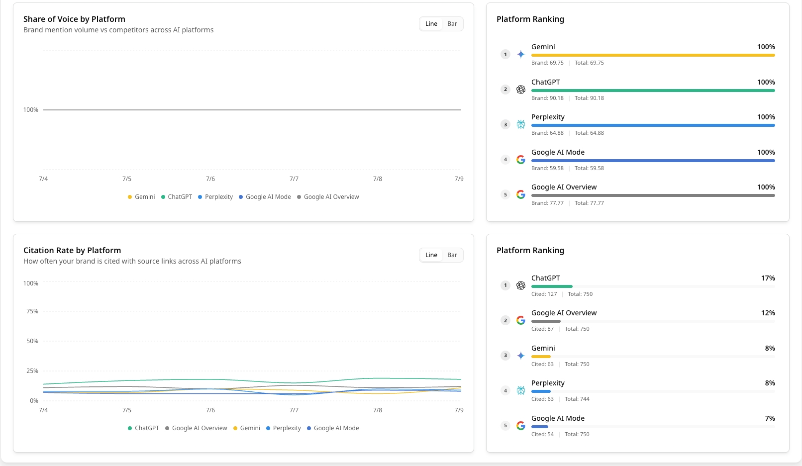

### **Geoly Diagnostic Report**

- **Positioning:** High-level diagnostic workflow for brand AI visibility.
- **Function Description:** Summarizes headline AIGVR, mention rate, citation rate, prompt performance, competitors, sentiment, citation sources, audits, and GA4 data where integrations are enabled.
- **Instructions for Use:** Use when a complete written diagnosis is required.

### **Geoly Agent**

- **Positioning:** GEO monitoring data analysis assistant.
- **Function Description:** Helps interpret GEOly data such as prompt performance, AIGVR, SoM, citation sources, sentiment, competitors, and platform trends.
- **Instructions for Use:** Suitable for daily operations and continuous follow-up questions.

### **Comparison of Competing Product AI Recommendations**

- **Positioning:** Competitive AI visibility analyst.
- **Function Description:** Compares the brand with tracked competitors using visibility, SoM, mention rate, citations, and per-platform performance.
- **Instructions for Use:** Applicable for presenting recommendation landscapes to clients or internal teams.

### **Comparison of AI Platform Performance**

- **Positioning:** Platform performance analyst.
- **Function Description:** Reads visibility, mention, citation, ranking, and sentiment signals by platform to identify best- and weakest-performing AI channels.
- **Instructions for Use:** Useful for formulating platform-specific content strategies.

### **AI Optimization Action Plan**

- **Positioning:** Strategy and task planner.
- **Function Description:** Turns blind spots, low citation coverage, weak topics, sentiment risks, and audit issues into prioritized recommendations with objectives and metrics.
- **Instructions for Use:** Applicable to implementation planning, quarterly reviews, or aligning with execution teams.

### **Brand AI Visibility Assessment**

- **Positioning:** Global performance assessor.
- **Function Description:** Aggregates AIGVR, mention rate, citation rate, SoM, platform performance, and trend signals into a readable summary overview.
- **Instructions for Use:** Suitable for one-page overall conclusions for management or clients.

### **AI Citation Source Analysis**

- **Positioning:** Citation structure researcher.
- **Function Description:** Classifies owned, third-party, community, media, and competitor citation sources and evaluates citation structure health and risk.
- **Instructions for Use:** Guidance for content, SEO, PR placement, and external source-building strategy.

### **AI Website Exploration**

- **Positioning:** AI-readiness and site audit assistant.
- **Function Description:** Uses audit and Agent Readiness signals to evaluate accessibility, structured data, content structure, and trust signals from an AI-search perspective.
- **Instructions for Use:** Pre- and post-launch evaluation of website AI-friendliness.

## 9. GA4 Access Tutorial

For GA4 traffic and page-level analysis, connect a GA4 property in GEOly. For a detailed setup tutorial, refer to: [GA4 tutorial](/integrations/google-analytics-help-docs)
