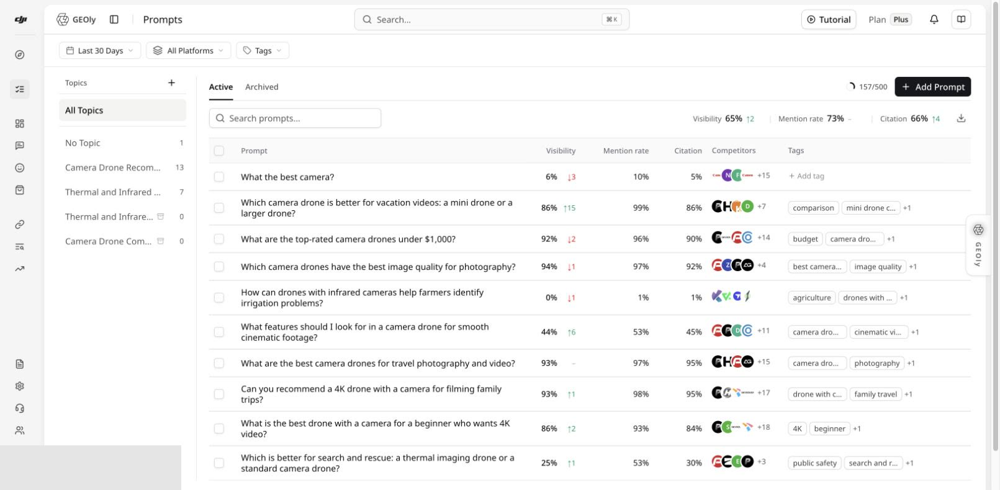
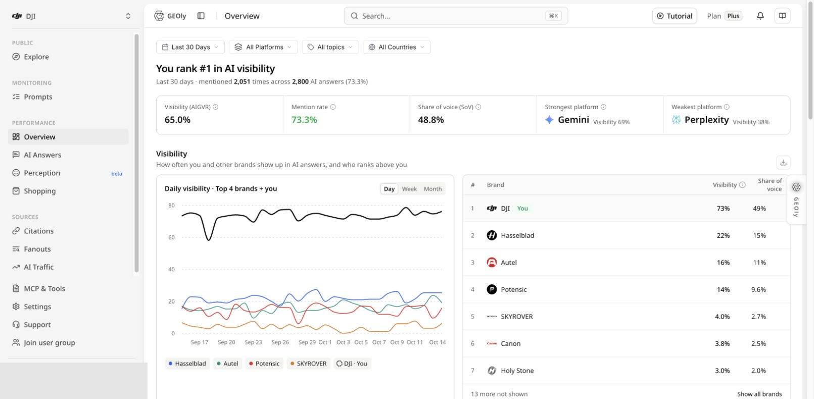

Open [GEOly registration](https://app.geoly.ai/auth/register) to create an account. GEOly currently offers three registration paths:

- **Sign Up with Google**
- **Sign Up with GitHub**
- **Email registration** with your name, work email address, and password

The exact next screen depends on the registration method, verification settings, invitation link, and account state.

## Before you register

Prepare the following:

- A **work email address** for email registration. GEOly does not accept personal consumer email domains for the email sign-up form.
- Access to the Google or GitHub account you want to connect, if you use social sign-up.
- An invitation link if a teammate or agency invited you to an organization.
- A referral code only if someone gave you one. Referral codes attribute the registration; they do not grant access to an organization, brand, or private data.

## Create your account

1. Open [GEOly registration](https://app.geoly.ai/auth/register).
2. Choose one of the available registration methods:
   - **Google or GitHub:** select the provider and complete its authorization flow.
   - **Email:** enter your name, work email address, and password. The referral-code field is optional.
4. Submit the form.
5. If GEOly asks you to verify your email, open the verification message and click its link. Check your spam or junk folder if it does not arrive.
6. Return to GEOly and sign in if the verification flow does not redirect you automatically.

Do not repeatedly submit the form while the verification email is still in transit. If you request another verification email, use the newest message.

## If you received an organization invitation

Open the original invitation link before registering or signing in. That link carries the organization context and is different from a referral link.

After you join:

1. Confirm the active organization in the organization switcher.
2. Confirm which brand is selected.
3. Check your role before changing brand settings or monitoring configuration.
4. If the invitation opens the wrong account or organization, return to the original invitation link or ask the sender to resend it. Do not enter a referral code as a substitute for an organization invitation.

## Complete the first setup

If you registered without an invitation, follow the setup screens shown for your account. If you were invited, the organization and brand may already be available.

After signing in:

1. Check the active organization and brand.
2. Open **Settings → Brand** and confirm the website and matching brand terms.
3. Go to **Monitoring → Prompts** and add questions that customers may ask AI systems. Organize them by topic and wait for monitoring to finish.
4. Open **Performance → Overview** to review visibility, mention, citation, competitor, platform, and original-answer evidence.

A newly added Prompt is not itself a completed AI answer. Wait for completed records before interpreting a score or trend.

## What the follow-up workflow looks like

The following screenshots show the next steps after sign-in. They are not screenshots of the registration form, and their example data is illustrative.

For a deeper walkthrough, see [What's the GEOly?](/get-started/geoly-platform), [Prompts](/analytics/geoly-prompts), and [Performance Overview](/analytics/performance).

## Troubleshooting

### The email form rejects my address

Use a company or work email address. If you need to use a Google or GitHub identity, return to the registration page and choose that provider instead.

### I did not receive the verification email

Check spam or junk, confirm that the address is correct, wait a few minutes, and request a new verification email only after checking the original inbox. Use the newest verification message.

### I already have an account

Use the sign-in link on the registration page instead of creating a second account. If you originally used Google or GitHub, use the same provider when possible.

### I joined the wrong organization

Switch to the intended organization if your account has access to more than one. Otherwise, ask the invitation sender or organization administrator to check the invitation and your membership.

### The workspace has no Prompt records

Confirm the active organization, brand, Prompt status, platform and date range. A saved Prompt may still be waiting for monitoring, and an empty result is not proof that the brand was not mentioned.

## Need help?

For account or invitation problems, contact [hello@geoly.ai](mailto:hello@geoly.ai). Include the page or step where the problem occurred, but never include your password, access token, or verification-link contents.
