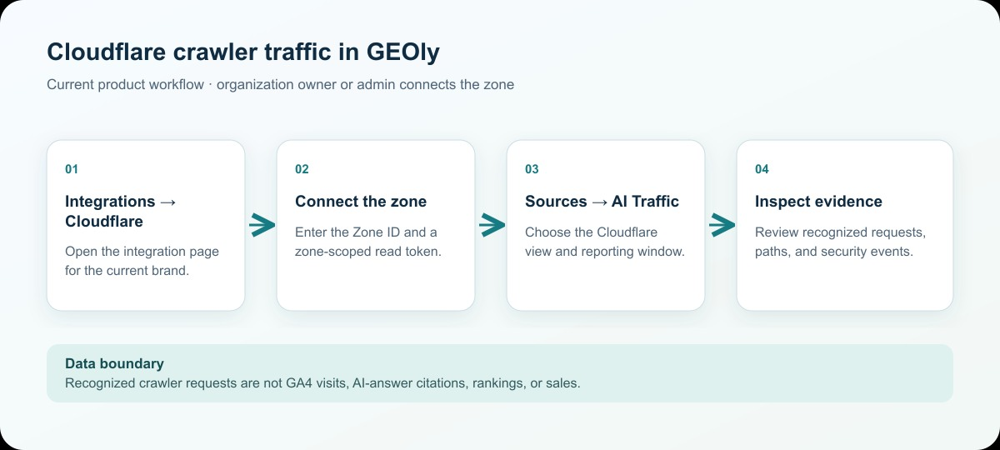

Connect a Cloudflare zone to GEOly to inspect AI crawler requests recorded for your site. This report concerns server-side requests identified by their User-Agent. It is separate from GA4 referral sessions and from GEOly's monitoring of AI answers.

## Connect a Cloudflare zone

1. Open **Integrations → Cloudflare** for the brand whose site you want to inspect. An owner or admin of that brand's organization must make or remove this connection.
2. In the Cloudflare Dashboard, open the target website and copy its **Zone ID** from the Overview page. Under **My Profile → API Tokens**, create a custom, zone-scoped token with the read permissions needed for zone analytics and security events. Copy the token when Cloudflare displays it and store it securely; do not place it in this article or a support screenshot.
3. Enter the Zone ID and API token in GEOly. GEOly verifies access before saving the connection. If verification fails, check the selected zone, token scope, permissions, and whether the token has been revoked.
4. Open **Sources → AI Traffic**, then choose the **Cloudflare** view. The integration page also shows the connected Zone ID and lets an authorized owner or admin disconnect it.

This is the current GEOly navigation. Older instructions that start at “Agent Analytics → Platform Settings” no longer describe the current interface.

This illustration explains the workflow; it is not an application screenshot.

## Choose the reporting scope

Select the available 7-day, 30-day, 90-day, or custom date window. Longer windows may be unavailable when the connected Cloudflare zone's analytics retention is shorter. Where the comparison control is available, keep the date window and comparison mode consistent before interpreting a change.

Use the crawler selector to focus on a recognized crawler, or leave it unfiltered to inspect the recognized set. A filtered view is not a count of all traffic to the site.

## Read the report

The Cloudflare view can show recognized AI crawler requests, the crawlers identified in the selected window, request trends, commonly crawled paths, country distribution, and detected security events. A blocked-event section may be unavailable even when request analytics loads successfully; treat that as an incomplete report, not as proof that no event occurred.

To investigate a path, compare its request count and crawler mix with the selected window, then check the actual page content and Cloudflare rules. Use the security-event details to distinguish a recorded block or challenge from an ordinary request. Cloudflare request volume is not a count of unique visitors, completed page reads, or AI answers.

## Identification and data boundaries

GEOly currently maps known User-Agent strings to ChatGPT, Claude, Perplexity, Gemini, Cohere, and Grok crawler groups. Unknown, changed, or spoofed User-Agent strings may not be classified. A missing crawler therefore does not prove that the service never accessed the site. The result also depends on Cloudflare's available analytics, the selected zone and date window, token permissions, and the relevant plan's data retention.

Cloudflare AI crawler requests must not be equated with:

- **GA4 AI referral sessions:** visits attributed to AI sources after people reach the site;
- **GEOly Monitoring and Performance:** what sampled AI answers mention, cite, or recommend;
- **Traffic, conversions, or revenue:** business outcomes that require first-party analytics and transaction data.

Use the report to decide whether a page or rule needs investigation, then validate the hypothesis with Cloudflare logs, the page itself, GA4, and GEOly's answer evidence. Do not infer a ranking, citation, sale, or causal lift from a crawler request alone.

## Troubleshooting

- **No data after connection:** Check the zone, token permissions, selected window, Cloudflare retention, and whether recognized crawler activity exists. There is no guaranteed fixed synchronization delay.
- **A crawler is missing:** The User-Agent may be unknown or changed, or the request may be outside the selected scope. Absence is not proof that the crawler never visited.
- **Blocked events are missing:** Request analytics and security-event data have separate availability and permission paths. A missing section is not proof that no blocking occurred.
- **Website performance:** GEOly reads Cloudflare's backend analytics API; this connection does not add a frontend script to the site.
