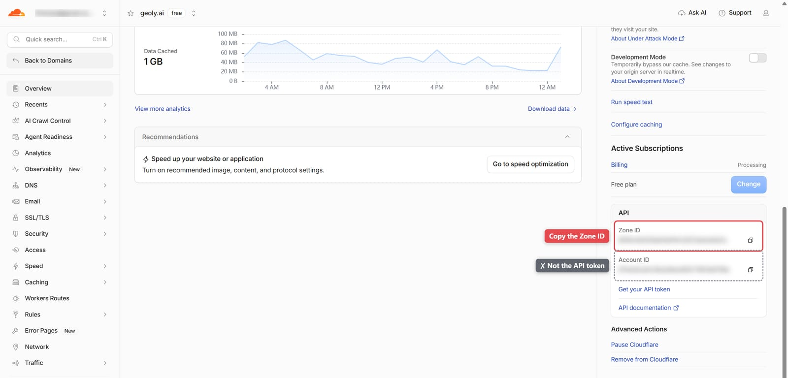
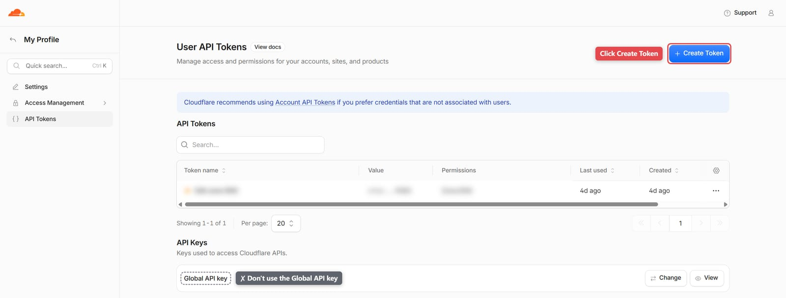
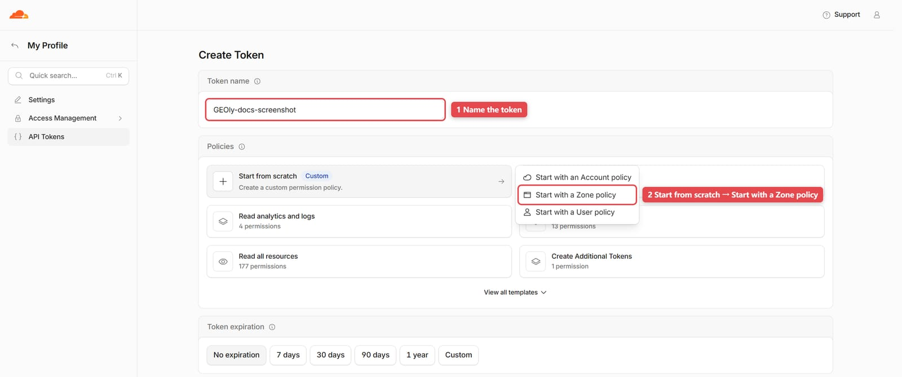
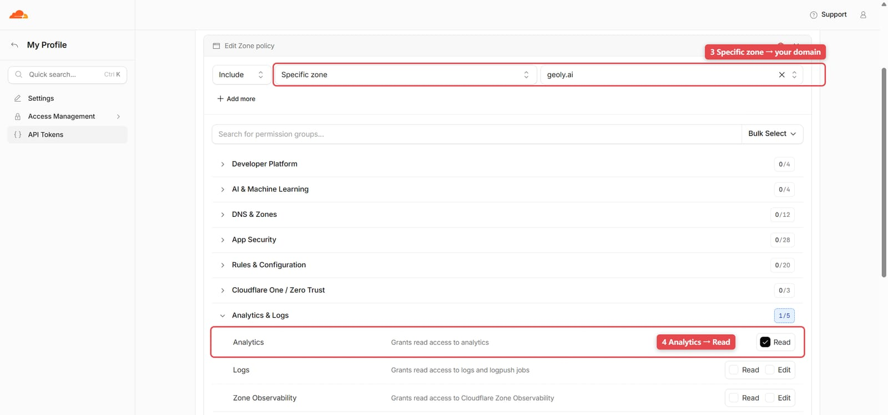
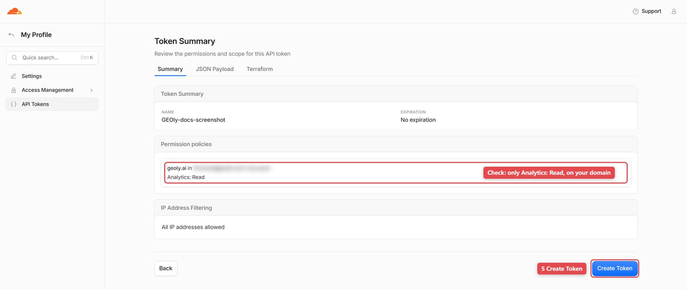
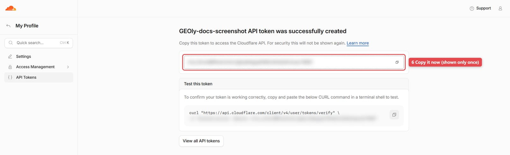
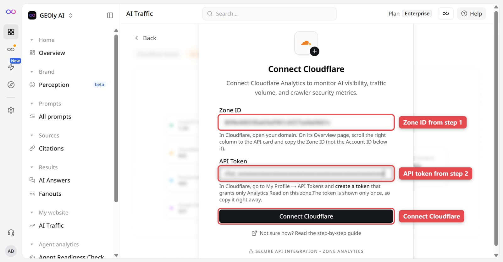

Connect a Cloudflare zone to GEOly to inspect AI crawler requests recorded for your site. This report concerns server-side requests identified by their User-Agent. It is separate from GA4 referral sessions and from GEOly's monitoring of AI answers.

## Before you start

Make sure that:

- You are an owner or admin of the organization that owns the current brand.
- The website's domain is on Cloudflare, and you can sign in to the Cloudflare account that holds it.

You need two values:

| GEOly field | What it is | Where to find it in Cloudflare |
| --- | --- | --- |
| **Zone ID** | The domain's Zone ID, a 32-character string | The **API** card on the domain's **Overview** page |
| **API Token** | A read-only API token you create for GEOly | **My Profile → API Tokens** |

<Warning>
The **API** card shows two similar 32-character IDs: **Zone ID** and **Account ID**. The Account ID is not an API token, and pasting it into the API Token field always fails. Create a separate API token as described in step 2 below. Don't use the Global API Key either.
</Warning>

## Step 1: Copy the Zone ID

1. Sign in to the [Cloudflare dashboard](https://dash.cloudflare.com/) and open the domain you want to connect.
2. On the domain's **Overview** page, scroll down the right-hand column to the **API** card.
3. Click the copy button next to **Zone ID**. You don't need the **Account ID** below it.

The Zone ID must belong to the domain you want to analyze. Each domain has its own Zone ID.

## Step 2: Create an API token

1. Open [My Profile → API Tokens](https://dash.cloudflare.com/profile/api-tokens) (or click **Get your API token** in the **API** card), then click **Create Token** in the top-right corner. Don't use the **Global API key** further down the page.

   

2. Under **Token name**, enter a name you'll recognize, such as `GEOly`. Under **Policies**, click **Start from scratch**, then choose **Start with a Zone policy** from the menu.

   

3. In the policy editor:

   - Resources: set the second dropdown to **Specific zone** and the third to the domain you want to connect.
   - Permissions: expand **Analytics & Logs** and check **Read** on the **Analytics** row. Leave every other permission unchecked.

   Leave **Token expiration** and **Client IP address filtering** at their defaults, then click **Continue to summary** at the bottom of the page.

   

4. On the **Token Summary** page, check that the policy lists only your domain and **Analytics: Read**, then click **Create Token**.

   

5. Copy the token shown on the page (a long string starting with `cfut_`). **Cloudflare shows it only once.** If you leave the page before copying it, delete the token and create a new one.

   

**Analytics Read** is the only permission GEOly needs. It covers the connection check and the request and security-event data GEOly reads afterwards (verified November 2026). Don't grant the token access to all zones, and don't paste it into chats, screenshots, or support tickets. If you set an expiration date, GEOly stops receiving data when the token expires; create a new token and connect again.

## Step 3: Connect in GEOly

1. Check that the brand selected in the top-left corner is the right one. The Cloudflare connection belongs to the current brand.
2. Open the Cloudflare connect page. If no data source is connected yet, go to **My website → AI Traffic** and click **Connect now** on the Cloudflare card. If you already connected another source such as GA4, click **Connect Cloudflare in Integrations** on the **Platform Settings** tab of the same page. You can also open `app.geoly.ai/integrations/cloudflare` directly.
3. Paste the Zone ID from step 1 into **Zone ID**, and the token from step 2 into **API Token**.
4. Click **Connect Cloudflare**. After the check passes, GEOly opens the Cloudflare view of **AI Traffic**.

The connect page also shows where to find each value and links back to this guide. If the connection fails, follow the message and see **Troubleshooting** below. To disconnect later, open `app.geoly.ai/integrations/cloudflare`, click **Disconnect**, and delete the token on the Cloudflare **API Tokens** page.

## Choose the reporting scope

Select the available 7-day, 30-day, 90-day, or custom date window. Longer windows may be unavailable when the connected Cloudflare zone's analytics retention is shorter. Where the comparison control is available, keep the date window and comparison mode consistent before interpreting a change.

Use the crawler selector to focus on a recognized crawler, or leave it unfiltered to inspect the recognized set. A filtered view is not a count of all traffic to the site.

## Read the report

The Cloudflare view can show recognized AI crawler requests, the crawlers identified in the selected window, request trends, commonly crawled paths, country distribution, and detected security events. A blocked-event section may be unavailable even when request analytics loads successfully; treat that as an incomplete report, not as proof that no event occurred.

To investigate a path, compare its request count and crawler mix with the selected window, then check the actual page content and Cloudflare rules. Use the security-event details to distinguish a recorded block or challenge from an ordinary request. Cloudflare request volume is not a count of unique visitors, completed page reads, or AI answers.

## Identification and data boundaries

GEOly currently maps known User-Agent strings to ChatGPT, Claude, Perplexity, Gemini, Cohere, and Grok crawler groups. Unknown, changed, or spoofed User-Agent strings may not be classified. A missing crawler therefore does not prove that the service never accessed the site. The result also depends on Cloudflare's available analytics, the selected zone and date window, token permissions, and the relevant plan's data retention.

Cloudflare AI crawler requests must not be equated with:

- **GA4 AI referral sessions:** visits attributed to AI sources after people reach the site;
- **GEOly Monitoring and Performance:** what sampled AI answers mention, cite, or recommend;
- **Traffic, conversions, or revenue:** business outcomes that require first-party analytics and transaction data.

Use the report to decide whether a page or rule needs investigation, then validate the hypothesis with Cloudflare logs, the page itself, GA4, and GEOly's answer evidence. Do not infer a ranking, citation, sale, or causal lift from a crawler request alone.

## Troubleshooting

- **"This 32-character value is an Account ID or Zone ID, not an API token":** You pasted an ID into the API Token field, usually the **Account ID** from the **API** card. Create an API token as described in step 2 and paste that instead. Older versions of the page showed "Cloudflare API error. Please try again." in this case; retrying does not help.
- **"The API token is invalid or can't read this zone":** Check that you pasted a newly created API token (not the Account ID, Zone ID, or Global API Key), that it was copied in full and hasn't been deleted or expired, and that it grants **Analytics Read** on this domain (**Analytics & Logs → Analytics → Read** in the zone policy).
- **"Zone ID not found":** The Zone ID is wrong, belongs to another domain, or you pasted a domain name or URL. Copy the **Zone ID** again from the **API** card on the domain's **Overview** page.
- **No data after connection:** Check the zone, token permissions, selected window, Cloudflare retention, and whether recognized crawler activity exists. There is no guaranteed fixed synchronization delay.
- **A crawler is missing:** The User-Agent may be unknown or changed, or the request may be outside the selected scope. Absence is not proof that the crawler never visited.
- **Blocked events are missing:** Request analytics and security-event data have separate availability and permission paths. A missing section is not proof that no blocking occurred.
- **Website performance:** GEOly reads Cloudflare's backend analytics API; this connection does not add a frontend script to the site.
