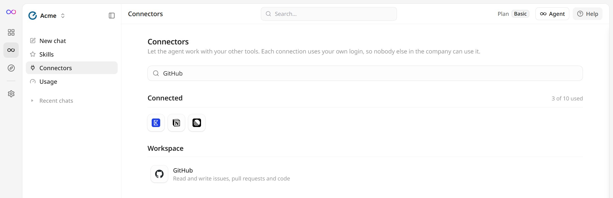
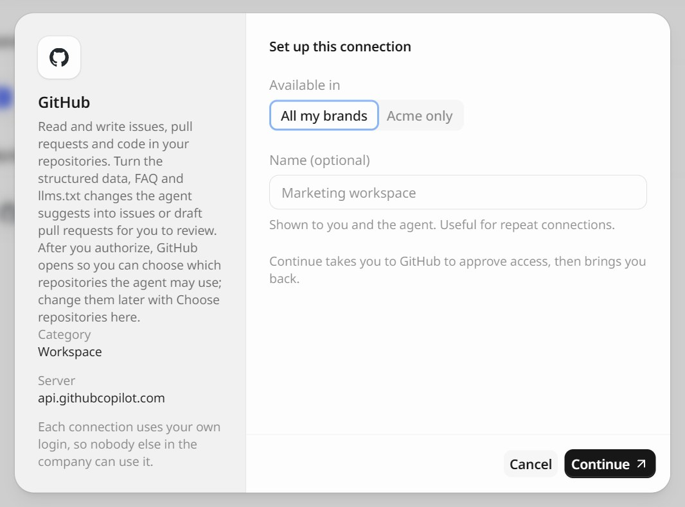
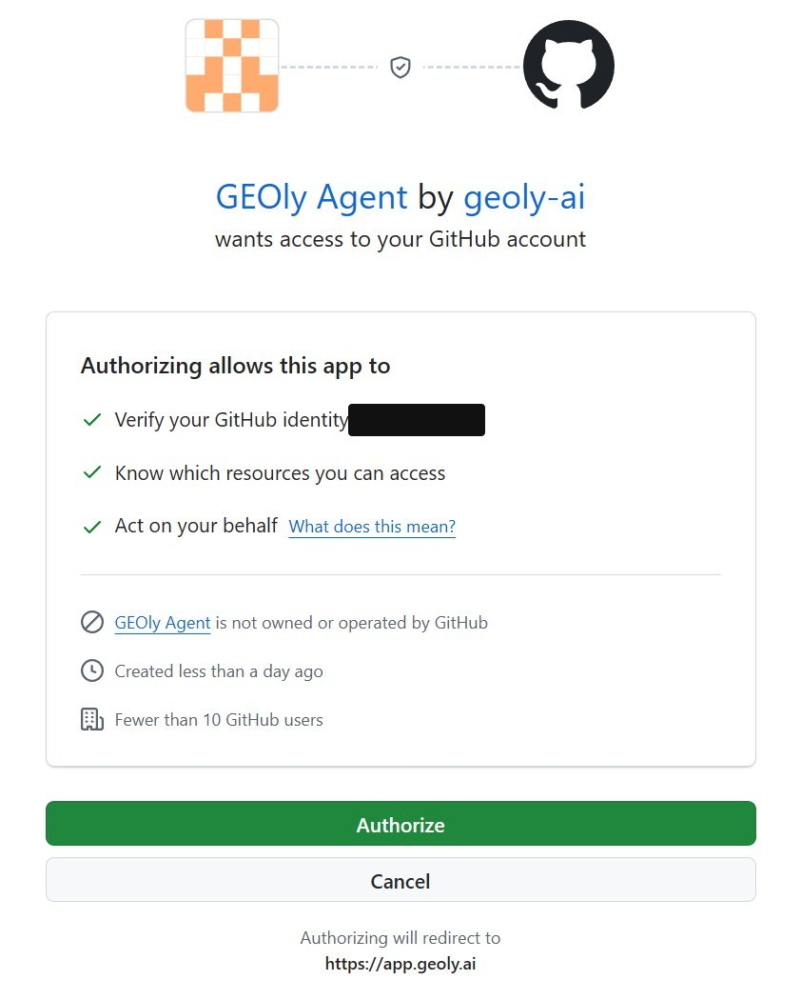
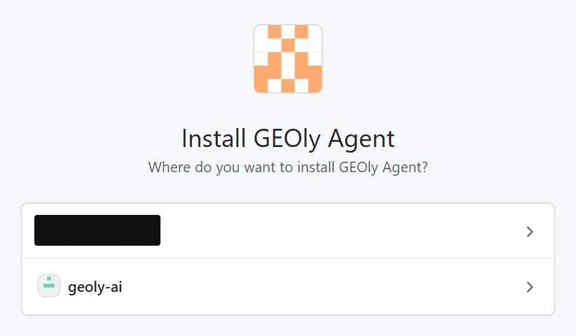
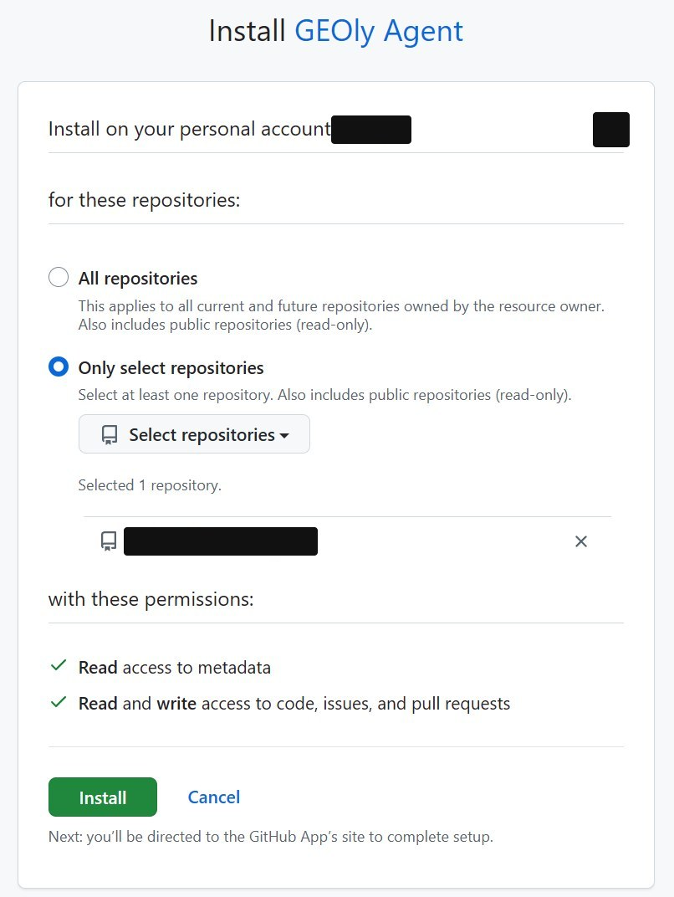
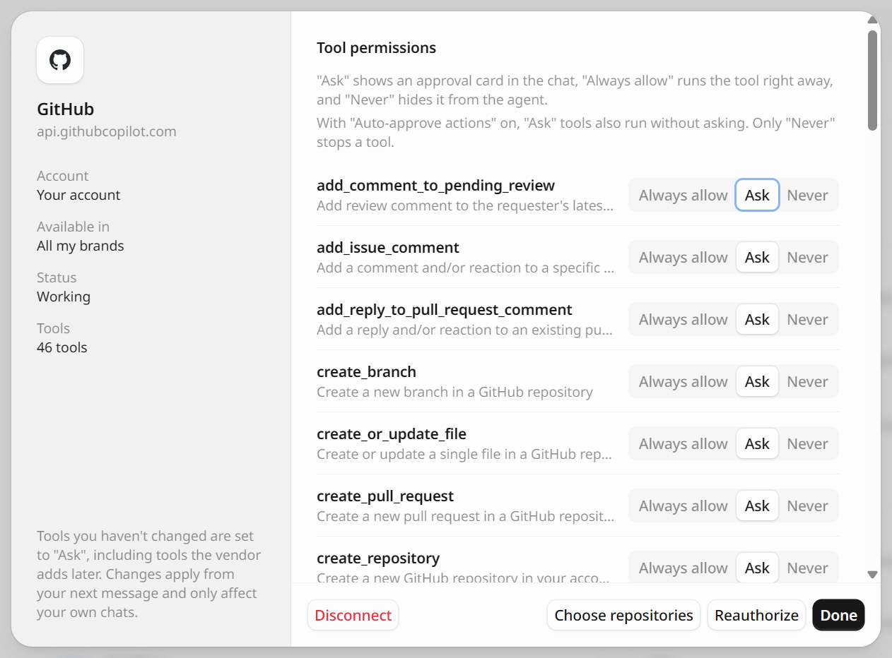

The GitHub connector lets the GEOly Agent work in your repositories. It can read issues, pull requests, and code, and it can turn the structured data, FAQ, and `llms.txt` changes it suggests into issues or draft pull requests for you to review and merge.

Connecting takes two steps on GitHub: you **authorize** the GEOly Agent app, then you **choose the repositories** it may use. GEOly opens both pages for you, one after the other.

## Before you start

Make sure that:

- You can open **Agent** in GEOly. Connectors live on the Agent's **Connectors** page.
- You can sign in to the GitHub account you want to connect.
- To use repositories that belong to a GitHub organization, you are an owner of that organization, or an owner can approve the installation for you.

Each connection uses your own GitHub login. Other people in your GEOly organization can't use it. The agent can read any public repository, but it can only write to, or read private code in, repositories that your GitHub account can access and that you selected for the app.

## Step 1: Open GitHub on the Connectors page

1. In GEOly, open **Agent**, then click **Connectors** in the sidebar. You can also open `app.geoly.ai/agent/connectors` directly.
2. Find **GitHub** in the **Workspace** group, or type `GitHub` in the search box, and click it.

## Step 2: Set up the connection

1. Under **Available in**, choose **All my brands**, or limit the connection to the brand you're working on.
2. Optionally enter a **Name**, such as `Company GitHub`. It helps when you connect more than one GitHub account.
3. Click **Continue**. GEOly takes you to GitHub.

## Step 3: Authorize GEOly Agent

GitHub shows **Authorize GEOly Agent**. Check that the account named on the page is the one you want to connect, then click **Authorize**.

Authorizing lets GEOly act as you on GitHub. Beyond reading public repositories, it can only work in the repositories you choose in the next step. It does not give GEOly your GitHub password.

## Step 4: Choose repositories

Right after you authorize, GitHub opens **Install GEOly Agent**.

1. Choose where to install the app: your personal account or an organization. If you see more than one account, pick the one that owns the repositories you want the agent to use.

   

2. Under **Repository access**, choose **Only select repositories** and pick the repositories the agent may use. We recommend this over **All repositories**.
3. Check the permissions: **Read access to metadata** and **Read and write access to code, issues, and pull requests**. Then click **Install**.

   

GitHub then brings you back to the GEOly **Connectors** page, and GitHub appears under **Connected**.

If you aren't an owner of the organization, GitHub shows **Request** instead of **Install** and sends the request to the organization's owners. GEOly then shows "Request sent. The agent can use it once an organization owner approves." The repositories become available as soon as an owner approves; you don't need to connect again.

<Warning>
Don't skip this step. Until the app is installed on a repository, the agent can only read public repositories, and private repositories look as if they don't exist. If you closed the GitHub page early, open the connection in GEOly and click **Choose repositories** (see below).
</Warning>

## Change repositories later

On the **Connectors** page, click your GitHub connection under **Connected**, then click **Choose repositories** at the bottom of the dialog. GitHub opens the same page as in step 4, where you can add or remove repositories. When you're done, GitHub brings you back to GEOly.

You can also change this on GitHub: open **Settings → Applications → Installed GitHub Apps**, then click **Configure** next to **GEOly Agent**. For an organization, open the organization's settings instead.

## Use GitHub in a chat

Start a new chat with the agent and name the repository, for example:

- "List the open issues in `acme/website` that mention structured data."
- "Open a draft pull request in `acme/website` that adds the FAQ schema we just wrote to the shipping page."
- "Create an issue in `acme/website` for each page that is missing a meta description."

By default, every GitHub tool is set to **Ask**. Before the agent runs one, a card in the chat shows what it is about to do, and nothing happens until you approve it. To change this per tool, open the connection dialog and set each tool to **Always allow**, **Ask**, or **Never**. With **Auto-approve actions** on, **Ask** tools also run without asking; only **Never** stops a tool.

## Disconnect

Open the connection dialog and click **Disconnect**. This deletes the copy of the authorization that GEOly keeps. To remove the app from GitHub as well:

- **Settings → Applications → Authorized GitHub Apps**: click **Revoke** next to **GEOly Agent**.
- **Settings → Applications → Installed GitHub Apps**: click **Configure** next to **GEOly Agent**, then **Uninstall**. Do the same in each organization where you installed it.

## Troubleshooting

- **The agent says it can't find a repository** (for example, "Could not resolve to a Repository"): the app isn't installed on that repository, or you typed the wrong owner or name. Click **Choose repositories** in the connection dialog and add the repository.
- **An organization's repositories are missing:** the app isn't installed on that organization yet, or an organization owner hasn't approved the installation. Ask an owner to approve it on GitHub.
- **The connection shows "Needs reauthorization":** GitHub access expires every 8 hours, and GEOly renews it automatically. Renewal stops working if you revoked the app on GitHub or haven't used the connection for about six months. Click **Reauthorize** in the connection dialog; you don't need to choose repositories again.
- **"Access was cancelled on the GitHub side":** you clicked **Cancel** on GitHub's authorization page. Start again from step 1.
