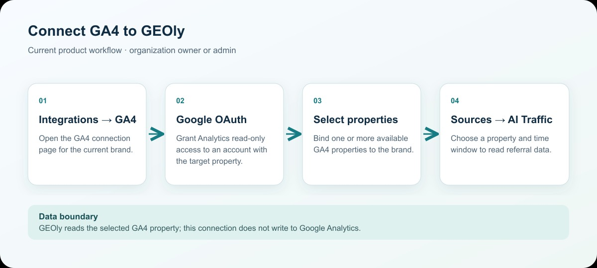
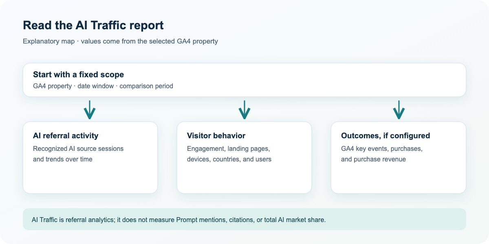

GEOly connects to Google Analytics 4 (GA4) with read-only OAuth access so you can measure traffic that reaches your site from AI sources. The connection setup and the traffic report are separate surfaces.

## Where to find it

1. Open **Integrations → GA4**.
2. Connect the Google account that can access the required GA4 property.
3. Select one or more available GA4 properties and bind them to the current brand.
4. After binding, open **Sources → AI Traffic** and select the property and reporting window.

Only an `owner` or `admin` of the brand's organization can read the available properties, bind a property, or disconnect GA4. GEOly requests the Google Analytics read-only scope; it does not write to the GA4 property.

This workflow diagram explains the current navigation and authorization sequence; it is not a screenshot of the application.

## Choose a property and reporting window

The GA4 connection page lists the accounts and properties available to the authorized Google account. Select the property that contains the current brand's website data. If several properties are bound, use the property selector in AI Traffic to change the active property.

AI Traffic supports the available 7-day, 30-day, 90-day, and custom windows. Depending on the selected window, compare the current period with the previous period, previous month, or previous year. Keep the property, window, and comparison mode fixed when comparing results.

## What AI Traffic reports

The report reads the selected property's GA4 data and can include:

- sessions, page views, active users, and new users;
- bounce rate, average session duration, and engagement rate;
- AI-source sessions, engaged sessions, conversions, purchase key-event rate, ecommerce purchases, and purchase revenue when the property returns those events;
- trends over time and changes against the selected comparison period;
- source distribution, landing pages, channel groups, device categories, countries, and new-versus-returning users.

The AI-source view groups matching referral sources into the AI platforms that GEOly recognizes. A source that is missing or classified as unknown does not prove that no AI referral occurred; it can reflect GA4 attribution, tagging, data retention, the selected window, or the current recognition rules.

This reading map explains how to interpret the report; it is not a screenshot of the application.

## Read the report in context

Use the overview to understand the selected property's traffic volume and engagement. Use the AI-source table and trend to compare recognized AI referral sources. Use landing-page, device, country, and new-versus-returning breakdowns to decide which pages or markets need investigation.

For conversion and revenue analysis, confirm that the GA4 property has the relevant key events and ecommerce tracking configured. A zero or missing conversion value can mean that the event is not configured or is outside the selected scope.

## Common mistakes

- AI Traffic is GA4 referral data. It is not the same as GEOly Prompt mentions, citations, AIGVR, Share of Model, or public Explore estimates.
- A recognized AI referral session is not proof that an AI answer cited the brand or caused a purchase.
- Purchase revenue and conversion values come from the connected GA4 property and its event configuration; they are not GEOly's estimate of total revenue.
- Results can differ from the GA4 interface because of date ranges, filters, attribution settings, consent handling, sampling, and data processing time.
- Disconnecting GA4 removes the stored connection and property binding from GEOly; it does not delete data from Google Analytics.

Use AI Traffic to connect AI referral activity with first-party analytics. Use Monitoring → Prompts, Performance, and Sources → Citations to investigate what AI systems say, cite, and recommend about the brand.
