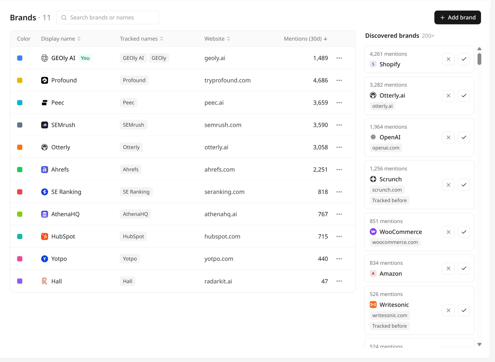
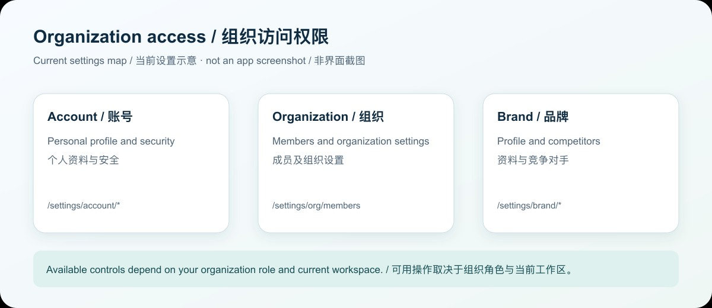
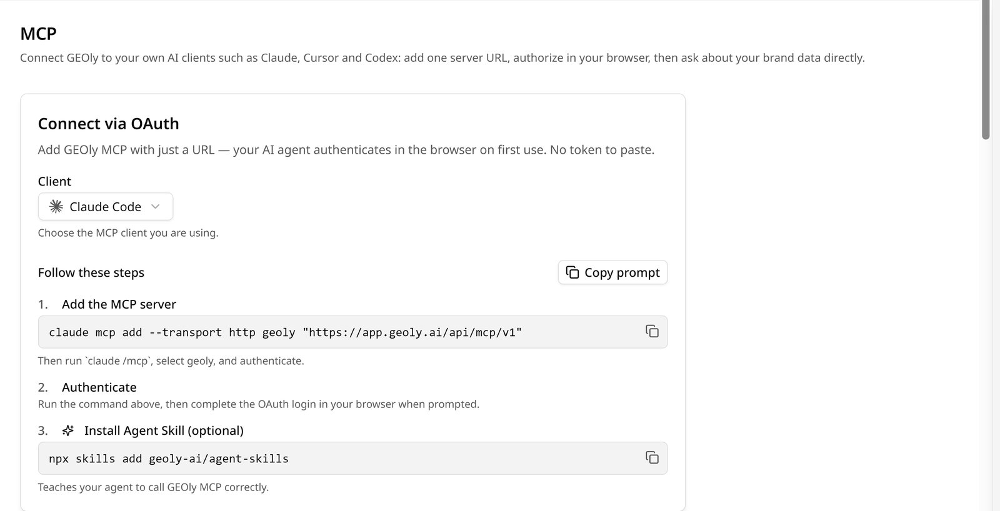

**Where to start:** Sign in to GEOly, then use the left navigation and the project menu to configure your project.

This guide covers the account, organization, project, and monitoring settings used in the current GEOly product. Completing these settings helps GEOly identify your brand consistently in AI answers, keeps Monitoring scoped to the correct project, and prevents teams from working in the wrong project.

A project is GEOly's monitoring unit: it tracks one own brand plus its competitors, and it is named after that brand. Your organization's plan sets how many projects it can have. Agencies tracking several client brands can use an [agency plan](/agencies/overview), which sets a number of client projects and a pool of tracking credits you split across them.

## 1. Sign in and confirm your project

Open [app.geoly.ai](https://app.geoly.ai) and sign in. Before changing settings, confirm the organization, plan, and active project shown in the app.

Your available data and actions depend on:

- the organization you are working in;
- the active project;
- your account permissions; and
- the plan and data scope available to that organization and project.

Switching projects changes the scope used by the Workspace pages and the project settings. It does not merge data between projects.

## 2. Switch projects and open Project settings

Use the project menu in the left navigation to:

- view the active project;
- switch to another authorized project;
- choose **Add project** when your account has permission to create another project; and
- choose **Manage projects** to open the settings for the current project.

After switching, confirm the project name shown in the product before creating Prompts, competitors, or monitoring tasks.

## 3. Configure the brand profile

Open **Settings → Project → Brand profile**. The top of the page shows the brand name, website, and logo. GEOly fills in the fields below from your website; edit anything that's off. The AI assistant and prompt suggestions use them to understand your brand:

- **Description:** what the brand does, in a sentence or two.
- **Category:** your specific category, not a broad industry.
- **Brand identity:** keywords that describe the brand.
- **Products and services:** what you offer.
- **Personas:** who your customers are.
- **Target markets:** where your brand operates, with the language prompts use for each country. Use **Change in Prompts** to edit them.
- **Audience distribution:** the kinds of people who make up your audience.

The names that GEOly uses to recognize brands in AI answers are not on this page. They are managed as **Tracked names** on **Settings → Project → Brands**.

### How to choose tracked names

Include the official brand name, common spelling or capitalization variants, important product lines, and common short names.

Example: Acme, ACME, Acme Drones.

Avoid generic words that are not unique to the brand. Overly broad tracked names can increase false matches. Save the changes, then review later monitoring results to confirm that brand detection is accurate.

### About the website

The website shown at the top of the brand profile is the project's official site. It does not prove that every AI answer cites the site or that the site receives recommendation traffic.

## 4. Manage the brands you track

Open **Settings → Project → Brands**. The list shows your own brand (marked **You**) and the competitors you track, with their **Display name**, **Tracked names**, **Website**, and **Mentions (30d)**.

- Click **Add brand** to track a competitor, then enter its tracked names and website.
- **Discovered brands** suggests brands that often appear in your AI answers. Add a suggestion to the list, or stop GEOly from suggesting it.
- Use a brand's **⋯** menu to **Edit** its names or website, or **Stop tracking** brands that are no longer relevant.

GEOly matches the tracked names in AI answers. To keep comparisons useful:

- add brands that are genuinely relevant to your market;
- use stable, recognizable names; and
- add common alternative names when needed.

The competitor list supports comparison inside the available AI-answer data. It is not an automatic discovery of the entire market and should not be treated as a complete market ranking.

## 5. Organization and account permissions

This diagram shows the settings areas; the controls available to you still depend on your current organization role and project.

The organization, plan, and account permissions determine which projects, data, and actions are visible to you.

When collaborating:

- confirm that each member is in the correct organization;
- check the active project and data scope before interpreting results;
- grant only the access needed for the task; and
- use the controls shown for your current account rather than assuming every account has the same management menu.

If an organization or member-management control is not visible, it may not be available for the current account, plan, or project. Changes involving organization access or permissions should be performed by an account that has the relevant authority.

### Choose the AI platforms you monitor

Basic tracks any 1 of the 4 AI platforms and Grow tracks any 2. Advanced and Plus track all 4. You pick the first ones when you set up your project. To change them later:

1. Open **Settings → Organization → Billing**.
2. On the **Monitoring coverage** card, click **Choose platforms**.
3. Pick the platforms your customers use, up to your plan's limit, and save.

Changes apply from the next daily run, and data from platforms you remove stays visible. You can change platforms once every 7 days, and only organization owners and admins can change them.

The button doesn't appear when GEOly or your agency manages the organization's platforms, such as on Enterprise. On an [agency plan](/agencies/overview), you choose platforms per project under **Settings → Organization → Projects** instead; see [Tracking credits](/agencies/tracking-credits). To track more platforms than your plan allows, upgrade your plan.

## 6. MCP and external AI clients

The current MCP entry point is:

**Settings → Developers → MCP**

GEOly MCP uses a remote MCP URL and OAuth. On first use, the AI client opens a browser for authentication; OAuth clients do not need to paste a key. For server integrations, owners/admins can create a resource-scoped key under Settings → Developers → API keys. Each key is bound to exactly one project. The complete value is shown once and must be stored securely. Choose your client on the MCP page and copy the command or configuration it generates. The MCP page is the source of truth for the current client configuration.

For client setup, OAuth scopes, and industry data credits, see the [GEOly MCP Guide](/developers/mcp/introduction).

MCP authorization controls which GEOly resources an external client can read or write. Project settings control the current project's brand profile and the names used to recognize brands. These are separate permission surfaces.

## 7. Recommended first-time setup

1. Sign in and confirm the organization, active project, and plan scope.
2. Open **Settings → Project → Brand profile** and review the description, category, products and services, and target markets.
3. Open **Settings → Project → Brands** and check the tracked names.
4. Add the competitors you want to track, or add them from **Discovered brands**.
5. Create or review Monitoring Prompts, platforms, and date ranges.
6. Run a read-only check to confirm brand detection and result scope.
7. If you need an external AI client, open **Settings → Developers → MCP** and complete OAuth.

## 8. Common issues and data boundaries

- A brand may be missing because a tracked name is missing, the spelling differs, coverage is limited, or the query scope is different.
- A competitor may be absent because of name matching, platform, language, date range, or sample coverage; absence does not prove that the competitor does not exist.
- AIGVR, Mention Rate, and Citation Rate are monitored-brand signals. Do not mix them with public-industry SoM, AI traffic estimates, or estimated revenue.
- Updating brand information, tracked names, or competitors does not by itself prove a change in ranking, traffic, conversion, or revenue.
- Review original AI answers, official website information, and first-party business data before making an important decision.

After the initial setup, run a read-only Monitoring check and adjust tracked names, the brands you track, or Prompt scope based on the observed results.
