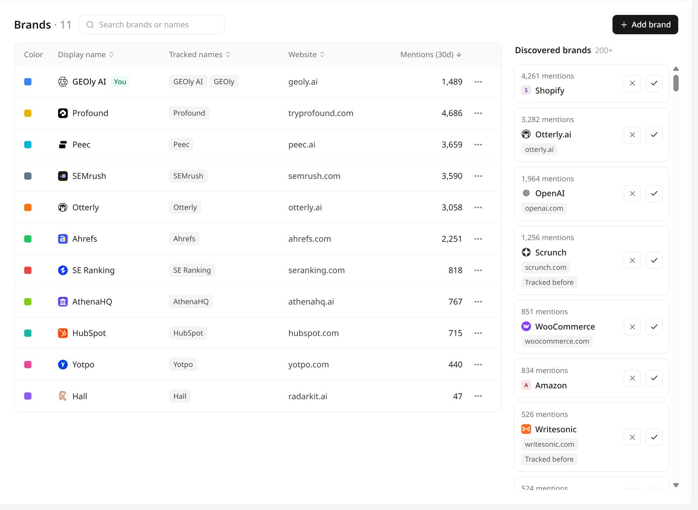
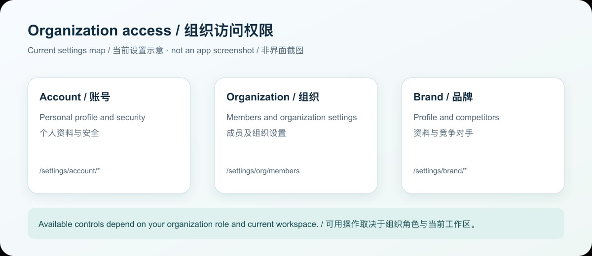
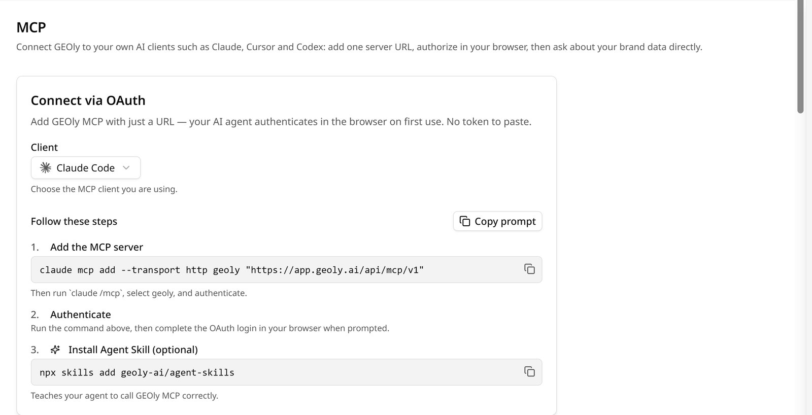

**Where to start:** Sign in to GEOly, then use the left navigation and current brand menu to configure your workspace.

This guide covers the account, organization, brand, and monitoring settings used in the current GEOly product. Completing these settings helps GEOly identify your brand consistently in AI answers, keeps Monitoring scoped to the correct brand, and prevents teams from working in the wrong workspace.

## 1. Sign in and confirm your workspace

Open [app.geoly.ai](https://app.geoly.ai) and sign in. Before changing settings, confirm the organization, plan, and active brand shown in the workspace.

Your available data and actions depend on:

- the organization you are working in;
- the active brand;
- your account permissions; and
- the plan and data scope available to that workspace.

Switching brands changes the scope used by the Workspace pages and the brand settings. It does not merge data between brands.

## 2. Switch brands and open Brand settings

Use the brand menu in the left navigation to:

- view the active brand;
- switch to another authorized brand;
- choose **Add Brand** when your account has permission to create another brand; and
- choose **Manage brands** to open the brand settings for the current brand.

After switching, confirm the brand name shown in the product before creating Prompts, competitors, or monitoring tasks.

## 3. Configure the brand profile

Open **Settings → Brand → Brand profile**. The page includes:

- **Brand Name:** the name shown in GEOly.
- **Website:** the official brand website URL.
- **Industry:** the industry the brand belongs to.
- **Brand description:** one or two sentences on what the brand sells and who it is for. Prompt suggestions use this description.
- **Logo URL:** optional; if empty, GEOly uses the website favicon.

The names that GEOly uses to recognize brands in AI answers are not on this page. They are managed as **Tracked names** on **Settings → Brand → Brands**.

### How to choose tracked names

Include the official brand name, common spelling or capitalization variants, important product lines, and common short names.

Example: Acme, ACME, Acme Drones.

Avoid generic words that are not unique to the brand. Overly broad tracked names can increase false matches. Save the changes, then review later monitoring results to confirm that brand detection is accurate.

### How to set the Website

Enter the official site URL and confirm the domain. The Website field is part of the brand profile; it does not prove that every AI answer cites the site or that the site receives recommendation traffic.

## 4. Manage the brands you track

Open **Settings → Brand → Brands**. The list shows your own brand (marked **You**) and the competitors you track, with their **Display name**, **Tracked names**, **Website**, and **Mentions (30d)**.

- Click **Add brand** to track a competitor, then enter its tracked names and website.
- **Discovered brands** suggests brands that often appear in your AI answers. Add a suggestion to the list, or stop GEOly from suggesting it.
- Use a brand's **⋯** menu to **Edit** its names or website, or **Stop tracking** brands that are no longer relevant.

GEOly matches the tracked names in AI answers. To keep comparisons useful:

- add brands that are genuinely relevant to your market;
- use stable, recognizable names; and
- add common alternative names when needed.

The competitor list supports comparison inside the available AI-answer data. It is not an automatic discovery of the entire market and should not be treated as a complete market ranking.

## 5. Organization and account permissions

This diagram shows the settings areas; the controls available to you still depend on your current organization role and workspace.

The organization, plan, and account permissions determine which brands, data, and actions are visible to you.

When collaborating:

- confirm that each member is in the correct organization;
- check the active brand and data scope before interpreting results;
- grant only the access needed for the task; and
- use the controls shown in the current workspace rather than assuming every account has the same management menu.

If an organization or member-management control is not visible, it may not be available for the current account, plan, or workspace. Changes involving organization access or permissions should be performed by an account that has the relevant authority.

## 6. MCP and external AI clients

The current MCP entry point is:

**Settings → Developers → MCP**

GEOly MCP uses a remote MCP URL and OAuth. On first use, the AI client opens a browser for authentication; OAuth clients do not need to paste a key. For server integrations, owners/admins can create a resource-scoped, single-brand key under Settings → Developers → API keys. The complete value is shown once and must be stored securely. Choose your client on that page and copy the command or configuration it generates. The MCP page is the source of truth for the current client configuration.

For client setup, OAuth scopes, and MCP Credits, see the [GEOly MCP Guide](/developers/mcp/introduction).

MCP authorization controls which GEOly resources an external client can read or write. The brand settings control the current brand profile and the names used to recognize brands. These are separate permission surfaces.

## 7. Recommended first-time setup

1. Sign in and confirm the organization, active brand, and plan scope.
2. Open **Settings → Brand → Brand profile** and review Brand Name, Website, Industry, Brand description, and Logo URL.
3. Open **Settings → Brand → Brands** and check the tracked names.
4. Add the competitors you want to track, or add them from **Discovered brands**.
5. Create or review Monitoring Prompts, platforms, and date ranges.
6. Run a read-only check to confirm brand detection and result scope.
7. If you need an external AI client, open **Settings → Developers → MCP** and complete OAuth.

## 8. Common issues and data boundaries

- A brand may be missing because a tracked name is missing, the spelling differs, coverage is limited, or the query scope is different.
- A competitor may be absent because of name matching, platform, language, date range, or sample coverage; absence does not prove that the competitor does not exist.
- AIGVR, Mention Rate, and Citation Rate are monitored-brand signals. Do not mix them with public-industry SoM, AI traffic estimates, or estimated revenue.
- Updating brand information, tracked names, or competitors does not by itself prove a change in ranking, traffic, conversion, or revenue.
- Review original AI answers, official website information, and first-party business data before making an important decision.

After the initial setup, run a read-only Monitoring check and adjust tracked names, the brands you track, or Prompt scope based on the observed results.
