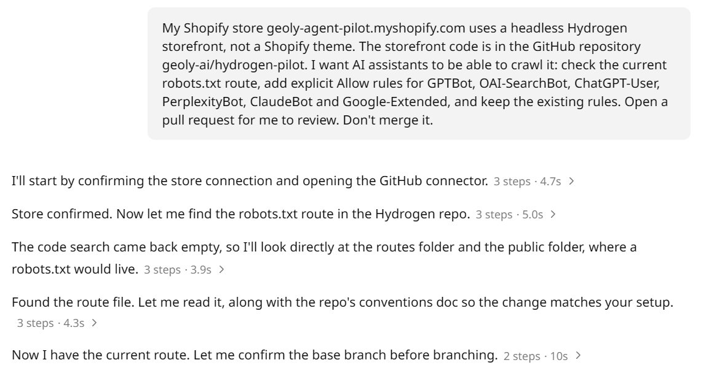
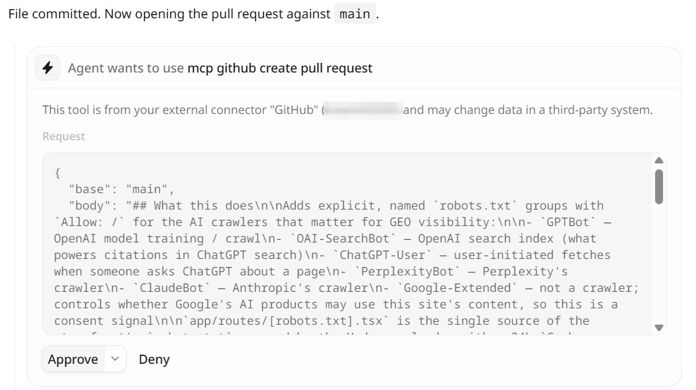
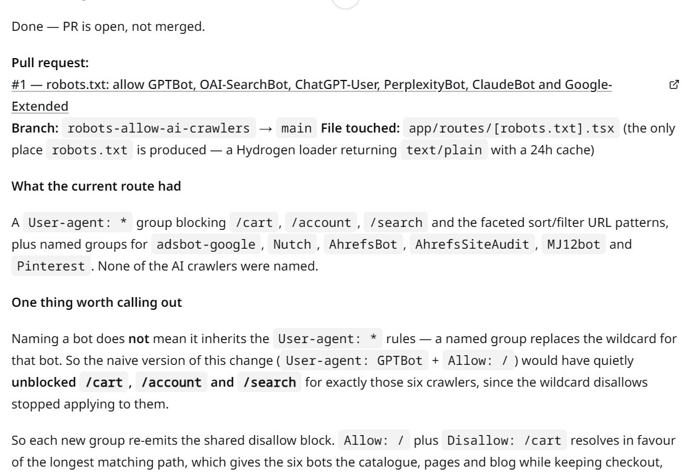
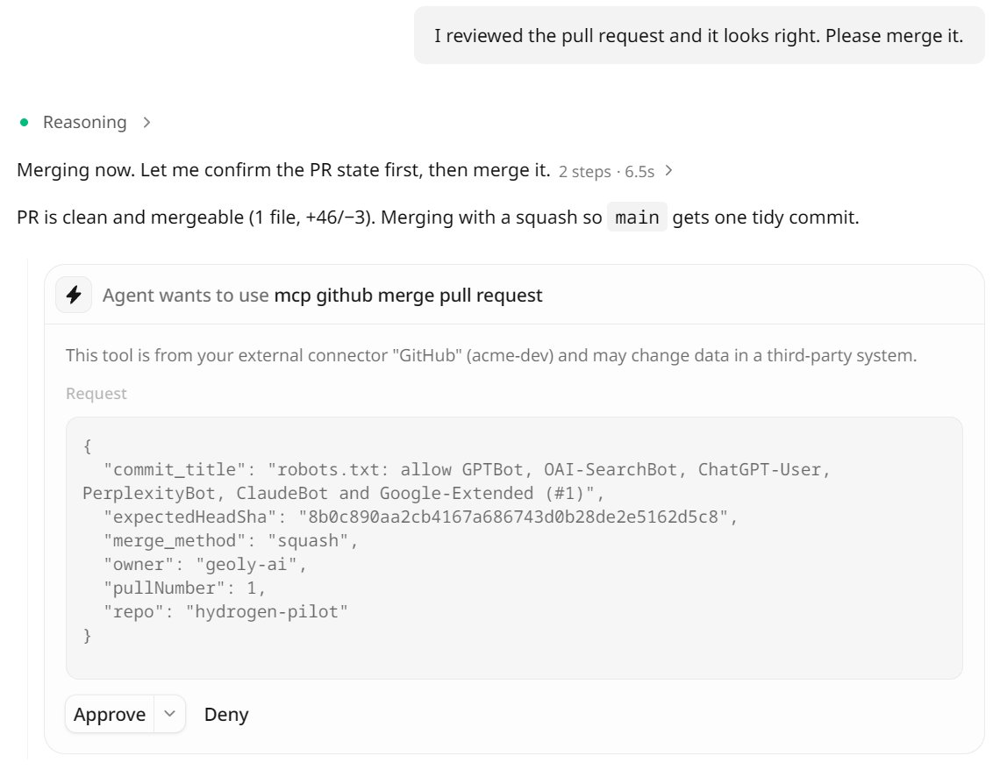

On a headless storefront (built with Hydrogen or another framework), shoppers see pages that your own code renders, not a Shopify theme. Your products, pages and blog posts still live in Shopify, but the site itself lives in your Git repository. The GEOly Agent changes each one where it lives:

| What | Where it lives | How the Agent changes it |
| --- | --- | --- |
| SEO titles and descriptions, product and collection descriptions, image alt text, pages, blog posts, metafields, redirects | Shopify | Directly in Shopify after you approve a card in the chat, the same as on a theme store. You can ask the Agent to undo it. |
| `robots.txt`, structured data (JSON-LD), meta tags and other site code | Your storefront repository | A pull request (a merge request on GitLab) that you review. Your site doesn't change until the pull request is merged and deployed. |

<Note>
Content changes show on your site only where your storefront code reads those fields. For example, Hydrogen's starter template builds the product page title in code, so changing a product's SEO title in Shopify doesn't change that page title until the code uses the SEO field. Redirects work in Hydrogen's starter template, because it sends unknown paths to your Shopify redirects.
</Note>

The structured data and FAQ blocks of the GEOly app are theme app embeds, so they don't appear on a headless storefront. On a headless store, the Agent adds structured data in your code instead.

## Before you start

Make sure that:

- Your store is connected to your GEOly project under **Agent › Connectors › Your store**. See [Before you start](/shopify/agent-theme-changes#before-you-start) on the theme page.
- The Git host that holds your storefront code is connected under **Agent › Connectors**:
  - **GitHub**: see [Connect GitHub to the GEOly Agent](/integrations/github-connector). Install the GEOly Agent app on the storefront repository. Until you do, the Agent can't see a private repository.
  - **GitLab** (gitlab.com): connect **GitLab** from the catalog.
  - A self-hosted GitLab or another Git server: [add a custom MCP connection](/agent/connectors#add-a-custom-mcp-server) to it.

## Tell the Agent how your store is built

The Agent checks your project's website and your store's domain to see whether a Shopify theme renders them. If it can't tell, for example while your store only has its `myshopify.com` address, it asks you.

Tell it that the storefront is headless and which repository holds the code, as in the example in Step 1. The Agent then offers to save this to the project's **Context** with an **Update context** card. Approve it, and later chats in this project start from the repository without asking again.

## Step 1: Ask for the change

Start a new chat, say that the store is headless, name the repository, and describe the change. For example:

> My Shopify store your-store.myshopify.com uses a headless Hydrogen storefront, not a Shopify theme. The storefront code is in the GitHub repository your-org/your-storefront. I want AI assistants to be able to crawl it: check the current robots.txt route, add explicit Allow rules for GPTBot, OAI-SearchBot, ChatGPT-User, PerplexityBot, ClaudeBot and Google-Extended, and keep the existing rules. Open a pull request for me to review. Don't merge it.

## Step 2: Approve each GitHub step

The Agent reads the repository, finds the file that produces the page (on Hydrogen, `robots.txt` comes from the route `app/routes/[robots.txt].tsx`), creates a branch, commits the change and opens a pull request.

Each GitHub tool shows a card that says it comes from your GitHub connection and what it's about to do. Nothing runs until you click **Approve**. In our test, the Agent read the repository six times, listed the branches, and then asked to create the branch, commit the file and open the pull request.

To stop approving every read, open your GitHub connection and set the read tools to **Always allow**. Keep the tools that write, such as creating branches, committing and merging, on **Ask**. See [Use GitHub in a chat](/integrations/github-connector#use-github-in-a-chat).

## Step 3: Review the pull request

The Agent gives you the pull request link, the branch and the files it changed, and explains the change. It doesn't merge the pull request.

Review the pull request on GitHub. If your host builds a preview for each pull request (Shopify Oxygen can), check the change on the preview first.

## Step 4: Merge the pull request

You decide when the change goes live:

- **Merge it yourself** on GitHub.
- **Ask the Agent to merge it**, for example: "I reviewed the pull request and it looks right. Please merge it." The Agent shows a card for **merge pull request**. The card includes the commit you reviewed (`expectedHeadSha`), so if anyone pushes to the branch after that, the merge doesn't go through.

If your repository deploys its default branch automatically, as Oxygen and most hosts do, merging publishes the change. After it deploys, open the page on the domain your storefront serves, for example `https://www.your-store.com/robots.txt`. The `myshopify.com` address doesn't serve your storefront's routes.

## Undo a change

- **Before merging**: close the pull request on GitHub, or ask the Agent to close it.
- **After merging**: click **Revert** on the merged pull request on GitHub, or ask the Agent to open a pull request that reverts it. Merge that one the same way.
- **Content changed in Shopify**: ask the Agent to undo it, the same as on a theme store.

## Troubleshooting

- **The Agent offers to change a theme file or a working copy:** it took your store for a theme store. Tell it the storefront is headless and which repository holds the code, and approve the **Update context** card.
- **The Agent says it can't find the repository:** the GEOly Agent app isn't installed on that repository, or the owner or name is wrong. In the GitHub connection, click **Choose repositories** and add it.
- **The Agent writes the change out in the chat instead of opening a pull request:** none of your connections can reach the repository. Connect the Git host, or give the connection access to the repository, and ask again.
- **A content change doesn't show on your site:** your storefront code doesn't read that field. Ask the Agent to update the code to use it, with a pull request.
