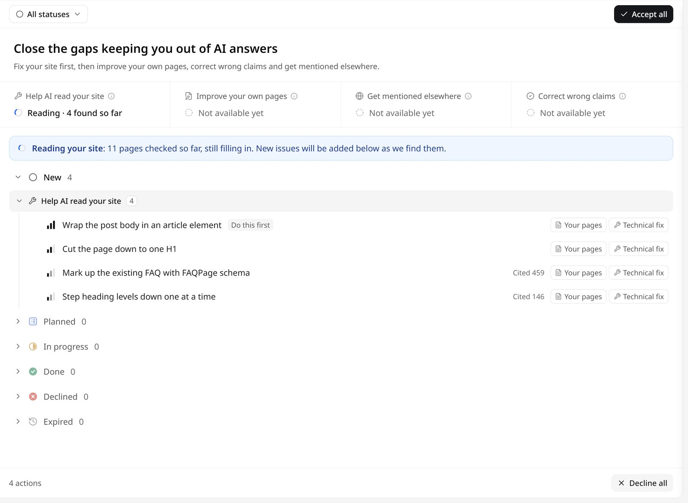
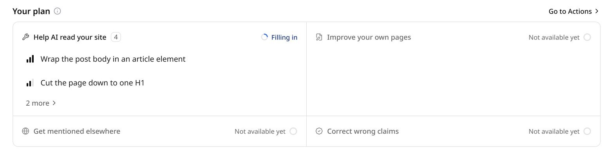

**Actions**（行动）是一份待办清单，用来补上让品牌进不了 AI 回答的缺口。GEOly 会读取品牌网站，找出让 AI 难以读取和理解的问题，把每个问题整理成一条行动，附上受影响的页面、证据和修改方法。每条行动怎么处理由团队决定，也可以交给 [GEOly Agent](/zh/agent/overview)。

<Note>
下面的截图是 GEOly 的英文界面。正文先写英文界面上的名称，括号里是中文界面的对应名称。
</Note>

点击左侧图标栏的 **Actions**（行动），或直接打开 `app.geoly.ai/actions`。

## 四个目标

行动分为四个目标，显示在页面顶部：

| 目标 | 包含什么 |
| --- | --- |
| **Help AI read your site**（让 AI 读懂你的网站） | 帮助 AI 爬虫读取并理解网站的技术修复。 |
| **Improve your own pages**（改进自家页面） | 品牌自己发布内容的地方：自家页面，以及社交与社区账号。 |
| **Get mentioned elsewhere**（在别处被提到） | 在别人网站上争取的位置，比如 AI 已经信任的媒体和参考类网站。 |
| **Correct wrong claims**（纠正错误说法） | 自家页面和其他网站上与已确认事实冲突的说法。 |

<Note>
目前的行动都来自 **Help AI read your site**（让 AI 读懂你的网站）。另外三个目标显示 **Not available yet**（暂未开放），仍在开发中，做好后会出现在这个页面上。
</Note>

## GEOly 怎么找出要修的问题

GEOly 会读取品牌网站（主站，以及监测的国家和地区对应的站点），逐页检查。检查项包括，例如：

- `robots.txt` 里阻止 AI 爬虫读取网站的规则；
- 站点地图或导航里打不开的页面；
- 不运行 JavaScript 时 HTML 里几乎没有正文的页面；
- 无法解析、或字符被转义了两次的结构化数据（JSON-LD）；
- 页面上已有、但没有用结构化数据标注的 FAQ、评分或面包屑导航；
- 缺失或重复的 meta 描述、缺失或重复的 H1 标题、跳级的标题层级；
- 没有 alt 文本或说明的图片、只以纯文本出现的日期。

订阅有效的品牌创建后，第一次读取会自动开始。不必等它读完：读取过程中，页面会显示已检查的页数，发现的新问题会陆续加进列表。之后 GEOly 每周重新读取一次网站。

## 看懂列表

行动先按状态分组，再按目标分组。每一行里：

- **条形图标**表示严重程度，从 **Very low**（很低）到 **Very high**（很高）。严重程度只看问题本身，不随其他行动变化；
- **Do this first**（先做这条）标在每个目标里排在最前的新建行动上；
- **Cited N**（被引 N）表示过去 30 天里，GEOly 追踪的提示词对应的 AI 回答引用这些受影响页面的次数。次数越多，修好后越可能改变 AI 对品牌的描述；
- **Your pages**（你的页面）、**Technical fix**（网站技术修复）等标签说明修复发生在哪里、属于哪类工作。

用顶部的 **All statuses**（所有状态）可以按状态筛选。

点一条行动可以打开详情：

- **Overview**（概述）：问题是什么、为什么重要；
- **What to do**（要做什么）：修改方法，并附上受影响页面的证据：GEOly 读到的页面源码（原样摘录），适用时还会给出应改成什么。做完后勾上这一步；
- **Affected pages**（受影响的页面）：已检查的页面里有多少存在这个问题，以及页面清单；
- **Severity and citations**（严重度和被引次数）：严重程度，以及 AI 回答引用这些受影响页面的次数。

## 状态

| 状态 | 含义 |
| --- | --- |
| **New**（新建） | 还没处理的新建议。 |
| **Planned**（计划中） | 已列入计划的工作。目前页面上还没有操作会把行动移到这里。 |
| **In progress**（进行中） | 已接受、正在处理。 |
| **Done**（已完成） | 已修好。 |
| **Declined**（已拒绝） | 决定不做。 |
| **Expired**（已过期） | 新建后 30 天没人处理，GEOly 自动关闭。 |

能做的操作取决于状态：

- **New**（新建）：**Accept**（接受）移到 **In progress**（进行中）；**Decline**（拒绝）移到 **Declined**（已拒绝）；
- **In progress**（进行中）：**Done**（完成）记为今天完成，点旁边的箭头可以 **Pick an earlier date**（按更早的日期完成）；**Drop**（放弃）移到 **Declined**（已拒绝）；
- **Declined**（已拒绝）和 **Expired**（已过期）：**Accept**（接受）移到 **In progress**（进行中）；已拒绝的行动也可以 **Restore**（恢复）回 **New**（新建）；
- 勾完 **What to do**（要做什么）里的全部步骤，行动也会记为 **Done**（已完成）；在已完成的行动上取消勾选任一步骤，会回到 **In progress**（进行中）。

可以勾选多行一起修改，或用 **Accept all**（全部接受）和 **Decline all**（全部拒绝）处理当前显示的全部行动。GEOly 不会覆盖团队的处理结果：已接受、已完成或已拒绝的行动，重新读取网站后保持不变。

### 问题消失或再次出现

- 如果最近一次读取没再发现某个问题，行动上会注明（例如「最近一次检查没再发现」）。确认已修好就标记完成，不再关心就拒绝；
- 如果一个已确认修好的问题又出现了，行动会标上 **Back again**（又出现了）。

## 把行动交给 Agent

在行动详情里点 **Hand to Agent**（交给 Agent），会新开一段 [Agent](/zh/agent/overview) 对话，带上这条行动的说明、修改方法、证据、受影响页面和行动 ID，Agent 可以读取当时保存的证据，协助完成修改。如果已经把 GitHub、Webflow、Wix 等工具连成[连接器](/zh/agent/connectors)，也可以让 Agent 直接在那边准备修改；默认情况下，它用这些工具前会先征求同意。

想用其他工具处理时，点 **Copy as prompt**（复制为提示词），会复制同样的说明、修改方法、证据和受影响页面（不含行动 ID）。

## 总览页的「Your plan」

**Overview**（总览）页有一块 **Your plan**（你的计划），列出四个目标和各自待处理的行动。点一条行动可以查看详情，点 **Go to Actions**（去行动页）打开完整列表。

## GEOly 读不了网站时

读取失败时，页面会显示上一次成功读取的结果，行动状态不受影响。最常见的原因是网站拦截了 GEOly 的爬虫。放行方法：

- 放行 User-Agent 中包含 `GeolyBot` 的请求；
- 放行行动页上显示的出口 IP；
- 不要在 `robots.txt` 里禁止 `GeolyBot`。

放行后，GEOly 会在下一次每周读取时重新读取。想更快处理，或者网站换了域名、首页跳转到了别的网站，可以通过在线客服告诉我们。

## 在 GEOly 之外使用行动

同一份行动列表也可以通过 [GEOly MCP](/zh/developers/mcp/introduction) 和 [GEOly CLI](/zh/developers/cli) 提供给 AI 助手：`list_actions` 列出行动，`get_action` 返回单条行动的完整信息。详见[工具参考](/zh/developers/mcp/tools)。
