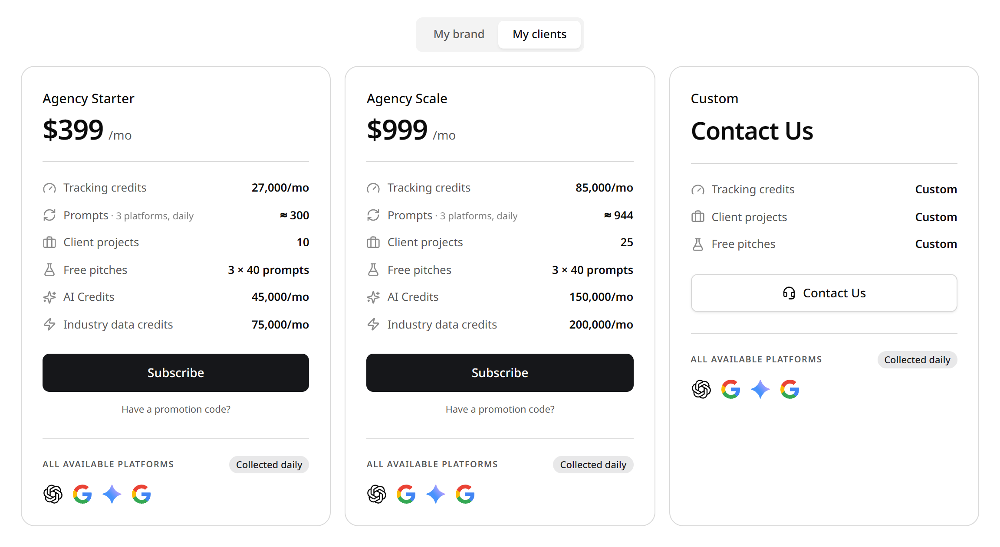

只有组织所有者或管理员能购买、更改或取消套餐，账单页也不对其他成员显示。

<Note>
下面的截图是 GEOly 的英文界面。正文先写英文界面上的名称，括号里是中文界面的对应名称。
</Note>

## 购买代理商套餐

1. 打开 **Settings → Organization → Billing**（设置 → 组织 → 账单），页面标题是 **Plans & Billing**（套餐与账单）；
2. 在 **Who are you tracking?**（你要追踪谁）里选 **My clients**（我的客户），页面上会出现代理商套餐：**Agency Starter**、**Agency Scale** 和一张 **Custom**（定制）卡；
3. 在要买的那一档上点 **Subscribe**（订阅），到结账页付款。有优惠码的话，改点 **Subscribe** 下面的 **Have a promotion code?**（我有优惠码），填好优惠码，再点 **Continue to Checkout**（继续结账）。

每张代理商卡片上写着这一档的 **Tracking credits**（监测额度）、按 3 个平台每天跑约合多少 **Prompts**（提示词）、**Client projects**（客户项目）、**Free pitches**（免费试跑）、**All available platforms**（全部在售平台）和 **Collected daily**（每天采集）。Agency Scale 还不够用时，点 **Custom**（定制）卡上的 **Contact Us**（联系我们）。

代理商套餐按月付费，不提供试用，也不能一次性购买。

<Note>
只有组织没有生效中的订阅时，才会出现 **My brand**（我的品牌）/ **My clients**（我的客户）这个选择。已经在付普通套餐的组织，卡片下方只会多一行「要管理多个客户？代理商套餐请联系我们」。详见下文「普通套餐和代理商套餐之间切换」。
</Note>

## 装得下才能买

结账前，系统会先算一遍：组织现有的项目放进你选的这一档，装不装得下。装不下时会告诉你要减什么：

- **监测额度**：比如「这一档最多 27,000 监测额度，你现在要 30,000（暂停的项目也算）」。先在「设置 → 项目」里减少提示词或项目，再来买；
- **客户项目**：比如「这一档最多 10 个客户项目，你现在有 12 个」。先删掉多出来的项目，再来买。

计算规则：

- 额度和套餐里的算法一样，每个项目按「最多提示词 × 平台数 × 30」算，见[监测额度](/zh/agencies/tracking-credits)；
- 没设最多提示词的项目，或者最多提示词低于在跑条数的项目，按在跑条数算；
- 暂停的项目也算进去，因为随时可以恢复；
- 项目个数只数客户项目，已到期、已暂停的都算，试跑项目不算；
- 刚好等于上限，算装得下。

## 已有项目会怎样

组织换到代理商套餐时，系统会自动给每个已有项目分好额度：

- 有在跑提示词、但没设最多提示词的项目：最多提示词 = 在跑条数；
- 最多提示词低于在跑条数的项目：抬到在跑条数；高于在跑条数的保持不变；
- 没有在跑提示词、也没设最多提示词的项目：不占额度；
- 每个项目的平台设成组织当时在采集的平台，之后可以按项目再改。

其中有的项目可能低于每个项目 900 额度的下限，照常采集。下次改这个项目的最多提示词或平台时，才需要满足 900 的下限。

## 从 Agency Starter 升级到 Agency Scale

1. 在账单页的 **Agency Scale** 卡片上点 **Upgrade**（升级）；
2. **Upgrade to Agency Scale**（升级到 Agency Scale）弹窗会显示今天要扣多少钱；
3. 点 **Confirm and pay**（确认并付款）。

差价按比例当场扣款，新的额度和名额马上生效。扣款不成功就整笔不换，你仍然在 Agency Starter 上。确认之前金额如果有变化，弹窗会提示「金额已更新，请再确认一次」。

## 从 Agency Scale 降到 Agency Starter

不能自助降档。在 **Agency Starter** 卡片上点 **Contact us to downgrade**（降级请联系我们），我们会帮你处理。

## 普通套餐和代理商套餐之间切换

普通套餐（Basic、Grow、Advanced、Plus）和代理商套餐之间，两个方向都不能自助切换。在站内切换会被拦下，并且不会扣费。你有两条路：

- 联系我们，由我们帮你切换；
- 或者取消现在的订阅，等订阅结束、组织回到免费（Free）后，再到账单页买另一种套餐。

组织是定制方案的，要更改请联系我们。

## 不够用时

- **要更多监测额度**：Agency Starter 升级到 Agency Scale（见上文「从 Agency Starter 升级到 Agency Scale」），「设置 → 项目」里 **Allocated credits / pool**（已分配额度 / 总池）卡片上的 **Upgrade plan**（升级套餐）会打开账单页；Agency Scale 在这张卡片上点 **Contact us to raise the pool**（联系我们调高总池）。
- **要更多客户项目**：客户项目个数由套餐决定，加额度不会多出名额。升级到 Agency Scale 可以有 25 个；再多就联系我们做定制。

## 付款方式、发票和取消

付款方式和发票在 Stripe 账单门户里管理，从账单页的 **Manage Subscription**（管理订阅）进入。

要取消，打开 **Manage Subscription**（管理订阅），在里面取消订阅。订阅结束后：

- 组织回到免费（Free）；
- 停止采集，数据和各项目的最多提示词都保留；
- 还在跑的试跑项目当场结束，数据保留。

想接着用，重新订阅即可。
