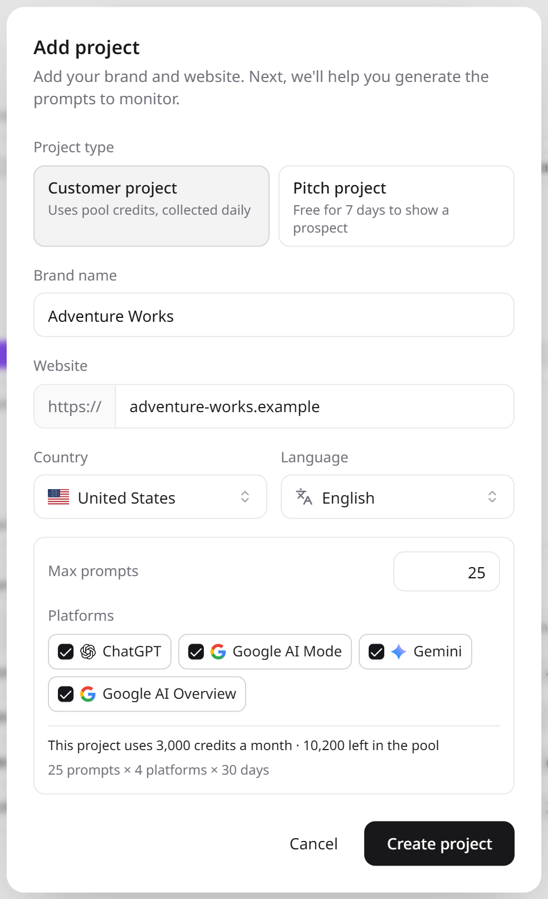
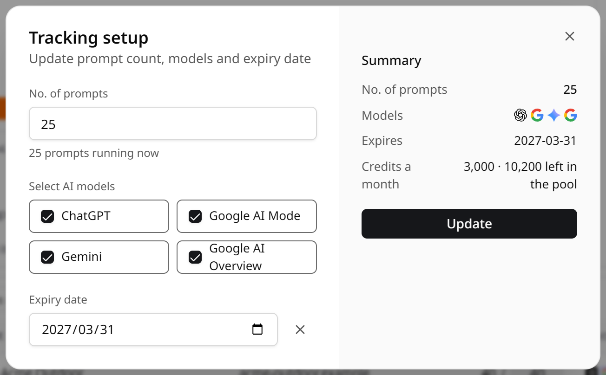

本页的操作都在 **Settings → Organization → Projects**（设置 → 组织 → 全部项目）里，只有组织所有者或管理员能做。每个项目行尾的 **⋯** 菜单里，会按项目的情况列出可用的操作：**Edit details**（编辑资料）、**Tracking setup**（监测设置）、**Convert to customer project**（转为正式项目，只对试跑项目）、**Pause tracking**（暂停采集）或 **Resume tracking**（恢复采集）、**Restore project**（恢复项目，只对已到期项目）和 **Delete**（删除）。

<Note>
下面的截图是 GEOly 的英文界面。正文先写英文界面上的名称，括号里是中文界面的对应名称。
</Note>

## 新建客户项目

1. 在「设置 → 项目」里点 **Add project**（添加项目）；
2. 填写客户的资料；
3. 在 **Project type**（项目类型）里选 **Customer project**（正式项目），它占用总池额度、每天采集；
4. 在 **Allocation**（分配）里填 **Max prompts**（最多提示词），并勾选要监测的 **Platforms**（平台）；
5. 看表单下方那一行，它会显示这个项目要占多少、总池还剩多少，比如「这个项目每月占 900 额度 · 总池剩 17,700」。如果提示超出总池，就调低提示词数或少选平台；
6. 完成添加。

新建客户项目要同时满足三件事：至少 900 额度，总池余量够，还有空的客户项目名额。已到期和已暂停的客户项目也占名额，试跑项目不占。

名额用完时，系统会建议你换更大的套餐。买额度不管用，因为客户项目个数由套餐决定。已经是 Agency Scale 的话，请联系我们做定制。

## 修改提示词数量、平台和到期时间

1. 在项目行尾打开 **⋯**，选 **Tracking setup**（监测设置）；
2. 在 **No. of prompts**（提示词数量）里设这个项目的最多提示词。弹窗会显示现在在跑多少条，不能低于这个数；
3. 在 **Select AI models**（选择 AI 平台）里勾选要监测的平台，至少选 1 个；
4. 在 **Expiry date**（到期时间）里选一个日期，或者选 **No expiry**（不到期）。**Clear**（清空）会去掉已选的日期；
5. 核对 **Summary**（摘要）：**No. of prompts**（提示词数）、**Models**（平台）、**Expires**（到期）和 **Credits a month**（每月额度），以及总池还剩多少；
6. 点 **Update**（更新）。提示词数量、平台和到期时间一次保存。

新的提示词数量和平台从第二天的采集起生效。

小改动也可以直接在列表里改：

- 在 **Used / allocated prompts**（已用 / 已分配）那一格的小框里输入新的最多提示词，回车保存；
- 在 **Platforms**（平台）那一格点 **+**，勾选或取消平台，看下方显示的额度变化，再点 **Update**（更新）。

### 到期时间

客户合同在某天结束时，给项目设个到期时间，到点自动停。

- 最早只能选明天：按 UTC 和你本地时间各算一个「明天」，取较晚的那天。选早了，弹窗会提示最早可选的日期。
- 选的日期当天 00:00（UTC）起，项目停用。
- **No expiry**（不到期）表示项目跟着组织的订阅走。
- 列表里会显示 **Expires**（到期）加日期，过了这天显示 **Expired**（已到期）。

### 项目到期后会怎样

- 监控和数据更新停止，项目的数据全部保留；
- 这个项目的例行任务不再运行，GEOly 会通知你例行任务因为项目到期没有运行；
- 同组织的其他项目不受影响；
- 这个项目不再占总池；
- 恢复之前，不能编辑它的资料，也不能改监测设置。

<Warning>
已到期的客户项目照样占客户项目名额。要腾出名额，只能删除这个项目。
</Warning>

## 恢复已到期的项目

1. 打开 **Expired**（已到期）标签，在项目行尾打开 **⋯**，选 **Restore project**（恢复项目）；
2. 弹出的是监测设置弹窗。重新设一个将来的到期时间，或者选 **No expiry**（不到期）；
3. 设好最多提示词和平台。系统默认给的分配不会低于这个项目原来的分配；
4. 点 **Restore project**（恢复项目），从下一轮起照常采集。

恢复后项目重新计入总池，所以总池要有足够余量。不够的话，先调低别的项目，或联系我们调高总池。到期前处于暂停状态的项目，恢复后直接回到采集中。

试跑项目到期不能恢复。要接着采，请把它[转为正式项目](/zh/agencies/pitch-projects)。

## 暂停与恢复采集

暂时不做某个客户、但想保留项目和数据时，可以暂停项目。

**暂停：**

1. 在项目行尾打开 **⋯**，选 **Pause tracking**（暂停采集）；
2. 看清弹窗里的说明：从现在起不再采集新数据，暂停期间漏掉的数据以后补不回来；历史数据都保留，照常能看、能改。这个项目占用的额度会还回总池；
3. 点 **Pause project**（暂停项目）。

项目会移到 **Paused**（已暂停）标签，并显示 **Paused · not counted in the pool**（暂停中 · 不占总池）。暂停期间照样可以改它的最多提示词和平台。

**恢复：**

1. 在 **Paused**（已暂停）标签里打开项目的 **⋯** 菜单，选 **Resume tracking**（恢复采集）；
2. 弹窗会显示这个项目需要多少额度、总池还剩多少；
3. 点 **Resume project**（恢复项目），从下一轮起照常采集。

总池不够时，先调低这个项目或别的项目的分配。如果暂停时组织的已分配合计已经超出总池，要先把分配调回总池以内，才能恢复这个项目。

已暂停的项目照样占客户项目名额。已到期的项目和试跑项目都不能暂停或恢复采集。

## 删除项目

1. 在项目行尾打开 **⋯**，选 **Delete**（删除）；
2. 输入项目名确认，再点 **Delete permanently**（永久删除）。

删除后，这个项目的提示词、AI 回答、引用、竞品、集成与成员授权全部永久删除，无法恢复；绑定这个项目的 API 密钥也会失效。数据在后台清理，期间项目显示 **Deleting**（删除中）。项目名额和额度在删除后马上释放。

有几种项目不能在这里自助删除，需要联系客服：组织合并时迁移过来的项目、历史数据很多的项目，以及组织开通前的预览项目。

## 用文件夹整理项目

在列表上方的工具栏里打开 **Folders**（文件夹），选 **Create folder**（新建文件夹），可以按客户经理、市场等给项目分组。文件夹只影响这一页的显示，不影响采集，也不影响谁能看到什么。

## 什么时候该重新分配额度

遇到下面几种情况，看一眼 **Allocated credits / pool**（已分配额度 / 总池）：

- **客户不续约了**：暂停项目、等它到期，或者删除，把额度收回来；
- **重点客户要加量**：调高它的最多提示词，或者加平台；
- **新客户签约了**：新建或转正之前，先确认总池还有余量。
