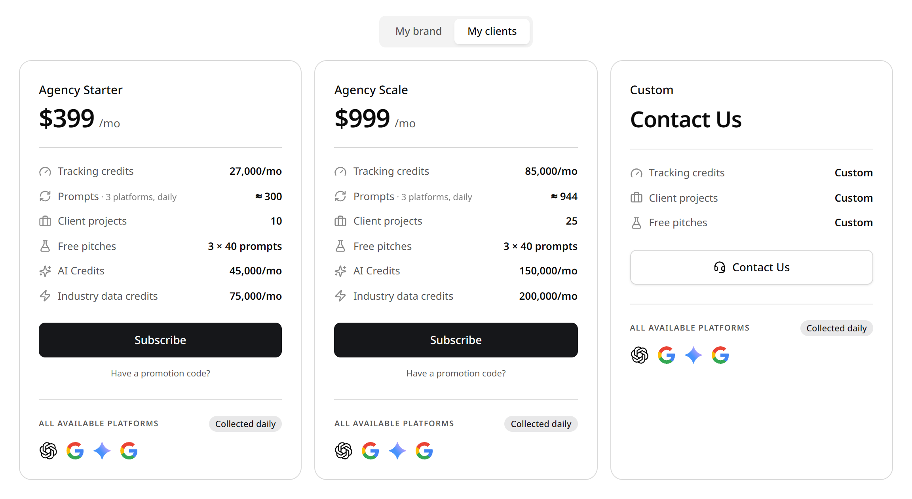

代理商套餐适合在一个 GEOly 组织里给多个客户品牌做 GEO 的代理商。每个客户一个项目。套餐不再给整个组织一个提示词上限，而是给一个**监测额度**总池：每个客户项目分多少、监测哪几个 AI 平台，都由你来定。你还可以给潜在客户开免费 7 天的**试跑项目**，签约前就拿真实数据去谈。

<Note>
下面的截图是 GEOly 的英文界面。正文先写英文界面上的名称，括号里是中文界面的对应名称。
</Note>

## 和普通套餐有什么不同

| | 普通套餐（Basic、Grow、Advanced、Plus） | 代理商套餐 |
| --- | --- | --- |
| 套餐限制什么 | 整个组织共用一个提示词上限，外加项目个数 | 一个监测额度总池，外加客户项目个数 |
| AI 平台 | 整个组织统一选：Basic 任选 1 个，Grow 任选 2 个，Advanced 和 Plus 全部 4 个 | 每个项目单独选，4 个在售平台都能选 |
| 试跑项目 | 没有 | 同时 3 个，免费 |
| 暂停项目 | 不能 | 可以，暂停期间这个项目的额度还回总池 |
| 付费方式 | 月付或年付 | 只有月付 |
| 免费试用 | Basic 和 Grow 有 3 天 | 没有 |

4 个在售平台是 ChatGPT、Google AI Mode、Gemini 和 Google AI Overviews。

## 两档套餐

| | Agency Starter | Agency Scale |
| --- | --: | --: |
| 价格 | $399 / 月 | $999 / 月 |
| 每月监测额度 | 27,000 | 85,000 |
| 约合多少条提示词（3 个平台、每天跑） | ≈ 300 条 | ≈ 944 条 |
| 客户项目 | 10 个 | 25 个 |
| 试跑项目 | 同时 3 个，每个最多 40 条提示词 | 同时 3 个，每个最多 40 条提示词 |
| 每月 AI 额度（AI Credits） | 45,000 | 150,000 |
| 每月行业数据额度 | 75,000 | 200,000 |
| AI 平台 | 全部 4 个，每个项目单独选 | 全部 4 个，每个项目单独选 |
| 采集频率 | 每天 | 每天 |
| 席位 | 不限 | 不限 |
| 产品功能 | 按 Advanced 开放 | 按 Plus 开放 |

- 两档都按月付费，不提供试用，结账时可以用优惠码。
- 两档开放的产品功能包括 ChatGPT Ads 分析、行业数据工具、公开报告导出 PDF、90 天时间范围等。GEO 审计每类页面最多抽样：Agency Starter 10 个，Agency Scale 50 个。
- Agency Scale 还不够用时，账单页上另有一张 **Custom**（定制）卡，点卡上的 **Contact Us**（联系我们）。

## 怎么用

1. **买套餐**：打开 **Settings → Organization → Billing**（设置 → 组织 → 账单），选 **My clients**（我的客户）后订阅。详见[购买与账单](/zh/agencies/billing)。
2. **每个客户建一个项目**：设好这个项目最多跑多少条提示词、监测哪些平台，项目就从总池里占相应的额度。详见[监测额度](/zh/agencies/tracking-credits)和[管理客户项目](/zh/agencies/manage-projects)。
3. **用试跑拿单**：给潜在客户开免费试跑项目；签约后转为正式项目，数据全部保留。详见[试跑项目](/zh/agencies/pitch-projects)。
4. **拉团队和客户进来**：席位不限；每个客户只给他自己项目的权限。详见[成员与客户访问](/zh/agencies/members-and-access)。

买套餐、分额度、试跑、暂停、设到期时间、删项目，都由组织所有者或管理员操作。

## 本组页面里的几个词

- **客户项目**：给已签约客户做的项目，占用总池额度，每天采集。账单卡和用量卡上叫「客户项目」（Client projects），**Add project**（添加项目）弹窗和转正菜单里叫「正式项目」（Customer project），指的是同一种项目。
- **试跑项目**：给潜在客户免费跑 7 天的项目。账单卡上叫「免费试跑」（Free pitches）。
- **监测额度**（Tracking credits）：套餐里用来做监测的额度。1 额度 = 1 条提示词在 1 个平台上跑 1 天。
- **总池**：套餐包含的全部监测额度。
- **分配**：某个项目从总池里占下的那一部分。

## 本组页面

<Columns cols={2}>
  <Card title="监测额度" icon="gauge" href="/zh/agencies/tracking-credits">
    额度怎么算、总池怎么分、用量在哪里看。
  </Card>
  <Card title="管理客户项目" icon="folder-kanban" href="/zh/agencies/manage-projects">
    新建项目，改提示词、平台和到期时间，暂停、恢复、删除。
  </Card>
  <Card title="试跑项目" icon="flask-conical" href="/zh/agencies/pitch-projects">
    给潜在客户免费跑 7 天，签约后转正。
  </Card>
  <Card title="成员与客户访问" icon="users" href="/zh/agencies/members-and-access">
    团队里谁能做什么，怎么让客户只看到自己的项目。
  </Card>
  <Card title="购买与账单" icon="credit-card" href="/zh/agencies/billing">
    购买、升级、降档、从普通套餐换过来、取消。
  </Card>
  <Card title="常见问题" icon="circle-help" href="/zh/agencies/faq">
    代理商最常问的问题，简短回答。
  </Card>
</Columns>
