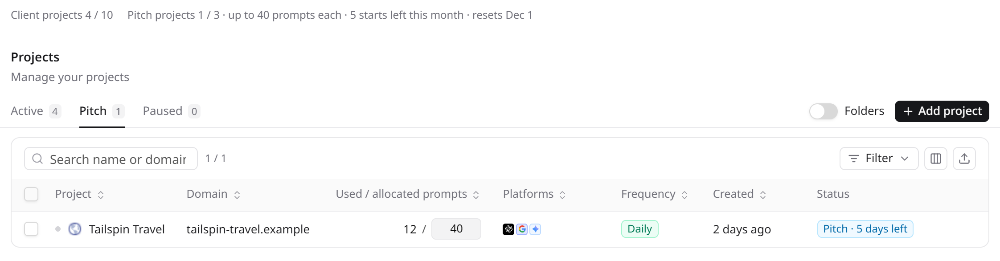

试跑项目让你在潜在客户签约之前，就给他看 AI 回答是怎么对待他的品牌的。它是免费的：不占监测额度，也不占客户项目名额。客户签约后，把它转为正式项目，试跑期间采到的数据全部保留。

试跑项目只在代理商套餐里有。只有组织所有者或管理员能新建和转正。

<Note>
下面的截图是 GEOly 的英文界面。正文先写英文界面上的名称，括号里是中文界面的对应名称。
</Note>

## 规则

| | Agency Starter 和 Agency Scale |
| --- | --- |
| 同时在跑 | 最多 3 个 |
| 每个试跑项目的提示词 | 最多 40 条，这个上限调不了 |
| 跑多久 | 7 天，到点自动停，数据保留 |
| 每月能开几次 | 每个自然月（按 UTC）最多 6 次。**Add project**（添加项目）弹窗里会显示本月还能开几次、哪天重置 |
| AI 平台 | 用组织默认的平台，最多 3 个，不能按试跑项目单独选；弹窗里会显示这次用哪几个 |
| 额度 | 不占。试跑项目不计入总池，也不占客户项目名额 |

- 删除或转正一个试跑项目会空出一个名额，但不退还已用的次数。次数每月 1 日（UTC）重置。
- 试跑期间不能改提示词上限和平台，也不能暂停或恢复采集。要改这些，先转为正式项目。

## 新建试跑项目

1. 打开 **Settings → Organization → Projects**（设置 → 组织 → 全部项目），点 **Add project**（添加项目）；
2. 填写潜在客户的资料；
3. 在 **Project type**（项目类型）里选 **Pitch project**（试跑项目）：
   - 显示 **Pitch slots full**（试跑名额已满）时，先删掉一个试跑项目或转正一个；
   - 本月次数用完时，弹窗会显示哪天重置；
4. 确认这次要用的平台，完成添加。

项目会出现在 **Pitch**（试跑）标签里，并显示剩余天数，比如 **Pitch · 7 days left**（试跑中 · 还剩 7 天）。像其他项目一样加提示词就行，最多 40 条，做法见[提示词](/zh/analytics/geoly-prompts)。7 天后状态变成 **Pitch ended**（试跑已结束），停止采集。

## 把试跑项目转为正式项目

试跑中、已结束的试跑项目都可以转正。

1. 在 **Pitch**（试跑）标签里打开项目的 **⋯** 菜单，选 **Convert to customer project**（转为正式项目）；
2. 设好最多提示词，选好平台。弹窗会显示现在在跑多少条；
3. 点 **Convert to customer project**（转为正式项目）。

从下一轮起，这个项目像其他客户项目一样每天采集，试跑期间的数据全部保留。转正后它占用总池额度，也占一个客户项目名额。

下面两种情况转不了：

- **客户项目名额满了**：先删掉一个客户项目，或联系我们调高；
- **总池余量不够**：先调低别的项目的分配，或联系我们调高总池。

如果试跑项目显示的是 **Expired**（已到期），而不是 **Pitch ended**（试跑已结束），请先联系客服，再转正。

## 订阅结束时

订阅结束，或者组织离开代理商套餐时，还在跑的试跑项目当场结束，数据保留。以后回到代理商套餐，仍然可以把它们转正。
