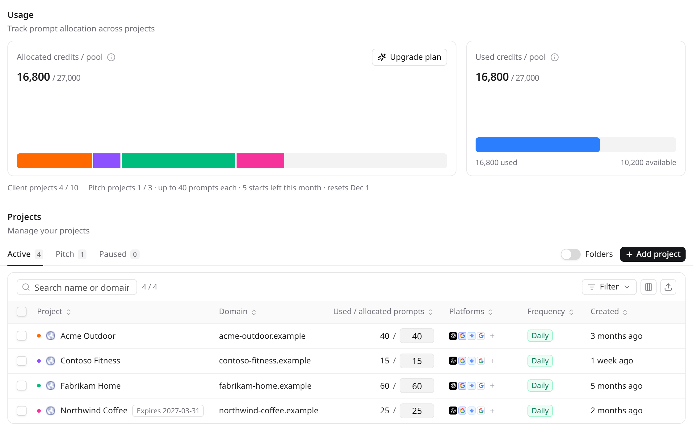

代理商套餐给你一个监测额度总池：Agency Starter 每月 27,000，Agency Scale 每月 85,000。每个客户项目从总池里占一部分，占多少取决于你定的两件事：这个项目最多跑多少条提示词，在几个平台上跑。

<Note>
下面的截图是 GEOly 的英文界面。正文先写英文界面上的名称，括号里是中文界面的对应名称。
</Note>

## 额度怎么算

<Note>
**1 监测额度 = 1 条提示词 × 1 个平台 × 1 天**。一个月固定按 30 天算，不看当月实际有几天。
</Note>

一个项目每月占用的额度 = **最多提示词 × 平台数 × 30**。例如：

- 10 条提示词、3 个平台：10 × 3 × 30 = **900** 额度 / 月；
- 50 条提示词、4 个平台：50 × 4 × 30 = **6,000** 额度 / 月；
- Agency Starter 的 27,000 额度，3 个平台每天跑约 300 条提示词，4 个平台全开约 225 条；
- Agency Scale 的 85,000 额度，3 个平台约 944 条，4 个平台全开约 708 条。

### 举例：Agency Starter 分给三个客户

| 客户 | 最多提示词 | 平台数 | 每月额度 |
| --- | --: | --: | --: |
| 客户 A | 50 | 3 | 4,500 |
| 客户 B | 30 | 4 | 3,600 |
| 客户 C | 20 | 2 | 1,200 |
| **合计** | | | **9,300** |

27,000 里还剩 17,700，可以给新客户，也可以给这三个客户加提示词或平台。

## 按分配占额度，不按实际跑了多少

<Note>
项目一旦分到额度，用没用满都照样占着。比如一个项目设了 50 条、3 个平台，就算只有 40 条在跑，也占 4,500 额度。想腾出额度，就调低它的最多提示词、去掉平台、暂停它，或者删掉它。
</Note>

下面这些项目不计入总池：

- 已暂停的项目；
- 试跑项目（在跑的和已结束的都不算）；
- 已到期的项目；
- 删除中的项目。

## 分配规则

- **每个项目最少 900 额度**：例如 10 条 × 3 个平台，或 30 条 × 1 个平台。
- **不能低于在跑条数**：最多提示词不能调到在跑条数以下。要先归档几条，再调低。系统不会替你停采或自动归档。
- **每个项目各管各的上限**：代理商套餐没有组织级的提示词上限，每个项目最多加到它自己的最多提示词。
- **平台按项目选**：每个项目至少选 1 个，从 4 个在售平台里选。改平台会按新的平台数重算这个项目的额度，两次修改之间不需要间隔。账单页上那个给整个组织选平台的入口，代理商套餐不用。
- **从第二天起生效**：改了分配或平台，从第二天建采集任务时生效。手动运行、重跑、补采都不另扣额度。
- **同一时间只能一个人改**：如果同事正在改分配，会提示「有人正在修改这个组织的分配，请稍后再试」。

## 总池不够用时

一次修改要的额度比总池剩下的多，系统不会保存，并告诉你还剩多少、这次要多少。你可以：

- 调低别的项目的最多提示词或平台；
- 暂停一个暂时不做的项目；
- 从 Agency Starter [升级](/zh/agencies/billing)到 Agency Scale；
- 在项目页点 **Contact us to raise the pool**（联系我们调高总池）。

如果已分配的合计超过了总池（比如总池被调小了），已有分配照常采集；但在调低之前，不能再调高分配、加平台或新建项目。调低一律可以。

## 未分配的项目

用别的方式建出来的项目（比如由 Agent 或新手引导建的）可能显示 **Unallocated**（未分配）。它照常采集在跑的提示词，并按在跑条数占总池；但在组织所有者或管理员到项目页给它设好最多提示词之前，不能再加提示词。

## 在哪里看分配和用量

打开 **Settings**（设置），点 **Organization**（组织）下的 **Projects**（全部项目，页面标题是「项目」）。应用里的提示把这一页叫「设置 → 项目」，本组页面也这么叫。

顶部的 **Usage**（用量）里有：

- **Allocated credits / pool**（已分配额度 / 总池）：分给各项目的额度合计占总池多少。暂停、试跑、已到期的项目不计入。
- **Used credits / pool**（已用额度 / 总池）：各项目在跑提示词实际占用的额度合计；总池包含还没分出去的部分。
- **Client projects**（客户项目），例如 `4 / 10`：现有客户项目数 / 套餐上限。
- **Pitch projects**（试跑项目），例如 `1 / 3 · up to 40 prompts each`：在跑的试跑项目数 / 3 个。
- **Contact us to raise the pool**（联系我们调高总池）。

下面的项目列表分 **Active**（进行中）、**Pitch**（试跑）、**Paused**（已暂停）、**Expired**（已到期）、**All**（全部）几个标签。每个项目显示：

- **Project**（项目）和 **Domain**（域名）；
- **Used / allocated prompts**（已用 / 已分配），比如 `40 / 50`：前面是在跑条数，后面是最多提示词。把鼠标移上去能看到这个项目的花费，比如「每月占 4,500 额度（50 条 × 3 个平台 × 30 天）」；
- **Platforms**（平台）：这个项目监测的平台；
- **Frequency**（频率）：**Daily**（每天）或 **Not collecting**（不采集）；
- **Created**（创建时间）；
- **Status**（状态）：**Active**（有效）、**Expires**（到期）加日期、**Paused**（已暂停）、**Pitch**（试跑中）加剩余天数、**Pitch ended**（试跑已结束）、**Expired**（已到期）或 **Deleting**（删除中）。

要改某个项目的最多提示词或平台，见[管理客户项目](/zh/agencies/manage-projects)。
