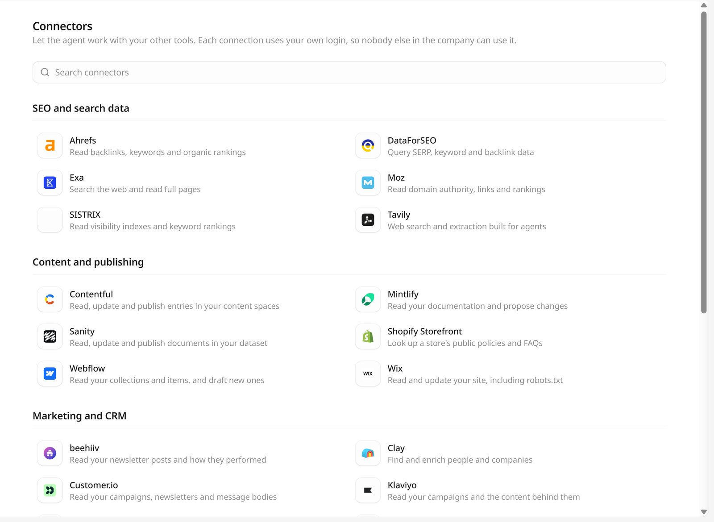
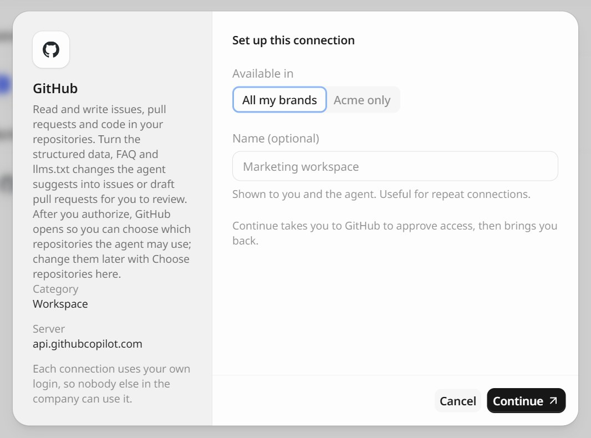
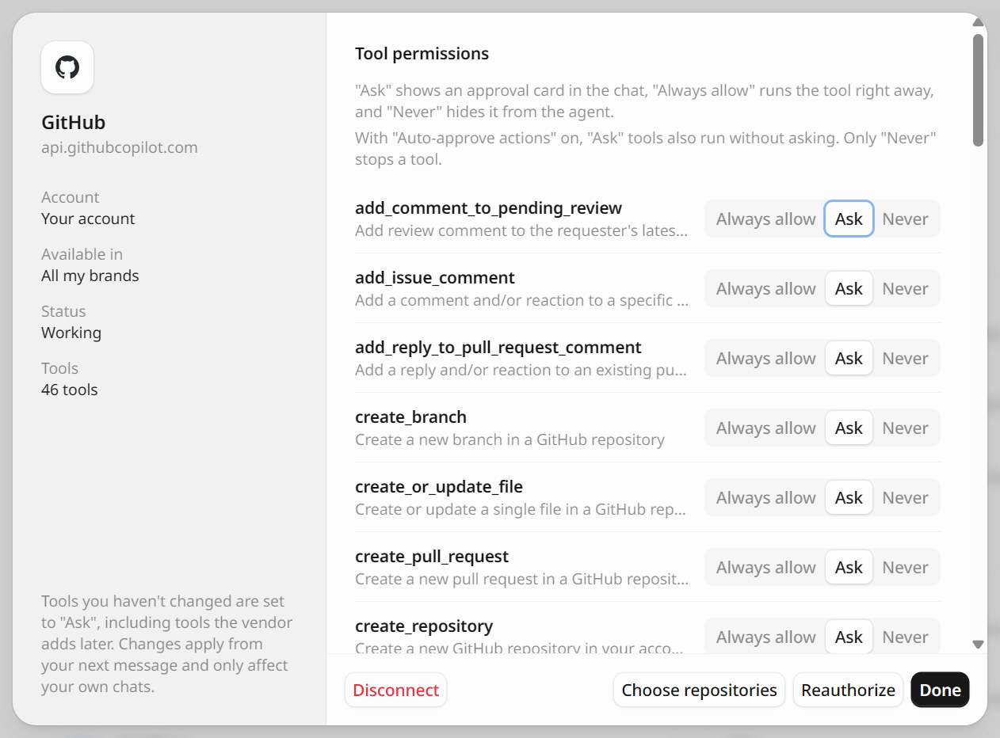

连接器让 GEOly Agent 能使用团队的其他工具。连上之后，Agent 可以把 GEOly 的数据和 SEO 工具对照、读写内容管理系统里的内容、为一项修复建 issue，或把总结用邮件发出去。

每个连接器都是对方官方提供的 MCP 服务。连接时，对方会告诉 GEOly 有哪些工具可用，每个工具 Agent 能不能用、要不要先问，都可以单独设置。

<Note>
下面的截图是 GEOly 的英文界面。正文先写英文界面上的名称，括号里是中文界面的对应名称。
</Note>

在 Agent 侧栏打开 **Connectors**（连接器），或直接打开 `app.geoly.ai/agent/connectors`。

## 连接只属于个人

- **只有本人能用**：每个连接都用个人的账号或密钥登录，公司里其他人用不了。它只在本人的对话和本人创建的定时任务里起作用；
- **按组织区分**：连接属于本人在当前组织下的账号，每人在每个组织最多 10 个连接；
- **选择可用范围**：连接时在 **Available in**（可用范围）里选 **All my brands**（我的全部品牌），或只给当前品牌用；
- **起个名字**（可选）：名称会显示给本人和 Agent，同一个工具连了多次时便于区分，比如两个 Notion 工作区。

连接前需要在 GEOly 里选好一个品牌。

## 连接器目录

连接器按页面上的分组列出。「连接方式」一列说明每个连接器怎么登录（见下文「连接一个工具」）。

### SEO and search data（SEO 与搜索数据）

| 连接器 | Agent 能做什么 | 连接方式 |
| --- | --- | --- |
| Ahrefs | 查反链、关键词与自然搜索排名 | 登录授权 |
| DataForSEO | 查 SERP、关键词与反链数据 | 登录授权 |
| Exa | 搜索网页并读取全文 | API key |
| Moz | 查域名权重、外链与排名 | 登录授权 |
| SISTRIX | 查可见度指数与关键词排名 | 登录授权 |
| Tavily | 面向 Agent 的网页搜索与抓取 | API key |

### Content and publishing（内容与发布）

| 连接器 | Agent 能做什么 | 连接方式 |
| --- | --- | --- |
| Contentful | 读写并发布内容空间里的条目 | 登录授权 |
| Mintlify | 读取文档站并提出修改 | 登录授权 |
| Sanity | 读写并发布数据集里的文档 | 登录授权 |
| Shopify Storefront | 查店铺公开的政策与常见问题 | 店铺域名 |
| Webflow | 读写集合与条目，起草新内容 | 登录授权 |
| Wix | 读取并更新网站，包括 `robots.txt` | 登录授权 |

### Marketing and CRM（营销与 CRM）

| 连接器 | Agent 能做什么 | 连接方式 |
| --- | --- | --- |
| beehiiv | 读取 newsletter 文章与表现 | 登录授权 |
| Clay | 查找并补全人员与公司信息 | 登录授权 |
| Customer.io | 读取营销活动、newsletter 与邮件正文 | 登录授权 |
| Klaviyo | 读取营销活动及其内容 | 登录授权 |
| lemlist | 读取活动表现，起草触达序列 | 登录授权 |
| Octolens | 读取社媒提及，管理追踪的关键词 | 登录授权 |
| Resend | 发送邮件，读写联系人与群发 | 登录授权 |

### Workspace（协作）

| 连接器 | Agent 能做什么 | 连接方式 |
| --- | --- | --- |
| Atlassian | 搜索 Confluence 页面与 Jira issue | 登录授权 |
| GitHub | 读写仓库里的 issue、PR 与代码，详见[连接 GitHub](/zh/integrations/github-connector) | 登录授权后选择仓库 |
| Granola | 读取会议纪要与转写 | 登录授权 |
| Linear | 读取并新建 issue | 登录授权 |
| Notion | 搜索页面与数据库 | 登录授权 |
| Superhuman | 用本人邮箱起草并发送邮件 | 登录授权 |

### Data and infrastructure（数据与基础设施）

| 连接器 | Agent 能做什么 | 连接方式 |
| --- | --- | --- |
| Apify | 运行 Actor 并读取数据集 | 登录授权 |
| PostHog | 读取漏斗、洞察与事件 | 登录授权 |

在 **Search connectors**（搜索连接器）里输入名称可以快速查找。

## 连接一个工具

点一个连接器，打开 **Set up this connection**（设置这个连接）。左侧说明这个连接器能做什么、连的是哪个服务器。然后按连接方式操作：

<Tabs>
  <Tab title="登录授权">
    大多数连接器用对方自己的登录授权（OAuth）：

    1. 选好 **Available in**（可用范围），**Name**（名称）可以不填；
    2. 点 **Continue**（继续），GEOly 会跳到对方页面确认授权，完成后自动回到 GEOly。

    之后这个连接器会出现在 **Connected**（已连接）里。GEOly 拿不到对方工具的登录密码。

    
  </Tab>
  <Tab title="API key">
    Exa 和 Tavily 用 API key 连接：

    1. 点 **Get one**（去获取），到对方的控制台创建一个 key；
    2. 粘贴到 **API key**，选好 **Available in**（可用范围），**Name**（名称）可以不填；
    3. 点 **Connect**（连接）。

    GEOly 会加密保存这个 key，页面上只显示打码后的内容。
  </Tab>
  <Tab title="店铺域名">
    Shopify Storefront 不需要登录。Agent 只读取店铺公开的退换、配送、保修等政策与常见问题，用来核对 AI 回答里说到的店铺政策跟店里是否一致。

    1. 在 **Store domain**（店铺域名）里填店铺名（如 `my-store`，会补成 `my-store.myshopify.com`）或完整域名（如 `my-brand.com`）；
    2. 点 **Connect**（连接）。

    每家店连一次即可，这类连接不保存任何凭据。
  </Tab>
</Tabs>

## 在对话里使用连接器

连好之后直接提问即可，Agent 会按任务挑选合适的连接器工具，例如：

- 「把我们主要提示词里 AI 引用的域名，和它们在 Ahrefs 里的反链数据对照一下。」
- 「为每个缺少 FAQ 结构化数据的页面在 Linear 里建一个 issue。」
- 「把本周的可见度总结存成 Notion 里的一个页面。」

在输入框里输入 `@`，在 **Connectors**（连接器）分组里选一个连接器，可以直接点名让 Agent 用它。

[技能](/zh/agent/skills)和[定时任务](/zh/agent/overview)里也能用连接器。定时任务只会用设为 **Always allow**（始终允许）的工具，并且用的是创建任务的人的连接。

## 工具权限

在 **Connected**（已连接）里点一个连接即可管理。在 **Tool permissions**（工具权限）里逐个设置工具：

| 权限 | 效果 |
| --- | --- |
| **Ask**（询问） | Agent 调用前会在对话里弹出审批卡片。 |
| **Always allow**（始终允许） | 直接执行。 |
| **Never**（从不） | Agent 看不到这个工具。 |

没改过的工具都是 **Ask**（询问），对方后来新加的工具也一样。改动从下一条消息起生效，只影响本人的对话。打开了 **Auto-approve actions**（自动批准改动）时，**Ask** 的工具也会直接执行，只有 **Never** 拦得住。

同一个弹窗里还能看到 **Account**（账号）、**Available in**（可用范围）、**Status**（状态）和这个连接有多少个 **Tools**（工具）。

## 重新授权或断开

- **Needs reauthorization**（需要重新授权）：对方不再接受 GEOly 的访问，比如授权过期，或在对方那边撤销了授权。打开这个连接，点 **Reauthorize**（重新授权）；
- **Disconnect**（断开连接）：从 GEOly 里移除这个连接，Agent 不能再用它。登录授权类的连接，如需彻底撤销，还要到对方那边撤销应用授权；API key 在对方那边仍然有效，不用了可以到对方的设置里删掉。

## 分享用过连接器的对话

公开分享对话时，来自连接器的内容不会出现在分享页面里。因为 Agent 的回答本身可能引用了这些内容，分享前 GEOly 也会提醒先确认对话可以公开。
