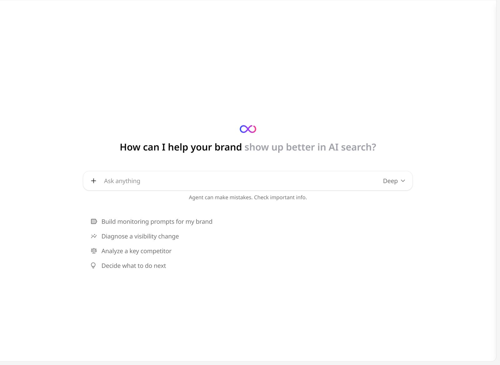

GEOly Agent 是一个基于品牌 GEOly 数据工作的对话助手。可以问它可见度为什么变了、竞品靠什么胜出、接下来先改什么。它会自己挑选需要的数据，展示每一步做了什么，并在回答里给出所用的数字。它读到的数据与 GEOly 页面上看到的一致，用的也是与 [GEOly MCP](/zh/developers/mcp/introduction) 相同的一套工具。

<Note>
下面的截图是 GEOly 的英文界面。正文先写英文界面上的名称，括号里是中文界面的对应名称。
</Note>

<Note>
组织套餐包含 AI Credits 时才能使用 Agent。套餐不含 AI Credits 时，菜单里不会出现 Agent。
</Note>

## 打开 Agent

- 点击左侧图标栏的 **Agent**，或直接打开 `app.geoly.ai/agent`；
- 在其他页面点击顶栏的 **Agent**，Agent 会以侧边面板打开，可以边看页面边提问。点 **Open in Agent**（在 Agent 中打开）可以把这段对话移到 Agent 整页。

Agent 侧栏包括 **New chat**（新对话）、[**Skills**](/zh/agent/skills)（技能）、[**Connectors**](/zh/agent/connectors)（连接器）、**Usage**（用量，见下文「AI 用量」）以及 **Recent chats**（最近对话）。

## 开始对话

在 **Ask anything** 输入框里输入问题后回车，或者点输入框下方的起手建议：

- **Build monitoring prompts for my brand**（帮我为品牌搭建一组监控提示词）
- **Diagnose a visibility change**（诊断最近的可见度变化）
- **Analyze a key competitor**（分析一个主要竞品）
- **Decide what to do next**（接下来该优先做什么）

后三条会启动对应的[技能](/zh/agent/skills)。对应技能被关闭时，这条建议不显示。

想让 Agent 针对具体对象时：

- 输入 `@`，提及某个提示词、竞品、行业，或已连接的[连接器](/zh/agent/connectors)；
- 输入 `/` 加命令运行[技能](/zh/agent/skills)，例如 `/visibility-change`；
- 点击 **+**，选择 **Add file**（添加文件）或某个技能。每条消息最多附 3 个文件，单个不超过 10 MB，支持 `.txt`、`.md`、`.csv`、`.xlsx`、`.docx`、`.pptx`、`.pdf`、`.png`、`.jpg`、`.jpeg`。附件会随这段对话的每一轮一起发送，每次都计入额度。

<Tip>
把期望的结果说清楚：时间范围、平台和输出格式。例如「对比过去 30 天我们在 ChatGPT 和 Perplexity 上的可见度，按话题出一张表」。
</Tip>

## 选择 Fast 或 Deep

点击输入框右侧的模式菜单，默认是 **Deep**。

| 模式 | 说明 |
| --- | --- |
| **Fast**（快速） | 不先思考，更快，适合简单查数。 |
| **Deep**（深度思考） | 先思考再回答，更准，但更慢、用量更多。 |

运行技能的对话轮次，无论选了哪个模式，都按 **Deep** 运行；如果 Agent 在回答中途自己选用了技能，从下一条消息起按 Deep 运行。同一个菜单里还有 **Ask before acting**（改动前先确认）开关，见下文「审批」。

## 查看 Agent 的工作过程

Agent 工作时可以看到它在做什么：

- **计划**：多步分析开始时，Agent 会在一张计划卡里列出步骤，做完一步勾一步，最后显示 **Plan complete**（计划完成）或 **Plan unfinished**（计划未完成）；
- **步骤**：每次取数都显示为一个步骤，展开可以看到它查了什么、拿回了什么；
- **推理**：**Deep** 模式下，展开 **Reasoning**（推理）可以看它是怎么得出结论的；
- **提问**：需要做决定时，Agent 会给出一张带选项的 **Question**（问题）卡片，可以选一个答案、自己填写，或点 **Skip**（跳过）；
- **建议追问**：回答结束后，输入框里会出现建议的下一个问题，按 **Tab** 即可采用。

Agent 也能搜索网页、读取对话里给出的链接。回答可能出错，重要的数字请回到出处核对。

## 审批

Agent 改动任何内容之前都会先征求同意。打开 **Ask before acting**（改动前先确认）时，Agent 在增删提示词、话题、竞品，触发采集，或调用外部工具前，会先在对话里弹出一张卡片，说明要做什么、用什么参数：

- **Approve**（批准）：执行这一次；
- **Approve ▾ → Always allow**（始终允许）：执行，并且在这段对话里之后同一个工具不再询问；
- **Deny**（拒绝）：不执行。

在模式菜单里关掉 **Ask before acting**，当前对话里的操作就不再逐次询问。如果希望新对话默认如此，点击左侧图标栏的 **Agent behavior**（Agent 行为，在 Agent 工作区内显示），打开 **Auto-approve actions**（自动批准改动）。这个设置只保存在当前浏览器，并且只影响新对话。

连接器的每个工具还有单独的权限，设为 **Never**（从不）的工具即使开了自动批准也不会被调用。详见[连接器](/zh/agent/connectors)页的「工具权限」。

## 通知

较长的分析可能需要几分钟。如果希望切到其他标签页时，Agent 回复完成或需要回应能收到浏览器通知：在 Agent 提示时点 **Turn on notifications**（打开通知），或点击左侧图标栏的 **Agent behavior**（Agent 行为，在 Agent 工作区内显示），打开 **Browser notifications**（浏览器通知）。如果浏览器拦截了 GEOly 的通知，需要先在浏览器的网站设置里允许。

## 管理对话

对话列在 **Recent chats**（最近对话）里。把鼠标移到某条对话上，打开它的菜单可以：

- **Rename**（重命名）；
- **Archive**（归档）：归档的对话移到 **Archived**（已归档），可以再 **Unarchive**（取消归档）；
- **Delete permanently**（彻底删除）已归档的对话：删除后无法恢复，分享链接也随之失效。

分享对话时点 **Share**（分享）：

- **Export as Markdown**（导出 Markdown）：把对话下载为 Markdown 文件；
- **Share Chat**（分享对话）：生成公开链接，**Revoke Link**（撤销链接）可以撤销。分享页面不包含来自连接器的内容；分享前 GEOly 也会提醒先确认对话内容可以公开。

## 定时任务

可以让 Agent 按计划自动执行指令，比如每周总结一次变化。定时任务在侧边面板里设置：

1. 在 Agent 工作区以外的任意页面，点击顶栏的 **Agent**；
2. 在侧边面板里点设置图标，打开 **Triggers**（触发器）；
3. 点 **Add trigger**（添加触发器），填写 **Run Instructions**（运行指令），例如「分析本周品牌在各平台的可见度，总结主要变化」；
4. 设置计划：**Every**（每）N 小时、天、周或月，具体时间、**Timezone**（时区）、**Start**（开始）日期，以及 **End**（结束）日期或 **Never**（永不）；
5. 按需打开 **Use connectors**（用连接器）。定时运行只会用设为 **Always allow**（始终允许）的连接器工具，并且用的是创建这个任务的人的连接。其他人修改指令后，连接器会停用，直到创建人重新保存任务。

触发器上会显示 **Next run**（下一次执行时间），关掉开关即可暂停。每次运行完成后，GEOly 会发一条通知，点开即可看到这次运行的对话和结果。

## AI 用量

Agent 对话消耗组织的 **AI Credits**。组织内所有品牌共用一个额度池，每个计费周期开始时重置。**Deep** 模式、附件和较长的分析会用掉更多额度。

在 Agent 侧栏打开 **Usage**（用量，`app.geoly.ai/agent/usage`）可以看到：

- **Agent credits**（Agent 额度）：本计费周期组织已用多少、还剩多少、何时重置；
- **Credits used per day**（按天用量）图表；
- **Usage this period**（本期用量）：可以 **By brand**（按品牌）或 **By member**（按成员）查看额度、对话数、消息数和占比；也可以在 **Billing period**（计费周期）里选择以前的周期。

这个额度池同样覆盖 [GEOly CLI](/zh/developers/cli)（`geoly run`）和 [Agent API](/zh/developers/agent-api)。这部分额度记在登录账号或密钥所属的成员名下；而对话数、消息数只统计 GEOly 应用内的 Agent 对话，所以两列不成比例。

本期额度用到 75% 后，输入框上方会出现提示，显示已用比例和重置日期。额度用完后，要等下个周期重置或升级套餐，才能继续发起新一轮对话。

## 相关页面

- [技能](/zh/agent/skills)：Agent 按品牌数据运行的固定工作流。
- [连接器](/zh/agent/connectors)：让 Agent 使用团队的其他工具。
- [行动](/zh/actions/overview)：可以交给 Agent 处理的修站行动。
