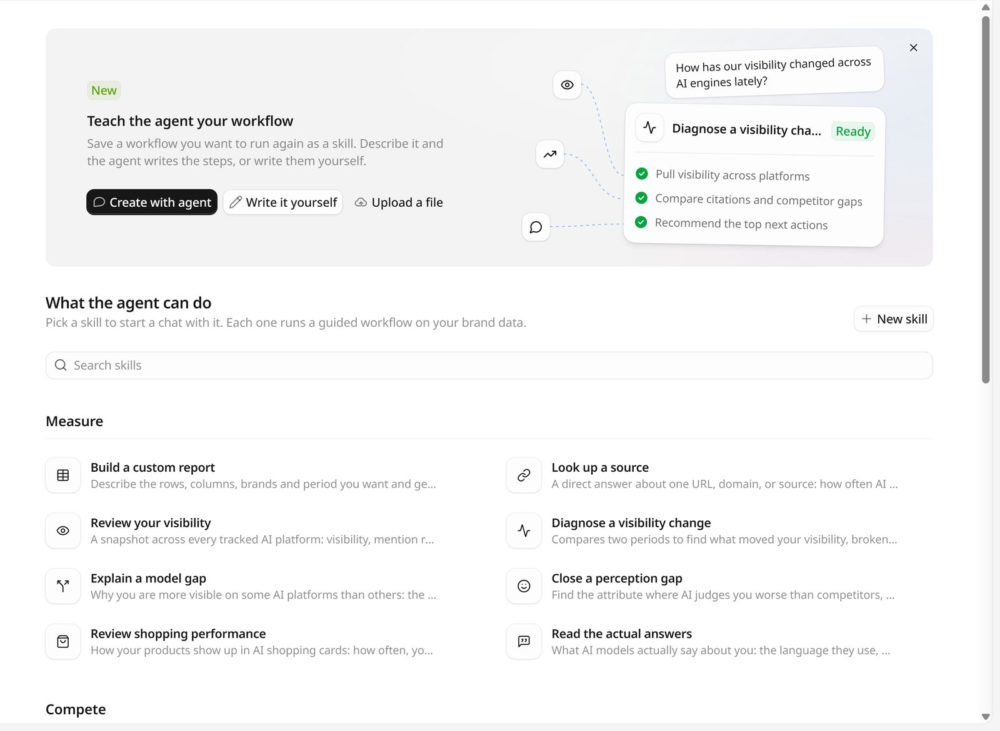

技能是一套保存下来的工作流：取哪些数据、怎么比较、最后交付什么。GEOly 自带一组内置技能，也可以新建自己的技能。用技能时，Agent 会按技能里的步骤处理项目数据，而不是每次从头摸索做法。

<Note>
下面的截图是 GEOly 的英文界面。正文先写英文界面上的名称，括号里是中文界面的对应名称。
</Note>

在 Agent 侧栏打开 **Skills**（技能），或直接打开 `app.geoly.ai/agent/skills`。

## 使用技能

运行技能有三种方式：

- 在 **Skills**（技能）页点一个技能，查看 **About this skill**（关于这个技能）和 **What happens**（会发生什么），再点 **Use skill**（使用技能），就会用这个技能开一段新对话；
- 在对话输入框里输入 `/` 加技能命令，例如 `/visibility-change`，命令后面可以接具体问题；
- 点输入框里的 **+**，在 **Skills**（技能）里选一个。

不点名技能也可以。问题和某个技能的说明对得上时，Agent 也会自己选用这个技能，并在同一段对话的后续追问里继续沿用。它最多可以同时用 3 个技能，比如一个回顾类技能，再加上排查数据为什么缺的技能。

运行技能的对话轮次一律按 **Deep**（深度思考）运行，因为技能都是多步分析；Agent 在回答中途自己选用技能时，从下一条消息起按 Deep 运行。参见 [GEOly Agent](/zh/agent/overview) 页的「选择 Fast 或 Deep」。

## 内置技能

内置技能按技能页上的分组排列，每个技能都列出了命令。

### Measure（衡量）

| 技能 | 命令 | 做什么 |
| --- | --- | --- |
| Build a custom report（搭一张自定义报表） | `/custom-report` | 说出要哪些行、列、品牌和时间段，直接搭好这张表，并写明排除了什么。 |
| Look up a source（查一个来源） | `/look-up-source` | 查一个网址或域名被 AI 引用多少次、有没有被 ChatGPT 搜到、出现在哪些提示词和平台；也能批量查。 |
| Review your visibility（回顾你的可见度） | `/visibility-review` | 一张快照看各 AI 平台上的可见度、提及率、引用、情感和声量份额，以及最强和最弱的平台。 |
| Diagnose a visibility change（诊断可见度变化） | `/visibility-change` | 对比两段时间，按平台、提示词、竞品和来源（含榜单类文章）找出是什么带动了可见度变化。 |
| Explain a model gap（解释平台差异） | `/model-gaps` | 解释你为什么在有的 AI 平台更容易被看到：差距落在哪些提示词上，各平台读的是哪些来源。 |
| Close a perception gap（缩小认知差距） | `/perception-gap` | 找出 AI 觉得你不如竞品的那项属性，用原文和来源说明原因，并告诉你该改什么。 |
| Review shopping performance（看单品表现） | `/shopping-performance` | 看你的商品在 AI 购物卡里出现得多频繁、货架份额多少，以及热门商品、卖家和价格。 |
| Read the actual answers（读原始回答） | `/read-answers` | 看 AI 回答原文怎么描述你、把你和谁放在一起提，以及哪些说法是错的。 |

### Compete（竞争）

| 技能 | 命令 | 做什么 |
| --- | --- | --- |
| Analyze a competitor（分析一个竞品） | `/analyze-competitor` | 拆解一个竞品：赢在哪些话题、什么时候开始涨、AI 在哪些地方更偏向它，以及背后的来源。 |
| Benchmark your pages（对标你的页面） | `/benchmark-pages` | 按页面类型给你和竞品排名：被引用次数、领先者、有这类页的品牌数，以及你缺的类型。 |

### Improve（改进）

| 技能 | 命令 | 做什么 |
| --- | --- | --- |
| Find what to fix first（找出先改什么） | `/next-actions` | 从网站问题、AI 不提你的提示词、没引用你的检索词和来源缺口里排出先改什么，你挑一条再展开。 |
| Find your content gaps（找内容缺口） | `/content-gaps` | 拿一个页面或你的话题，对照 AI 实际搜的词和不提你的提示词，列出没写到的子话题。 |
| Draft the content（起草内容） | `/draft-content` | 按 AI 实际搜的词，用发布时的语言直接写出页面：整篇初稿、FAQ 区块或补丁。 |
| Write from a content brief（按简报写页面） | `/content-brief` | 把一份内容简报写成它描述的页面，先问几个关键选择。 |
| Optimize your content（优化一个页面） | `/optimize-page` | 判断一个页面照现在的写法会不会被 AI 引用，给出要改的措辞和结构，改完还能复查。 |
| Audit ChatGPT's site queries（审 ChatGPT 的站内检索） | `/site-queries` | 把 ChatGPT 对你网站做的 `site:` 检索整理成审计，看它想在你站上找到什么。仅 ChatGPT 有这类数据。 |
| Correct a wrong claim（纠正一条说法） | `/correct-claim` | 把 AI 的一条错误说法追到背后的页面，给出自家页面的改法和给其他网站的外联稿。 |
| Check how you describe yourself（核对自我描述） | `/self-description` | 对比你自己各页面怎么介绍你、说法是否一致，并检查关键页面有没有能被模型整段引用的段落。 |
| Check claims against sources（核对说法出处） | `/check-claims` | 逐条核对 AI 关于你的说法：引用的来源有没有这么说、官网怎么写。 |
| GEO technical diagnosis（GEO 技术诊断） | `/tech-diagnosis` | 按 AI 获取信息的链路逐层检查你的官网：能不能抓到、读懂、切开、引用，并给出 P0–P2 整改清单。 |

### Set up（搭建）

| 技能 | 命令 | 做什么 |
| --- | --- | --- |
| Run prompt discovery（发现提示词） | `/prompt-discovery` | 逐个话题审发现的候选提示词（带相对搜索量），接受的转成监控提示词。 |
| Set up brand prompts（搭建监控提示词） | `/brand-prompt-setup` | 按认知、考虑、决策三段，逐个话题跑发现、挑出监控提示词，带品牌名的提示词按发现配比一起出。 |
| Set up shopping prompts（搭建购物提示词） | `/shopping-prompt-setup` | 把商品目录变成品类、商品对比和人群 × 意图的一组购物提示词。 |
| Audit your prompts（体检现有提示词） | `/prompt-audit` | 按覆盖、均衡、整洁给你在监控的提示词打分，并列出按优先级排的修改清单。 |
| Fix brand setup（补齐竞品库） | `/fix-brand-setup` | 找出回答里反复出现却没加进竞品的品牌，顺手理一理品牌库。 |
| Clean up topics and tags（清理话题与标签） | `/topic-cleanup` | 体检报表背后的话题、标签和项目资料，标出重复的和太薄的。 |
| Check crawlers and referrals（核对爬虫与访问） | `/check-crawlers` | 看哪些 AI 爬虫在抓你的页面、`robots.txt` 放行了哪些，以及已接入的数据里有多少 AI 带来的访问。 |

多数技能只读数据。Set up（搭建）组的技能还能新增或修改提示词、话题和竞品；和其他改动一样，每次改动前都会先弹审批卡（见 [GEOly Agent](/zh/agent/overview) 页的「审批」）。

### Help（帮助）

| 技能 | 命令 | 做什么 |
| --- | --- | --- |
| Ask how GEOly works（问 GEOly 怎么用） | `/how-geoly-works` | 从文档和定价页回答设置、指标、套餐额度和计费问题，再从 GEOly 的研究讲 AI 搜索怎么运作。 |
| Find out why data is missing（查数据为什么缺） | `/why-data-missing` | 图表、提示词、平台或集成没数据时，查出原因：还在采集或计算、被筛掉、监控停了、套餐限制，还是出了故障。 |

## 新建自己的技能

想反复使用的工作流可以存成技能。在技能页上用 **Teach the agent your workflow**（把你的工作流教给 Agent）横幅，或点 **New skill**（新建技能）。有三种方式：

<Tabs>
  <Tab title="让 Agent 来写">
    点 **Create with agent**（让 Agent 来写）。会打开一段对话，Agent 先问清这个工作流要做什么，再替你写好指令。保存前，它会弹出一张卡片，列出名称、命令、说明和指令，等你批准。
  </Tab>
  <Tab title="自己写">
    点 **Write it yourself**（自己写），或 **New skill → Write skill instructions**（新建技能 → 写技能指令），填写：

    - **Name**（名称），例如 `Weekly visibility digest`；
    - **Slash command**（斜杠命令）：只能用小写字母、数字和连字符，例如 `weekly-visibility-digest`；
    - **Description**（说明）：一句话。会显示在技能卡片上，Agent 也靠它判断什么时候该用这个技能；
    - **Instructions**（指令）：一步步写清 Agent 要做什么：取哪些数据、怎么比较、交付什么。

    然后点 **Create skill**（创建技能）。
  </Tab>
  <Tab title="上传文件">
    点 **Upload a file**（上传文件），或 **New skill → Upload a skill**（新建技能 → 上传技能），拖入一个不超过 64 KB 的 `.md` 或 `.txt` 文件，比如 `SKILL.md`。GEOly 会从文件里读出名称、说明和指令，核对无误后点 **Upload skill**（上传技能）。
  </Tab>
</Tabs>

自己的技能显示在技能页顶部的 **My skills**（我的技能）里。每人最多保留 20 个自己的技能，满了先删掉不用的再新建。自己的技能在分享之前只有你能看到。

## 分享技能

在自己的技能上打开菜单，点 **Share**（分享）。有三种分享方式：

- **Invite by email**（通过邮箱邀请）：逐个邀请本组织的成员，每人可以给 **Can use**（可使用）或 **Can edit**（可编辑）；
- **Share with this project**（共享给本项目）：能打开这个项目的人都可以使用；
- **Share with the whole organization**（共享给整个组织）：组织里每个人都可以使用，不管在哪个项目。

别人分享给你的技能显示在 **Shared with me**（共享给我）里，并标出创建人。拿到 **Can edit**（可编辑）权限时，你改的是共享的技能本身，所有能用它的人都会看到改动。只有创建人能分享或删除技能。

## 编辑、复制或删除技能

点一个技能，再打开 **More actions**（更多操作）：

- **Edit with agent**（用 Agent 编辑）：打开一段对话，Agent 先问你想改什么，再修改技能。内置技能会先复制一份到 **My skills**（我的技能），Agent 改的是副本；
- **Edit manually**（手动编辑）：打开表单，修改你建的技能，或别人以 **Can edit**（可编辑）分享给你的技能；
- **Duplicate**（复制）：把你的技能或别人分享给你的技能复制一份到 **My skills**（我的技能），方便改成自己的版本；
- **Delete**（删除）：删除你建的技能，之后对话里不能再用。

## 技能与连接器

技能可以像普通对话一样使用你的[连接器](/zh/agent/connectors)。设为 **Ask**（询问）的连接器工具在技能里同样会先弹审批卡，即使这个技能本身只读数据。

[例行任务](/zh/agent/routines)也可以用技能：在例行任务的指令里输入 `/` 加命令即可。

## 相关页面

- [GEOly Agent](/zh/agent/overview)
- [例行任务](/zh/agent/routines)
- [连接器](/zh/agent/connectors)
