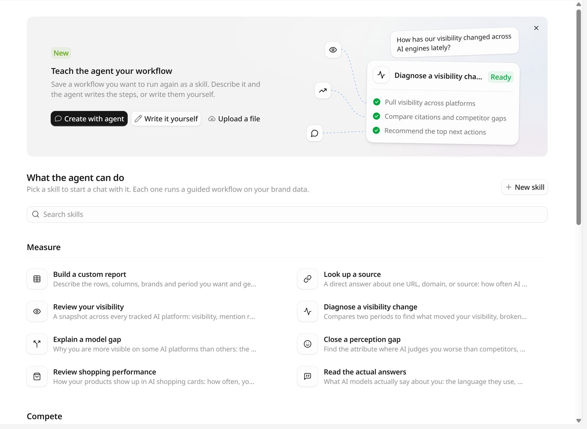

技能是一套保存下来的工作流：取哪些数据、怎么比较、最后交付什么。GEOly 自带一组内置技能，也可以新建自己的技能。用技能时，Agent 会按技能里的步骤处理品牌数据，而不是每次从头摸索做法。

<Note>
下面的截图是 GEOly 的英文界面。正文先写英文界面上的名称，括号里是中文界面的对应名称。技能名称在中英文界面里都显示英文，括号里的中文仅作说明。
</Note>

在 Agent 侧栏打开 **Skills**（技能），或直接打开 `app.geoly.ai/agent/skills`。

## 使用技能

运行技能有三种方式：

- 在 **Skills**（技能）页点一个技能，查看 **About this skill**（关于这个技能）和 **What happens**（会发生什么），再点 **Use skill**（使用技能），就会用这个技能开一段新对话；
- 在对话输入框里输入 `/` 加技能命令，例如 `/visibility-change`，命令后面可以接具体问题；
- 点输入框里的 **+**，再选技能。

不点名技能也可以。问题和某个技能的说明对得上时，Agent 也会自己选用这个技能，并在同一段对话的后续追问里继续沿用。

运行技能的对话轮次一律按 **Deep**（深度思考）运行，因为技能都是多步分析；Agent 在回答中途自己选用技能时，从下一条消息起按 Deep 运行。参见 [GEOly Agent](/zh/agent/overview) 页的「选择 Fast 或 Deep」。

## 内置技能

内置技能按技能页上的分组排列，每个技能都列出了命令。

### Measure（衡量）

| 技能 | 命令 | 做什么 |
| --- | --- | --- |
| Build a custom report（搭一张自定义报表） | `/custom-report` | 说清要哪些行、列、品牌和时间段，Agent 搭出表格，并写明排除了什么。 |
| Look up a source（查一个来源） | `/look-up-source` | 直接回答某个 URL、域名或来源的情况：AI 多常引用它、ChatGPT 搜索时有没有拉到它、它支撑了哪些提示词和平台。也能核对文件里的一批 URL。 |
| Review your visibility（回顾可见度） | `/visibility-review` | 一张快照看清各个 AI 平台上的可见度、提及率、引用、情感、声量份额，以及最强和最弱的平台。 |
| Diagnose a visibility change（诊断可见度变化） | `/visibility-change` | 对比两个时间段，找出可见度变化的原因，按平台、提示词、竞品，以及背后的来源和榜单文章拆开。 |
| Explain a model gap（解释平台差异） | `/model-gaps` | 为什么在某些 AI 平台上更可见：造成差距的提示词，以及各平台读的来源。 |
| Close a perception gap（缩小认知差距） | `/perception-gap` | 找出 AI 评价品牌不如竞品的属性，用原话和来源说明原因，并给出改进方向。 |
| Review shopping performance（看单品表现） | `/shopping-performance` | 品牌商品在 AI 购物卡片里的表现：出现频率、货架份额、热门商品、卖家和价格。 |
| Read the actual answers（读原始回答） | `/read-answers` | AI 模型实际怎么说品牌：用词、和谁一起被提到、哪些说法是错的。 |

### Compete（竞争）

| 技能 | 命令 | 做什么 |
| --- | --- | --- |
| Analyze a competitor（分析一个竞品） | `/analyze-competitor` | 拆解竞品胜出的话题、增长拐点、AI 偏好它的地方，以及背后的来源。 |
| Benchmark your pages（对标页面） | `/benchmark-pages` | 按来源类别，找出 AI 为竞品引用、却没有为本品牌引用的来源。 |

### Improve（改进）

| 技能 | 命令 | 做什么 |
| --- | --- | --- |
| Find what to fix first（找出先改什么） | `/next-actions` | 从修站行动、漏掉的提示词、未核实的搜索和来源缺口里排出先改什么，再展开选中的那一项。 |
| Find your content gaps（找内容缺口） | `/content-gaps` | 拿一个页面或品牌话题，对照 AI 实际做的搜索和没提到品牌的提示词，列出缺失的子话题。 |
| Draft the content（起草内容） | `/draft-content` | 按简报或 AI 搜索，用页面实际发布的语言直接写出内容：整篇初稿、FAQ 区块或局部补丁。 |
| Optimize your content（优化一个页面） | `/optimize-page` | 评估页面按现在的写法会不会被 AI 引用，给出要改的措辞和结构，改完后再复查。 |
| Audit ChatGPT's site queries | `/site-queries` | 把 ChatGPT 针对品牌网站做的 `site:` 搜索整理成一份审计：它期望在网站上找到什么。 |
| Correct a wrong claim（纠正一条说法） | `/correct-claim` | 追溯一条错误说法来自哪些页面，起草自家页面的修改稿，并为其他来源起草联系说明。 |
| Check how you describe yourself（核对自我描述） | `/self-description` | 对比自家各页面对品牌的描述是否一致，并检查关键页面里有没有一段能被模型直接引用的话。 |

### Set up（搭建）

| 技能 | 命令 | 做什么 |
| --- | --- | --- |
| Audit your prompts（体检现有提示词） | `/prompt-audit` | 从覆盖、均衡和规范三方面给在追踪的提示词、话题和标签打分，返回按优先级排好的修改清单。 |
| Check crawlers and referrals（核对爬虫与访问） | `/check-crawlers` | 哪些 AI 爬虫在抓取品牌页面、`robots.txt` 允许它们访问哪些内容，以及数据能支撑哪些 AI 引荐访问的结论。 |

### Help（帮助）

| 技能 | 命令 | 做什么 |
| --- | --- | --- |
| Ask how GEOly works（问 GEOly 怎么用） | `/how-geoly-works` | 实时读取 GEOly 文档，回答关于设置、指标和功能的问题。 |
| Find out why data is missing（查数据为什么缺） | `/why-data-missing` | 判断属于哪种原因：还在采集或计算、被筛选掉、监控已停、套餐上限，还是出了故障。 |

## 新建技能

想反复使用的工作流，可以保存成技能。在技能页用 **Teach the agent your workflow**（把你的工作流教给 Agent）横幅，或点 **New skill**（新建技能）。有三种方式：

<Tabs>
  <Tab title="让 Agent 来写">
    点 **Create with agent**（让 Agent 来写）。会打开一段对话，Agent 先问这个工作流要做什么，再替团队写好指令。保存前，它会弹出一张卡片，列出名称、命令、说明和指令，批准后才保存。
  </Tab>
  <Tab title="自己写">
    点 **Write it yourself**（自己写），或 **New skill → Write skill instructions**（写技能指令），然后填写：

    - **Name**（名称），例如 `Weekly visibility digest`；
    - **Slash command**（斜杠命令）：只能用小写字母、数字和连字符，例如 `weekly-visibility-digest`；
    - **Description**（说明）：一句话，显示在技能卡片上，Agent 也靠它判断什么时候该用这个技能；
    - **Instructions**（指令）：一步一步写清 Agent 要做什么：取哪些数据、怎么比较、交付什么。

    最后点 **Create skill**（创建技能）。
  </Tab>
  <Tab title="上传文件">
    点 **Upload a file**（上传文件），或 **New skill → Upload a skill**（上传技能），拖入一个不超过 64 KB 的 `.md` 或 `.txt` 文件，比如 `SKILL.md`。GEOly 会从文件里读出名称、说明和指令，核对后点 **Upload skill**（上传技能）。
  </Tab>
</Tabs>

自建的技能显示在技能页最上方的 **My skills**（我的技能）里。每人最多保留 20 个自建技能，满了需要先删掉不用的。自建技能属于个人账号，组织里的其他成员看不到。

## 编辑、复制或删除技能

点一个技能，再打开 **More actions**（更多操作）：

- **Edit with agent**（用 Agent 编辑）：打开一段对话，Agent 先问要改什么，再修改技能。如果是内置技能，GEOly 会先复制一份到 **My skills**（我的技能），Agent 在副本上修改；
- **Edit manually**（手动编辑）：打开自建技能的表单直接修改；
- **Duplicate**（复制）：把技能复制一份到 **My skills**（我的技能），在此基础上改；
- **Delete**（删除）：删除自建技能，之后对话里不能再用它。

## 技能与连接器

技能和普通对话一样可以使用[连接器](/zh/agent/connectors)。即使是只读数据的技能，权限为 **Ask**（询问）的连接器工具在执行前仍会弹出审批卡片。

## 相关页面

- [GEOly Agent](/zh/agent/overview)
- [连接器](/zh/agent/connectors)
