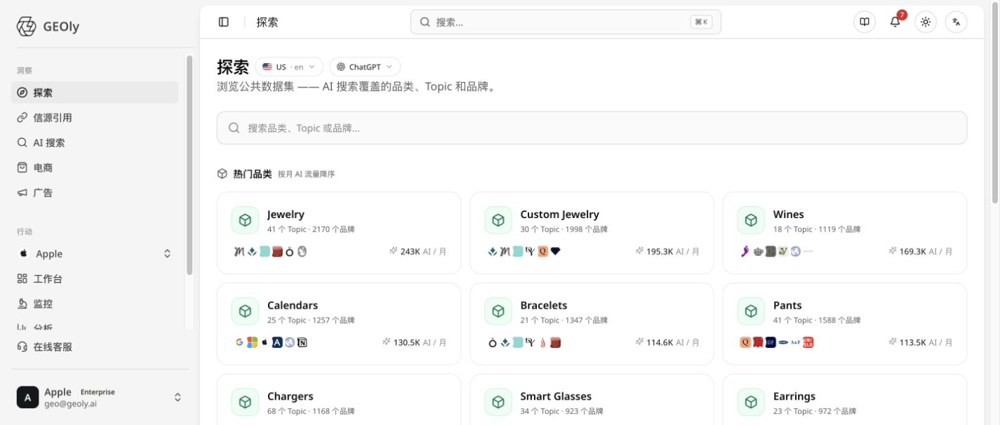
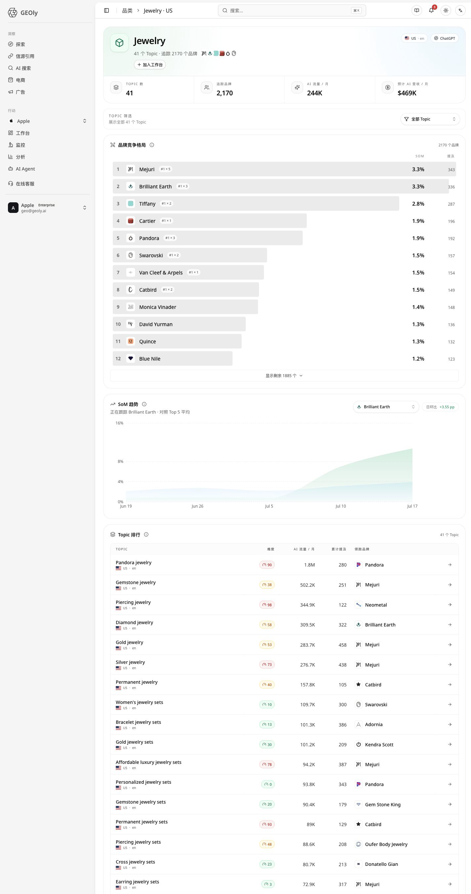
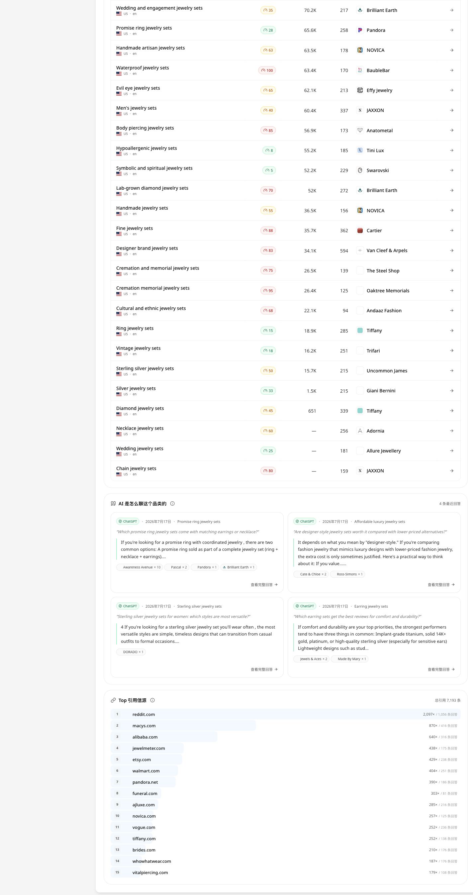
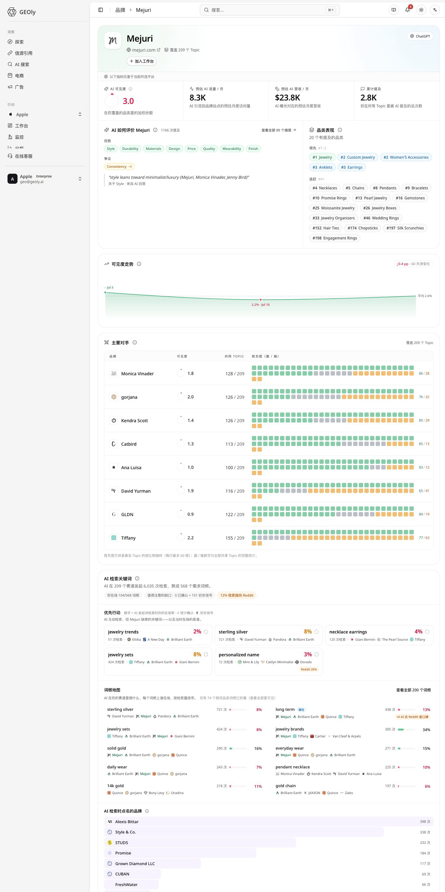
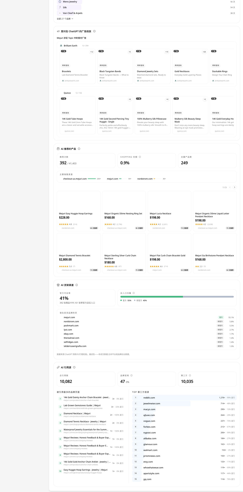

**入口路径：** 顶部导航 **探索**。

探索 是 GEOly 的公共行业研究入口。它把公开 AI 搜索数据中的品类、Topic 与品牌放在同一个范围内，帮助你从“我应该研究哪个市场”逐步走到“用户在问什么、AI 推荐谁、下一步该验证什么”。

## 1. 探索 的数据边界

探索 研究的是公共行业数据，不是自有品牌的 Monitoring 或 Analysis。

- **可以回答：** 在当前市场、语言与 AI 平台范围内，哪些品类、Topic、品牌和公开引用更值得研究。
- **不能直接回答：** 自有品牌在已监测 Prompt 中的 AIGVR、Mention Rate、Citation Rate，或实际流量、订单、广告花费与收入。
- **正确用法：** 用 探索 形成市场与内容假设，再回到 **行动**和**总览** 验证自有品牌是否发生变化。

## 2. 先固定研究范围

每次开始前，先固定三项条件：

1. **市场与语言**：相同品牌、品类在不同国家或语言下的 Topic、品牌格局与来源可能不同。
2. **AI 平台**：只选择当前数据范围内有可用数据的平台；不要把不同平台的数据混成同一份排名。
3. **研究对象**：明确本次从品类、Topic 还是品牌开始，并记录时间范围。

跨市场、跨语言或跨平台的 SoM、提及、AI 流量/月等指标不应直接横向比较。

## 3. 首页：发现品类、Topic 与品牌

探索 首页提供热门品类、热门 Topic 与搜索入口。

### 品类

品类卡片会显示 Topic 数量、品牌数量和 AI 流量/月等公共信号。用它筛选研究方向，而不是把数值直接当作真实市场规模或销售额。

优先选择同时满足以下条件的品类：

- 与产品、目标受众和内容主题直接相关；
- Topic 足够丰富，能继续拆解需求；
- 品牌格局值得研究，而非只因数字大；
- 在选定市场和平台有足够的数据。

### Topic

Topic 是某个品类下重复出现的用户问题、需求或讨论方向。进入 Topic 后可以研究品牌表现、用户问题、公开引用与竞争集中度。

### 品牌

品牌是公共 AI 回答中被识别到的实体。进入品牌页后，可以查看其 Topic 覆盖、AI 描述、品类表现和相对可见度，用来理解 AI 如何把品牌放进消费决策语境。

## 4. 品类页：研究竞争格局

进入品类页后，建议按以下顺序阅读：

1. **品类概览**：先确认 Topic、品牌与公共提及的覆盖范围。
2. **品牌排行榜与 SoM**：识别头部、追赶者和长尾品牌。
3. **SoM 趋势**：在相同的市场、语言、平台和时间范围内观察相对份额变化。
4. **Topic 排行**：找到与业务最相关、值得继续深挖的问题。
5. **公开引用域名与近期提及**：回看 AI 参考什么、如何描述品牌。

**SoM（Share of Mention）** 只表示当前公共品类范围内品牌的相对提及份额；它不是总体市场份额，也不等同于自有监测中的 AIGVR 或提及率。SoM 变化应与提及量和可比较的数据周期一起解读。

## 5. 品牌页：理解 AI 如何描述一个品牌

品牌详情适合回答：

- 品牌出现在哪些 Topic 与品类语境中？
- AI 反复把它与哪些产品特征、场景或人群联系在一起？
- 它是跨多个品类获得可见度，还是只在少数 Topic 中突出？
- 与同品类品牌相比，它的相对位置如何？

品牌感知和 AI 描述是研究线索，不是人工访谈或客户调研结论。重要定位判断应结合原始回答、官网信息和第一方业务数据验证。

## 6. Topic：从宏观品类走到用户问题

在 Topic 中重点检查：

- 这个问题是否与目标受众和业务目标高度相关；
- 品牌格局是集中还是分散；
- 哪些品牌反复出现，出现在哪种回答语境；
- AI 常引用哪些域名与页面；
- 是否有足够样本支撑竞争难度或趋势的判断。

竞争难度高通常表示头部品牌在当前品类内部更集中；难度低可能意味着格局更分散。样本不足或可比较品牌过少时，不应把缺少结果解读为“没有竞争”。

## 7. 从 探索 连接其他研究页签

探索 用来选定研究对象；之后按研究目标进入相邻模块：

- 想知道 AI 如何展开用户问题：进入 **AI 检索词**，查看 Query FanOut 与需求主题。
- 想知道答案参考什么：进入 **信源引用**，研究类型、域名、位置与 Topic 覆盖。
- 想知道推荐货架与渠道：进入 **电商**，查看商品卡片、价格段与零售渠道。
- 想观察竞争入口：进入 **广告**，查看广告主、创意与 Topic 覆盖。

不要在 探索 中把这些页面的细节重复解读；应让 探索 负责定义品类、Topic 和品牌范围，再把同一范围传递给后续研究。

## 8. 推荐研究流程

1. 固定市场、语言和 AI 平台。
2. 选择高度相关的品类，而不是只选数值最大的品类。
3. 从品类页筛选重点 Topic 与竞争品牌。
4. 打开品牌页，验证其 Topic 覆盖和 AI 描述。
5. 深入高价值 Topic，查看品牌、引用与实际回答。
6. 进入 AI 搜索、信源引用、电商或广告补足需求、证据、货架和竞争信号。
7. 形成内容、产品信息或竞争研究假设。
8. 回到**总览**和**行动** 用自有品牌数据验证结果。

## 9. 各板块功能详解

### 9.1 首页与搜索：确定研究入口

首页解决的是“先研究什么”。热门品类通常按公共 AI 流量/月等信号排序；Topic 入口帮助你看到品类下反复出现的用户问题；品牌入口则用于反查某个品牌在哪些品类和 Topic 中被 AI 提及。这里的排序是研究导航，不是市场规模排名。

使用时先设置市场、语言和 AI 平台，再进行搜索。搜索结果中的同名品类或品牌可能属于不同数据范围，必须确认筛选条件后再记录。建议为每次研究建立一条范围记录：市场、语言、平台、品类、访问日期。这样后续回看时，能区分真实变化与筛选范围变化。

### 9.2 品类概览：判断研究范围和优先级

品类概览把一个行业范围压缩成几个总量：Topic 数表示可继续拆分的问题数量；品牌数表示当前公共数据中被识别到的品牌规模；公共提及反映回答中品牌出现的累计次数；AI 流量/月是对该品类相关 AI 查询需求的方向性估算；预计 AI 营收/月是基于流量与商业价值推导的估算。

这些数字适合做“先看哪个品类”的排序，不适合直接当作真实搜索量、订单金额或财务收入。判断品类价值时，要同时看 Topic 是否与目标人群相关、品牌格局是否有研究意义、数据是否有足够覆盖。一个数字很大的品类，如果与你的产品无关，也不应优先于一个规模较小但高度相关的品类。

### 9.3 品牌排行榜与 SoM：看谁占据公共回答

品牌排行榜按当前品类范围展示品牌的累计提及和 SoM。累计提及回答“品牌被提到了多少次”；SoM（Share of Mention）回答“该品牌占当前品类全部品牌提及的相对份额”。排行榜的背景条用于比较相对大小，不代表百分比之外的绝对市场份额。

阅读时先看前几名是否集中，再把 SoM 与累计提及放在一起看。高 SoM 但提及样本很少，可能只是小样本波动；提及量很高但 SoM 较低，可能说明品类整体样本也很大。排行榜只在相同市场、语言、AI 平台、时间和品类范围内有效，不能与 Monitoring 中自有 Prompt 的 Mention Rate、AIGVR 或 Citation Rate 直接互换。

### 9.4 SoM 趋势与品牌动量：看相对位置是否变化

SoM 趋势按日期展示品牌在该品类中的相对提及份额。它用于观察“品牌在公共品类回答中的位置是否变强或变弱”，不是网站流量或销售趋势。品牌动量通常比较当前窗口与前一个等长窗口，用来标记上升、稳定或下降的方向。

解读趋势要看三个条件：日期是否连续、每日是否有足够采样、对比窗口是否一致。图表出现空档时，优先理解为当天没有可比较采样，不要自动当作品牌下降。趋势变化还应回到 Topic 和近期提及，检查是哪些问题或回答语境推动了变化。

### 9.5 Topic 列表与竞争难度：从行业总览进入具体需求

Topic 列表把品类拆成具体的用户需求或问题，并通常提供 Topic 名称、AI 流量/月、累计提及、领先品牌和竞争难度等信号。AI 流量/月用于判断该 Topic 的需求优先级；累计提及用于衡量当前样本中的讨论量；领先品牌显示谁在回答中占据最明显位置。

竞争难度主要反映品牌提及是否集中在少数头部品牌。难度高表示头部集中，不等于新品牌绝对无法进入；难度低表示格局更分散，也不代表内容一上线就能获得可见度。选择 Topic 时，先用业务相关性筛选，再用流量、难度和品牌格局排序，最后打开原始回答确认问题实际在问什么。

### 9.6 公开引用域名与近期提及：找到答案背后的证据

公开引用域名回答“AI 在回答这个品类或品牌时参考了哪些外部来源”。常见字段包括引用次数、占比、平均出现位置、来源类型和覆盖的 Topic。引用次数反映在当前数据中的出现频率；平均位置是引用在答案中的相对位置；覆盖 Topic 表示来源影响了哪些问题范围。

近期提及则回到具体回答语境，帮助你确认品牌是被推荐、比较、解释还是仅被顺带提到。域名榜适合找证据生态和内容选题，近期提及适合验证上下文。公开引用不等于自有网站的 Citation Rate，也不代表某个域名内容质量得到 GEOly 背书；重要结论必须回看原始回答和来源页面。

### 9.7 品牌详情：把一个公共品牌拆成多个视角

品牌详情用于回答“AI 在什么场景、以什么方式描述这个品牌”。Topic 覆盖表示品牌出现在哪些问题中；AI 可见度表示品牌在覆盖范围内的相对公共可见程度；品类表现用于比较品牌在不同品类的领先或追赶位置；主要竞争对手展示与该品牌共享 Topic 或回答语境较多的品牌。

页面中的 AI 流量/月和预计 AI 营收/月是方向性估算，不是品牌后台的真实访问、订单或收入。购物匹配与渠道信息说明 AI 推荐的商品和零售来源，不能直接推导销量。阅读品牌详情时，建议依次看覆盖范围、AI 描述、品类表现、趋势、竞争对手和证据，再把值得验证的 Topic 记录到内容或产品信息计划中。

### 9.8 AI 感知：理解 AI 如何描述品牌

AI 感知把回答中反复出现的品牌属性归纳出来，并展示提及量、属性数量、正向或负向倾向、占比以及证据语句。提及量回答“有多少条回答涉及该属性”；属性数量说明描述被拆分成多少类；倾向反映当前样本中的语气方向，而不是用户满意度调查结果。

使用时先看高频属性，再区分优势、争议和缺失信息。点击证据回看原始回答，检查属性是否来自不同 Topic、不同平台或少数重复文本。低样本的正面或负面结论都要谨慎；AI 感知是内容和定位研究线索，不能替代客户访谈、评论分析或第一方转化数据。

### 9.9 Topic 空白机会：把差距转成研究优先级

Topic 空白机会用于发现“竞争品牌已经出现，而目标品牌还没有充分覆盖”的问题。机会信号通常综合 Topic 的 AI 查询需求、与领先品牌的差距、可争取的份额空间和样本量稳定性。它的价值在于帮助排序，不在于自动生成最终内容。

一个机会被标记后，先确认三件事：Topic 是否真的符合业务；领先品牌的优势是否来自真实产品信息、第三方引用还是回答偏差；当前样本是否足够。确认后再把机会转成具体假设，例如补充产品规格页、增加比较型内容、建设第三方证据或调整商品信息，并回到**总览**和**行动** 验证是否带来可观察变化。

### 9.10 其他 Insights 入口如何配合

探索 负责定义“研究对象和范围”；AI 搜索负责拆解用户问题和 Query FanOut；信源引用负责寻找答案证据；电商负责观察商品、价格和渠道；广告负责理解竞争性曝光入口。它们应沿用同一市场、语言、平台和 Topic 范围，形成“需求—证据—货架—竞争”的连续研究链。

不要把 探索 的公共 SoM、AI 流量/月或预计营收，与 Monitoring 的自有品牌指标拼成一个结果。正确做法是：先在 探索 选品类和 Topic，再用 AI 搜索理解需求，用信源验证证据生态，用电商检查商品可见度，用广告观察竞争入口，最后回到自有数据验证行动效果。

## 10. 常见误区

- 把公共 AI 流量/月或营收估算当作真实经营数据；
- 跨市场、语言或平台比较排名和 SoM；
- 将公开引用替代自有品牌的 Citation 明细；
- 将品牌出现或商品卡片数理解为广告、点击、销量或因果关系；
- 数据为空时直接判定品牌不存在，而不检查数据范围与可用性。

探索 的价值在于把公共 AI 市场变成可追溯的研究对象；真正的优化效果仍需要在自有品牌的 Monitoring 与 Analysis 中验证。
