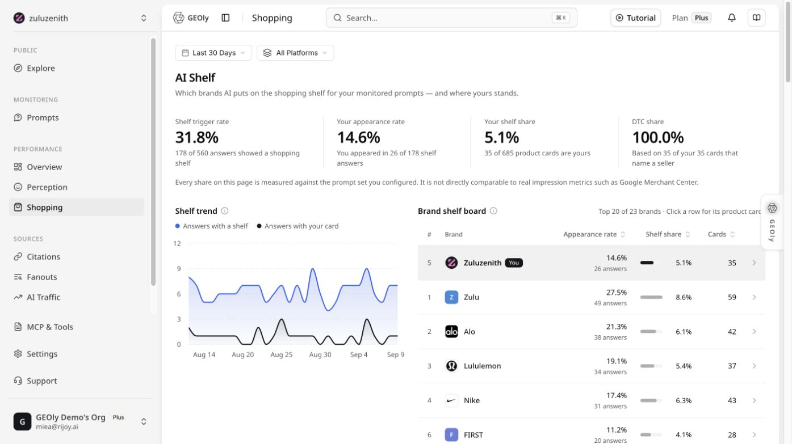

GEOly 有两个 Shopping 入口，它们使用不同数据集，不能合并解读：

| 入口 | 数据范围 | 主要用途 |
| --- | --- | --- |
| **公共 → 探索 → AI 商品** | GEOly 公共 AI Shopping 数据集 | 研究公开市场中被 AI 推荐的商品、Topic、渠道和价格 |
| **表现 → AI 商品** | 当前品牌已监测 Prompt 返回的购物货架 | 查看自有品牌的 AI Shelf、出现率、货架份额和竞品 |

本文重点说明 **表现 → AI 商品** 中的 AI Shelf。它不是订单、销售额或广告投放报表；数据来自 GEOly 对监测回答的观测，会随时间范围、平台、主题、品牌配置和采集进度变化。

## 当前界面与截图

截图中的页面说明是：AI 会把监测 Prompt 的购物回答整理成货架，再展示你的品牌是否出现、出现占比以及与其他品牌的相对位置。截图里可以看到 **Last 30 Days**、**All Platforms**、货架触发趋势和 **Brand shelf board**。

## 这页主要回答什么问题

- AI 在多少回答中展示了购物货架？
- 你的品牌在展示货架的回答中出现了多少次？
- 你的品牌在货架中的相对份额如何？
- 哪些平台、主题或时间段表现更好或更弱？
- 哪些竞品在相同购物场景中更常出现在货架上？

## 先确认筛选范围

页面顶部的筛选条件决定所有卡片和趋势的统计范围。开始比较前，先固定：

1. **时间范围**：例如 Last 30 Days。不要把不同窗口直接比较。
2. **AI 平台**：当前 AI Shelf 支持 ChatGPT 和 Google AI Mode（以页面实际可选项为准）。All Platforms 会合并当前可用平台，单个平台则只显示该平台样本；平台之间的百分比不能直接当作同一量尺。
3. **主题或 Prompt 范围**：如果页面提供主题筛选，应保持前后一致。
4. **品牌和组织**：先确认进入的是正确的品牌工作区。

如果页面显示暂无数据，不要直接理解成“品牌没有商品”。也可能是当前筛选范围、平台覆盖或最近采集状态暂时没有满足条件的回答。

## 四个核心数据怎么读

### Shelf trigger rate

**货架触发率**表示监测回答中出现 AI 购物货架的比例。它回答的是“这批问题有多常触发购物展示”，不是全网购物搜索量，也不是用户购买率。

怎么看：

- 触发率高：这批 Prompt 更常进入购物或商品推荐场景，适合继续研究商品信息和竞品。
- 触发率低：不要急着判断电商需求低，先检查 Prompt 是否真的有购买意图，以及平台和样本是否覆盖。

### Your appearance rate

**你的出现率**表示在已经出现购物货架的回答中，你的品牌出现的比例。它不是所有回答中的 Mention Rate，也不是销售转化率。

怎么看：

- 触发率高但出现率低：购物场景存在，但品牌还没有稳定进入货架候选。
- 出现率上升：说明在当前筛选范围内，品牌更常被放进 AI 的购物货架；仍需回到具体回答检查商品是否准确。

### Your shelf share

**你的货架份额**表示在货架品牌或商品集合中的相对占比，用于和竞品比较。它不等于市场份额、GMV 或广告份额。

怎么看：

- 份额靠前：说明品牌在这批货架中占据较多位置，但要结合商品数量、重复出现和平台分布判断。
- 份额下降：先检查是竞品增加、样本变化，还是某个平台/主题的结构变化。

### DTC share

**DTC 份额**表示货架中直接面向消费者的品牌或渠道占比。它用于理解 AI 展示的购物路径更偏品牌直达还是零售渠道，不等于 DTC 渠道收入。

## 趋势图怎么用

趋势图用于观察货架触发、品牌出现和份额随时间的变化。建议按下面顺序读：

1. 先看时间范围是否完整。
2. 观察整体货架触发是否突然上升或下降。
3. 再看你的出现率是否同步变化。
4. 最后切换平台或主题，判断变化来自哪里。

只有在时间范围、平台、Prompt 集合和品牌配置一致时，趋势比较才有意义。某一天没有数据，可能代表没有完成采集，不一定代表指标为 0。

## Brand shelf board 怎么看

**Brand shelf board**用于查看当前货架中不同品牌的相对位置。它适合回答“谁经常和我一起出现”和“竞品在同一购物场景中的位置”。

查看时重点记录：

- 品牌名称是否被正确归一。
- 品牌在货架中的位置和出现频率。
- 竞品是否集中在某些平台或主题。
- 你的商品是否被正确识别，而不是被错误归到相似品牌。

不要只看排行榜。点击或回到对应 Prompt / 回答详情，确认 AI 实际展示了什么商品、价格、渠道和来源。

## 推荐的实际使用流程

### 1. 先做市场扫描

选择固定时间范围和平台，记录货架触发率、你的出现率、你的货架份额和主要竞品。

### 2. 再找差距

筛选你没有出现、但竞品反复出现的购物 Prompt 或主题，阅读原始 AI 回答，记录竞品被推荐的理由。

### 3. 检查商品信息

回到官网或零售页面核对标题、规格、价格、库存、评价、配送、退换货和图片。AI 能否正确展示，首先取决于可抓取且一致的商品信息。

### 4. 转成优化任务

- 缺少商品基础信息：补齐结构化商品数据和清晰的产品页。
- 缺少比较信息：增加对比表、适用人群和购买指南。
- 竞品在特定主题领先：补充对应场景、FAQ 和证据来源。
- 商品出现但信息错误：先修正官网与零售渠道，再观察后续批次。

### 5. 用业务数据验证

Shopping 只能说明 AI 购物回答中的观测表现。是否带来点击、访问、订单或收入，需要结合 GA4、商城、广告平台和内部销售数据验证。

## 常见误区

- 货架触发率不是购物搜索量。
- 你的出现率不是全量 Prompt 的品牌提及率。
- 货架份额不是市场份额、GMV 或订单份额。
- 出现在货架中不代表用户购买，也不代表商品库存充足。
- 未出现在货架中不代表品牌没有销售，只说明当前观测范围内没有出现。
- 不同平台、国家、语言和时间窗口的数据不能直接混比。
- 排名变化应结合样本量、Prompt、平台和原始回答一起解释。

## 与其他 GEOly 模块的配合

- **Prompts**：找出哪些购买问题让品牌出现或缺席。
- **Citations**：检查 AI 引用的是官网、零售商还是第三方内容。
- **Perception**：了解 AI 如何描述品牌和商品。
- **Competitors / Industry Intelligence**：比较竞品在品类和主题中的位置。
- **GA4 / 商城数据**：验证 AI 购物可见度是否带来真实业务影响。

最稳妥的判断路径是：**固定筛选 → 看货架指标 → 回到原始回答 → 检查商品信息 → 制定任务 → 用业务数据验证**。
