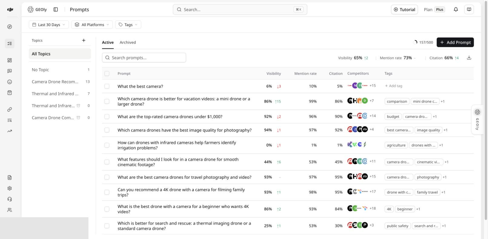
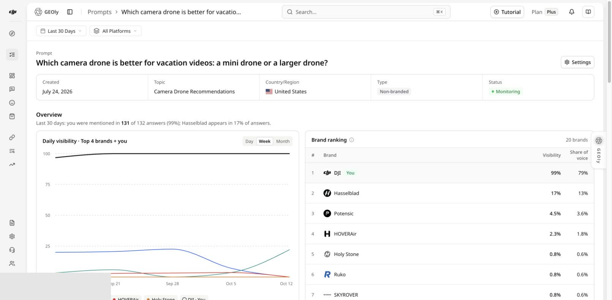
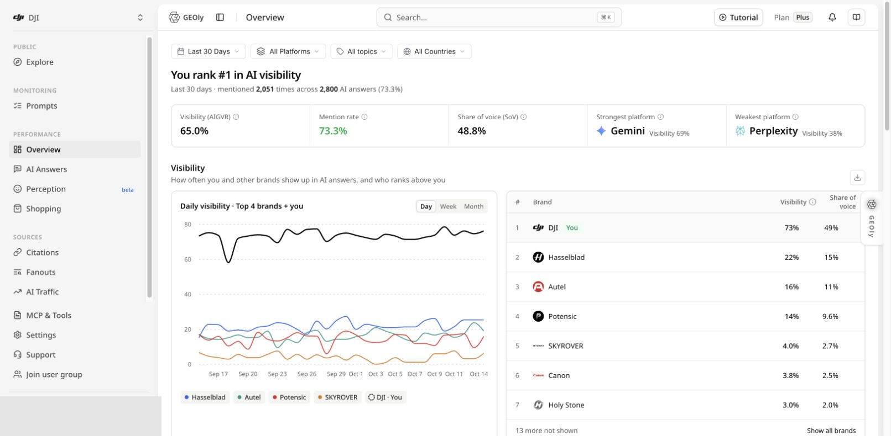

**入口：提示词 → 全部提示词。** 在左侧 Topic 列表中选择一个主题筛选提示词；通过主题菜单进入主题详情。平台比较则使用页面顶部的「全部平台」筛选器，并在「总览」、主题详情和提示词详情中继续下钻。

当前主导航没有独立的“主题分析”或“平台分析”页面。这篇文章说明如何把提示词分组、主题汇总、平台比较和原始回答串成同一条分析路径。

## 先分清两种 Topic

- **监控中的 Topic**：由你为当前品牌创建，用于按场景、意图、产品线或项目组织自己的提示词。
- **公共 Explore 中的 Topic**：GEOly 公共研究数据集中的行业研究对象。

两者的数据范围、样本和用途不同，不能合并统计。分析前还应确认当前组织、品牌、时间范围、平台、Topic 所含提示词以及已完成的回答记录数。

## 从 Topic 找到具体问题

1. 在「提示词」页选择 Topic 或「无主题」，检查提示词是否被正确归类。
2. 先看列表中的可见度、提及率、引用率、竞争品牌和标签，定位异常提示词。
3. 通过 Topic 菜单打开详情，查看主题级 KPI、趋势、平台比较、竞争品牌、品牌语境、引用页面与相关提示词。
4. 同时查看提示词数和完成记录数。样本较少时，百分比和趋势会明显波动。
5. 打开表现较弱的提示词详情，再查看具体回答记录和引用证据。
6. 判断问题属于未提及、可见度较弱、缺少引用、品牌表述不准确，还是某个平台缺少可用记录。

## 正确理解核心指标

这些指标回答的问题不同：

| 指标 | 用途 | 不代表什么 |
| --- | --- | --- |
| **可见度（AIGVR）** | 综合描述品牌在 AI 回答中的可见程度 | 传统搜索排名或推荐名次 |
| **提及率** | 在符合当前范围的完成回答中，品牌被提及的比例 | 总市场知名度 |
| **引用率** | 回答中品牌相关来源被引用的比例 | 所有外部链接的质量或因果影响 |
| **Share of Voice** | 当前样本内品牌相对提及份额 | 总体市场份额 |
| **平均可见性等级/位置** | 汇总品牌在回答中的呈现位置 | 商品榜单排名或收入表现 |

使用页面定义的聚合结果，不要把每日百分比简单平均后当作总 KPI。没有完成记录、执行失败或某个平台暂不可用，也不应被解释为 0 分。

## 比较平台时保持同一口径

1. 在「总览」选择相同时间范围、Topic、国家/地区和平台。
2. 先比较全部平台，再查看最强与最弱平台以及趋势差异。
3. 回到同一个 Topic 或提示词，切换到目标平台核对完成记录和原始回答。
4. 对比时保持提示词集合和日期一致；若某个平台样本明显更少，应单独标注。

可选平台由当前套餐、组织配置和页面能力决定，请以筛选器实际显示的选项为准。AI 商品、AI 检索词等模块有自己的数据来源与平台范围，不能因为某个平台出现在总览中，就假定所有页面都支持它。

## 把发现转成可验证动作

建立一条可复查的证据链：

**Topic → 提示词 → 平台 → 原始回答 → 引用 URL → 待优化页面**

根据证据补充 FAQ、场景说明、产品事实、对比信息或权威来源。保留原提示词、时间范围和平台；内容更新后等待新的完成记录，再用同一口径复查。若修改或替换提示词，应把它视为新的测试版本，避免把前后结果直接混在一起。

## 常见边界

- 监控 Topic 的变化不是整个行业的市场变化。
- 公共 Topic 的流量或营收估算不是 GA4 实测访问或销售。
- 配置的竞争对手与回答中的品牌共现不是同一概念。
- 配额上限、提示词数量和完成回答数量应分别报告。
- 聚合指标用于定位问题；原始回答与具体引用才是判断原因的证据。
