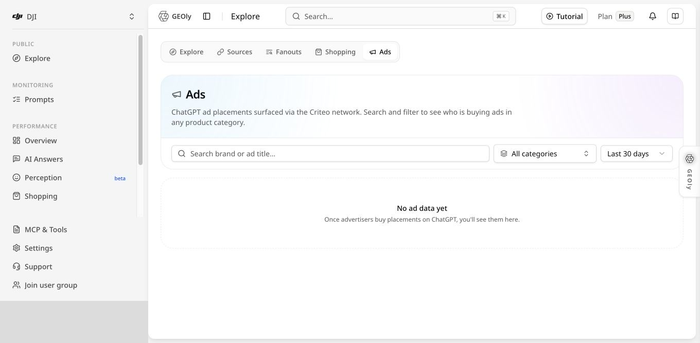

## 洞察-广告

**入口路径：** GEOly → 公共 → 探索 → 广告（ChatGPT Ads Library）

洞察-广告是一套面向 ChatGPT 广告场景的市场研究工具。它把在公开数据范围内观察到的广告主、赞助商品卡片、触发问题、Topic、创意、投放来源、真实落地页和同答品牌连接起来，帮助你回答五个核心问题：

1. **谁在投放：** 当前范围内有哪些广告主，哪些品牌出现得更频繁。
2. **投在哪里：** 广告覆盖哪些类目、Topic 和具体购买问题。
3. **如何表达：** 广告卡使用了哪些商品、卖点、价格和创意形式。
4. **如何承接：** 广告最终进入什么落地页，卡片信息和页面是否连续。
5. **与谁竞争：** 同一回答中还自然提到了哪些品牌，广告与自然推荐如何并存。

它适合用于广告、品类、电商和竞争情报研究，但不是广告账户后台，不能在这里创建、暂停或调整广告，也不能查看预算、出价、点击率、转化率或收入。当前数据对象仅为 **ChatGPT 广告卡**；其他 AI 平台不应按本文口径推断。该页面需要具备相应套餐权限，未授权用户只会看到升级提示，不会加载广告数据。

## 当前版本补充：ChatGPT Ads 页面与数据边界

截图中的页面当前显示 **No ad data yet**，因此下文的广告主、广告卡和详情分析流程只适用于所选范围内出现记录之后；空状态不代表市场上没有广告。当前页面的说明是 **ChatGPT ad placements surfaced via the Criteo network**。因此本文应把它理解为 GEOly 观察到的、经 Criteo 网络呈现的广告位置与相关卡片，而不是覆盖所有 ChatGPT 广告，也不是广告账户后台。

页面上的 **impressions、topics、广告主数量和时间筛选** 都是 GEOly 当前观测范围内的字段：

- impressions 表示页面展示的观测计数，不能直接当作广告账户结算曝光、独立用户数或归因结果；
- topics 表示广告出现时关联的需求主题，用来理解场景覆盖，不等于关键词搜索量；
- 广告主数量受搜索、类目、时间窗口和数据覆盖影响；
- 比较竞品时必须固定筛选条件，并记录观察日期。

如果页面显示 Delivery: Direct 或其他渠道标签，应理解为当前可见的交付/跳转路径。它不等于预算、竞价、点击率、转化率或收入，也不能仅凭一条广告记录断言品牌主动投放。

## 一、先建立完整的数据理解框架

阅读广告库时，可以把全部信息理解为一条从市场到用户决策的链路：

**广告主 → 类目与 Topic → 触发问题 → 广告卡 → 投放来源 → 真实落地页 → 同答品牌**

这七类对象分别说明不同问题：

| 数据对象 | 说明 | 适合回答的问题 |
| --- | --- | --- |
| 广告主 | 出现在赞助卡中的品牌或商家 | 当前有哪些主要参与者 |
| 类目 | 较宽的行业或商品范围 | 哪些行业广告活动更集中 |
| Topic | 将相似需求归纳后的主题 | 品牌覆盖了哪些具体需求场景 |
| 触发问题 | 用户向 ChatGPT 提出的原始问题 | 什么用户意图触发了广告 |
| 广告卡 | 被观察到的赞助商品单元 | 品牌用什么商品和表达承接需求 |
| 投放来源 | 如 Criteo 或商家直链 | 广告卡通过哪类交付路径出现 |
| 真实落地页 | 点击后实际到达的页面 | 广告如何承接用户下一步决策 |
| 同答品牌 | 同一自然回答中出现的品牌 | 广告位所处的自然竞争环境 |

分析时不要孤立看某个数字。广告卡数量只能说明当前范围内观察到多少条记录；Topic 数量说明需求覆盖的广度；触发问题说明具体意图；落地页和同答品牌才帮助你理解品牌如何承接需求以及它面对什么竞争。

## 二、页面结构与使用顺序

洞察-广告实际包含四个逐层深入的查看层级：

1. **广告库首页：** 搜索、筛选并浏览广告主及其代表性创意。
2. **广告主详情：** 查看该广告主的去重创意数、Topic 数、品类数、品类投放分布和最多 24 张最新创意卡。
3. **广告卡详情：** 以一组相同创意为中心，查看累计出现次数、Topic 覆盖、投放渠道、真实落地页、竞争格局和出现记录。
4. **完整 AI 回答：** 从某条出现记录继续打开原文，查看问题、回答及对应的数据背景。

推荐顺序是“先广后深”：先在首页确定研究范围和重点广告主，再进入广告主详情观察整体分布，然后选代表性创意进入卡片详情和完整回答。首页也支持直接点击代表性创意跳到卡片详情。不要从一张偶然出现的卡片直接推断整个品牌的策略。

## 三、广告库首页

首页用于完成市场扫描。页面提供品牌或广告标题搜索、类目筛选和时间范围筛选，并展示当前数据范围内的广告主和广告卡。

### 3.1 搜索

搜索框支持按**品牌名称或广告标题**查找记录，适合两种任务：

- 已知竞品名称时，直接查看其广告卡和覆盖范围。
- 已知商品、型号或创意关键词时，寻找使用相近表达的广告。

搜索结果代表当前筛选范围内已观察到的记录，不代表该品牌全部历史广告。

### 3.2 类目筛选

类目用于将研究范围限定到与你业务相关的行业或商品大类。它适合回答“这个行业有哪些广告主”和“哪些商品方向更活跃”。

使用类目时应注意：类目是宽口径，不能代替 Topic。两个品牌都出现在同一类目，并不表示它们面向相同的需求或购买阶段，还需要进入 Topic 和触发问题继续判断。

### 3.3 时间范围

时间范围决定当前页面统计和记录所对应的观察窗口。切换时间范围后，广告主数、广告卡数、Topic 覆盖和重复出现情况都可能变化。

比较品牌时必须使用相同时间范围。不同窗口的数量不能直接横向比较，否则容易把采样时间差异误判成投放变化。

### 3.4 首页总量

页面顶部实际显示的是“广告主总数”和“当前页广告主数”：

- **广告主总数：** 当前搜索、品类和时间范围内，按广告主名称或域名归并后的广告主数量。
- **当前页数量：** 当前页实际展示的广告主数量；每页最多展示 12 个广告主。
- **卡片数与 Topic 数：** 位于每个广告主卡片内，不是页面全局总量。卡片数是去重创意数，Topic 数是该广告主覆盖的去重 Topic 数。

这些数字描述当前筛选范围的数据覆盖，不是广告账户数、原始曝光量或预算规模。

## 四、广告主列表与卡片指标

广告主卡片用于比较“谁出现得更多、覆盖得更广”。常见信息包括品牌名称、域名、广告卡记录数和 Topic 数。

### 4.1 卡片数：去重创意数量

广告主卡片中的“卡片”不是原始广告记录数，而是**去重后的广告创意数**。代码将同一广告主下“标题 + 图片 + 落地域名”相同的记录视为同一创意；带有不同追踪参数的落地链接不会因此被重复计为新创意。

- 数量较高：说明当前筛选范围和时间窗口内观察到的不同创意更多。
- 数量较低：可能是创意较少，也可能是时间、品类或数据覆盖有限。
- 不能推出：预算更高、原始曝光更多或广告效果更好。

### 4.2 Topic 数

Topic 数表示广告主被观察到覆盖多少类需求主题。

- Topic 多：说明广告主出现在更多需求场景，覆盖相对更广。
- Topic 少但创意多：说明多组创意集中出现在少数需求主题。
- Topic 多但创意少：说明少量创意跨越更多主题出现；是否属于主动测试，需要继续查看出现记录，不能直接下结论。

### 4.3 重复出现标记

首页与广告主详情中的“×N”表示同一广告主下，标题、图片和落地域名相同的创意在当前时间窗口和筛选范围内对应了多少条原始观测记录。它是代理观测中的重复出现次数，不等同于广告平台定义的曝光频次，也不能证明品牌主动提高了投放强度。

### 4.4 如何筛选重点广告主

建议同时比较：

1. 与目标业务的类目相关性。
2. 广告卡记录数。
3. Topic 覆盖广度。
4. 具体触发问题是否具有明确购买意图。
5. 创意与落地页是否形成重复模式。
6. 同答品牌是否与你的核心竞争集合重合。

经过这一步，通常可将广告主分为“核心竞品、跨界参考、偶发记录”三组，再决定深入查看顺序。

### 4.5 广告主详情

点击广告主标题区域会打开广告主详情。顶部三个 KPI 分别是：

- **卡片：** 当前时间窗口内的去重创意数。
- **Topic：** 当前时间窗口内覆盖的去重 Topic 数。
- **品类：** 当前时间窗口内覆盖的去重品类数。

“品类投放分布”最多展示 12 个品类，按各品类中的去重创意数排序；同一创意可以出现在多个品类，因此各品类数量相加可能大于顶部卡片总数。点击品类可以回到广告库，并自动按该品类筛选。

“全部广告卡片”按时间展示去重后的最新创意，当前详情最多加载 24 张；如果总数更高，页面会提示“已显示 N / 共 M 张”。因此不要把屏幕上可见的卡片张数误当成该广告主的完整创意总数。

## 五、从类目进入 Topic 与触发问题

类目、Topic 和触发问题是三个不同粒度：

- **类目**回答“属于哪个行业或商品范围”。
- **Topic**回答“围绕哪类相似需求”。
- **触发问题**回答“用户具体问了什么”。

例如，同一商品类目中可能同时存在“最佳推荐、价格比较、替代品、特定使用场景、规格选择”等不同 Topic；每个 Topic 下又包含具体措辞不同的问题。

研究时建议先用类目限定行业，再通过广告主详情或广告卡详情回看 Topic，最后进入具体触发问题理解用户意图。这样可以避免把宽泛的类目热度误解为某个具体问题的机会。

### 5.1 判断问题的购买阶段

可将触发问题标记为：

| 问题类型 | 用户意图 | 研究重点 |
| --- | --- | --- |
| 最佳推荐 | 正在建立候选清单 | 品牌进入候选的理由和卖点 |
| 产品比较 | 正在缩小选择范围 | 差异化信息、规格、价格和证据 |
| 替代品 | 对当前方案不满意 | 竞品弱点和替代价值 |
| 价格/优惠 | 接近交易决策 | 价格、折扣、配送和退换信息 |
| 场景需求 | 从使用环境出发寻找商品 | 场景语言、功能适配和落地页内容 |
| 明确商品 | 已有较高品牌或产品认知 | 商品信息完整度和购买承接 |

问题类型不同，适合的广告创意和落地页也不同。不要把所有触发问题都当成同一购买阶段。

## 六、广告卡详情：完整追溯一条广告

广告卡详情是最重要的分析页面。它将一张赞助卡与触发问题、商品创意、投放来源、落地页和自然回答连接起来。

### 6.1 广告主与域名

用于确认广告由哪个品牌或商家提供，以及广告卡展示域名和真实落地页之间是否一致。品牌名相近时，应结合域名判断，不要只依赖卡片标题。

### 6.2 商品与创意

查看商品名称、图片、卖点、价格、优惠或行动信息。重点分析：

- 广告是否直接回应触发问题。
- 首要卖点是功能、价格、品牌、评分还是使用场景。
- 同一广告主是否在不同问题中重复使用相同创意。
- 同一商品是否针对不同意图改变表达方式。

### 6.3 投放渠道

渠道标签根据广告卡目标链接的域名推导。当前代码可识别 **Criteo、StackAdapt、Kargo、Google、Awin**；未匹配这些明确平台域名的链接统一归为**商家直链**。

该标签描述的是可见的点击跳转路径，不是广告平台回传的账户字段。经程序化广告网络出现的卡片可能来自自动再营销，不能仅凭这条记录断言品牌主动策划了该次投放，也不能据此判断渠道预算或效果。

### 6.4 真实落地页

真实落地页是用户点击广告后实际进入的页面。建议检查：

- 页面类型：单品页、集合页、活动页、品牌页或内容页。
- 首屏是否延续广告卡中的商品和卖点。
- 是否提供规格、评价、配送、退换、库存、价格和信任信息。
- 页面是否能继续回答触发问题中的关键疑虑。

广告卡与首屏信息一致，说明承接更连贯；但它不直接证明转化率更高。

### 6.5 创意足迹、触发问题与记录

卡片详情不是只查看被点击的单条数据库记录。系统会把**同一广告主 + 相同标题 + 相同图片 + 相同落地域名**归为同一创意，并统计该创意在全部保留数据中的累计出现次数和覆盖 Topic 数。这里的累计口径不跟随首页的“近 30 天/全部时间”筛选，因此可能大于首页卡片上的 ×N。

出现记录按回答去重并按日期倒序，最多返回 40 条。每条记录可查看：

- 原始问题。
- Topic 与品类。
- 日期、国家/市场和 AI 模型。
- 是否联网检索、是否有引用、是否出现自然购物卡等 grounding 信号。
- 完整 AI 回答。

建议先识别问题意图，再查看联网状态和回答内容，最后回看创意、落地页与自然竞争品牌。不要把“出现在某问题中”直接解释为广告主主动选择了该关键词。

### 6.6 自然竞争格局

卡片详情中的竞争格局统计的是：在该创意出现过的回答集合里，ChatGPT 正文自然点名的同类第三方品牌。系统会排除广告主自身，因为赞助卡文本可能让广告主名称混入回答提及数据，但这不属于自然推荐。

每个竞争品牌的次数表示它在多少条去重回答中被自然点名；如显示平均出场名次，数值越小代表在这些回答中通常出现得越靠前。详情最多展示 14 个竞争品牌。

这一板块适合判断赞助卡面对哪些自然推荐品牌，但不能证明广告主自身获得了自然提及。若要判断广告主的自然可见度，应进入品牌页、探索或品牌监测模块单独核对。

## 七、如何判断一个需求场景的商业化程度

当前广告库首页没有单独提供“广告出现率”这一固定指标。判断某个类目、Topic 或问题的商业化程度时，应综合查看：

- 当前时间范围内观察到的广告卡记录。
- 参与的广告主数量。
- 广告主覆盖的 Topic 数。
- 同一创意是否被重复观察到。
- 触发问题是否具有推荐、比较、价格或购买等高意图特征。
- 同一回答中的自然竞争品牌数量。

如果在关联的探索或 Topic 页面中明确显示广告相关比例，应把它理解为该页面定义和样本范围下的相对信号，并同时记录时间、市场、样本量和统计口径。它不是广告平台的曝光率，也不能推出点击率、转化率、预算、收入或盈利能力。

广告记录较多通常说明该场景值得进一步研究；记录较少既可能代表竞争尚少，也可能只是当前时间、市场或数据范围覆盖有限，因此不能直接写成“蓝海机会”。

## 八、如何形成系统的广告研究结论

建议把每次观察分成三层：

### 8.1 已验证事实

可直接从页面确认的信息，例如广告主、广告卡、触发问题、Topic、来源标签、落地页和同答品牌。

### 8.2 合理推测

根据多条记录形成的解释，例如某品牌可能集中覆盖某类购买问题，或反复使用某类落地页。推测应标注时间范围和样本依据。

### 8.3 待验证假设

需要结合自有广告平台、网站分析、商城、CRM 或用户研究验证的判断，例如某种卖点是否提高点击或转化。

这种记录方式可以避免把“观察到广告”写成“广告效果好”，也能让竞争情报真正转化为测试计划。

## 九、与探索、AI 检索词和电商协同使用

洞察-广告不是孤立模块，最好与其他洞察能力共同使用。

### 9.1 与洞察-探索协同

先在探索中观察行业 Topic、用户问题、品牌竞争和信源格局，再进入广告库确认其中哪些需求已经出现赞助卡、主要广告主是谁。探索帮助找到市场问题，广告帮助理解这些问题如何被商业化。

### 9.2 与公共 AI 检索词协同

公共 AI 检索词用于研究当前公开数据范围内 ChatGPT 联网检索的查询词与相关问题，不是自有品牌监测。广告库则显示赞助商品卡。两者结合可以区分：

- 有自然可见度但没有观察到广告。
- 有广告卡但自然回答没有提及品牌。
- 广告与自然推荐同时出现。
- 广告主与主要信源或引用页面之间是否存在内容差距。

### 9.3 与洞察-信源协同

信源分析帮助判断 AI 自然回答依赖哪些网站和页面。广告详情中的同答品牌与完整回答说明竞争语境；信源进一步说明自然推荐背后的证据来自哪里。由此可以分别制定广告承接页优化和 GEO 内容/引用建设计划。

### 9.4 与洞察-电商及 表现 → Shopping（AI Shelf） 协同

广告库用于观察外部广告市场，电商与 Shopping 用于研究 AI 购物推荐和自有商品表现。推荐流程是：

1. 从广告库找到高相关购买问题、竞品商品表达和落地页。
2. 在电商洞察中查看该类商品和品牌的购物推荐格局。
3. 在 表现 → Shopping（AI Shelf） 中检查自有商品是否出现、是否获得购物卡。
4. 优化商品标题、规格、价格、评价、配送、结构化数据和页面内容。
5. 使用自有业务数据验证最终效果。

## 十、推荐实操流程

### 阶段一：定义研究任务

明确目标类目、市场、时间范围、核心竞品和需要回答的问题。一次研究只围绕一个清晰目标，例如“研究某类商品的主要广告主和高意图问题”。

### 阶段二：扫描市场

使用搜索、类目和时间筛选浏览广告主列表，记录广告卡数、Topic 数和代表性广告主，形成初步竞争地图。

### 阶段三：进入问题层

打开重点广告主和广告卡，查看 Topic 与触发问题，并按推荐、比较、价格、替代品和场景需求分类。

### 阶段四：拆解创意与承接

记录商品、卖点、价格、来源、真实落地页和同答品牌。比较同一广告主在不同问题中的重复模式，也比较不同广告主对同一问题的差异。

### 阶段五：形成行动清单

将结论转化为可执行项，例如：

- 新增需要覆盖的高意图问题。
- 调整广告卡或商品页的核心表达。
- 补充规格、评价、FAQ、配送、退换和信任信息。
- 建设对比、替代品或场景内容。
- 在 AI 搜索和信源模块中补充自然可见度策略。
- 在自有广告平台和分析系统中建立验证实验。

### 阶段六：定期复查

使用相同筛选口径定期回看广告主、创意、Topic 和落地页变化。只有相同时间窗口和研究范围的数据才适合比较。

## 十一、数据边界与常见误区

- 广告库展示的是公开数据范围内观察到的广告卡信号，不是完整广告账户数据。
- 广告主卡片中的“卡片数”是去重创意数，不是原始记录数、预算、展示量、点击量或曝光频次。
- Topic 覆盖多不等于广告效果更好。
- 重复出现标记是代理观测的原始行数，不等于广告平台定义的投放频次。
- 未观察到广告不代表品牌从未投放。
- 页面中的广告相关比例（如有）不能直接用于判断盈利能力。
- 广告卡中的品牌不一定获得自然推荐。
- 落地页信息完整不代表已经产生转化。
- 渠道标签由目标链接域名推导，只表示可见跳转路径；程序化网络中的广告可能来自自动再营销，不代表品牌明确主动投放。
- 任何创意、价格、商品和页面结论都应注明观察时间，因为这些信息可能变化。

## 十二、与品牌监测的区别

**洞察-广告**研究更广泛的 ChatGPT 广告市场，核心对象是广告主、广告卡、触发问题、创意、来源和落地页。

**品牌监测（品牌监测分析）**研究自有品牌在已监测 Prompt 中的可见度表现，包括 AIGVR、提及、引用、平台趋势和回答记录。

两者的数据范围和指标口径不同，不能直接混用。推荐先用洞察-广告发现外部机会和竞品模式，再在 品牌监测分析、广告平台和自有业务数据中验证行动结果。
