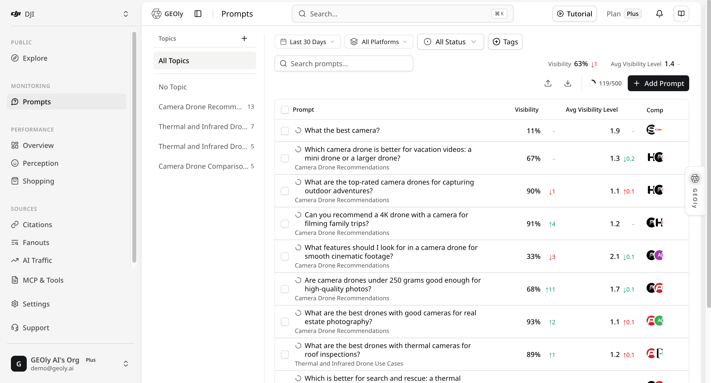
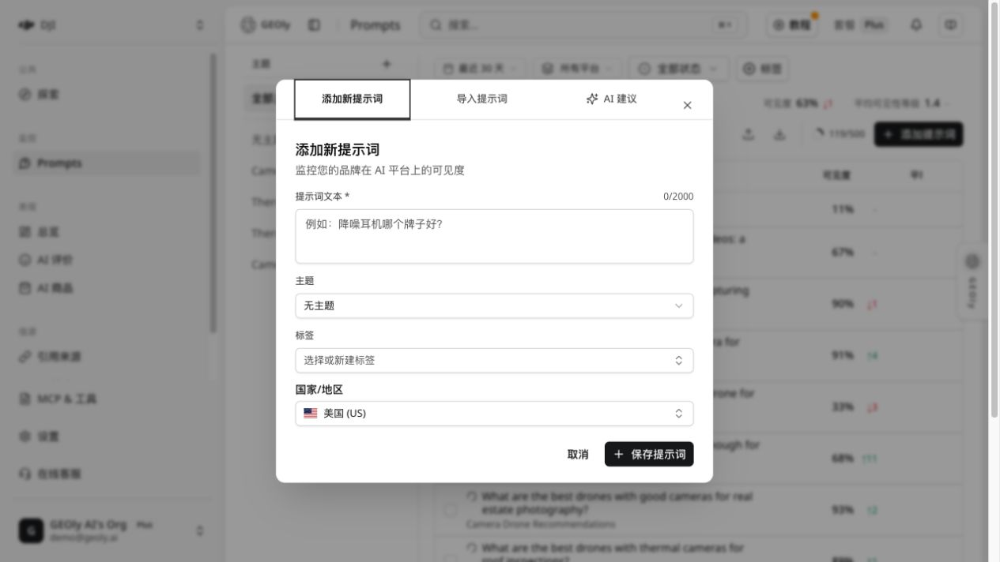
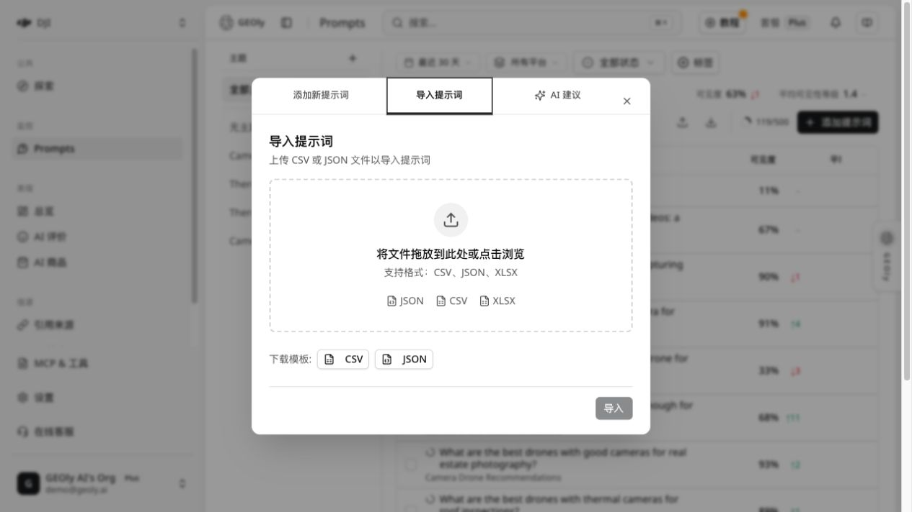
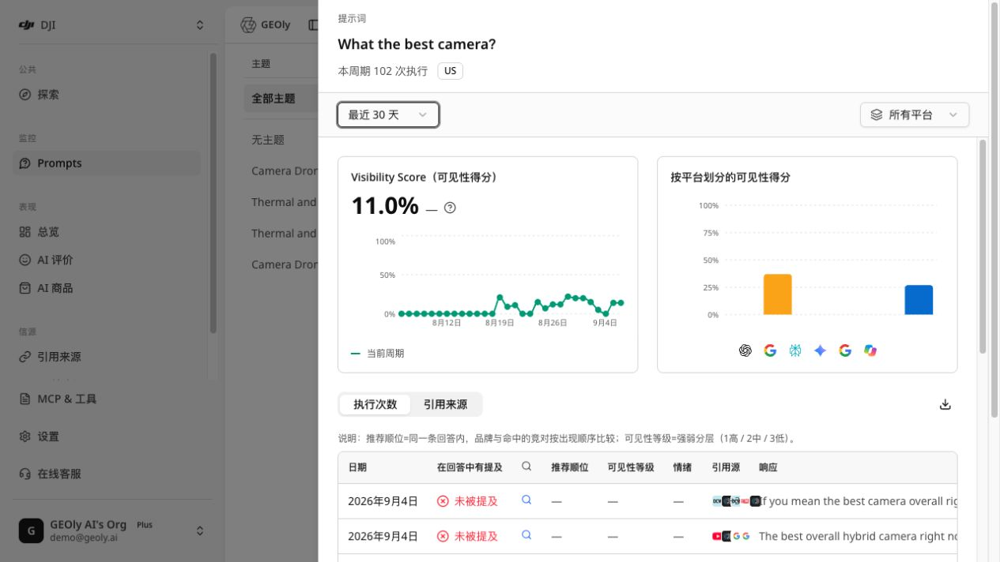

## 入口与用途

登录 GEOly 后，从左侧导航进入 **监控 → Prompts**。这里管理品牌要持续观察的自然语言问题，并查看这些问题在 AI 回答中的品牌可见性、竞品共现、提及份额、引用来源和原始回答。

提示词不是单个 SEO 关键词，而是目标客户可能直接问 AI 的完整问题。下面直接以已选择的 **DJI（大疆）品牌**为例。截图中的列表里可以看到这条示例 Prompt：

> What are the best thermal camera drones for solar panel inspections?

这是一条不带品牌名的类别型 Prompt，用来观察 DJI 在“太阳能板巡检热成像无人机”问题中的可见度。若要进一步测试品牌定位，可以再创建一条品牌型 Prompt：

> Which DJI drone is best for solar panel inspections, and what evidence supports the recommendation?

一次完整的 Prompt 工作流是：**创建问题 → 等待系统自动完成监测 → 固定范围查看列表 → 打开详情 → 阅读执行记录和引用 → 形成内容或定位动作 → 用相同条件复查**。



本手册的截图以 DJI 示例品牌和工作区为背景，仅用于说明界面与分析方法；指标会随账号、时间范围和平台变化，不代表读者账号的实际结果。

## 为什么要持续看 Prompt

客户通常想知道三件事：**AI 会不会推荐我的品牌？竞品为什么会出现？AI 参考了哪些页面？** 以 DJI 的太阳能板巡检 Prompt 为例：

- **没有提到 DJI**：检查官网是否缺少太阳能板巡检场景、产品参数或适用对象；
- **提到 DJI，但没有引用官网**：补充 AI 容易找到和引用的参数、案例页面；
- **竞品经常出现**：查看 AI 用什么标准做推荐，再说明 DJI 和竞品的区别；
- **网站更新后**：用同一条 Prompt 和同样的筛选条件再次查看。

这样，Prompt 就不只是一个问题，而是帮助团队找到内容问题、决定修改方向的入口。它不能直接证明流量、转化或收入，但能告诉团队下一步应该检查和优化什么。

### 不知道该问哪些问题？用 AI 建议先生成

在登录后的 **Prompts** 页面点击 **添加提示词 → AI 建议**。在“监控方向”中填写品牌、产品类别、目标人群或使用场景，也可以只输入几个关键词；留空时，系统会根据品牌资料生成建议。然后选择是否让 AI 建议主题，并确认国家/地区、语言以及每个主题生成的数量。页面会显示当前设置下的剩余额度。

点击 **生成建议** 后，GEOly 会先返回可供挑选的主题和 Prompt 草案。这个步骤不会自动保存或开始监测；请逐条检查问题是否属于你的业务、是否覆盖真实的购买或比较场景、国家/语言是否正确，并删除重复或不相关的问题。以 DJI 为例，可以输入“面向户外创作者和企业巡检的相机无人机”，再从候选结果中保留类似 `What are the best thermal camera drones for solar panel inspections?` 的具体问题。确认并保存后，选中的问题才会加入 Prompts 监控。

AI 生成的内容是 Prompt 设计辅助，不是实时用户提问日志、搜索量统计、传统搜索排名或结果保证。生成数量、剩余额度和可用选项以当前账号、国家/地区、语言、套餐和页面显示为准；保存后仍需等待监测执行完成，才能在列表和详情中读取 Visibility、提及、引用等结果。界面和规则会随产品版本更新，操作时以 Prompts 页面当前可见选项为准。

### 按团队需要选择套餐

| 你的情况 | 可以从哪里开始 | 什么时候考虑升级 |
| --- | --- | --- |
| 只有一个品牌，先看看 AI 是否会推荐 | Basic | 需要监测更多平台或让多人一起使用 |
| 想看更多平台，或需要团队协作 | Grow | 需要更长时间的数据或更多自动化能力 |
| 要在多个平台上持续优化 | Advanced | 需要 GEO Agent、更多数据和更长的观察时间 |
| 代理商或管理多个品牌 | Plus | 需要多品牌、全部平台和 API |

如果只是想先看一次结果，可以从试用或 Basic 开始。如果要长期追踪很多问题、保存引用证据，并让团队根据结果持续修改内容，再按品牌数、平台数和协作人数升级。具体额度和权益以[当前定价页](https://www.geoly.ai/zh/pricing)及账户页面为准。

### GEOly 能帮你做什么

GEOly 把“想问什么、AI 怎么回答、AI 引用了什么”放在同一个地方：

- 帮你根据监控方向、品牌资料或关键词生成候选问题；
- 按品牌、主题、国家/地区、平台和时间查看结果；
- 直接阅读 AI 原文、竞品出现情况和引用链接；
- 把结果导出，交给内容或市场团队继续处理。

所以，GEOly 不只是告诉你“今天有没有被提到”，还让你知道**为什么会这样、下一步改哪里、改完后有没有变化**。不同套餐提供的平台、Agent、报告和 API 不同，具体以账户和定价页为准。

## 核心：如何判断 Prompt 质量

GEOly 不会用一个单独的“Prompt 质量分数”替代人工判断。Prompt 质量指的是：这个问题是否足够接近真实客户提问，能否稳定地观察一个明确的 AI 决策场景，并能在回答和引用中找到可执行证据。它和 DJI 当前的 Visibility 高低不是同一个概念；一个质量很高的问题也可能得到较低可见度。

### Prompt 质量检查表

| 检查维度 | 高质量标准 | DJI 示例 | 常见问题 |
| --- | --- | --- | --- |
| 客户意图 | 像真实购买、比较或使用问题 | `What are the best thermal camera drones for solar panel inspections?` | 只写 `drone` 或 `DJI` |
| 单一目的 | 一条 Prompt 只回答一个决策问题 | 只问“太阳能板巡检用什么热成像无人机” | 同时混入价格、售后、旅行拍摄等无关目的 |
| 场景具体 | 写清使用对象、任务或环境 | `solar panel inspections` | “适合所有行业”“性能最好”但没有场景 |
| 决策标准 | 使用 best、compare、under $X、for beginners 等可解释标准 | `best` + 巡检场景 | 形容词堆叠，无法判断为什么被推荐 |
| 可复查性 | 国家/地区、平台和时间条件可以固定 | US + All Platforms + Last 30 Days | 每次改写问题或混用国家，导致前后不可比 |
| 可行动性 | 回答和 Citation 能对应到产品页、参数或案例证据 | 检查 DJI 是否被提及、排位和引用 URL | 只追求“出现品牌”，不准备验证证据 |

### 用 DJI 建立不同类型的 Prompt

不要把所有问题都写成带品牌名的 Prompt。建议把同一产品市场拆成不同意图：

1. **类别发现型**：`What are the best thermal camera drones for solar panel inspections?`——观察客户不点名品牌时，DJI 是否进入候选答案。
2. **品牌能力型**：`Which DJI drone is best for solar panel inspections, and what evidence supports the recommendation?`——观察 AI 如何描述 DJI，以及是否给出可核实依据。
3. **对比替代型**：`How does DJI compare with other thermal camera drones for solar panel inspections?`——观察回答中的选择标准、竞品共现和差异。
4. **具体用例型**：围绕飞行时间、热成像参数、户外环境或合规要求分别提问；每条只保留一个主要限制条件。

### 使用 Prompt 的正确方式

- 先建立一组意图平衡的问题，再看整体分布；不要用单条 Prompt 代表 DJI 的全部 AI 可见度。
- 创建后先固定国家/地区、平台和时间窗口；不要把“足够”理解成一个固定数字，至少先确认存在已完成 Records，再结合记录规模阅读原始回答和引用。
- 内容优化后尽量保留原 Prompt 文本，只改变网站内容并记录上线日期。若必须改写 Prompt，要标记为新版本，否则前后结果不再是同一问题的可比趋势。
- 不要为了让 DJI 更容易出现而把品牌名强行加入所有类别型问题；这会改变要测量的客户意图。
- 质量判断看“问题是否有效、范围是否可复查、证据是否可用”，不要把 Visibility、Mention Rank 或 Citation Rate 直接当作 Prompt 质量分。

## 先理解 Prompt 能解决什么问题

Prompt 监测回答的是“当客户这样问 AI 时，品牌会不会被看见、如何被描述、依据了哪些来源”。它适合持续观察以下场景：

- **类别发现**：客户还不知道买哪个产品，只描述需求或问题。
- **最佳选择**：客户使用“最好的、推荐、适合我”等决策词。
- **对比和替代**：客户比较两个方案，或寻找某个竞品的替代品。
- **具体用例**：客户带有行业、规模、地区、预算或团队角色限制。
- **品牌问题**：客户直接询问品牌能力、定价、集成、可靠性或适用对象。

### 建议的 Prompt 组合

主推功能不只是添加一条问题，而是建立可复查的问题集合。一个基础集合可以包括：

1. 3–5 条类别发现问题；
2. 3–5 条最佳选择或榜单问题；
3. 3–5 条对比、替代问题；
4. 3–5 条核心用例问题；
5. 2–3 条直接询问品牌能力的问题。

每条 Prompt 只表达一个清晰意图，并用 Topic 和 Tags 标出意图、市场、行业或项目批次。

## 使用前先确认

1. 当前工作区和品牌正确。不同品牌的数据不能混在一起解读。
2. 问题来自真实的购买、比较、使用或信息场景，而不是只写一个宽泛词。
3. 创建时选择正确的国家/地区。AI 平台会从该地区视角进行搜索；后续比较时保持一致。
4. 先决定观察窗口。列表工具行默认显示最近 30 天；可在工具行切换时间范围和平台。

## 以 DJI 为例：一次完整操作流程

1. 在左上角品牌选择器中选择 **DJI**，先确认当前品牌、工作区和套餐。不要在品牌切换后继续沿用上一个品牌的结论。
2. 进入 **监控 → Prompts**，将列表条件设为需要观察的国家/地区、时间范围、平台和状态。第一次复盘可以从 **Last 30 Days、All Platforms、All Status** 开始，再根据问题缩小范围。
3. 点击 **添加提示词**，输入截图中的类别型 Prompt：`What are the best thermal camera drones for solar panel inspections?`；选择对应国家/地区，可用 Topic 和 Tags 标记“太阳能板巡检/热成像”。
4. 点击 **保存提示词**。这一步只代表 Prompt 已创建并产生待执行监测，不代表已经有完成记录；等待任务完成后回到列表刷新。
5. 在列表中确认 Prompt 文本、国家/地区、状态和 Records 数。右上角类似 `71/500` 的数字表示已使用 Prompt 数/套餐 Prompt 上限，不是 Responses 数、完成记录数或可见度分数。
6. 点击该行或更多菜单中的 **查看**，先核对详情顶部的国家/地区、时间范围和平台；再依次阅读 Visibility、Executions、Citations 和 AI 实际检索词。
7. 打开至少一条原始回答，记录品牌是否被提及、Mention Rank、Visibility Level、情绪和实际 Citation URL。没有记录、进行中或失败记录都先标为数据缺口。
8. 形成“观察—证据—动作—复查条件”，内容上线并积累新记录后，用相同 Prompt、国家/地区、平台和时间窗口复查。

## 创建或导入提示词

### 单条创建

在 Prompts 页点击 **添加提示词**，填写：

- **提示词文本**：必填，最多 2,000 个字符。尽量包含产品类别、目标人群、使用场景和决策意图。
- **主题**：可选。用于把相近问题分组，之后可从左侧主题栏进入筛选或主题详情。
- **标签**：可选。可选择已有标签，也可以在输入时创建新标签；标签适合表示场景、意图、市场或项目批次。
- **国家/地区**：观察范围，默认是 `US`；可以搜索并选择其他国家/地区。

点击 **保存提示词** 后，系统会自动为新提示词触发待执行的监测。保存成功不等于已经有完成记录，请回到列表确认记录数。



### 批量导入

点击工具行的上传图标，在添加窗口切换到 **导入提示词**。支持 **CSV、JSON、XLSX**。文件至少要有 `text` 或 `prompt` 列；常用可选列包括 `topic`、`topic_id`、`tags` 和 `country`。CSV 的多个标签用逗号分隔，JSON 应为对象数组。导入时，文件中的主题名称会与已有主题匹配；找不到的主题会自动创建。

导入前先检查预览和组织共享的提示词配额。导入成功后，系统会自动触发本品牌待执行的监测。

#### 导入文件示例

CSV 的最小格式如下：

```csv
text,topic,tags,country
What are the best thermal camera drones for solar panel inspections?,Use Case,solar inspection;thermal camera,US
What are the best camera drones for high-quality travel videos?,Comparison,travel video;camera quality,US
```

JSON 使用对象数组，每个对象至少包含 `text` 或 `prompt`：

```json
[
  {"text":"What are the best thermal camera drones for solar panel inspections?","topic":"Use Case","tags":["solar inspection","thermal camera"],"country":"US"}
]
```

导入前先用预览检查：必填文本是否为空、国家码是否正确、Topic 是否被正确匹配、标签是否被拆分，以及预计消耗的组织配额。不要把客户个人信息、密码、API 密钥或其他敏感资料放入 Prompt 文件。



### 套餐、配额与数据边界

下面的数字是[当前定价页](https://www.geoly.ai/zh/pricing)展示的默认额度；价格、可用平台、组织覆盖配置和附加权益可能调整，实际使用时以**当前定价页和账户页面**为准。

| 套餐 | Prompt 总数 | AI 平台 | Responses/月 | AI Credits/月 | MCP Credits/月 |
| --- | ---: | --- | ---: | ---: | ---: |
| Basic | 30 | 1（ChatGPT） | 900 | 3,000 | 不含公开行业额度 |
| Grow | 50 | 2（ChatGPT、Google AI Mode） | 3,000 | 10,000 | 25,000 |
| Advanced | 100 | 4（ChatGPT、Gemini、Perplexity、Google AI Mode） | 12,000 | 30,000 | 75,000 |
| Plus | 500 | 全部 6 个 | 90,000 | 100,000 | 200,000 |
| Enterprise | 自定义 | 自定义 | 自定义 | 自定义 | 自定义 |

请按以下边界解读这些额度：

- **Prompt 总数是组织级监测 Prompt 配额**，不是每个品牌、每个平台各有一份；导入前应先确认组织剩余配额。
- **Responses/月是监测回答容量，不是保证拿到的完成记录数**。平台不可用、任务失败、仍在进行或筛选范围过窄，都可能让实际 Records 少于额度。
- **AI Credits 是产品内 AI/Agent 推理或生成能力使用的独立额度池**，与 Responses、Prompt 执行次数不同；**MCP Credits 是 MCP、CLI 及后续 API 调用的独立组织共享额度**。当前配置下，很多品牌监控读取按调用计入 MCP Credits；导航、写入、审计、GA4、Agent Ready 和免费公开信源工具仍可能不扣额度。两者都不能直接换算成可执行 Prompt 数，具体消耗和重置以账户页、工具的 quota 回执及 `get_quota` 为准。
- MCP Credits 当前为：Basic 3,000、Grow 25,000、Advanced 75,000、Plus 200,000、Enterprise 按方案定制；额度由组织共享，未用额度不自动结转。具体工具是否计费、计费单位和可用平台仍以账户页面、工具回执和当前套餐配置为准。AI Credits 是独立额度池，用于产品内 AI/Agent 推理或生成能力，具体有效期、消耗和结算以账户页面与调用回执为准。
- 情绪分析、Shopping 商品卡、Agent、报告等附加能力有各自的套餐开关或额度，不能从 Prompt 总数或 Responses/月自行推断；需要按套餐对比表和当前账户状态确认。
- 详情页的 **Last 30 Days** 或自定义日期不能突破账号实际可用历史。**AI 实际检索词**在有数据时可能展示近 90 天，但仍以当前账号实际保留和可用的数据为准。公开行业洞察的 90 天窗口需要 Advanced 及以上；不要把定价页中的 365 天说明扩展到所有模块。
- **All Platforms** 表示当前工作区和套餐允许的平台，不代表系统中所有 AI 平台；不同套餐看到的平台选择器可能不同。
- 列表、详情、引用和导出都只覆盖当前品牌、Prompt、国家/地区、平台、时间范围和可用完成记录；不包含用户真实搜索日志、全市场份额或未返回的 AI 回答。
- 截图中的 `71/500` 只能解读为 Prompt 配额使用情况；套餐升级、品牌切换或平台权限变化后，分母可能不同，不能拿它估算监测覆盖率。

因此，报告中应同时写明套餐、筛选条件、数据保留窗口和完成 Records 数；不要把“配额上限”“已完成记录数”和“AI Credits 余额”写成同一个指标。

## 主题栏、筛选与搜索

页面采用左右工作区布局：桌面端左侧是主题栏，右侧是列表；窄屏时主题栏会变成横向 chips。

- **主题栏**：可查看全部主题、无主题和已创建主题。自建主题支持新增、重命名、删除和打开主题详情；删除主题不会删除提示词，已分配提示词会变为未分类。
- **时间范围与平台**：工具行第一排的全局筛选。比较前后结果时，保持时间范围和平台组成不变。
- **状态**：可选全部、活跃、未激活。停用提示词不会删除历史执行记录。
- **标签**：可按一个或多个标签筛选，也可打开标签管理器重命名或删除标签。
- **搜索**：在第二排输入提示词文本，搜索会延迟约 700 ms 后更新结果。
- **清除**：有搜索、状态或标签筛选时，可清除这些工具行筛选；主题筛选由左侧主题栏单独控制。

筛选和排序在服务端分页执行。列表支持每页 10、25、50 或 100 条；不要把当前页看到的数量当成全部结果。

## 列表怎么读

列表行可点击打开 Prompt 详情。当前列包括：

| 列 | 解释 | 使用建议 |
| --- | --- | --- |
| 提示词 | 两行截断显示完整问题，过长时悬停查看全文；副行按需要显示国家码和主题 | 先确认问题本身属于目标场景 |
| 可见度 | 当前筛选范围内的 AIGVR 可见性分数（百分比）及环比 | 只在相同范围内做比较 |
| 竞品提及 | 与本品牌在同一批回答中共现的、已配置竞品头像堆 | 表示回答中的共现，不代表市场份额，也不代表系统自动发现了新竞品 |
| 提及率 | 已完成监测记录中提到品牌的比例 | 保持 Prompt、平台、国家/地区和时间范围一致再比较 |
| 引用率 | 当前范围内品牌来源记录的占比及环比 | 点击详情核对具体 URL 和来源类型 |
| 归档时间 | 仅在“未激活/已归档”视图显示，用于定位旧 Prompt | 不代表历史执行记录已被删除 |

列表上方的汇总条显示当前筛选结果集的可见度、提及率和引用率；这些值按全部筛选结果计算，不只是当前页。

表中的“环比”是把当前筛选条件下的结果，与前一个等长时间窗口的结果进行比较；切换时间范围或平台后，比较基准也会随之变化。

### 行内和批量操作

每行右侧的更多菜单提供 **查看、编辑、激活/停用、删除**。删除提示词前，系统会取消该提示词正在运行的监测任务；删除后无法在列表中恢复，执行前请确认选中对象。

勾选多行后可以批量 **激活、停用、设置主题、设置或清除标签、删除**。批量删除前会出现确认对话框。批量操作只作用于当前已选中的提示词。

工具行的上传图标用于导入，下载图标可导出当前列表中的提示词为 **CSV 或 JSON**。

## Prompt 详情

点击整行或更多菜单中的 **查看**，右侧会打开详情抽屉。详情页顶部可以切换：



- **时间范围**：最近 2 天、最近 7 天、最近 30 天或自定义日期；当前产品暂不显示更长的预设范围。
- **平台**：全部平台或单个平台。

### 先看整体，再看平台

详情上方有两个图表：

1. **Visibility Score（可见性得分）**：当前范围的总体分数和按日趋势。
2. **按平台划分的可见性得分**：比较各 AI 平台差异。

分数和趋势只描述当前 Prompt、时间、国家/地区和平台范围内的监测结果。没有记录或记录很少时，不要把缺失当成品牌没有被提及。

### 推荐的阅读顺序

打开详情后，建议按以下顺序阅读：

1. 先确认标题下的国家/地区、时间范围和平台筛选；
2. 看总体 Visibility Score，再看各平台的差异；
3. 在“执行次数”中打开至少一条原始回答，确认品牌是否真的被提及；
4. 对被提及的回答检查 Mention Rank、Visibility Level、情绪和竞品共现；
5. 切换到“引用来源”，判断 AI 参考的是品牌自有页面、第三方页面还是搜索结果；
6. 最后查看 AI 实际检索词，寻找 AI 在回答过程中补充的概念和证据入口。

如果总体分数与单条回答感觉不一致，优先检查筛选范围、记录数量、平台差异和时间窗口，而不是立即判断指标错误。

### 执行次数

在 **执行次数** 标签中查看每次已完成或进行中的执行记录。表格可读到：日期、品牌是否被提及、联网搜索状态、推荐顺位、可见性等级、情绪、引用源、AI 回答和平台。点击一行会打开更深一层的执行详情。

执行详情可能包含：

- 原始回答及品牌、竞品高亮；
- 提及次数、推荐顺位和可见性等级的规则解释；
- AI 分析中的品牌态度、关键洞察、品牌叙事和竞对对比（若该记录已有分析结果）；
- AI 触发的实时检索词和搜索来源；问题原文的复述改写会被剔除或折叠计数；
- Shopping 商品结果及商户报价（若本次回答返回购物数据）。

记录列表支持加载更多、收起，以及按日期、推荐顺位、可见性等级、情绪和来源等字段排序。切换筛选或排序后，页面会重新获取对应页的数据。

#### 如何解读单次执行

- **Mentioned** 表示品牌是否在该次回答中出现；`Not Mentioned` 不代表品牌在所有回答中都没有出现。
- **Mention Rank** 是品牌与已配置竞品在同一回答中的出现顺序，不是全市场排名。
- **Visibility Level** 是回答中呈现强弱的等级：1 高、2 中、3 低；它与 Mention Rank 不是同一个概念。
- **Sentiment** 描述 AI 对品牌的表达倾向，应结合原文判断，不要只看颜色或标签。
- **Sources** 显示该回答关联的来源数量或来源入口，必须打开引用页核对具体 URL。
- **Response** 是判断 AI 叙事、产品定位和竞品差异的主要证据，不要只根据分数写结论。

记录可能处于进行中、已完成或没有可用回答的状态。进行中的记录先不要纳入最终结论；平台暂时没有返回数据时，应记录为数据缺口，而不是负面结果。

### 引用来源

在 **引用来源** 标签中查看当前 Prompt 范围内按 URL 去重后的来源页面。可查看：

- 排名、页面 URL、来源类型；
- 是否为品牌来源；
- 在当前范围中的占比和出现次数。

点击来源行可继续查看页面详情。来源类型用于区分正文引用、来源列表、附带链接和搜索来源；“品牌来源”是基于 URL、标题或描述中的品牌名/域名匹配，不代表系统抓取并验证了页面全部内容。

详情抽屉支持导出：**AI 精简 JSON、完整 JSON、执行 CSV、引用源 CSV**。导出内容只覆盖当前 Prompt 和当前筛选条件下可用的数据。

导出前先确认当前 Prompt、时间范围、国家/地区和平台筛选。导出的 CSV 适合做批量复盘；JSON 适合保留回答、分析和来源的结构化证据。导出文件仍可能包含品牌监测数据，应按组织的数据访问规则保存和共享。

### AI 实际检索词

如果有可用数据，详情底部会出现 **AI 实际检索词** 区块，展示近 90 天 AI 回答该 Prompt 时实际发起的独立检索词、检索词覆盖的回答数量和在场品牌。与 Prompt 本身相同或只是复述的查询会被剔除并折叠为计数。它反映 AI 在回答过程中触发的检索行为，不是用户真实搜索量或关键词市场份额。

可把这些检索词按“产品定义、比较标准、场景限制、品牌证据”四类整理。它们适合帮助内容团队补充 FAQ、对比页、用例页和可引用事实，但不能当作用户级搜索日志或需求规模。

## 指标的计算和比较方法

在当前监测模型中，AIGVR 可见性由“是否被提及、出现位置、提及频次、是否有引用”共同影响。下面是帮助理解的简化表达，不是需要手工计算或导出的字段：

> 可见性 = 被提及门槛 ×（位置贡献 + 频次贡献 + 引用贡献）

因此，品牌被提及但没有来源引用，或只在回答末尾出现，分数可能仍然较低。列表中的环比只适用于筛选条件一致、且前后窗口长度相同的比较。记录量很小、平台组成变化或 Prompt 文本变化时，不应把分数变化解释成内容优化已经产生因果效果。

## 常见问题和排查

### 保存后为什么没有记录？

保存只创建 Prompt 并触发待执行任务。等待监测完成后，刷新列表并检查 Records；如果仍为空，确认 Prompt 处于活跃状态、国家/地区和组织配额正确。

### 为什么列表有记录，但详情图表没有数据？

先确认详情抽屉使用的时间范围和平台筛选与列表一致。详情只统计当前 Prompt、国家/地区、平台和时间范围内的可用完成记录；进行中或失败的任务不会贡献完整图表数据。

### 为什么竞品头像和我配置的竞品不一致？

竞品只根据组织中已配置的品牌名称和别名匹配。系统不会自动发现、验证或补充新的竞品；需要新增竞品时，应先在竞品管理功能中配置。

### 为什么引用率很高，但品牌可见度不高？

引用率和可见度是不同信号。AI 可能引用了品牌页面，但没有在回答正文中提及品牌，或品牌只在较弱的位置出现。应同时阅读原始回答和引用 URL。

### 为什么不同平台的结果差异很大？

平台的搜索、回答结构和引用策略不同。不要把一个平台的结果当成整体结论；使用平台筛选逐个平台阅读，并保持国家/地区和 Prompt 文本一致。

### 如何安全删除 Prompt？

删除前确认已导出需要保留的证据。系统会先取消正在运行的监测任务；删除后 Prompt 无法从列表恢复，但不应把删除当成清理历史数据的替代方案。

## 建议的日常工作节奏

- **首次建立**：按意图和主题创建一组 Prompt，确认国家/地区、标签和配额。
- **每周复盘**：固定最近 7 天或 30 天窗口，按平台检查新增回答、竞品共现和引用变化。
- **内容迭代后**：记录上线日期，等新记录累积，再用同一时间和平台条件复查。
- **月度汇总**：用导出文件保留代表性回答和引用证据，不只抄写分数。

每次复盘都要写清楚：**观察范围、记录规模、证据 URL、结论、下一步动作和复查日期**。

## 用结果形成行动

建议把每次分析记录成四行：

| 记录项 | 写法示例 |
| --- | --- |
| 观察 | 最近 30 天、全部平台中，先查看 DJI 在该太阳能板巡检 Prompt 下的提及、位置和引用 |
| 证据 | 记录原始 AI 回答、Mention Rank、Visibility Level，以及实际出现的 Citation URL；不要预设品牌一定被提及 |
| 动作 | 根据回答中的缺口，在 DJI 对应产品页补充热成像参数、巡检场景、兼容性和可核实的案例证据 |
| 复查条件 | 内容上线并累积新记录后，用同一时间和平台范围复查 |

常见情况：

- **没有被提及**：先排除记录不足、时间范围过窄或只看了一个平台，再补充与问题直接相关的场景内容。
- **被提及但引用少**：检查品牌页面是否有清晰、可核实、可引用的事实，并补充 FAQ、对比页或第三方资料。
- **竞品频繁共现**：查看 AI 给出的选择标准，明确自己的适用对象、差异和限制。
- **平台之间差异很大**：单独阅读该平台的原始回答和引用，不要用一个平台代表全部平台。

## 指标边界与常见误读

| 信号 | 可以支持的判断 | 不能直接证明 |
| --- | --- | --- |
| AIGVR / 可见度 | 当前范围内的相对可见性 | 流量、点击、转化、收入或因果关系 |
| 平均可见性等级 | 回答中呈现强弱的分层 | 推荐名次或全市场排名 |
| 提及率 / 提及次数 | 品牌在已完成记录中出现的频率 | 真实用户搜索量或市场份额 |
| SoM / 竞品共现 | 当前监测回答中的提及竞争语境 | 商业销售份额或竞品整体排名 |
| 引用率 / 引用 URL | AI 在当前范围内使用了哪些来源 | 网站流量、链接权重或转化 |
| AI 实际检索词 | AI 回答期间触发的检索行为 | 用户真实查询日志、搜索量或需求规模 |
| 无记录 | 当前筛选条件没有可用完成记录 | 品牌必然没有被 AI 提及 |

不要把少量 Prompt 的结果自行相加或平均，替代品牌概览中的整体 KPI。所有结论都应注明时间范围、国家/地区、平台和记录规模。

## 首次使用清单

- [ ] 当前品牌和工作区正确。
- [ ] Prompt 是完整的真实客户问题。
- [ ] 国家/地区和平台范围符合本次目标。
- [ ] 已确认存在已完成记录，并记录当前数量。
- [ ] 看过至少一条原始 AI 回答，而不只是分数。
- [ ] 查看过引用来源和 AI 实际检索词（如有）。
- [ ] 已写下观察、证据、动作和复查条件。
