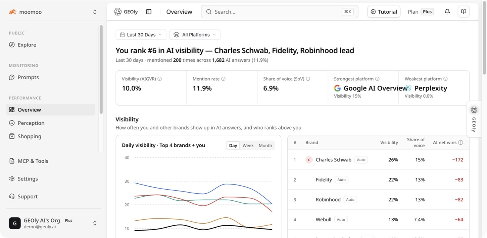
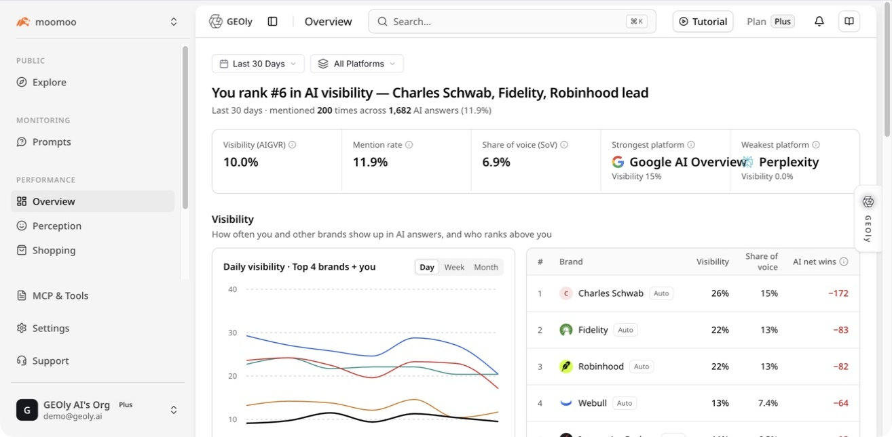
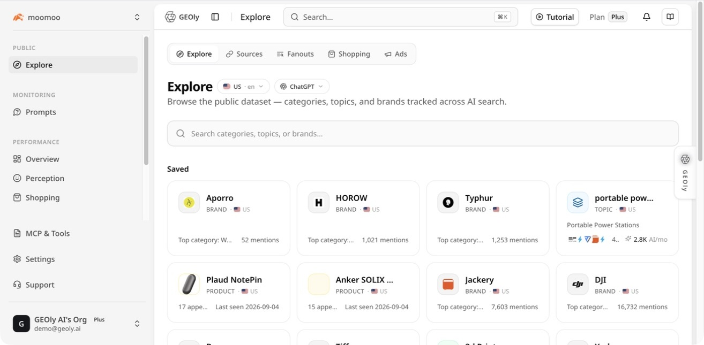
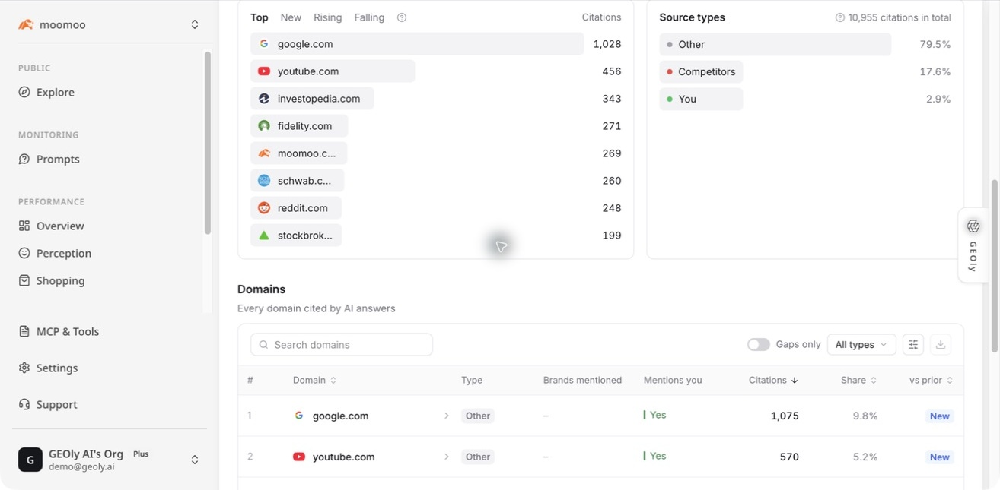
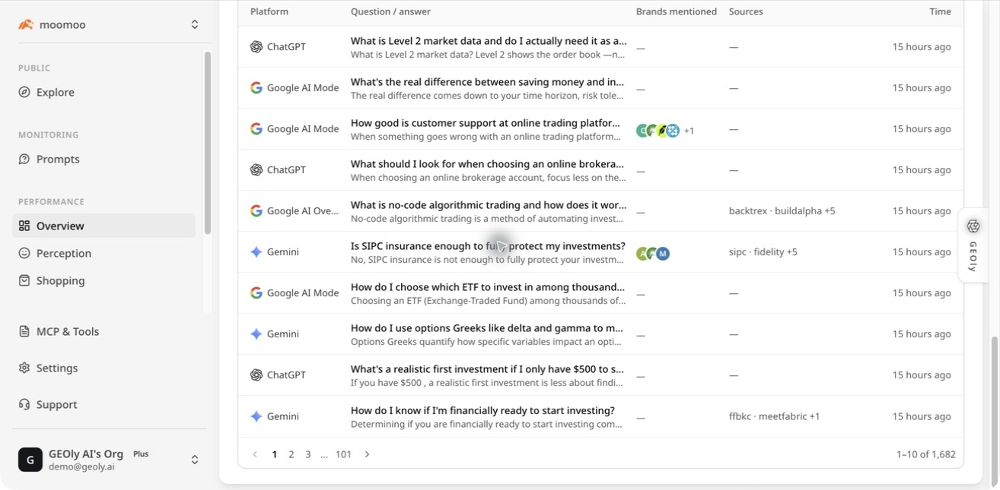

## 这页是做什么的

在左侧进入 **表现 → 总览**，可以快速看清：

- 品牌最近在 AI 回答里出现得多不多；
- 哪些平台表现好，哪些平台需要关注；
- 竞品是否经常排在前面；
- AI 回答引用了哪些网站；
- 哪些具体问题和回答需要进一步处理。

### 截图中的数据注释

这张图用于帮助理解总览页面的布局；图中具体百分比只是某个时间和平台范围下的示例，实际数值会随筛选条件和监测数据更新而变化。

- **截图当前显示 mentioned 200 times across 1,682 AI answers (11.9%)**：在截图所示的时间和平台范围内，品牌被提到的次数、已完成的 AI 回答数量，以及对应的比例。实际数字会随筛选条件和监测数据更新而变化；它反映监测结果，不是网站访问量。
- **Visibility (AIGVR)**：品牌在 AI 回答中的综合可见度，综合考虑出现位置、出现次数和相关引用；不是市场份额或销售额。
- **Mention rate**：总览 KPI 会在已完成监测记录中判断品牌是否出现在结果中，再按 Prompt 等权汇总。初次使用时可以把它理解为“有多少监测问题的回答识别到了品牌”；它不代表正面评价，也不能直接等同于 AI Answers 表格里显示的品牌标签数量。
- **Share of voice (SoV)**：当前范围内各品牌获得的提及份额，用于比较品牌之间的相对表现；不是收入、订单或真实市场占有率。
- **Strongest / Weakest platform**：在当前筛选范围内，可见度最高和最低的平台。它们只代表当前样本，不代表平台整体能力排名。

## 先选好查看范围

页面顶部可以选择：

- **时间范围**：决定主要指标、趋势和竞品对比看哪一段时间；
- **平台**：查看全部 AI 平台，或只看某个平台。

为了方便比较，建议每次复盘尽量使用相同的时间和平台范围。

**先记住三件事：**

1. 顶部卡片回答“整体表现怎么样”。
2. 可见度和竞品区域回答“和谁相比、变化在哪里”。
3. AI Answers 和 Citations 用来回到原始回答与来源，确认数字背后的具体原因。

需要注意：

- “引用来源”会使用页面当前显示的时间、平台、主题和竞品筛选。具体可用的时间范围和筛选项以页面当时显示为准；比较不同周期时，应记录并保持筛选条件一致。
- “AI 怎么回答你的问题”是独立板块，固定看最近 30 天，并有自己的平台筛选和“只看提到你”开关，不跟随顶部时间范围。
- 没有数据不代表品牌没有被提及，可能只是时间、平台或监测任务还没有覆盖到。页面上的空档应先检查是否有已完成监测，再判断表现。

## 顶部指标怎么看

**顶部卡片怎么读：**

- 先看卡片标题，再看百分比；百分比必须结合顶部的时间范围、平台筛选和已完成回答数量理解。
- **Visibility / AIGVR** 看综合可见度；**Mention rate** 看品牌覆盖了多少回答；**Share of voice** 看品牌在被提到品牌中的相对占比。
- **Strongest / Weakest platform** 用来决定先下钻哪个平台，不要把它理解成永久的全平台排名。

| 指标 | 简单理解 | 可以怎么用 |
| --- | --- | --- |
| AI 可见度（AIGVR） | 综合看品牌出现的位置、出现次数和品牌相关引用；每个问题先单独计算，再求平均。可以把它理解成“品牌在 AI 回答里出现得有多好”，品牌越早出现、被提及越充分、回答里有相关引用时，通常越高 | 判断整体表现是否变好，发现需要继续下钻的平台或问题；不需要自己手算 |
| 提及率 | 总览 KPI 按 Prompt 等权汇总每个问题的品牌识别覆盖；系统以完成记录中确认品牌出现的位置作为判断依据 | 看品牌是否进入监测回答结果；不代表回答一定正面，也不要和其他模块的 `mentions > 0` 明细直接混算 |
| 提及份额（SoV） | 在当前范围内各品牌获得的提及份额，用于比较品牌之间的相对表现 | 看竞品压力和机会；竞品比较的分母覆盖当前范围内被识别到的品牌，不只是页面展示的 Top 20；它不是市场份额或销售份额 |
| 最强 / 最弱平台 | 当前范围内，可见度最高或最低的平台 | 先打开弱平台的回答，找出具体原因 |
| “排第 1” | 当前时间、平台和样本范围内的相对排名 | 用来找方向，不代表全市场排名 |

顶部 KPI 与趋势/竞品明细不是同一层聚合：顶部 AIGVR、提及率和引用率按 Prompt 等权汇总；趋势按日期和平台展示，竞品比较使用记录级相对口径。因此不同区域的百分比不能直接当作同一个分母下的数值，出现小幅差异是正常的。

## 可见度和竞品怎么用

**趋势图和竞品表怎么读：**

- **趋势图**：横向看日期，纵向看可见度百分比；观察连续上升或下降，不要只根据某一天的波动下结论。
- **Brand** 是品牌名称；**Visibility** 是该品牌在当前范围内的可见度；**Share of voice** 是该品牌在被提到品牌中的提及占比。
- **AI 偏好净胜** 是品牌与竞品共同出现时的相对优势信号；数值为“—”表示共同提及样本不足，不能可靠比较，不是 0。
- 表格里的百分比会随时间、平台和监测问题变化，复盘时应保持筛选条件一致。

“可见度”区域包括趋势图和品牌表，可以按日、周、月查看。

重点看三件事：

1. 品牌的趋势是否连续变好或变差；
2. 哪些竞品经常排在前面；
3. 提及份额和可见度是否同时变化。

表格里的“AI 偏好净胜”是一个相对优势信号，适合在品牌和竞品共同出现时做相对比较，帮助你找出需要下钻的竞品和问题。它不是销量、订单或用户真实偏好，不能单独用来判断品牌整体表现。“—”表示共同提及样本太少，不能可靠比较，不是 0。

单日变化先不要急着下结论。先打开具体回答，确认品牌出现的位置、竞品语境和引用来源。

## 公共探索怎么用

> 图中 `Saved`、`BRAND`、`TOPIC`、`PRODUCT` 以及 `mentions`、`AI/mo`、`appearances` 是公开行业库里的对象类型、提及次数、估算的 AI 需求线索和出现次数。它们用于发现行业机会，不是当前账号的 Prompt 完成量，也不是网站流量。

需要从左侧 **公共 → 探索** 进入。这里展示的是 GEOly 的公开行业数据，不是总览页里的品牌监测卡片，也不是当前账号自己的 Prompt（监测问题）数据。

截图中的卡片可以帮助你发现：

- `BRAND`、`TOPIC`、`PRODUCT`：当前卡片对应的对象类型；
- `Top category`：该对象关联的主要品类；
- `mentions`：公开行业数据中出现或被提及的次数；
- `appearances`：对象在公开数据中的出现次数；
- `AI/mo`：页面提供的 AI 需求线索；
- `Last seen`：页面记录的最近出现时间。

这些字段适合用来发现行业主题、品牌和产品机会。它们不等于当前账号的 Prompt 完成量、网站流量、销售额或市场份额，也不应和总览页的监测数字直接相加。

## 引用来源怎么用

> 图中 `Citations` 表示监测回答中的引用条目；域名列表显示哪些网站被引用得更多，`Source types` 用于区分 `You`、`Competitors` 和 `Other`。这些数字不是访问量、点击量或转化量，仍要打开具体回答确认引用支持的内容。

“引用来源”会告诉你：

- 哪些域名经常被 AI 引用；
- 引用次数大概是多少；
- 来源属于 `You`、`Competitors` 或 `Other` 哪一类。

实际使用时，先看重复出现且与品牌相关的来源，再打开回答确认引用内容是否真的支持品牌主张。这里的 `Citations` 是监测回答中收集到的引用 URL 条目数；`citationRate` 则是有品牌自有域名引用的已完成记录占比。两者分子不同，不能用引用条目数除以回答数自行推算引用率。引用次数也不是访问量、点击量、转化率或收入。

## AI 回答明细怎么用

> 图中每行对应一条已完成的 AI 回答；`Platform` 是回答来源平台，`Question/answer` 是原始问题和回答，`Brands mentioned` 是识别到的品牌，`Sources` 是引用来源，`Time` 是回答时间。顶部的 `1–10 of ...` 是当前筛选下的记录数量，不是用户访问量。

这个板块固定展示最近 30 天的已完成回答。每条记录通常包括：

- AI 平台；
- 原始问题和回答摘要；
- 是否提到品牌；
- 出现的竞品；
- 引用来源；
- 回答时间。

建议先看全部回答了解整体情况，再使用“只看提到你”或平台筛选定位问题。

打开单条回答后，重点检查：

- 品牌有没有出现；
- 出现得早不早；
- AI 是怎么描述品牌的；
- 竞品为什么排在前面；
- 哪些来源被引用。

然后把结论转成具体动作，例如补充产品页面证据、改写 FAQ、增加监测问题，或继续观察下一周期。

## 第一次打开时，建议这样看

如果你第一次使用总览，可以按这个顺序：

1. **先固定时间和平台**：先确定你要看最近 30 天，还是某个自定义范围；再决定看全部平台，还是只看一个平台。
2. **看顶部指标和样本量**：先判断数据量是否足够，再看 AIGVR、提及率和提及份额。数据量很少时，不要因为一个百分点的变化就下结论。
3. **找出最需要关注的平台**：优先看最弱平台，或者趋势连续下降的平台。
4. **打开具体 AI 回答**：确认品牌出现的位置、AI 对品牌的描述，以及竞品为什么排在前面。
5. **再看竞品和引用来源**：判断差距来自品牌表达、竞品内容，还是 AI 更常引用其他来源。
6. **最后形成动作**：把发现的问题转成内容优化、补充证据、增加监测问题，或下一周期继续观察。

### 用一个例子理解顶部指标

假设当前范围显示：

- 提及率 70%；
- AIGVR 45%；
- 提及份额（SoV）20%。

这三个数字不是同一件事：

- **70% 提及率**：大约 70% 的监测问题对应回答提到了品牌；
- **45% AIGVR**：品牌虽然出现了，但还要结合出现位置、出现次数和引用情况看整体可见度；
- **20% SoV**：在被提到的品牌中，你占到的比例仍然可能落后于竞品。

正确的做法是继续打开回答，看品牌是否出现得晚、是否只被顺带提到，以及竞品是否占据更靠前的位置。它们都不能直接当作流量、销售额或市场份额。

## 常见情况怎么处理

### 1. 提及率低，可见度也低

先确认监测问题是否覆盖了真实业务场景，再打开未提到品牌的回答，看看 AI 是否理解错品牌、问题是否过于宽泛，或回答是否引用了其他来源。之后可以补充产品事实、FAQ 和权威来源，并在 Prompts 中增加更具体的问题。

### 2. 提及率高，但可见度或排名不高

这通常表示品牌出现了，但位置靠后，或者竞品在答案前面。重点看回答开头几段、竞品排序和引用来源，优先改进能直接回答用户问题的页面内容。

### 3. 可见度不错，但提及份额落后

这说明品牌出现的位置可能还可以，但同一范围内有更多竞品被提到。对比竞品被引用的来源、覆盖的使用场景和回答中的产品证据，找出自己缺少的主题。

### 4. 引用次数很多，但业务没有明显变化

引用说明 AI 使用了某个来源，不等于用户访问了该来源，也不等于产生了转化。应把引用来源与网站分析、线索、订单等第一方数据放在一起看。

## 页面参数怎么理解

**数据口径边界：**

- **已完成记录**：只有已完成的监测回答进入主要 KPI；没有运行监测的日期不会自动补成 0。
- **Prompt 等权**：总览核心 KPI 先按单个 Prompt 计算，再跨 Prompt 平均；回答数量更多的 Prompt 不会因为记录多而自动获得更大权重。
- **每日趋势**：趋势图按日期和平台展示当天有完成记录的结果；某天没有点，不应直接解读为可见度为 0。
- **竞品对比**：竞品表用于当前监测范围内的相对比较，使用记录级的品牌识别/提及数据，不等同于顶部 KPI，也不代表完整市场排名。
- **引用数据**：引用 URL 条目数、品牌引用记录占比和 Citation 页面中的域名统计是不同指标，不能互相换算。

- **时间范围**：决定主要指标、趋势图和竞品表的统计窗口。比较两个周期时，尽量保持范围相同。
- **平台筛选**：决定当前总览主要区域查看哪些 AI 平台。切换平台后，指标和排名可能变化，这是正常的。
- **样本量 / 已完成回答**：先看有多少条已完成监测，再判断百分比是否稳定；样本太少时，只把结果当作线索。这里没有一个适用于所有场景的固定最低值，应结合回答明细和连续周期一起判断。
- **提及率**：看品牌覆盖了多少监测问题，不等于正面评价。
- **引用率**：看已完成回答中有多少条包含品牌自有域名引用；它和 Citations 页面中的引用 URL 条目数不是同一个指标。
- **AIGVR / 可见度**：看品牌在回答中的综合出现质量。系统会综合品牌出现位置、提及频次和品牌自有引用，再按 Prompt 等权汇总；提及频次在计算中最多贡献 3 次，三部分权重分别是 0.4、0.25、0.25。它是系统指标，不需要自己用截图数字手算。总览顶部与按日品牌表的聚合方式不同，数值不必完全相等。
- **提及份额（SoV）**：看当前范围内品牌之间的相对提及份额；竞品比较时不要把页面展示的 Top 20 当成完整分母。它不是销售或市场占有率。
- **AI 怎么回答你的问题**：固定最近 30 天，有自己的平台筛选和“只看提到你”开关；它不会跟随顶部时间范围。

## 一个简单的复盘方法

1. 固定时间范围和平台。
2. 记录顶部指标和样本量。
3. 找出最弱平台或下降最明显的趋势。
4. 打开对应的 AI 回答，确认真实原因。
5. 查看竞品和引用来源，寻找差距。
6. 把问题整理成内容、监测问题、技术或来源建设任务。
7. 下一周期用相同范围重新比较。

## 需要记住的边界

- 总览只反映 GEOly 当前已完成的监测样本，不是所有真实用户的 AI 搜索日志。
- 提及、可见度和引用不能直接推导流量、销量、收入或广告效果。
- 品牌没有出现，可能是覆盖不足、任务未完成或平台暂时没有返回。
- 竞品比较只覆盖当前监测中识别到的竞品，不代表完整市场格局。
- 一条回答可能有多个引用 URL，引用条目数不能当成回答条数。

## 和其他模块的关系

- **Prompts**：管理要监测的问题。
- **AI 评价（Perception）**：查看回答中的评价和品牌语境。
- **AI 商品（Shopping）**：查看购物场景中的商品表现。
- **引用来源（Citations）**：深入查看域名和 URL。
- **AI 检索词（Fanouts）**：查看问题和检索词层面的数据。
- **AI 流量（AI Traffic）**：查看 AI 流量相关信号。

总览适合先发现问题；真正做决定前，要回到原始回答、引用证据和第一方业务数据。
