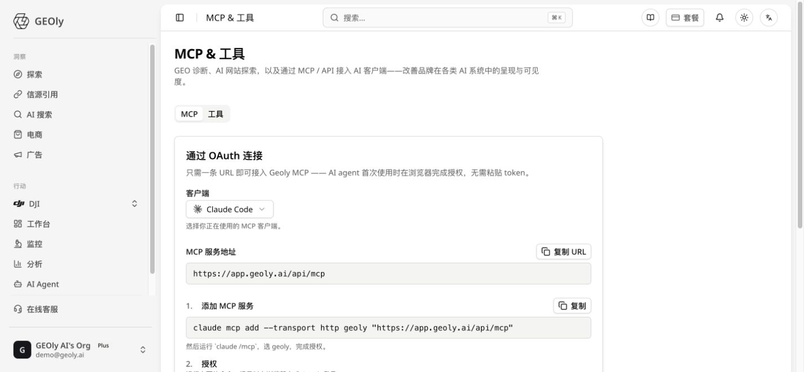
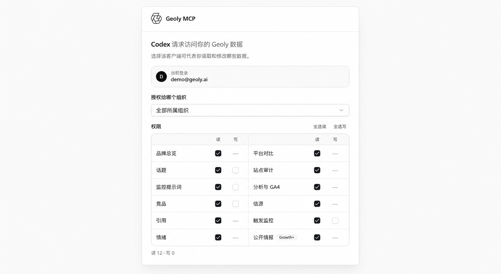
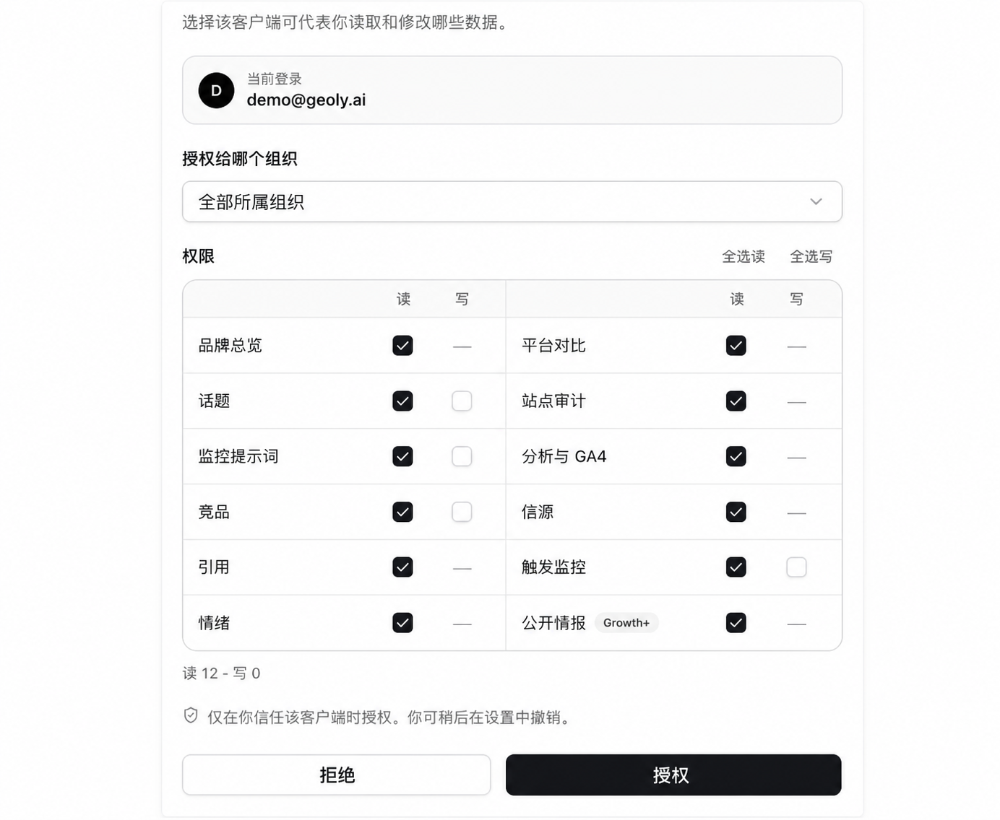
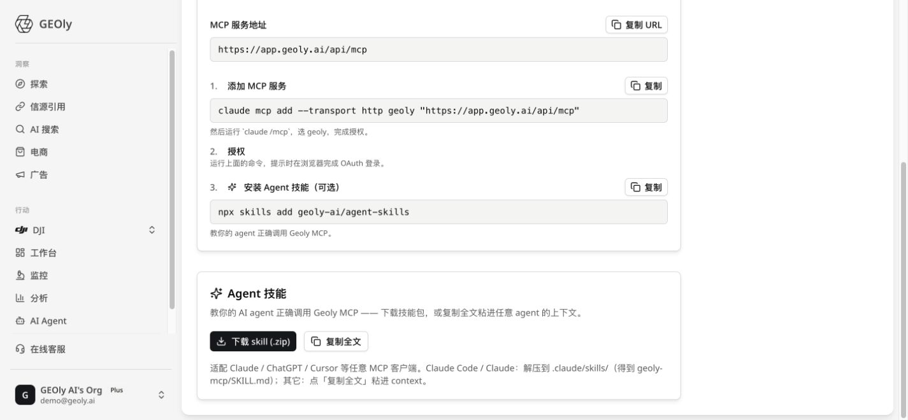

GEOly MCP（Model Context Protocol）把经过授权的 GEOly 数据与工具接入支持 MCP 的 AI 客户端。连接后，你可以在 Claude Code、Claude Desktop、Cursor、VS Code、Windsurf 或 Codex 中使用自然语言查询品牌监测、Prompt、竞争对手、引用、信源、情感和 GEO 审计数据。获得“信源”读取权限后，可使用三个免费的公开信源工具；Grow 及以上套餐在获得“公开数据”读取权限后，还可使用不扣 MCP Credits 的公开发现工具和计费的公开行业情报工具。获得写入权限后，还可以创建监测对象或触发监测。

进入路径：**左侧导航 → MCP & 工具 → MCP**。

> GEOly MCP 提供的是受组织、品牌、套餐及资源权限约束的工具访问，不是原始数据库访问。页面旁边的“工具”标签包含 AI Site Explorer、GEO 审计和 Agent Ready 等独立操作页面，不属于 MCP 的连接配置流程；但获授权的 MCP 仍可以读取当前用户自己的 Agent Ready 报告历史与详情。

## 开始前先分清三个概念

| 功能 | 数据流向 | 主要作用 |
|---|---|---|
| **GEOly MCP** | GEOly → 外部 AI 客户端 | 让 Claude、Cursor、Codex 等客户端调用获授权的 GEOly 数据与操作 |
| **Agent Skill** | 使用说明 → AI Agent | 教 AI 如何选择、组合并正确解释 GEOly MCP 工具 |
| **Agent 中的 MCP** | Notion、GitHub、Shopify 等 → GEOly Agent | 给 GEOly Agent 接入外部服务，与本篇介绍的 GEOly MCP 不是同一项功能 |

MCP 负责“能够调用”，Agent Skill 负责“知道怎样调用”。如果已经连接 MCP，但 AI 仍经常选错工具、混淆指标或无法完成多步分析，可以再安装 Agent Skill。

## 三分钟完成连接

新连接统一使用 OAuth，不需要创建或粘贴 `geom_` Token。

1. 登录 GEOly，进入 **MCP & 工具 → MCP**。
2. 在“客户端”中选择你正在使用的工具。
3. 复制页面生成的命令或 JSON 配置。
4. 将配置添加到对应客户端，并按界面提示重载或重启。
5. 首次连接或调用时，客户端会打开浏览器授权页面。
6. 登录 GEOly，选择允许访问的组织和资源权限。
7. 授权完成后返回客户端，先执行一次只读验证。

推荐使用下面的验证提问：

> 请调用一次只读的品牌概览能力，说明当前品牌、查询时间范围和返回的核心指标。暂时不要执行写入、触发监测或计费的公开行业调用。

如果客户端能够识别 GEOly，并返回品牌概览或当前可用的工具类别，说明连接已经生效。单组织单品牌范围内，工具会直接使用唯一品牌，不再提供组织或品牌选择工具；单组织多品牌时会提供品牌选择能力；多组织时应先选择组织，再选择该组织中的品牌。实际可用能力会随组织、品牌、套餐和 OAuth 权限而变化。




<video controls playsinline preload="metadata" width="100%" src="https://cdn.shopify.com/videos/c/o/v/cf1b4c7ead9e48b1a46f1536cd205504.mp4"></video>

## 视频：让 Claude 一次完成 GEOly 周报分析

这个 1 分 25 秒的示例展示如何通过 GEOly MCP，让 Claude 一次查询周报、竞品和平台差异，发现分析盲点，并生成内容计划。

<iframe src="https://www.youtube.com/embed/y1M4VjtRniQ" title="Ask Claude once：周报、竞品、平台、盲点和内容计划 | GEOly MCP" width="100%" height="480" allow="accelerometer; autoplay; clipboard-write; encrypted-media; gyroscope; picture-in-picture; web-share" allowFullScreen></iframe>

> 在 MCP 页面中先选择客户端，再复制当前界面生成的命令或配置；首次连接时按客户端提示完成 OAuth 授权。

## 各客户端的配置方法

### Claude Code

在 **MCP & 工具** 页面选择 Claude Code，复制并运行页面生成的命令。当前标准形式为：

```bash
claude mcp add --transport http geoly "https://app.geoly.ai/api/mcp"
```

添加完成后，先运行 `claude` 启动 Claude Code，然后在交互界面输入：

```text
/mcp
```

选择 `geoly`，并在打开的浏览器中完成 OAuth 授权。不要把 `claude /mcp` 作为一条终端命令运行；`/mcp` 是 Claude Code 交互界面中的命令。

### Cursor

将页面生成的配置加入 `~/.cursor/mcp.json`：

```json
{
  "mcpServers": {
    "geoly": {
      "url": "https://app.geoly.ai/api/mcp"
    }
  }
}
```

保存后重载 Cursor。在 Agent 模式中首次使用 GEOly 工具时，按提示完成浏览器授权。

### Claude Desktop

当前 GEOly 页面提供的是 `mcp-remote` 本地桥接配置。它会在本机通过 `npx` 启动一个桥接进程，再连接 GEOly 的远程 MCP 服务。使用前请确认电脑已安装 Node.js，并且终端可以运行 `npx`：

```json
{
  "mcpServers": {
    "geoly": {
      "command": "npx",
      "args": ["-y", "mcp-remote", "https://app.geoly.ai/api/mcp"]
    }
  }
}
```

将配置加入 Claude Desktop 的本地 MCP 配置后，完全退出并重新打开应用。`mcp-remote` 会在需要时打开 OAuth 浏览器授权流程。

如果 Claude Desktop 的 **Settings → Connectors** 中可以添加自定义连接器，也可以直接填写以下远程 MCP 地址：

```text
https://app.geoly.ai/api/mcp
```

原生 Connectors 的可用性取决于 Claude 账户方案和组织管理员设置。使用原生方式时，不需要运行 `mcp-remote`；不要把远程 HTTP 地址直接作为远程服务器写入 Claude Desktop 的本地配置，应使用 Connectors，或保留上面的 `mcp-remote` 本地桥接配置。

### VS Code

将配置加入项目的 `.vscode/mcp.json`：

```json
{
  "servers": {
    "geoly": {
      "type": "http",
      "url": "https://app.geoly.ai/api/mcp"
    }
  }
}
```

保存后按 VS Code 的 MCP 提示启动服务器并完成授权。

### Windsurf

将下面的配置加入 Windsurf 的 `~/.codeium/windsurf/mcp_config.json`：

```json
{
  "mcpServers": {
    "geoly": {
      "serverUrl": "https://app.geoly.ai/api/mcp"
    }
  }
}
```

保存并重载 Windsurf，首次调用时在浏览器完成 OAuth。

### Codex

Codex 使用 GEOly 插件市场安装：

```bash
codex plugin marketplace add geoly-ai/codex-plugins
codex plugin add geoly-mcp@geoly
```

插件已经内置生产 MCP Server 和 Agent Skill。安装后会自动打开浏览器授权，无需再填写 MCP URL，也不需要单独安装 Skill。

#### 升级 Codex 插件

如果 Codex 已安装 GEOly 插件，但没有显示最新工具或使用说明，先更新插件市场，再重新安装当前插件版本：

```bash
codex plugin marketplace upgrade geoly
codex plugin add geoly-mcp@geoly
```

升级后重新启动 Codex；如果客户端仍沿用旧授权或无法加载工具，再重新发起 OAuth 连接。

> 页面中的连接配置是当前版本的单一事实来源。客户端更新可能改变配置文件位置或重载方式；如界面生成的配置与本文示例不同，以 **MCP & 工具** 页面为准。

## OAuth、组织与资源权限

OAuth 决定某个客户端可以代表你访问哪些 GEOly 数据和操作。授权页面会显示组织范围以及按资源划分的读取、写入权限。



> 如果账号可以访问多个组织，先确认授权的是某个明确组织还是全部组织。组织范围会影响客户端可查询的数据范围，以及写入能力是否可用。

### 读取权限

读取权限用于查询已有数据，例如品牌概览、Topic、Prompt 记录、竞争对手、引用、信源、情感、平台表现、GEO 审计或 Analytics 数据。关闭某项资源的读取权限后，与该资源映射的业务工具不会向该客户端开放。组织与品牌发现、部分基础工具，以及当前用户自己的 Agent Ready 报告工具不参与这组资源权限控制，因此仍可能显示。

### 写入权限

写入权限默认不会自动授予，需要在授权页面明确选择。目前写入能力包括：

- 创建 Topic；
- 创建 Prompt；
- 创建竞争对手；
- 触发 Prompt 监测。

当账号可以访问多个组织并选择“全部组织”时，写入能力会被关闭，避免客户端在没有明确目标组织的情况下修改数据。需要写入时，应授权一个明确的组织范围。



> 写入权限默认关闭。只勾选完成任务确实需要的资源；触发 Prompt 监测会消耗对应的产品监测额度，但不消耗 MCP Credits，应在授权和实际执行前分别确认。

### Agent Ready 报告权限

Agent Ready 的扫描入口位于“工具”标签，它与 MCP 连接配置是两个独立页面。完成 MCP 授权后，客户端仍可以读取当前用户自己的 Agent Ready 扫描历史和单次报告详情。这些报告工具属于用户级只读能力，不受品牌资源权限矩阵控制，也不会访问其他用户的数据。

### 套餐与数据范围

计费的公开行业情报工具仅对 Grow 及以上套餐开放，同时需要在 OAuth 授权中启用“公开数据”读取权限。三个免费公开信源工具由“信源”读取权限控制；不扣 MCP Credits 的公开发现工具也需 Grow 及以上套餐和“公开数据”读取权限。Analytics 数据也只有在相应数据可用且权限允许时才能查询。工具未出现不一定是连接失败，也可能是当前组织、品牌、套餐或授权范围不包含该能力。

旧 `geom_` 静态 Token 仅保留只读兼容，不能使用创建 Topic、Prompt、竞争对手或触发监测等写入能力，当前界面也不再提供静态 Token 的新建或管理入口。新连接应使用页面提供的 OAuth 流程，并在授权时明确选择所需权限。

## MCP Credits：免费范围、计费规则与套餐额度

GEOly MCP、GEOly CLI 及后续开放 API 共用同一个 MCP Credits 额度池和计费规则。MCP Credits 与产品内 AI 分析使用的 AI Credits 相互独立；使用其中一项不会直接扣减另一项。

### 哪些能力不消耗 MCP Credits？

| 免费能力 | 客户可以做什么 |
|---|---|
| 自有品牌监控数据 | 查询品牌可见度、Prompt 记录、竞争对手、引用来源、平台矩阵、情感、Analytics 和网站审计等数据；部分读取当前按调用计入 MCP Credits，具体以工具回执为准 |
| 写操作 | 创建 Topic、Prompt、竞争对手等；写入调用不按 MCP 数据行计费，触发 Prompt 监测会消耗对应的产品监测额度 |
| 发现与导航 | 查看额度、组织和品牌等基础能力适用于各套餐；搜索公开实体、浏览行业目录、查询公开数据可用平台与语言等公开发现工具不扣 MCP Credits，但需 Grow 及以上套餐和“公开数据”读取权限 |
| 免费信源能力 | 查询信源全景、信源域名详情和信源—品牌通路，不扣 MCP Credits |

因此，不能把所有自有品牌取数都视为免费。当前配置下，很多品牌监控读取按调用计入 MCP Credits；导航、写入、审计、GA4、Agent Ready 和免费公开信源工具仍可能不扣额度。具体以工具的 quota 回执和 `get_quota` 为准。

### 哪些能力会消耗 MCP Credits？

计费范围既包括跨品牌、跨品类的公开行业研究，例如品牌榜单、品类白空间、品牌动量、品牌对比、Prompt 矩阵、AI 货架榜和搜索需求分析，也包括当前配置下按调用计费的部分品牌监控读取。这些数据来自授权可见的工作区监测数据或 GEOly 独立采集的行业级 AI 可见度数据集，具体以工具返回的 quota 回执为准。

计费的公开行业情报工具需要 Grow 及以上套餐，并且 OAuth 授权中必须启用“公开数据”读取权限。三个公开信源工具本身免费，但受“信源”读取权限控制；公开发现工具不扣 MCP Credits，但同样受 Grow 及以上套餐和“公开数据”读取权限限制。工具未出现时，应同时检查套餐、组织范围和 OAuth 权限，不能直接判断为连接故障。

### 各套餐每月额度

| 套餐 | 每月 MCP Credits | 适合的使用方式 |
|---|---:|---|
| Basic | 3,000 | 组织级 MCP 额度；自有品牌监控、写操作、额度查询和获授权的三个免费公开信源工具仍可使用；公开发现与行业工具需 Grow 及以上 |
| Grow | 25,000 | 常规行业研究和单品牌增长分析 |
| Advanced | 75,000 | 更高频的多平台与深度行业分析 |
| Plus | 200,000 | 多品牌、多市场或较大规模自动化 |
| Enterprise | 不限量 / 按方案 | 代理机构批量分析、企业自动化管线和定制集成 |

额度按组织共享，而不是每位成员单独拥有。组织内全部席位共用一个总池，多购买席位不会增加额度；每笔消耗会按调用人记录。MCP Credits 按月度额度周期重置，具体时间以 `get_quota` 返回的 `resets_at` 为准，未使用额度不结转。升级套餐后，新档位额度即时生效。

### 如何计算一次调用的消耗？

**实际消耗取决于工具的计价单位。** 公开行业列表通常按返回行数以 1、3、10 Credits/条计费；许多品牌监控读取按调用计费。以工具返回的 `_quota` 回执和 `get_quota` 为准。

| 计费档位 | 单价 | 常见结果 |
|---|---:|---|
| 概览档 | 1 Credit / 条 | Topic、品牌或品类概览，单条详情，商品卡和 Prompt 枚举 |
| 详情档 | 3 Credits / 条 | 品牌榜单、SoM 趋势、引用域名、品牌感知、搜索词和商品全景 |
| 深度档 | 10 Credits / 条 | Prompt 矩阵、品类白空间、品牌动量、估算指标和品牌对比 |

需要注意：

- 请求 100 条但实际只返回 8 条，只按 8 条结算。
- 返回一个汇总对象的 KPI 类调用通常按 1 条结算。
- 系统错误或超时不扣额度，已预扣部分会自动退还。
- 查无数据或样本不足时，可能收取该工具 1 条的最低查询费；回执会标注原因。
- 单次调用最多消耗 2,500 Credits；超过上限的请求会被拒绝且不扣费，并提示缩小范围。
- 少数重型工具查询超过 90 天的时间窗口时，每条单价可能按 2 倍计算。

### 常见调用大约消耗多少？

以下按默认参数举例，最终仍以实际返回条数为准：

| 常见调用 | 参考消耗 |
|---|---:|
| 查看一个 Topic 概览 | 1 Credit |
| 查看一个商品的 AI 货架全景 | 3 Credits |
| 对比两个品牌的可见度 | 20 Credits |
| 拉取品牌榜单前 20 名 | 60 Credits |
| 拉取 30 天 SoM 趋势 | 90 Credits |
| 查询 15 个品类白空间机会 | 150 Credits |
| 获取 50 行 Prompt × 品牌矩阵 | 500 Credits |

### 如何控制和查看用量？

建议 Agent 先使用免费的发现与导航能力缩小品牌、品类、平台和时间范围，再调用计费工具，并只请求任务需要的行数。这样可以减少无效返回，也更容易复核分析范围。

免费额度查询工具 `get_quota` 可以随时查看本周期已用额度、剩余额度和重置时间。每次计费调用的返回结果还会附带 `_quota` 回执，说明本次消耗和剩余额度；接近上限时系统会给出预警，额度不足时会明确提示当前余额可支持的调用范围。

额度用完后，不需要 MCP Credits 的工具仍可继续使用；需要额度的品牌监控或公开行业调用会返回额度错误，直到额度重置或组织升级。实际余额、单次费率和扣费结果以产品内 `get_quota` 与调用回执为准。

## 安装 Agent Skill（可选）

在 MCP 页面下方的“Agent 技能”卡片中，可以下载 Skill 压缩包或复制全文。也可以在支持 Skills 的环境中运行：

```bash
npx skills add geoly-ai/agent-skills
```



Agent Skill 不会扩大账号权限，也不会绕过 OAuth。它主要帮助 AI：

- 先确认组织、品牌、时间范围和平台；
- 区分品牌自身监测数据与公开行业数据；
- 为复杂问题组合多个读取工具；
- 避免把提及、引用、流量、收入或因果关系混为一谈；
- 在写入或消耗额度前先请求用户确认。

如果使用 Codex 插件，则无需重复安装 Skill。

## GEOly MCP 可以完成什么

GEOly MCP 的工具会持续更新，并根据权限动态开放，因此不建议按固定数量理解。更实用的方式是按任务认识它的能力。

| 能力类别 | 可以回答的问题 | 使用时需要注意 |
|---|---|---|
| **品牌监测** | 最近 7、30 或 90 天的 AIGVR、提及率、引用率和各平台表现如何？ | 不同指标的分子、分母和含义不同，不能相互替代 |
| **Topic 与 Prompt** | 哪些问题表现较弱？具体 AI 回答中是否提及品牌？ | 时间范围内没有记录与记录中没有提及是两种情况 |
| **竞争分析** | 已监测竞争对手表现如何？哪些品牌经常在同一回答中出现？ | 竞争对手识别依赖已配置的名称和别名，不等于自动发现整个市场 |
| **引用与信源** | AI 经常引用哪些域名、页面和 URL？哪些 Prompt 存在引用机会？ | 引用变化不能直接证明网站引荐流量变化 |
| **情感与回答内容** | AI 通常怎样描述品牌？正面、中性和负面信号如何分布？ | AI 回答和情感分析属于观测信号，需要结合原文核对 |
| **平台分析** | ChatGPT、Gemini、Perplexity 或 Google AI 等平台表现有何差异？ | 只比较实际有监测记录的平台，不把缺失数据当作 0 |
| **GEO 审计** | 网站有哪些 AI 可访问性、结构化数据、内容结构或技术问题？ | 审计结果用于排查和排序，不代表修复后一定带来流量或引用增长 |
| **Analytics** | 在相应数据可用时，哪些页面获得访问，流量如何变化？ | 第一方 Analytics 与 AI 提及、引用指标应分别解释 |
| **公开行业研究** | 某个行业、公开品牌、Topic、品类、信源或商品的竞争格局如何？ | 免费信源与发现能力可直接使用；计费的深度行业情报工具需 Grow 及以上套餐并授予“公开数据”读取权限 |
| **写入与监测** | 能否创建监测对象，或立即运行一个 Prompt？ | 必须拥有写入权限；触发 Prompt 监测会消耗产品监测额度、但不消耗 MCP Credits，并受套餐限制 |

## 典型工作流一：诊断品牌表现变化

适合周报、月报或品牌可见性出现明显变化时使用。

1. 先查询品牌在明确时间范围内的 AIGVR、提及率和引用率。
2. 按 AI 平台比较记录覆盖和表现差异。
3. 找出变化较大的 Topic 或 Prompt。
4. 打开相关 Prompt 的记录和 AI 回答，检查是否提及品牌、竞争对手和引用来源。
5. 将结论拆成“已观察事实、待验证原因、建议下一步”。

推荐提问：

> 分析最近 30 天品牌的 AIGVR、提及率和引用率，并按平台说明差异。找出最值得复核的 Prompt。请把观测事实与推测原因分开，不要把引用率当作流量。


一份合格的输出应说明查询范围和可用记录，并把“发生了什么”与“为什么发生”区分开。MCP 可以帮助定位异常，但不能仅凭相关变化证明原因。

## 典型工作流二：分析引用、信源与竞争机会

适合内容团队、SEO、数字公关和竞争研究人员。

1. 查询品牌引用概览，确认常见引用域名和页面。
2. 按域名或 URL 查看它们出现在哪些 Prompt 和 AI 回答中。
3. 检查品牌缺席而其他来源被引用的监测问题。
4. 对比竞争对手的提及和共同出现情况。
5. 将结果整理为需要验证的内容、信源建设或数字公关假设。

推荐提问：

> 找出最近 30 天最常被引用的域名和页面，并说明它们对应哪些 Prompt。再列出品牌官网未被引用、但存在其他引用来源的问题。请把结果写成待验证的内容机会，不要把它们描述为确定的流量损失。

“未被引用”只能说明在当前监测范围、平台和时间窗口中没有观察到该引用。它不自动意味着页面质量差，也不意味着所有 AI 场景都没有引用。

## 典型工作流三：从 GEO 审计形成修复计划

适合技术 SEO、网站团队和内容运营人员。

1. 获取审计列表并选择最新一次已完成的审计。
2. 查看总分、分类分数以及严重、警告和通过项。
3. 按可修复性和影响范围整理优先级。
4. 将问题分配为技术、结构化数据、内容结构或可访问性任务。
5. 修复后回到 GEOly 的 GEO 审计页面重新运行审计，再通过 MCP 读取新的审计结果，比较同一检查项是否改善。

推荐提问：

> 查看最新一次 GEO 审计，把问题按严重程度和所属类别整理为修复清单。每项包含现象、建议动作、负责角色和验证方法；不要承诺修复后一定提高 AI 引用或自然流量。

GEOly MCP 当前提供审计列表和审计详情等读取能力，不负责触发新的审计。审计用于发现网站对 AI 抓取、理解和引用可能存在的障碍，可以支持技术优先级判断，但最终效果仍需通过后续监测和第一方数据验证。

## 写入操作与安全确认

只读分析不会修改 GEOly 中的数据。创建 Topic、Prompt、竞争对手或触发监测则属于写入操作，应先确认目标组织、品牌和具体内容。

建议在会话开始时加入以下规则：

> 执行任何写入或消耗额度的操作前，先展示目标组织、品牌、操作内容和预期影响，并等待我明确确认。

触发 Prompt 监测会立即创建或运行相应监测任务，消耗对应的产品监测额度、但不消耗 MCP Credits，并受账号套餐和可用平台限制。不要仅凭模糊指令批量触发任务。

## 如何正确理解返回结果

- **AIGVR、提及率和引用率不是同一个指标。** 它们可以共同描述品牌在 AI 回答中的表现，但不能相互替代。
- **引用不等于引荐访问。** 引用数据表示 AI 回答中观察到的来源，实际访问应使用 Analytics 等第一方数据验证。
- **SoM 不等于市场份额。** 它描述特定数据范围中的品牌提及分布，而不是销售额或整个市场占有率。
- **没有返回数据不一定等于 0。** 还需检查时间范围、平台、采集记录、组织、品牌、套餐和资源权限。
- **公开数据与品牌监测数据范围不同。** 可以联合研究，但必须分别标注来源、时间和指标口径。
- **AI 生成的解释属于分析建议。** 对竞争原因、内容缺口和业务影响的判断，应回到实际回答、页面内容和第一方数据中验证。

## 常见问题

### 为什么没有打开 OAuth 页面？

确认已经在客户端中启动或首次调用 `geoly` MCP 服务。Claude Desktop 使用本地桥接时需要能够运行 `npx mcp-remote`；使用原生 Connectors 时应检查连接器是否已添加并启用。其他客户端需要支持远程 HTTP MCP。保存配置后按客户端要求重载或重启，再重新发起连接。

### 为什么连接成功后可用工具很少？

检查 OAuth 中选择的组织和读取权限，同时确认当前套餐是否包含相应公开数据。客户端只会看到授权范围内且当前账号可用的工具。

### 为什么没有写入工具？

可能没有授予相应资源的写入权限；如果账号拥有多个组织并选择了“全部组织”，写入能力也会被关闭。重新发起授权时选择明确组织并只授予必要的写入资源。

### 为什么查询到的不是预期品牌？

单组织单品牌范围内，工具会直接使用唯一品牌，可以先查询品牌概览确认名称；单组织多品牌时先列出品牌，多组织时先列出组织再列出该组织中的品牌。执行写入时必须明确目标，不要依赖上下文猜测。

### 为什么有些公开行业工具不可用？

三个免费公开信源工具需授予“信源”读取权限；公开发现工具不扣 MCP Credits，但需 Grow 及以上套餐和“公开数据”读取权限。计费的公开行业情报工具还会按返回结果消耗 MCP Credits。

### 哪些 MCP 操作会消耗 Credits？

只有计费的公开行业情报工具消耗 MCP Credits。自有品牌监控、免费公开信源、发现与导航、写操作均不扣 MCP Credits；触发新的 Prompt 监测会使用对应的产品监测额度。

### AI Agent 查询自己的品牌数据会消耗 MCP Credits 吗？

不会。查询自己组织内的品牌可见度、Prompt、引用、竞品、平台矩阵或审计数据属于订阅内能力。

### MCP Credits 和 AI Credits 是同一套额度吗？

不是。AI Credits 用于 GEOly 产品内的 AI 分析或生成；MCP Credits 用于计费的公开行业情报调用，两套额度相互独立。

### 各套餐有多少 MCP Credits？

Basic 为 0，Grow 为 25,000，Advanced 为 75,000，Plus 为 200,000，Enterprise 按方案提供不限量或定制额度。MCP Credits 按月度额度周期重置，具体时间以 `get_quota` 返回的 `resets_at` 为准，未使用额度不结转。

### MCP Credits 如何计算？调用失败会扣费吗？

计费按实际返回条数乘以工具费率结算；汇总 KPI 视为一个结果。系统错误或超时不扣费，空结果或样本不足可能产生一条结果的最低费用，最终以调用回执为准。

### MCP Credits 是每位成员单独计算吗？

不是。同一组织的成员共享一个额度池，增加席位不会增加 MCP Credits；调用记录仍会保留调用人信息，便于核对。

### MCP Credits 用完后会发生什么？

自有品牌数据、写操作和当前套餐范围内的免费能力仍可使用；只有计费的公开行业工具暂停。升级后新套餐额度即时生效。

### 如何查看剩余额度和每次调用的消耗？

使用免费的 `get_quota` 查看已用、剩余和重置时间；每次计费调用返回的 `_quota` 会显示本次消耗与余额。完整计费规则见上文“MCP Credits：免费范围、计费规则与套餐额度”。

### 为什么 Codex 没有显示最新工具或说明？

先执行 `codex plugin marketplace upgrade geoly` 更新插件市场，再运行 `codex plugin add geoly-mcp@geoly` 安装当前版本。升级后重启 Codex；如果仍无法加载工具，重新发起 OAuth 连接。

### 为什么 MCP 已连接，但 AI 仍然不会正确调用？

先明确问题、品牌、平台和时间范围；对于多步任务，安装 MCP 页面提供的 Agent Skill。Skill 会改善工具选择和指标解释，但不会增加账号权限。

## 推荐的提问方式

为了获得更可复核的结果，提问时尽量包含以下信息：

- **范围**：组织、品牌、Topic 或 Prompt；
- **时间**：最近 7 天、30 天、90 天或明确日期；
- **平台**：全部平台或指定平台；
- **指标**：AIGVR、提及率、引用率、情感或审计问题；
- **输出**：表格、摘要、修复清单或待验证假设；
- **边界**：不推断流量、收入或因果关系；
- **安全**：写入和消耗额度前必须等待确认。

示例：

> 请分析最近 30 天品牌在各 AI 平台的 AIGVR、提及率和引用率，找出需要复核的 Prompt，并用“观测事实—可能原因—验证动作”的结构输出。不要执行写入操作，也不要把引用变化解释成流量变化。

通过这种方式，GEOly MCP 不只是把报表搬进聊天窗口，而是让你在明确权限、数据范围和判断边界的前提下，把品牌监测、引用研究、竞争分析和网站审计组织成可重复的 AI 工作流。
