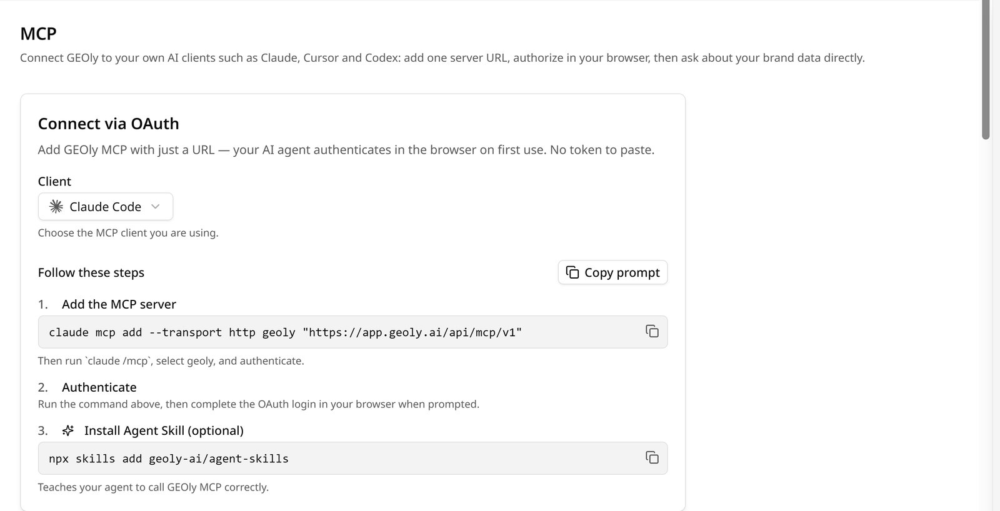
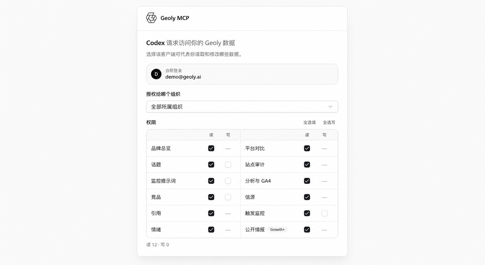
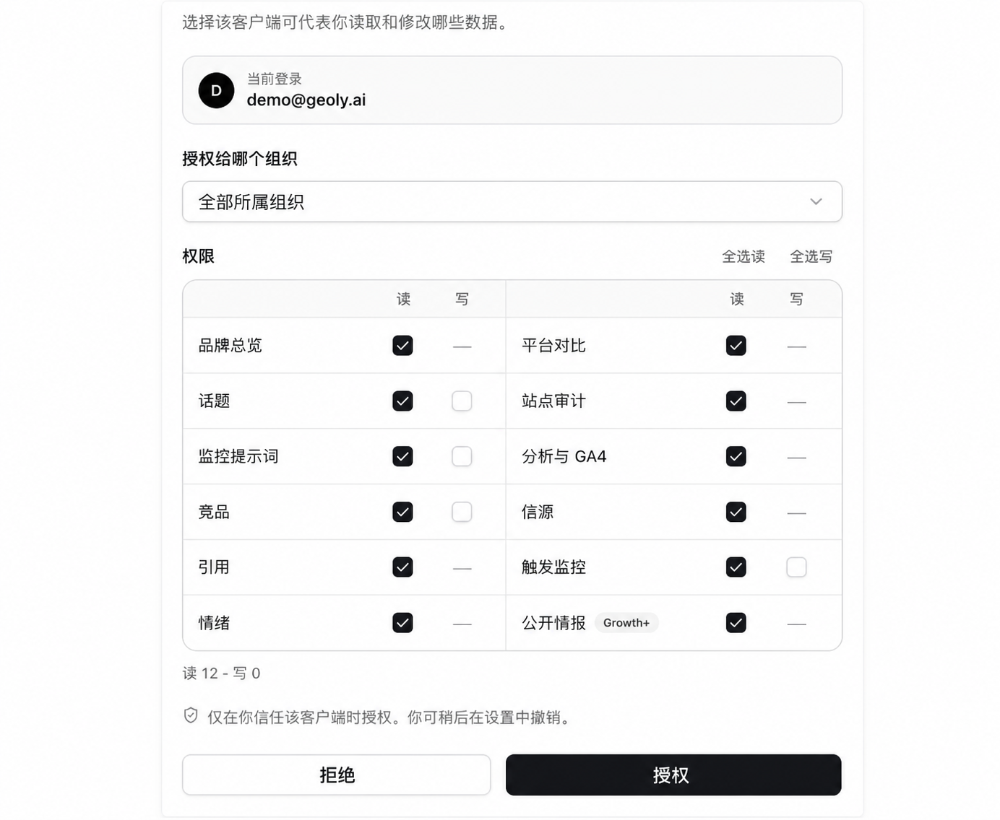

## 服务器地址

```text
https://app.geoly.ai/api/mcp/v1
```

也可以在 GEOly 的 **设置 → 开发者 → MCP 接入** 里复制。在这个页面选择你的客户端，会直接生成下面对应的命令或配置。



## 认证

GEOly 使用 OAuth，不需要创建或粘贴令牌：客户端第一次连接时，会在浏览器里打开 GEOly。

1. 登录 GEOly。
2. 选择一个组织；或选择「全部组织」，跨组织只读访问。
3. 勾选允许客户端读取的内容，只给确实要修改的资源开写入。
4. 确认授权，回到客户端。





<video controls playsinline preload="metadata" width="100%" src="https://cdn.shopify.com/videos/c/o/v/cf1b4c7ead9e48b1a46f1536cd205504.mp4"></video>

## Claude Code（命令行）

```bash
claude mcp add --transport http geoly "https://app.geoly.ai/api/mcp/v1"
```

启动 `claude`，在会话里输入 `/mcp`，选择 `geoly`，然后在浏览器里完成登录授权。`/mcp` 是 Claude Code 会话里的命令，不是终端命令。

## Claude Desktop 和 claude.ai

如果你的 Claude 方案支持添加自定义连接器，打开 **Settings → Connectors → Add custom connector**，粘贴服务器地址，Claude 提示时登录授权即可。能否使用自定义连接器取决于你的 Claude 方案和组织管理员设置。

不能用自定义连接器时，在 Claude Desktop 的 MCP 配置里使用本地桥接。需要先装好 Node.js，保证 `npx` 能运行：

```json
{
  "mcpServers": {
    "geoly": {
      "command": "npx",
      "args": ["-y", "mcp-remote", "https://app.geoly.ai/api/mcp/v1"]
    }
  }
}
```

完全退出并重新打开 Claude Desktop。桥接会在需要时打开浏览器让你登录授权。

## Codex（命令行和 IDE）

安装 GEOly 官方插件，插件里已经包含 MCP 服务器和 [Agent Skill](https://www.geoly.ai/zh/open/skill)：

```bash
codex plugin marketplace add geoly-ai/codex-plugins
codex plugin add geoly-mcp@geoly
```

Codex 提示时重启一下。第一次调用 GEOly 会在浏览器里打开登录授权。以后更新运行 `codex plugin marketplace upgrade geoly`。

## Cursor

把下面的配置加到 `~/.cursor/mcp.json`：

```json
{
  "mcpServers": {
    "geoly": {
      "url": "https://app.geoly.ai/api/mcp/v1"
    }
  }
}
```

重载 Cursor，在 **Settings → MCP** 里启用服务器，第一次调用 GEOly 工具时登录授权。

## VS Code（GitHub Copilot）

在项目里新建或修改 `.vscode/mcp.json`：

```json
{
  "servers": {
    "geoly": {
      "type": "http",
      "url": "https://app.geoly.ai/api/mcp/v1"
    }
  }
}
```

在编辑器里启动服务器，按提示登录授权。GEOly 工具在 Copilot 的 Agent 模式下可用。

## Windsurf

把下面的配置加到 `~/.codeium/windsurf/mcp_config.json`：

```json
{
  "mcpServers": {
    "geoly": {
      "serverUrl": "https://app.geoly.ai/api/mcp/v1"
    }
  }
}
```

重载 Windsurf，第一次调用时登录授权。

## 其他客户端

支持 Streamable HTTP 远程 MCP 服务器和 OAuth 的客户端都可以使用，填上面的服务器地址即可。只支持本地（stdio）服务器的客户端，用上文 Claude Desktop 部分的 `mcp-remote` 桥接。

## 安装 Agent Skill

技能教 AI 助手怎么用 GEOly：先确认组织和品牌、选对工具、按后台口径解释每个指标。每台电脑装一次：

```bash
npx skills add geoly-ai/agent-skills
```

如果在用 [GEOly CLI](/zh/developers/cli)，运行 `geoly init` 会为 Claude Code、Codex 和 Cursor 装好最新版技能。Codex 插件已经自带技能。详见[技能介绍页](https://www.geoly.ai/zh/open/skill)。

## 验证连接

对 AI 助手说：

> *「用 GEOly 列出我能访问的品牌，再给我看我们品牌最近 30 天的可见度。」*

正常情况下，你会先看到品牌列表，然后是一段简短概览：可见度、提及率，以及数据覆盖的时间窗口。如果助手说没有 GEOly 工具，按下面的排障步骤检查。

## 排障

**浏览器没有弹出登录授权。**
在客户端里启动或调用一次 `geoly` 服务器（Claude Code 里用 `/mcp`）。用 Claude Desktop 桥接时，确认终端里能运行 `npx`。保存配置后重载或重启客户端。

**看到的工具比预期少。**
服务器只列出当前连接能用的工具。检查你选的组织、授权时勾选的读取权限、你的角色和套餐。公开行业工具需要 Grow 及以上。详见[你能看到哪些工具](/zh/developers/mcp/tools)。

**没有写入工具。**
授权时没有开写入，或者连接的是「全部组织」（这种连接没有写入）。重新连接，只选一个组织，并给要修改的资源开写入。

**助手查错了品牌。**
有多个品牌或组织时，先让它列出来，再点名你要的那个。目标品牌没显示出来之前，不要批准任何改动。

**工具返回额度不足。**
组织本月的 MCP 额度用完了，免费工具照常可用。让助手调用 `get_quota` 查看余额和重置日期。

**Codex 里还是旧的工具或说明。**
运行 `codex plugin marketplace upgrade geoly`，更新 `geoly-mcp@geoly`，然后重启 Codex。授权过期就重新登录。

**内置斜杠命令没有出现。**
删掉服务器再重新添加，刷新工具和命令列表。一条命令只有在它用到的工具在当前连接上全部可用时才会出现。

还有问题？在 GEOly 后台里通过在线客服联系我们。
