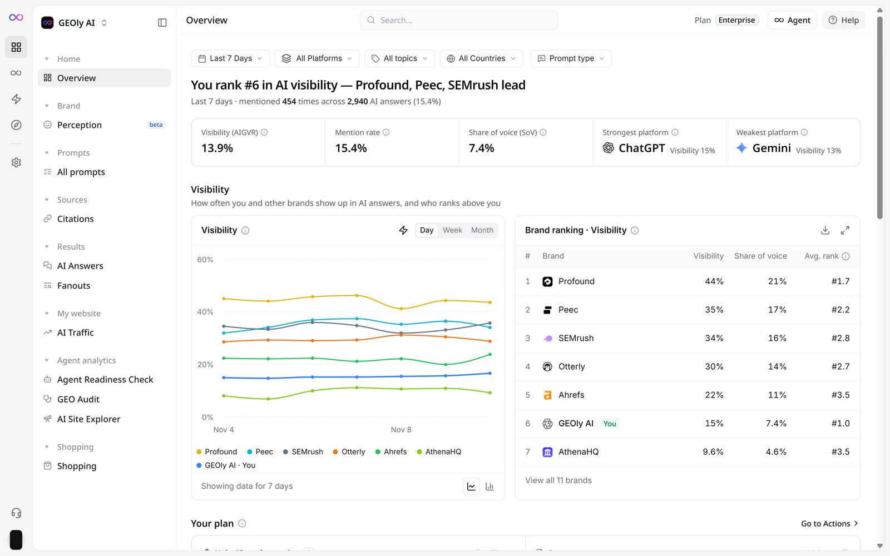
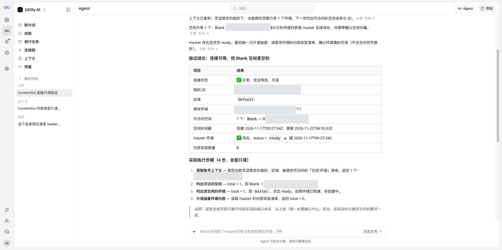

本文是一篇面向 GEOly 使用者的完整操作手册。连接器配置与 Agent 直接调用的完整步骤见 [第 17 节](#connector-guide)；第一次监测可以先阅读 [提示词操作指南](/zh/analytics/geoly-prompts)。无论你是刚开始配置，还是已经在做日常复盘，都可以按照本文顺序理解功能、查看数据并制定下一步优化动作。读完以后，你会知道：

- GEOly 是用来解决什么问题的。
- 进入工作区后应该先看哪里。
- 每个功能入口在哪里。
- 每个页面的核心指标是什么意思。
- 看到结果以后下一步该做什么。
- 如果团队启用了 Agent / MCP，应该如何把分析结果推进到执行。

建议先完成一次“看结果—找原因—做行动”的流程：

1. 从最左侧空间栏进入 **工作台**，确认当前品牌和时间范围。
2. 查看 **总览**，先了解品牌在 AI 回答中的可见度、提及份额和平均排名。
3. 打开 **全部提示词**，找出 AI 没有提到品牌或竞品领先的问题。
4. 打开 **引用来源**，确认 AI 依赖哪些官网、媒体、评测或其他页面。
5. 进入 **AI 回答**，阅读原始回答，判断问题到底出在品牌认知、内容还是来源。
6. 使用 **GEO 诊断**、**Agent** 或 **Agent 就绪度检测**，把发现整理成可执行任务。
7. 如果需要查看行业机会，再从最左侧空间栏进入 **探索**；如果要查看优化行动和待办，进入 **行动**；如果要管理账号，进入 **设置**；要连接外部工具供 Agent 使用，进入 **Agent → 连接器**。

新版菜单按工作任务分组。后文如果提到 Dashboard、Prompts、Citations 等旧版英文名称，请按当前左侧中文菜单中的 **总览、全部提示词、引用来源** 操作。

## 新版工作区界面截图

以下截图来自新版 GEOly 工作区（GEOly 内部品牌），用于快速定位菜单和理解页面结构。总览截图为英文界面，菜单对应关系是：Home → Overview（首页 → 总览）、Brand → Perception（品牌 → AI 评价）、Prompts → All prompts（提示词 → 全部提示词）、Sources → Citations（信源 → 引用来源）、Results → AI Answers / Fanouts（结果 → AI 回答 / AI 检索词）、My website → AI Traffic（我的网站 → AI 流量）、Agent analytics（Agent 分析）、Shopping（购物）。图中的品牌、数字、时间范围和平台筛选会随账号及采集结果变化；实际使用时，以当前工作区显示的数据为准。

**工作台：总览**

新版工作台把品牌可见度、提及率、提及份额和平台表现集中在一个页面。左侧导航按“首页—品牌—提示词—信源—结果—我的网站—Agent 分析—购物”组织，便于从结果继续追查原因。

**探索：公开数据集**

探索用于查看公开的品类、Topic、品牌和 AI 商品数据。它和品牌工作台的监测数据用途不同：工作台回答“我的品牌表现如何”，探索回答“这个市场和品类里发生了什么”。

**购物：AI 商品**

**购物 → AI 商品**是品牌工作区里的 AI 货架页面。它根据已监控 Prompt 产生的 AI 购物回答，展示商品货架触发情况、品牌商品出现情况和竞品位置。截图中的“AI 货架刚刚起步”状态表示当前样本仍在积累，不代表商品表现为零；先添加商品导向 Prompt，等待回答持续采集，再查看货架份额、品牌榜和缺席货架。

## 1. 先理解 GEOly 在做什么

**用一句话解释**

GEOly 用来监控品牌在 AI 搜索和 AI 回答里的表现。

过去品牌主要看 Google 搜索排名、SEO 流量和广告投放。现在很多用户会直接问 ChatGPT、Gemini、Google AI Mode 或 Google AI Overview，例如：

- “Best ergonomic chair for back pain”
- “Which DTC skincare brand is best for sensitive skin?”
- “What are good alternatives to Brand A?”
- “Is this product worth buying?”

GEOly 关心的是：AI 在回答这些问题时，有没有提到你的品牌、有没有推荐你的产品、有没有引用你的官网、有没有把竞品放在你前面，以及它给用户的印象是否正面。

**你需要记住的 3 个基础概念**

**Mention**

Mention 是“AI 回答里有没有提到你的品牌”。

如果 AI 说 “Brand X is a popular option”，这就是一次 Mention。Mention 代表 AI 知道你、愿意把你放进答案里。

**Citation**

Citation 是“AI 回答里有没有引用你的品牌自有 URL”。

如果 AI 回答里引用了你的官网、产品页、博客、帮助中心或其他品牌自有页面，这就是 Citation。Citation 比 Mention 更进一步，因为它说明 AI 不只是提到你，还把你的页面当作信息来源。

**Prompt**

Prompt 是 GEOly 用来监控的一条问题。

你可以把 Prompt 理解成用户可能会问 AI 的问题。例如：

- “What is the best standing desk for home office?”
- “Compare Brand A and Brand B”
- “Best supplements for sleep”

GEOly 会定期拿这些 Prompt 去问不同 AI 平台，然后记录 AI 的回答、品牌出现情况、引用来源、竞品、情绪和趋势。

## 2. 进入工作区后应该先做什么

**如何打开新版工作区**

1. 打开 GEOly 应用并登录。
2. 如果你有多个组织或品牌，先选择正确的组织和品牌。
3. 最左侧空间栏用于切换 **工作台、Agent、行动、探索、设置**；第二栏显示当前空间的页面。
4. 在 **工作台** 中使用第二栏查看品牌监测结果。

**新版菜单怎么理解**

| 菜单分组 | 入口 | 用途 |
| --- | --- | --- |
| 首页 | 总览 | 查看品牌在 AI 回答中的整体表现 |
| 品牌 | AI 评价 | 查看 AI 对品牌的描述和认知 |
| 提示词 | 全部提示词 | 查看和管理正在监控的问题 |
| 信源 | 引用来源 | 查看 AI 引用的域名和页面 |
| 结果 | AI 回答、AI 检索词 | 阅读原始回答，并分析用户实际搜索的问题 |
| 我的网站 | AI 流量 | 结合网站流量查看 AI 带来的访问 |
| Agent 分析 | Agent 就绪度检测、GEO 诊断、AI 网站探索 | 检查网站是否适合 AI 理解，并生成诊断和优化方向 |
| 行动 | 行动 | 查看系统整理的优化建议和待办，并进入具体执行项 |
| 购物 | AI 商品 | 查看 AI 购物场景中的商品表现 |

空间栏中的 **Agent** 会进入新的对话式 Agent；**行动** 用于查看当前版本提供的优化行动和待办；**探索** 用于查看公开市场数据；**设置** 用于品牌、团队、组织和开发者配置。进入 **设置** 后，第二栏会切换为账号、品牌、组织和开发者分组；不同账号可能因权限、套餐和数据状态看到不同入口。

**推荐查看顺序**

1. **总览**：先看品牌当前整体表现。
2. **全部提示词**：找到没有提到品牌、排名下降或竞品领先的问题。
3. **引用来源**：找出 AI 当前信任的来源。
4. **AI 回答**：阅读原文，确认指标背后的实际原因。
5. **GEO 诊断 / Agent**：把问题整理成内容、技术、品牌或数据任务。
6. **探索**：补充行业和公开市场背景。

这样你会从“发生了什么”走到“为什么发生”，最后进入“接下来做什么”。

## 3. 总览：先看品牌整体健康度

**这个页面解决什么问题**

总览页是最适合先看的页面。它回答三个问题：

1. AI 是否知道我的品牌？
2. AI 是否引用我的官网或品牌页面？
3. 我的品牌在不同 AI 平台上的表现是否稳定？

**如何打开**

在左侧导航点击 **总览**。如果你的账号仍显示旧版英文名称，它对应 Dashboard、Overview 或 Brand Overview。

**页面上会看到什么**

页面顶部是品牌在 AI 可见度中的排名和五个指标（英文界面名在前）：

- Visibility（可见度）：提到品牌的回答占全部已完成回答的比例
- Share of voice (SoV)（提及份额）
- Avg rank（平均排名）
- Strongest platform / Weakest platform（最强平台 / 最弱平台）

往下依次是可见度趋势图与 Brand ranking（品牌榜）、Your plan（行动计划）、Citation sources（引用来源）和 How AI answers your questions（AI 回答列表）。Citation Rate（引用率）不在总览顶部，在 **全部提示词** 列表的汇总条和 Citation 列里查看。 看总览时，先固定品牌、时间和平台，再看 Visibility、Share of voice 与 Avg rank；引用情况到“全部提示词”或“引用来源”核对。趋势和平台对比用于定位变化，具体原因还要回到提示词、原始回答和引用页面查证。

**指标怎么理解**

**Visibility（可见度）**

Visibility 描述当前已完成回答中提到本品牌的比例。比较变化前先看回答样本量，并保持品牌、平台与时间范围一致。可见度变化本身不能说明原因。

**Share of voice（提及份额）与 Avg rank（平均排名）**

提及份额和平均排名描述品牌在当前监测回答中的相对位置，不等于市场份额或销量。需要解释差异时，打开具体回答核对品牌出现的位置与竞品。

**Citation Rate**

Citation Rate 是 AI 回答中引用品牌自有 URL 的比例。

如果可见度较高但引用率较低，说明这批回答较常提到品牌，却较少引用自有页面。下一步到 **引用来源** 核对实际引用 URL，再检查相关内容机会。

**如何操作**

1. 在页面顶部选择时间范围，例如 7 天、30 天或 90 天。
2. 先看 Visibility、Share of voice 和 Avg rank 的整体数值；Citation Rate 到 **全部提示词** 的汇总条里看。
3. 再看趋势线，判断最近是上升、下降还是稳定。
4. 切换平台筛选，例如 ChatGPT、Gemini、Google AI Mode、Google AI Overview。
5. 如果某个平台明显更差，记录下来，后续去 **全部提示词** 里按平台筛选。

**看到结果后怎么判断**

如果可见度与提及份额都偏低：

说明品牌在 AI 里的基础可见性还不够，需要从 Prompt 覆盖、内容建设和引用来源开始优化。

如果可见度较高但引用率较低：

说明 AI 会提到品牌，但没有引用品牌页面。重点看 **引用来源**、域名详情、页面详情和内容机会。

如果某个平台特别低：

说明不同 AI 引擎对品牌理解不一致。进入 **全部提示词**，按平台查看具体回答差异。

## 4. 全部提示词：查看 AI 对关键问题怎么回答

**这个页面解决什么问题**

全部提示词页面告诉你：当用户问某个问题时，AI 到底怎么回答。

这是 GEOly 最重要的页面之一，因为总览只告诉你“结果好不好”，全部提示词会告诉你“为什么好或为什么不好”。

**如何打开**

在左侧导航点击 **提示词 → 全部提示词**。

**页面上会看到什么**

你通常会看到一个 Prompt 列表。每一行代表一个被监控的问题，可能包含：

- 提示词文本
- 可见度
- 引用率
- 竞品
- 热度
- 类型
- 标签

提示词列表适合先筛选，不适合一条条从头读。可以按主题、平台和标签缩小范围，再查看可见度或引用率，把“高价值但表现差”的问题挑出来。当前列表没有独立的提及率列；要核对提及情况，进入问题详情和原始回答。

**如何查看一个 Prompt**

1. 打开 **全部提示词**。
2. 在搜索框输入关键词，或按 Topic 筛选。
3. 点击某一条 Prompt。
4. 进入 Prompt 详情页面。
5. 查看不同平台的 AI 回答。
6. 检查回答里是否提到你的品牌。
7. 检查品牌出现位置是否靠前。
8. 检查是否引用了品牌官网。
9. 检查是否推荐了竞品。

在 Prompt 详情里，重点看三件事：品牌有没有出现、出现位置是否靠前、AI 回答引用了什么来源。如果不同平台回答差异很大，优先记录表现最差的平台，因为后续内容优化可能要针对这个平台的回答习惯来补证据。

**建议优先看什么**

查看 Prompt 时，不要试图一次读完所有问题。优先看三类：

1. 高价值问题：最接近购买决策的问题。
2. 低 Mention 问题：AI 没有提到品牌的问题。
3. 高竞品问题：AI 推荐了竞品但没有推荐你的问题。

**如何新建 Prompt**

如果你的账号有写入权限，可以新建 Prompt。

1. 点击 New Prompt、Create Prompt 或 Add Prompt。
2. 输入用户可能会问 AI 的真实问题。
3. 选择 Category 或 Topic。
4. 选择国家和语言。
5. 设置优先级。
6. 添加标签，例如 “purchase-intent”、“comparison”、“brand”。
7. 保存。

**好 Prompt 怎么写**

好的 Prompt 应该像真实用户会问的问题，而不是内部术语。

不建议：

- “Brand visibility test”
- “SEO keyword”
- “Product analysis”

更建议：

- “What is the best standing desk for a small apartment?”
- “Compare Brand A and Brand B for sensitive skin”
- “Best protein powder without artificial sweeteners”

**看到结果后怎么做**

如果 AI 没提到你的品牌：

- 检查这个 Prompt 是否和你的业务真的相关。
- 如果相关，说明这是内容或品牌认知机会。
- 可以创建 FAQ、对比页、购买指南、品类教育内容。

如果 AI 提到竞品但没有提到你：

- 查看竞品被推荐的理由。
- 查看 AI 引用了哪些来源。
- 思考你的网站是否缺少同类信息。

如果 AI 提到你但引用了第三方页面：

- 去 **引用来源** 查看引用来源。
- 优化品牌自有页面，让 AI 更容易引用官网。

## 5. 主题分析：把问题按主题分组来看

**这个页面解决什么问题**

一个品牌可能监控几百条 Prompt。主题分析的作用是把这些问题分组，例如：

- Product Comparison
- Buying Guide
- Pain Point
- Alternatives
- Pricing
- Shipping
- Brand Reputation

这样你不用一条条看 Prompt，而是看某一类主题整体表现。

**如何打开**

在 **全部提示词** 页面按 Topic 或主题筛选；如果账号提供独立的主题分析入口，也可以从提示词分析页面进入。

**如何操作**

1. 进入 **全部提示词**，按主题筛选。
2. 选择时间范围。
3. 选择平台。
4. 查看当前页面实际提供的提及、引用、情绪和竞品信号；具体字段以账号和时间范围为准。
5. 点击表现差的 Topic，下钻到对应的 **全部提示词**。

**怎么判断结果**

如果某个 Topic 的 Mention Rate 很低：

说明 AI 在这类问题里不常提到你的品牌。需要补内容或增强品牌信号。

如果某个 Topic 的 Citation Rate 很低：

说明你可能有相关内容，但 AI 没有引用你的页面。需要优化页面结构、信息完整度和引用可信度。

如果某个 Topic 的负面情绪较高：

说明 AI 在这个主题下可能提到品牌缺点、投诉或风险。需要看具体回答和来源。

## 6. 引用来源：查看 AI 引用了哪些网站和页面

**这个页面解决什么问题**

引用来源告诉你 AI 回答的“信息来源”。

AI 提到你的品牌是一件事，引用你的官网是另一件事。Citation 页面可以帮助你判断：

- AI 有没有引用你的官网。
- AI 是否更多引用第三方媒体、评测站、论坛或竞品页面。
- 哪些品牌页面最常被 AI 引用。
- 哪些重要页面从来没有被 AI 引用。

**如何打开**

在左侧导航点击 **信源 → 引用来源**。

**页面上会看到什么**

你可能会看到：

- Citation Overview
- Domain Distribution
- Owned Domains
- Third-party Sources
- Pages
- 与每条引用来源关联的提示词

Citation 页面要先看来源结构：AI 是引用品牌自有域名、第三方媒体、社区论坛，还是竞品页面。只要发现第三方来源占比很高，就需要继续检查这些来源是在正面介绍品牌，还是在影响 AI 对品牌的判断。

**如何操作**

1. 打开 Citation Overview。
2. 选择时间范围和平台。
3. 查看引用最多的 Domain。
4. 判断这些 Domain 是品牌自有域名、竞品域名还是第三方域名。
5. 点击某个 Domain 进入 Domain Detail。
6. 点击某个 URL 进入 Page Detail。

**Domain Detail 怎么看**

Domain Detail 是看一个网站整体被 AI 引用的情况。

例如你输入自己的官网域名，可以看到：

- 这个域名被引用的趋势。
- 哪些页面被引用。
- 哪些 Prompt 会引用它。
- 哪些平台更常引用它。

**Page Detail 怎么看**

Page Detail 是看某一个 URL 被 AI 引用的情况。

适合分析：

- 某个产品页有没有被引用。
- 某篇博客有没有被 AI 用作来源。
- 某个帮助中心页面是否支撑了 AI 回答。

Page Detail 适合用来做页面级优化。比如某个产品页经常被 AI 引用，就说明它已经具备一定可信度，可以继续加强参数、FAQ、使用场景和对比信息；如果重要页面从未被引用，就要回到 Content Opportunities 看它对应的 Prompt 缺口。

**Content Opportunities 怎么用**

Content Opportunities 用来找内容缺口。

操作方法：

1. 选择品牌官网域名。
2. 查看哪些 Prompt 没有引用你的域名。
3. 按商业价值或 Topic 优先级排序。
4. 为这些 Prompt 创建或优化页面。

**看到结果后怎么做**

如果 AI 常引用第三方而不是官网：

- 检查官网是否缺少清晰答案。
- 补充 FAQ、对比表、产品参数、价格、配送、退换货、适用人群。
- 增加结构化、易引用的内容段落。

如果竞品域名出现很多：

- 查看竞品页面写了什么。
- 对比自己页面是否缺少关键信息。
- 优化同类内容，不要只堆关键词。

## 7. AI 评价：查看 AI 对品牌的语气

**这个页面解决什么问题**

AI 评价中的情绪分析告诉你，AI 在提到品牌时，是正面、中性、负面，还是混合。

这对品牌声誉非常重要。AI 如果持续用负面语气描述品牌，用户在购买前会被影响。

**如何打开**

在左侧导航点击 **品牌 → AI 评价**，再查看情绪和品牌描述相关内容。

**页面上会看到什么**

通常会看到：

- 正面、中性、负面、混合、未知的比例。
- 情绪趋势。
- 不同平台的情绪对比。
- 提到品牌的回答样本。

Sentiment Overview 适合先判断风险级别：如果整体分数稳定，偶发负面样本可以逐条看；如果负面或混合情绪连续上升，就需要把它当作品牌声誉问题处理，继续追到具体 Prompt 和引用来源。

**如何操作**

1. 选择时间范围。
2. 选择平台。
3. 查看整体情绪分布。
4. 如果负面比例上升，点击对应日期或样本。
5. 阅读 AI 原始回答。
6. 找到负面描述来自哪个 Prompt 和哪个引用来源。

进入详情后，不要只看情绪标签。更重要的是看 AI 为什么这样描述品牌：是引用了旧资料、误解了产品定位，还是引用了投诉、评测或社区讨论。只有找到原因，后续才知道应该更新官网、补充说明，还是处理第三方内容。

**看到负面情绪怎么办**

先不要只看百分比，要看原文。

你需要判断：

- AI 是否引用了过时信息。
- AI 是否误解了产品。
- AI 是否引用了投诉、低质量评测或第三方负面页面。
- 官网是否缺少正确信息。

然后再制定行动：

- 更新官网说明。
- 增加 FAQ。
- 补充产品适用范围和限制。
- 发布更清晰的对比内容。
- 处理第三方负面来源。

## 8. 竞品：看竞品为什么被 AI 推荐

**这个页面解决什么问题**

竞品分析帮助你回答：

- 哪些竞品更常出现在相同的 AI 回答中？
- 竞品在哪些 Prompt、平台或主题中更领先？
- AI 如何同时描述你的品牌和竞品？
- 哪些引用来源可能影响了竞品的表现？

**如何配置竞品**

如果当前账号有配置权限，在 **设置** 中找到品牌或竞品相关配置：

1. 添加竞品名称。
2. 填写竞品官网域名。
3. 补充常见别名。
4. 保存后回到 **总览**、**全部提示词** 或相关分析页面查看结果。

具体入口和可用字段可能随账号权限和产品版本变化，请以当前工作区显示的设置页面为准。

**如何分析竞品**

1. 固定时间范围、平台、国家/地区和 Prompt 范围。
2. 在 **总览** 中查看品牌榜、可见度、提及份额（SoV）和平均排名。
3. 在 **全部提示词** 中打开具体问题，阅读 AI 原始回答。
4. 检查同一回答中出现的品牌、推荐理由和引用来源。
5. 记录竞品领先的场景，再判断是内容、产品信息、品牌认知还是来源差距。

**怎么判断结果**

竞品出现更多不一定代表市场份额更高；先确认样本量、Prompt、平台、时间范围和竞品配置是否一致。Share of Voice、可见度和平均排名只描述当前监测范围内的观察结果，不能直接等同于销售额、市场份额或收入。

## 9. 探索：看行业、品类和公开竞争格局

**这个页面解决什么问题**

前面的总览、全部提示词、引用来源更多是看“自己的品牌监控”。**探索** 看的是更大的行业和品类格局。

它适合回答：

- 这个品类里谁最常被 AI 提到？
- 我的品牌在行业里排第几？
- 哪些 Topic 是我可以追赶或领先的？
- 哪些品牌最近增长很快？
- 用户在 AI 里都问哪些问题？

**如何打开**

从最左侧空间栏进入 **探索**，再选择公开的品类、Topic、品牌或 AI 商品数据。

**如何开始**

1. 在搜索框输入品牌、品类、Topic 或域名。
2. 选择国家和语言。
3. 打开 Category、Topic 或 Brand 页面。
4. 查看排行榜、趋势、Prompt、引用来源和品牌感知。

探索中的图表重点不是“看热闹”，而是找到品牌在行业里的相对位置。你可以把它当作公开竞争地图：看谁在 AI 回答里领先、自己落后在哪些 Topic、哪些问题已经被竞品占住。

**看品类排行榜：知道自己在行业里排在哪里**

品类排行榜适合品牌客户先回答一个最基础的问题：**当用户在 AI 里问这个品类时，AI 更容易想到哪些品牌？我的品牌有没有进入候选名单？**

**从哪里打开**

1. 从最左侧空间栏进入 **探索**。
2. 在页面顶部搜索框输入品类名称，例如“running shoes”“office chair”“skincare”，也可以输入品牌名或域名先定位相关行业。
3. 选择目标 **国家 / 地区** 和 **语言**。如果品牌主要做美国市场，就先选择美国和英文；如果做多市场，可以分别查看，不建议混在一起判断。
4. 打开对应的 **Category** 页面。
5. 在 Category 页面中找到 **品牌榜** 或类似的品牌排行区域。

**页面上主要看什么**

| 你看到的内容 | 对品牌客户的含义 | 应该怎么理解 |
|---|---|---|
| 品牌排名 | AI 在该品类回答中更常提到哪些品牌 | 排名靠前说明 AI 更容易把该品牌当作品类代表，但不等于转化一定更高 |
| Mention / Visibility / Share 类指标 | 品牌在 AI 回答里的出现频率或可见度份额 | 适合判断“有没有被 AI 想到”和“与竞品差多少” |
| 平台筛选 | 不同 AI 平台的品牌排序可能不同 | ChatGPT、Google AI Mode、Gemini 等平台要分开看，避免只用一个平台下结论 |
| 国家和语言筛选 | 不同市场的品类认知不同 | 同一品牌在美国、英国、中文市场可能表现完全不同 |
| 时间范围 | 排名和份额是否稳定变化 | 如果近期突然上升或下降，要继续追具体 Topic、Prompt 和引用来源 |

**品牌客户应该怎么判断**

看排行榜时，不建议只问“我排第几”。更建议按下面四步判断：

1. **先看自己是否进入榜单**：如果没有进入，说明 AI 在这个品类里还没有稳定把品牌纳入候选，需要优先补品牌基础信息、品类页面、产品说明和外部信源。
2. **再看领先品牌是谁**：如果头部都是竞品，说明这些品牌已经在 AI 的品类认知里占位。下一步要看它们被提到的原因，是产品覆盖、内容覆盖、评测背书，还是零售渠道更强。
3. **看差距有多大**：如果你和前几名差距很小，可以通过重点 Topic、引用来源和页面优化快速追赶；如果差距很大，要先建立长期内容和信源计划。
4. **看平台差异**：如果某个平台表现好、另一个平台表现弱，不要平均处理。表现弱的平台可能需要单独检查引用来源、Prompt 覆盖和页面可读性。

**看完以后怎么做**

如果品牌没有进入榜单：

- 先确认品牌名称、官网域名、产品线和品类信息是否在 GEOly 里配置完整。
- 回到 **全部提示词**，为该品类补充更贴近购买场景的问题。
- 回到 **引用来源**，查看 AI 是否引用过官网、商品页、评测页或第三方页面。
- 优先补充品类介绍页、产品对比页、FAQ、参数说明、适用人群和权威背书。

如果品牌已进入榜单但排名靠后：

- 打开领先竞品，查看它们在哪些 Topic 或 Prompt 里更强。
- 对比竞品页面是否有更清楚的卖点、价格、评价、使用场景、对比信息。
- 找出你和竞品都出现的 Prompt，阅读 AI 原始回答，看 AI 为什么更推荐竞品。
- 把差距拆成内容任务、商品页任务、PR / 评测任务或广告补位任务。

如果品牌排名靠前：

- 不要只停留在“排名不错”。继续看哪些 Topic 是优势来源，哪些 Topic 仍然薄弱。
- 对优势 Topic 做 **Defend**，持续维护页面、引用和第三方信源。
- 对薄弱 Topic 做 **Prioritize / Gap**，防止竞品从细分场景追上来。

**找可投入 Topic：把行业机会变成内容和增长任务**

可投入 Topic 的作用，是帮助品牌客户回答：**这个品类里哪些主题值得我优先投入？哪些主题我已经有优势，哪些主题我明显缺席？**

**从哪里打开**

1. 进入 **探索**。
2. 搜索并打开目标 **Category**。
3. 在 Category 页面中找到 **Category Whitespace**、**Opportunity Map**、**Topic Coverage Matrix** 或类似的机会地图区域。
4. 选择自己的品牌。如果页面支持竞品对比，也可以同时选择 1-3 个主要竞品。
5. 选择国家、语言、平台和时间范围，确保和你前面看的品类排行榜一致。

**页面上的分组怎么理解**

| 分组 | 对品牌客户的意思 | 应该采取的动作 |
|---|---|---|
| Prioritize | 主题商业价值较高，且品牌有机会提升 | 优先投入内容、商品页、引用来源和 Prompt 监控 |
| Gap | 竞品或行业已有覆盖，但你的品牌明显缺席 | 尽快补内容和信源，是最容易解释给团队的短板 |
| Watch | 主题有潜力，但当前优先级或确定性没那么高 | 定期观察，不一定马上投入大量资源 |
| Defend | 你已经有一定优势或占位 | 持续维护，防止竞品追赶，不要轻易停更 |

**品牌客户应该怎么判断优先级**

不要看到所有 Topic 都想做。建议用这四个问题筛选：

1. **这个 Topic 是否接近购买决策？** 例如“best...”“A vs B”“for sensitive skin”“under $100”通常比泛科普更接近转化。
2. **我的品牌是否有真实优势？** 如果产品、价格、服务或场景本身不支持，不要只靠内容硬做。
3. **竞品是否已经占位？** 如果竞品在该 Topic 中稳定出现，而你缺席，这通常是 Gap，需要优先处理。
4. **AI 是否有可引用证据？** 如果官网、商品页、FAQ、评测、媒体、零售渠道都缺少清楚内容，AI 很难稳定推荐你。

**看到 Prioritize 时怎么做**

Prioritize 通常代表“值得主动投入”的主题。建议这样处理：

1. 回到 **全部提示词**，为这个 Topic 新建或补充 5-10 条真实用户会问的问题。
2. 回到 **引用来源**，查看这些问题下 AI 现在引用哪些网站和页面。
3. 检查自己的官网是否有能回答这些问题的页面。没有的话，新建专题页、对比页、FAQ 或产品集合页。
4. 如果是电商品类，同时检查商品页、价格、评价、库存、图片、规格和配送信息是否完整。
5. 处理后持续观察 2-4 周，看提及率、引用率和排名是否变化。

**看到 Gap 时怎么做**

Gap 代表“别人已经有，你还没有”。它适合变成明确的补短板任务。

你可以按这个顺序处理：

1. 打开 Gap 里的 Topic，查看领先品牌是谁。
2. 进入对应 Prompt 或 Query 详情，阅读 AI 原始回答。
3. 记录 AI 推荐竞品的理由，例如价格、专业性、评价、功能、适用人群、渠道。
4. 对照自己的页面，找出缺失信息。
5. 优先补齐官网和商品页中的关键答案，再考虑第三方评测、PR、社区内容和广告补位。

**看到 Watch 和 Defend 时怎么做**

Watch 不代表不重要，而是暂时不必占用最多资源。可以把它放进月度复盘，观察行业和竞品是否变化。

Defend 代表已有优势。品牌客户常见误区是：看到优势就不管了。但在 AI 搜索里，竞品内容、媒体报道、商品信息都会变化。Defend 类 Topic 应该保持页面更新、评价积累、引用来源稳定，并定期检查是否有竞品逼近。

**一个简单例子**

假设你的品牌是护肤品，Category 是“skincare”。在品牌榜里你发现竞品 A 排在前面；在 Opportunity Map 里，“sensitive skin moisturizer”被归到 Gap。

这时不要只写“优化 sensitive skin 内容”。更具体的动作应该是：

- 在 **全部提示词** 中新增“适合敏感肌的保湿霜推荐”“品牌 A 和我的品牌哪个更适合敏感肌”等问题。
- 在 Citation 中查看 AI 当前引用了哪些评测、成分页、商品页。
- 在自己的商品页补充成分说明、适用肤质、临床/测试信息、FAQ 和用户评价。
- 如有必要，补充第三方评测或媒体内容，让 AI 有更多可信来源可引用。
- 之后回到 Category 和 Prompt 页面，观察品牌是否开始进入相关回答。

**看用户在 AI 里问什么**

1. 打开 **结果 → AI 检索词**。
2. 选择产品空间或品类。
3. 查看高频问题、主题和品牌覆盖。
4. 点击某个 Query 进入详情。
5. 查看哪些品牌赢得这些问题，AI 引用了哪些来源。

## 10. 探索中的公开主题：深入看某个公开主题

**这个页面解决什么问题**

探索中的公开主题用于分析某个主题下，AI 如何回答、哪些品牌领先、哪些来源被引用。

**如何打开**

在 **探索** 中点击 Topic，或从公开数据页面进入对应的主题分析。

**如何操作**

1. 搜索或选择一个 Topic。
2. 打开 Topic 概览。
3. 查看品牌榜。
4. 查看提及份额趋势。
5. 打开 Prompt 矩阵，查看不同 Prompt 下哪些品牌出现。
6. 打开 Prompt 详情，阅读具体回答。
7. 打开记录详情，查看某一次 AI 回答和引用来源。

**怎么判断结果**

如果你想知道“这个主题值不值得做”，看两个东西：

1. Topic Difficulty：难度越高，说明头部品牌越集中。
2. 品牌榜：看领先品牌是谁，以及你和它们差距多大。

## 11. 探索品牌页：理解公开数据中的品牌认知

**这个页面解决什么问题**

在 **探索** 空间中打开品牌详情页，可以查看公开数据里 AI 如何描述一个品牌，以及品牌在哪些品类、Topic、产品特征和用户场景中出现。

它适合回答：

- 品牌出现在哪些 Topic 和品类语境中？
- AI 反复把品牌与哪些产品特征、场景或人群联系在一起？
- 品牌是在多个品类中获得可见度，还是只在少数 Topic 中突出？
- 与同品类品牌相比，品牌的相对位置如何？

这里的结果属于公开行业研究，不等同于品牌工作区中的 **品牌 → AI 评价**，也不等同于客户调研或第一方业务数据。

**如何打开**

1. 从最左侧空间栏进入 **探索**。
2. 搜索或选择一个品牌。
3. 打开品牌详情页。
4. 查看品牌感知、可见度、竞争格局、购物信息、引用来源和 AI 检索词等板块。

**如何操作**

1. 先固定国家/地区、语言、平台和时间范围。
2. 查看品牌出现的品类和 Topic。
3. 阅读 AI 对品牌的常见描述和关联特征。
4. 对比同品类品牌的相对位置和 Share of Model。
5. 打开引用来源和 AI 检索词，了解这些描述可能来自哪些公开证据。
6. 把值得验证的发现带回品牌监测，使用相同类型的 Prompt 进行复查。

**看到结果后怎么做**

如果公开品牌页显示 AI 经常把品牌与正确的场景和优势联系起来，可以把这些表达用于内容规划、产品页和销售话术。

如果 AI 的描述不准确或缺少关键能力：

- 检查官网是否缺少清晰的产品、场景和限制说明。
- 补充 FAQ、对比页、案例和可引用事实。
- 检查第三方来源是否存在过时或冲突信息。
- 回到品牌工作区的 **AI 评价** 和 **AI 回答**，确认问题是否也出现在自己的监测结果中。

公开品牌认知是研究线索，不是人工访谈、客户调研或销售归因结论；重要判断应结合原始回答、来源页面和第一方业务数据验证。

## 12. AI 商品：查看品牌在 AI 购物回答中的表现

**这个页面解决什么问题**

当前 GEOly 的 **AI 商品**页面（产品内部名称为 **AI 货架 / AI Shelf**）用于分析：在你已经监控的 Prompt 中，AI 多久展示一次商品货架，你的品牌出现了多少次，以及竞品在同一货架中的位置。

它回答的是“品牌在已监控的 AI 购物回答里表现如何”，不是公共市场的商品排行榜，也不是订单、销售额或广告报表。

**如何打开**

打开品牌工作区，在左侧导航进入：

**购物 → AI 商品**

也可以直接打开 /zh/shopping。

当前页面的货架数据基于已监控 Prompt 产生的 AI 购物卡片。先添加商品导向或购买意图较强的 Prompt，并等待 AI 回答持续采集；如果没有足够的购物回答，页面可能显示空状态或“样本不足”。

**3 分钟上手**

1. 在 **提示词 → 全部提示词** 中添加真实用户会问的购买类问题，例如“适合小户型的最佳办公椅是什么？”或“比较 Brand A 和 Brand B”。
2. 等待这些 Prompt 完成 AI 回答采集。只有已经完成的回答才会进入 AI 货架统计。
3. 回到 **购物 → AI 商品**，先确认品牌、时间范围和平台筛选。
4. 先看货架触发率，确认当前样本中有多少回答真的出现了商品货架。
5. 再看我的出现率和我的货架份额，判断品牌是否进入货架，以及进入后占据多少商品卡。
6. 最后打开品牌货架榜、商品卡和“你缺席的货架”，找到下一步要优化的 Prompt 或商品页面。

> **初始状态怎么理解：** 如果页面显示“AI 货架刚刚起步”，并提示只采集到少量包含商品货架的 AI 回答，这表示样本正在积累，不代表品牌表现为零。继续使用同一批购买类 Prompt 采集，数据才会逐步形成趋势。

> **不要和公共 AI 商品混淆：** **购物 → AI 商品**看的是当前品牌监测 Prompt 里的 AI 货架；**探索 → AI 商品**看的是公共 AI Shopping 数据，两者不能合并计算。

**页面状态与排查**

- **没有数据或样本不足**：先检查是否存在购买意图较强的已监控 Prompt，并确认这些 Prompt 已完成 AI 回答采集。
- **有货架但没有我的商品卡**：打开“你缺席的货架”，阅读竞品商品、原始回答和引用来源，再判断是品牌识别、商品信息还是 Prompt 覆盖问题。
- **商品名称或品牌识别不准确**：核对品牌名称、别名、域名、商品标题和型号；不同标题可能被聚合成不同商品记录。
- **平台或时间范围差异很大**：先确认筛选条件和样本量，再比较同一时间范围、同一平台和同一批 Prompt。
- **看不到某个入口**：功能和数据可见性可能受账号权限、套餐、品牌配置及采集状态影响。

**页面顶部的四个核心指标**

**货架触发率**

表示当前监控回答中，有多少回答出现了 AI 商品货架。

它回答：“这些 Prompt 有多常进入购物推荐场景？”

它不是：

- 全网购物搜索量。
- 商品点击率。
- 购买率。
- 销售转化率。

**我的出现率**

表示在已经出现 AI 商品货架的回答中，有多少回答包含你的品牌商品卡。

如果货架触发率高、我的出现率低，说明购物场景存在，但品牌还没有稳定进入货架。

**我的货架份额**

表示当前货架中的商品卡里，有多少属于你的品牌。

它用于和竞品比较，不等于：

- 市场份额。
- GMV。
- 订单份额。
- 广告份额。

需要注意：**我的出现率按回答数计算，货架份额按商品卡数量计算**，所以两个数字不一定同步。

**DTC 份额**

表示本品牌商品卡中，由自有渠道承接的卡数占本品牌带有商家信息的卡数的比例。它与“商家信息覆盖率”不同，不代表 DTC 收入或完整的渠道市场份额。

**货架趋势怎么读**

货架趋势按天展示：

- 出现商品货架的回答数。
- 其中包含你商品卡的回答数。

这是绝对计数，不是日比例。样本量较小时，逐日比例容易产生噪声，因此不要把某一天的波动直接当成趋势。

如果某天没有数据，可能是当前时间范围内没有完成采集，不一定代表指标为 0。

**品牌货架榜怎么读**

品牌货架榜按商品上货架的频次展示品牌，适合回答：

- 哪些品牌经常和你一起出现。
- 哪些竞品在同一购物场景中更常出现。
- 你的品牌在不同时间范围内是否有变化。

查看时先确认：

1. 品牌名称是否被正确归一。
2. 竞品是否被正确配置。
3. 排名对应的是回答范围还是商品卡数量。
4. 是否存在“未识别”的商品卡。

品牌出现率按回答数计算，货架份额按商品卡数计算；同一个品牌可能出现率较高，但货架份额较低，反之亦然。

**承接渠道怎么看**

承接渠道只描述当前已识别的商品卡把购买路径指向哪些商家或域名。

它不是完整的零售渠道份额，也不是订单归因。部分商品卡可能没有商家字段，因此应同时关注：

- 带商家信息的商品卡数量。
- 自有渠道和其他渠道的分布。
- 商品标题和品牌是否被正确识别。

**“你缺席的货架”怎么用**

这个列表展示：已经触发了商品货架，但货架中没有你的商品卡的 Prompt 或回答。

它适合用来找机会：

1. 打开缺席记录。
2. 阅读原始 Prompt 和 AI 回答。
3. 查看当时出现了哪些竞品商品。
4. 记录 AI 推荐竞品的理由和引用来源。
5. 判断是产品信息缺失、品牌没有被识别，还是当前 Prompt 与业务并不匹配。
6. 再决定是否补充商品页、FAQ、对比内容、第三方来源或新的监控 Prompt。

缺席不一定意味着产品没有竞争力，也可能是时间范围、Prompt 覆盖、平台采集或品牌归一造成的。

**商品卡和产品详情怎么读**

商品数据按商品标题聚合。同一商品如果在 AI 回答中使用了不同标题，可能被分成不同的商品记录。

查看商品卡时，重点核对：

- 商品名称、型号和品牌。
- AI 展示的价格或商家信息。
- 商品出现在哪些 Prompt。
- 商品在货架中的位置。
- 对应的原始 AI 回答。

**推荐的使用流程**

1. 先检查当前品牌、时间范围和已监控 Prompt。
2. 查看货架触发率，确认购物场景是否有足够样本。
3. 对比我的出现率和我的货架份额。
4. 查看品牌货架榜，找出主要竞品。
5. 打开“你缺席的货架”，阅读原始回答。
6. 检查商品卡、引用来源和承接渠道。
7. 把问题交给 Agent 或 GEO 诊断，整理成商品页、内容、品牌和数据任务。
8. 完成优化后，继续采集同一批 Prompt，再比较变化。

更多页面说明可参考 [品牌 AI 购物货架](/zh/analytics/ai-engine-shopping)。

## 13. Agent：从看懂数据到直接行动

**Agent 是什么**

新版 Agent 是 GEOly 里的对话式工作助手。你可以直接用自然语言描述问题，让 Agent 结合当前品牌工作区中的监测数据，帮助你分析可见度变化、查找竞品差距、整理 Prompt，或确定下一步优先级。

Agent 的定位不是替你盲目执行所有操作，而是把“发现问题—核对证据—形成行动”放在一个对话里完成。重要结论、数字和外部写入操作仍然需要人工复核。

**如何打开**

有两种入口：

- 在最左侧空间栏点击 **Agent**，进入 Agent 对话页。
- 在工作台第二栏的 **Agent 分析** 下打开 **Agent 就绪度检测**、**GEO 诊断** 或 **AI 网站探索**，进入对应的诊断工具。

Agent 对话页会显示“我能怎样帮你的品牌在 AI 搜索里表现更好？”。你可以在输入框直接提问，也可以从推荐问题开始：

- 帮我为品牌搭建一组监控提示词。
- 诊断最近的可见度变化。
- 分析一个主要竞品。
- 接下来该优先做什么。

**推荐操作方法**

1. 先说明你要分析的品牌、时间范围和目标。
2. 再说明要比较的平台、Topic 或竞品。
3. 要求 Agent 给出证据、结论和建议，避免只要一个结论。
4. 打开它引用的 Prompt、AI 回答和引用来源，核对原始数据。
5. 把建议拆成内容、技术、品牌或数据任务。
6. 完成改动后，回到总览和相关 Prompt 继续观察变化。

示例：

> 分析过去 30 天品牌在 AI 回答中的可见度变化，列出下降最明显的 5 个 Prompt，说明每个 Prompt 的竞品和引用来源，并按影响和执行难度给出下一步建议。

### 在对话里使用连接器

需要读取外部内容或把建议保存到工作系统时，先到 **Agent → 连接器** 完成个人账号连接。回到连接可用的项目中新开对话，说明连接名称、目标空间或仓库、具体动作和输出要求；发送只读请求后，还要在执行步骤中确认目标工具确实被调用，并核对外部结果。

例如：“使用 Contentful 连接‘官网内容空间’，读取指定 FAQ 条目，先给出修改建议，不保存或发布。”连接设置、只读验证、工具审批、草稿写入及排错见 [第 17 节：连接器](#connector-guide)。

**Skills：保存可重复的工作流**

如果团队经常重复同一种分析，可以从最左侧空间栏进入 **Agent**，再打开 **Skills**。Skills 用来保存一套可重复的工作步骤，让 Agent 下次按照相同方法完成任务。

在 Skills 页面可以：

- 点击 **让 Agent 来写**，让 Agent 根据你的描述生成 Skill。
- 点击 **自己写**，手动定义步骤和输出要求。
- 点击 **上传文件**，把已有流程或规范交给 Agent 参考。
- 点击 **新建技能**，创建一个可复用的工作流。
- 使用搜索框查找已有 Skill。

当前页面按诊断与报告、竞争、品牌认知、引用来源等方向组织技能。实际可用的技能和权限以你当前账号显示为准。

> **菜单名称提示：** 本手册统一使用新版中文菜单。若你的账号仍显示旧版英文名称，可按以下对应关系操作：Dashboard → **总览**；Prompts → **全部提示词**；Citations → **引用来源**；Audit / AI Readiness → **GEO 诊断 / Agent 就绪度检测**。

**用量：查看 Agent 使用情况**

进入 **Agent > 用量** 可以查看当前周期的 Agent 用量，以及按品牌或成员拆分的使用情况。页面还会提示当前统计是否包含 CLI / API 调用。

用量和额度会随账号、套餐、组织配置和当前周期变化，不要把某个账号截图中的数字当成固定上限。遇到额度或使用量问题时，以用量页面显示的当前周期数据为准。

**注意事项**

- Agent 可能会出错，请核对重要信息。
- Agent 的可见数据取决于当前品牌、时间范围、账号权限和已完成的数据采集。
- 如果 Agent 建议修改外部系统、创建任务、触发监控或写入协作工具，请先确认操作范围和目标。
- 不要把 Agent 的推测直接当作业务事实；至少回到对应的 AI 回答和引用来源核对一次。

**如何把 Agent 建议变成行动**

建议按四类拆：

- 内容任务：新建页面、更新 FAQ、写对比文章。
- 技术任务：修复抓取、结构化数据、页面性能。
- 品牌任务：强化第三方介绍、媒体、评测和案例。
- 数据任务：补充 Prompt、Topic、竞品和 GA4 配置。

## 14. GEO 诊断与 Agent 就绪度检测：检查网站是否适合被 AI 理解

**这个页面解决什么问题**

GEO 诊断和 Agent 就绪度检测不是看 AI 已经怎么回答，而是看你的网站有没有准备好让 AI 理解。

如果网站信息不清楚，AI 可能不会引用你，或者引用时说错。

**如何打开**

在工作台第二栏点击 **Agent 分析 → GEO 诊断** 或 **Agent 就绪度检测**。

**如何操作**

1. 打开 GEO 诊断或 Agent 就绪度检测列表。
2. 选择最近一次扫描。
3. 查看总体评分。
4. 查看每个分类的 Critical、Warning 和 Passed。
5. 先处理 Critical，再处理 Warning。

**常见问题类型**

- 页面信息太少。
- 产品参数不完整。
- FAQ 缺失。
- 品牌介绍不清楚。
- 抓取受阻。
- 页面结构混乱。
- 重要信息只在图片里，文本不可读。

## 15. AI 流量与 GA4：把 AI 可见性和网站流量连起来

**这个页面解决什么问题**

GA4 帮你看 AI 可见性变化是否影响网站流量。

例如某个页面被 AI 引用增加后，你可以观察这个页面的访问量是否也上升。

**如何打开**

在左侧导航点击 **我的网站 → AI 流量**。还没连接数据源时，在 Google Analytics 卡片上点击 **立即连接**；也可以直接打开 `app.geoly.ai/integrations/ga4`。

**如何连接**

1. 点击 Connect Google Analytics。
2. 登录 Google 账号。
3. 授权 GEOly 读取 GA4 数据。
4. 选择正确的 GA4 Property。
5. 保存。

**如何使用**

1. 打开 GA4 Traffic。
2. 选择时间范围。
3. 查看 Sessions、Page Views、Traffic Sources。
4. 打开 GA4 Page Data。
5. 输入或选择某个页面路径。
6. 对比这个页面的 Citation 和流量变化。

**怎么判断结果**

如果某个页面 Citation 增加但流量没变：

- AI 可能引用了页面，但用户没有点击。
- 也可能平台没有传递可见 referral。
- 仍然可以把它视为品牌曝光和信任信号。

如果某个页面流量上升但 Citation 没变：

- 流量可能来自 SEO、广告、社媒或其他渠道。
- 需要结合 GA4 来源和 GEOly Citation 一起判断。

## 16. 设置：基础配置在哪里改

**这个页面解决什么问题**

**设置** 用来维护账号、品牌、组织和开发者连接；Prompt、Topic 和监测范围仍在工作台对应页面中管理。供 Agent 使用的外部工具在 **Agent → 连接器** 管理，详见 [第 17 节](#connector-guide)。

**如何打开**

从最左侧空间栏进入 **设置**。进入后，第二栏会切换为设置导航，不再显示工作台的监测菜单。

**设置分组**

- **账号**：个人资料、安全，以及账号级通知或额度入口（具体项目取决于组织配置）。
- **品牌**：品牌资料和竞争对手。
- **组织**：账单、组织设置、成员和代理商相关配置。
- **开发者**：API 密钥和 MCP。

**品牌信息**

检查品牌名称、官网域名、别名、国家、语言是否正确。

**竞品**

在 **设置 → 项目 → 品牌列表** 中添加竞品，填写跟踪名称（含常见别名）和官网。竞品配置会影响 Competitor 分析和 Share of Model。

**Prompt 与 Topic**

回到 **工作台 → 提示词 → 全部提示词** 管理监控问题；需要按主题整理时，在提示词或分析页面使用 Topic。不要把 Topic 和 Prompt 当作设置空间中的账号或组织配置。

**配置建议**

如果数据看起来不对，先检查基础配置：

- 当前组织和品牌是否正确。
- 品牌域名和别名是否完整。
- 竞品域名是否填错。
- Prompt 是否和业务相关。
- 当前筛选的时间、平台、国家/地区和语言是否一致。

## 17. 连接器：配置外部工具，并在 Agent 对话里调用

连接器让 GEOly Agent 使用你已有的内容、搜索或协作工具。例如，先在 GEOly 找到缺少引用的页面，再读取 Contentful 中对应的内容条目，提出 FAQ 修改方案；确认后，把方案保存为草稿。

完整路径是：**选择连接器 → 设置项目范围 → 完成授权 → 确认已连接 → 在 Agent 描述任务 → 检查工具调用与审批 → 核对结果**。连接器接通的是外部工具，不会替代 GEOly 自身的提示词监测，也不会自动把所有外部数据导入工作台。

第一次跟做，先把目标限定为**读到一条真实的外部结果**：选择正确项目并授权，在“已连接”核对范围，然后到该项目的 Agent 新对话发出小范围只读请求。执行步骤里出现目标服务的工具调用，且返回能在外部系统核对的对象，才算完成连接验证；在此之前不要继续草稿写入或发布。

### 先分清三个入口

| 你要做什么 | 使用入口 | 连接方向 |
| --- | --- | --- |
| 让 GEOly Agent 读取内容空间、查仓库或使用外部搜索 | **Agent → 连接器** | GEOly Agent 使用你的外部工具 |
| 为网站分析配置 GA4 或 Cloudflare | 对应的数据集成设置 | 把网站分析数据用于相关报表；按 [GA4 手册](/zh/integrations/google-analytics-help-docs) 或 [Cloudflare 手册](/zh/integrations/cloudflare-integration) 操作 |
| 在外部 AI 客户端调用 GEOly 数据与工具 | [GEOly MCP Server](/zh/developers/mcp/introduction) | 外部客户端使用 GEOly |

本节讲第一种。连接器目录里没有出现的服务，不应按“已支持”处理；GA4、Cloudflare 等数据集成也不能直接当作 Agent 连接器使用。

### 第一步：找到合适的连接器

1. 在空间栏进入 **Agent**，点击左侧 **连接器**，也可以打开 [连接器页面](https://app.geoly.ai/zh/agent/connectors)。
2. 确认左上角的当前项目。后面如果选择“仅当前项目”，切到其他项目后就不能沿用这个连接。
3. 在 **搜索连接器**中输入服务名称，或者按目录分类查找，点击对应卡片。

当前目录中的常见选择包括：

| 工作目的 | 连接器举例 | 使用前要确定的对象 |
| --- | --- | --- |
| 搜索公开资料、核对网页证据 | Exa、Tavily、Ahrefs、DataForSEO | 域名、问题、市场与时间范围 |
| 阅读内容并准备修改 | Contentful、Sanity、Webflow、Mintlify | 内容空间、数据集、集合或文档站 |
| 查任务与代码，整理执行事项 | GitHub、Linear、Notion、Atlassian | 仓库、项目、页面或数据库 |
| 核对公开店铺政策 | Shopify Storefront | 店铺前台域名与要核对的政策 |
| 分析营销内容或业务事件 | Klaviyo、Customer.io、PostHog | 活动、内容或事件范围 |

卡片介绍用于判断用途。能否读取或写入某个具体对象，还取决于外部账号权限、授权范围和该连接实际提供的工具。

### 第二步：设置范围，按连接方式完成授权

打开卡片后，在 **设置这个连接** 中先选择 **可用范围**：

- **我的全部项目**：在自己的多个项目中使用这个连接。
- **仅当前项目**：例如当前界面显示“仅Acme”，只供这个项目使用。

\*\*名称（可选）\*\*可以写成“官网内容空间”“市场部工作区”等便于识别的名称。同一服务连接多个账号时，在对话里也使用这个名称区分。

每个连接属于你个人，使用你自己的外部账号；同一 GEOly 组织中的其他成员不会自动获得这个连接。“我的全部项目”也不是向整个团队共享账号。

不同连接器的最后一步不同：

| 连接方式 | 实际操作 | 完成后检查 |
| --- | --- | --- |
| 跳转授权，例如 Contentful | 点击 **继续**，在服务方页面登录目标账号并核对授权范围，完成后返回 GEOly | 服务是否进入“已连接”，连接状态是否正常 |
| API key，例如 Tavily | 点击 **去获取**前往服务控制台，取得 key，填入连接窗口的 **API key**，点击 **连接** | 是否出现连接成功反馈；失败时检查 key、服务权限和服务方额度 |
| 公开店铺，例如 Shopify Storefront | 输入店铺前台域名，点击 **连接**；这个连接不需要登录店铺后台 | 是否连到正确店铺；它读取的是公开政策和常见问题，不是私有订单、客户或后台销售数据 |

API key 填在连接设置中，不需要贴进 Agent 对话。点击“继续”只代表开始授权；取消登录、授权失败或停留在服务方页面，都还不能算连接完成。

**GitHub 还需要选择仓库。** 授权账号之后，继续选择允许 GEOly Agent 使用的仓库；私有仓库和写入权限同时受账号权限及所选仓库范围约束。组织仓库可能需要所有者批准，出现安装申请提示时要等待批准。具体步骤见 [连接 GitHub 操作手册](/zh/integrations/github-connector)。

### 第三步：确认连接状态和工具权限

回到 **连接器 → 已连接**，打开对应连接，核对可用范围、状态与工具。账号栏可能只显示“你的账号”，不能据此确认 Contentful 的具体登录邮箱或空间权限；目标资源还需通过实际只读调用核对。

工具权限有三个选项：

| 权限 | Agent 调用时的行为 |
| --- | --- |
| **询问** | 调用前在对话中展示审批卡，批准后执行 |
| **始终允许** | 该工具可以直接执行 |
| **从不** | Agent 不可使用该工具 |

未调整的工具以及服务方后来新增的工具默认是“询问”；权限修改从下一条消息起生效，只影响你自己的对话。首次使用时，可以先保留“询问”，核对实际工具、目标对象及操作内容，再批准。

空间栏的 **Agent 行为 → 自动批准改动**会改变审批方式。该开关开启时，设为“询问”的工具也可能直接执行；“从不”仍会阻止工具使用。当前界面注明开关只影响新对话，因此修改后应在新对话中使用期望的行为。不要把“每次一定会弹审批卡”当作固定规则。

### 第四步：在 Agent 里直接描述要调用的连接器

点击 **Agent → 新对话**，确认项目属于连接的可用范围。在输入框直接写清楚 **连接器或连接名称 + 目标对象 + 要做的动作 + 输出要求**。通常不需要自己填写 MCP 工具名，也不需要把连接器名写成 `/命令`；斜杠命令用于调用已安装技能。

先发起一个小范围的只读任务，核对能访问的对象，再进行内容修改。以下是可复制的提问模板，需要将方括号中的内容替换成实际值；它们不是本手册已经执行成功的结果。

**Contentful：先确认可访问的内容空间**

> 使用 Contentful 连接“[连接名称]”，列出我可访问的内容空间名称和 ID。只读取，不创建、修改或发布内容。如果连接不可用，请指出具体缺少哪一步。

从返回结果中确认正确的空间和环境，再继续同一个对话：

> 使用同一个 Contentful 连接，在空间 [space ID]、环境 [environment ID] 中查找标题为“[页面标题]”的条目。返回条目 ID、标题、当前状态和相关正文；如果有多个匹配项，先列出候选让我选择。只读取。

**GitHub：核对已有任务**

> 使用 GitHub 连接“[连接名称]”，列出 [owner/repository] 中与 FAQ 或结构化数据有关的未关闭 issue。返回标题、状态和链接，不创建新 issue。

**Tavily：补充公开来源**

> 使用 Tavily 搜索“商业屋顶太阳能板巡检 热成像 RTK 软件”的公开资料，优先列出官方产品文档与技术说明。每条给出标题、链接和它能支持的事实，无法核实的信息单独标注。

**Shopify Storefront：核对公开政策**

> 使用 Shopify Storefront 连接“[店铺连接名称]”，读取这家店公开的退换货政策，列出退货期限、条件和证据来源。只依据实际返回的政策，不查询订单或客户资料。

连接器没有完成授权时，在对话里说“帮我连接 Contentful”不能替代服务方的登录、授权或资源选择。应先回到连接器页面完成第二步，再发送实际查询。

### 第五步：查看工具调用，确认结果真的来自目标系统

发送后，检查 Agent 的执行过程；如果出现审批卡，先确认连接器、工具、目标空间或仓库，以及它是读取还是写入，再决定是否批准。

不要只依据最终一句“已完成”判断成功。按任务核对具体产物：

- **读取任务**：应返回实际对象名称、ID、正文或可打开的来源链接，且与指定空间、仓库或店铺一致。
- **写入任务**：应返回新建或更新对象的 ID/链接。回到外部系统检查内容、所在位置及草稿状态。
- **失败或未执行**：连接不可用、资源无权访问、审批未通过等，都应当作为未完成处理。让 Agent 说明停在哪一步，不要用推测内容补成成功结果。

需要写入时，先让 Agent 在对话里输出计划和完整草稿，人工确认后再明确指定写入对象。Contentful 的具体指令和后台复核点见下文。草稿保存与发布是两个独立动作。

### 本稿的 Contentful 验证状态

2026 年 11 月 24 日至 25 日在 **GEOly AI** 项目实测：Contentful 连接显示“已连接”，健康检查“正常”；Agent 实际调用 `get_initial_context`、`list_spaces`、`list_environments`、`list_content_types`，读到 **Blank** 空间（ID：`zx8…7685`）及状态为 `ready` 的 **master** 环境。首次读取时内容类型数为 **0**。随后在同一空间新建并发布专用测试内容类型，创建测试条目草稿，读取核对，再发布同一条目并重新读取状态。**连接 → 读取 → 建模 → 草稿 → 读取 → 发布 → 读取**均有实际工具结果；测试条目并非 GEOly 官网内容。

2026 年 11 月 27 日再次在 **GEOly AI → Agent → 连接器**复核：Contentful 仍位于“已连接”，可用范围为**仅 GEOly AI**，状态为“正常”，详情列出 **78 个工具**。未单独修改的工具权限为“询问”，调用时会在 Agent 对话中出现审批卡；本次复核没有重新授权、修改权限或执行 Contentful 写入。

下文的空间和条目 ID 只显示首尾片段，截图也遮盖了组织和空间标识；客户操作时应使用自己后台返回的完整 ID。测试完成后，Contentful Remote MCP 安装配置中临时开启的 **Content types Create、Content types Publish、Entries Publish** 已关闭并保存；重新打开配置页核对，三项均为关闭。测试内容类型和已发布条目仍保留在 `Blank/master`，便于复核。

第一次新对话曾在界面显示 GEOly AI 时仍报告会话绑定 Thermalmaster，且没有 Contentful 工具。返回 Agent 页面重新切换项目、确认显示 GEOly AI 后再开新对话，才出现 Contentful 工具审批卡。本轮只能确认这个操作后调用成功，尚不能断定项目切换异常的根因。

### Contentful 示例：从连接到测试条目发布的实测流程

以下以 **GEOly AI** 项目说明跟做顺序。`Blank/master` 是专用测试空间：首次读取时为空，之后已加入下述测试内容类型和条目。它**不存放 GEOly 官网正文**。正式内容任务必须使用实际管理目标页面的 Contentful 空间，核对内容模型、语言和权限；GEOly 项目范围不会自动授予 CMS 权限。

**开始前准备这些信息。** 方括号表示需要用你自己的实际值替换，不是可直接使用的 ID。

| 信息 | 从哪里确认 | 何时需要 |
| --- | --- | --- |
| Contentful 账号与 Organization | 登录 Contentful 后，查看实际管理目标内容的组织 | 授权时；确认自己有目标资源权限 |
| `space ID`、`environment ID` | Contentful 的目标空间与环境设置；也可用已成功执行的只读工具核对 | 只读查找和后续写入；不能把空间名称当成 ID |
| 页面标题或 `entry ID` | Contentful 条目列表、目标条目详情 | 查找现有内容；更新指定条目时必须确认 `entry ID` |
| `content type ID`、`locale`、必填字段 | Contentful 内容模型及目标条目 | 仅在准备新建草稿时需要；先确认字段映射 |
| GEOly 提示词、回答与引用链接 | GEOly AI 项目的监测详情 | 准备修改建议时用于核对事实与缺口 |

**最短只读验收路径：**

1. 在 GEOly 选中 **GEOly AI** 项目，按上文第一至第三步进入 **Agent → 连接器 → Contentful**，将可用范围设为 **仅GEOly AI**，填写自己认得出的连接名，例如“官网 Contentful”，点击 **继续**。
2. 在 Contentful 登录有目标空间权限的账号，核对 OAuth 权限，选择正确的 **Organization、Space、Environment**，再点击 **Authorize**。如遇“unverified location”，核对回调域名确为当前使用的 GEOly 域名后自行决定；陌生域名不要勾选信任。停留在登录页或未返回 GEOly，说明授权尚未完成。
3. 回到 **Agent → 连接器 → 已连接**，核对连接名、**仅GEOly AI** 范围、状态与读取工具。账号栏若只写“你的账号”，到 Contentful 确认实际账号。没有出现连接或提示重新授权，就先处理授权问题。
4. 返回 **Agent** 页面再次确认当前项目显示 **GEOly AI**，然后点击 **新对话** 发送下方只读请求。若出现审批卡，逐项确认工具是读取、目标空间正确，再批准。
   > 使用 Contentful 连接“官网 Contentful”，列出我能访问的空间名称和 ID，并确认目标空间 `[space ID]` 的环境 `[environment ID]` 是否可读取。只读取，不创建、修改或发布。若没有 Contentful 工具可用，请直接说明。

**通过条件：** Agent 的执行步骤中确实出现 Contentful 工具调用，并返回可在 Contentful 后台核对的空间或环境信息。只看到“已连接”、健康检查“正常”或 Agent 文字回答，都不足以证明 Agent 能调用工具。若没有工具步骤或无法读取目标资源，就停在这里，不进行草稿写入或发布。

首次实际返回：`Blank` / `zx8…7685`、环境 `master` / `ready`，`list_content_types` 返回 `total = 0`。这是**建模前的历史状态**；当前空间已有下面的测试内容类型和条目。

只读验收通过后，再在同一对话查找目标条目：

> 使用同一个 Contentful 连接，在空间 `[space ID]`、环境 `[environment ID]` 查找标题为“`[页面标题]`”的条目。返回条目 ID、内容类型、语言、状态和相关正文；如果有多个候选，先列出候选让我选择。只读取。

**本轮已执行的测试流程：**

1. **准备内容模型。** 因 `Blank/master` 原本没有内容类型，管理员临时开放该安装的内容类型创建、发布和条目发布权限。Agent 调用 `create_content_type` 创建 `geolyConnectorTest20261124`（`title`：必填短文本；`body`：可选长文本），再调用 `publish_content_type`。两个调用均成功，内容类型的 `publishedVersion = 1`。
2. **确认语言并创建草稿。** Agent 用 `list_locales` 确认默认语言为 `en-US`，然后调用 `create_entry`，填写 `title = GEOly Connector Test Entry 2026-11-25`、`body = 仅用于 GEOly Contentful 连接器端到端验证；非官网内容。`。返回条目 ID `7J1…8i8`、版本 1、`publishedCounter = 0`、`fieldStatus.en-US = draft`。
3. **独立读取草稿。** Agent 调用 `get_entry`，再次读到同一 ID、内容类型、两个 `en-US` 字段、版本 1 和草稿状态。创建成功的回答本身不能替代这一步。
4. **发布同一条目并复读。** 在发布前，Agent 再次 `get_entry` 确认目标未变化；随后调用 `publish_entry`，仅传入该条目 ID，返回成功。发布工具只返回 ID，因此又调用 `get_entry`：`publishedVersion = 1`、`publishedCounter = 1`、`fieldStatus.en-US = published`，`publishedAt = 2026-11-25T02:36:44.251Z`。Contentful 后台 **All entries** 也显示同一标题、ID 和 **Published**。
5. **恢复临时权限。** 在 `Blank/master` 的 **Contentful Remote MCP** 安装配置中，关闭临时开启的 **Content types Create、Content types Publish、Entries Publish** 并保存；重新打开配置页复核均为关闭。若后续再次需要这些写入或发布动作，应由管理员按实际任务重新审查授权；页面提示现有会话可能需要重新认证才能获得权限变更。

这证明 **GEOly Agent 对这个测试空间的 Contentful 连接器读写及发布链路已跑通**。本轮没有读取或修改 GEOly 官网真实条目，也没有证明 Contentful 发布后某个网站页面已更新。

**将流程用于正式内容时：**

1. **生成修改稿。** 把已核对的 GEOly 提示词、回答和引用链接交给 Agent，要求它对照刚读取的 Contentful 正文，列出已覆盖、缺失及待核实的点，并在对话中输出完整 FAQ 草稿。此步不写入 Contentful。
2. **人工确认后单独写入。** 核对事实、产品表述、内容类型、语言和必填字段，再发送明确的写入指令：
   > 将上面确认的 FAQ 写入 Contentful 空间 `[space ID]`、环境 `[environment ID]`，使用内容类型 `[content type ID]`、语言 `[locale]` 新建草稿。按内容类型的要求填写标题、正文及其他必填字段。不要发布或修改已有条目。字段映射不明时先停下并提问；完成后返回新条目 ID 和状态。

   若是修改现有条目，应改为指定已经核对的 `[entry ID]` 和要改的字段，先预览变更；不要混用“新建”和“更新”。出现写入审批卡时，核对目标、字段和动作后再决定。
3. **到 Contentful 复核。** 用工具返回的条目 ID 打开后台，核对空间、环境、语言、字段内容与草稿状态。找不到条目或状态不符，就视为未完成。
4. **需要上线时另行发布。** 明确指定要发布的条目，在 Contentful 后台核对发布状态，再检查网站页面。CMS 发布和网站展示可能不是同一时刻；回到 GEOly 用同一提示词、国家和平台观察后续回答，也不能把一次发布等同于指标改善。

连接状态、Agent 读取、草稿保存和发布各有独立核对点。上面的测试逐一完成了这些核对；正式内容仍需在承载该内容的空间重新核对字段、条目和网站展示。

### 把 GEOly 品牌监测接到 Contentful 内容工作中

以下以 **GEOly AI** 项目和 GEOly 自身内容为例，说明如何把监测证据用于正式内容工作。该业务流程还需在实际承载 GEOly 官网内容的空间单独验证。

1. 在 GEOly AI 项目选择一条与 GEOly 官网内容有关的提示词，记录问题、日期、国家、AI 平台、回答原文和引用链接。先判断哪一个事实或页面值得核对。
2. 完成上面的 **最短只读验收路径**，再查找与这条提示词相关的 GEOly 内容条目，核对返回的条目 ID、标题和正文。查不到就停下核对目标空间，不凭猜测填写内容。
3. 把第一步的 GEOly 证据和 Contentful 正文放在同一对话，先生成修改稿。人工确认后，按上面的 **将流程用于正式内容时** 单独保存草稿，并在 Contentful 后台核对。
4. 如需上线，另行确认发布并检查网站页面。回到 GEOly，沿用同一提示词、国家和平台观察后续回答。

这条流程只有在相应工具真正执行、外部对象能够对应时才算走通。**连接、读取、草稿保存、发布和监测结果要分别核对。**

### 常见问题与排查

| 遇到的情况 | 检查与处理 |
| --- | --- |
| 目录里有卡片，但 Agent 用不了 | 卡片表示可选择的服务；先检查是否已经出现在“已连接”，以及状态是否正常 |
| 同事已经连过，我仍然用不了 | 连接属于个人；用自己的账号完成连接，并取得外部资源权限 |
| 换项目后无法调用 | 检查连接是否仅限原项目；在允许的项目中使用，或按业务需要调整可用范围 |
| 显示“需要重新授权” | 打开连接，点击“重新授权”，完成后再发起查询 |
| 已连接且测试正常，但 Agent 称没有工具 | 在 **Agent** 页面核对当前项目，重新选择连接可用的项目后新开对话；如果 Agent 报告绑定的是另一个项目，记录界面项目、会话链接和连接范围，交给 GEOly 支持排查。健康检查正常不代表会话已挂载工具 |
| 已读到空间，但没有内容类型或条目 | 核对是否选中了实际承载内容的空间和环境；`Blank/master` 在建模前返回 `total = 0`，因此本轮先建立了专用测试类型和条目。正式内容应查实际空间 |
| 已连接，却找不到条目或仓库 | 核对外部账号、空间/环境/仓库 ID 及资源权限；GitHub 还要检查所选仓库及组织安装批准 |
| 工具没有执行 | 检查是否等待审批、已被拒绝或权限设为“从不”；不要直接重复发起可能已经写入的任务 |
| 没有审批卡就执行了 | 检查该工具是否“始终允许”，以及新对话是否启用了“自动批准改动” |
| 连接数已满或服务提示额度不足 | 以当前页面和服务方提示为准；不要把某个账号的连接数或服务额度写成通用套餐上限 |

不再使用时，在连接管理中选择 **断开连接**。断开后 GEOly Agent 不能继续使用它，但服务方的授权或 API key 不一定同时撤销；需要完全停用时，再到服务方管理授权或密钥。Shopify Storefront 的公开店铺连接没有保存登录凭据。

## 18. 推荐工作流

**第一步：先建立基本认知**

1. 登录并选择品牌。
2. 打开 **总览**。
3. 记录可见度、提及份额和平均排名；到 **全部提示词** 核对引用率。
4. 打开 **全部提示词**。
5. 阅读 5 到 10 条最重要 Prompt 的 AI 回答。
6. 打开 **引用来源**。
7. 看 AI 最常引用哪些域名。

目标：知道品牌在 AI 里大概处于什么状态。

**第二步：找出主要问题**

1. 找出低 Mention 的 Prompt。
2. 找出低 Citation 的 Topic。
3. 找出负面 Sentiment 的回答。
4. 找出竞品明显领先的问题。
5. 运行一次 **GEO 诊断** 或 Agent 诊断报告。

目标：整理出 5 到 10 个最重要的优化机会。

**第三步：开始优化并复盘**

1. 新建或优化关键页面。
2. 补充 FAQ、对比页、购买指南和产品信息。
3. 更新 Prompt 和 Topic。
4. 跟踪 **总览**指标变化。
5. 打开 **行动**，查看系统整理的优化建议和待办，选择需要推进的执行项。
5. 对比 GA4 页面流量。
6. 用 **探索** 找下一批机会。

目标：让 AI 更常提到品牌，更常引用品牌页面，并减少错误或负面描述。

## 19. 常见误解和解释

**“AI 提到了我们，为什么 Citation Rate 还是低？”**

因为 Mention 和 Citation 不是一回事。

Mention 只是 AI 说到了你的品牌。Citation 是 AI 引用了你的官网或品牌自有页面。AI 可能知道你的品牌，但仍然引用第三方网站。

**“全部提示词的引用率和我自己算的每日平均值不一样？”**

不要用每日趋势简单平均来当总体值。每日回答数可能不同，简单平均会偏。先固定同一品牌、平台和时间范围，再以 **全部提示词** 当前窗口的汇总值为准，并核对样本量。

**“为什么有些天趋势图没有数据？”**

这通常表示那天没有监控运行，或者没有完成记录，不一定是指标为 0。

**“为什么我的公共探索数据和品牌总览不一样？”**

Public Industry 和品牌自有监控是不同数据管线，采集范围、Topic、平台和时间窗口可能不同。它们都能帮助决策，但不应该强行对齐。

**“为什么我看不到某个菜单？”**

常见原因：

- 套餐不包含该功能。
- 当前用户没有权限。
- 当前组织或品牌没有启用。
- 数据还没采集完成。
- 该功能只在特定账号模式下可用。

## 20. 指标口径速查

| 指标 | 用人话解释 | 建议怎么看 |
|---|---|---|
| 可见度（Visibility） | 当前已完成回答中提到品牌的比例 | 固定品牌、平台和时间范围后看趋势及样本量 |
| 提及份额（Share of voice） | 品牌在当前监测回答中的相对提及位置 | 与竞品比较时保持相同监测范围；不等于市场份额 |
| 平均排名（Avg rank） | 品牌在当前监测回答中的平均位置 | 结合原始回答检查出现位置 |
| 引用率（Citation Rate） | 当前回答引用品牌自有 URL 的比例 | 在 **全部提示词** 查看，并到 **引用来源** 核对 URL |
| 提及份额（Share of Mention，公开探索） | Public 场景下品牌被提到的份额 | 只用于对应品类、Topic 和时间窗口，不与品牌监测数据直接比较 |

## 21. 最后：每个角色应该重点看什么

**品牌负责人**

重点看 **总览、探索、竞品分析、Agent**。

你要回答：品牌在 AI 里有没有被看见，和竞品差在哪里，下个月优先做什么。

**SEO / GEO 负责人**

重点看 **全部提示词、引用来源、主题分析、GEO 诊断、内容机会**。

你要回答：哪些问题没有覆盖，哪些页面没有被引用，哪些内容需要优化。

**内容团队**

重点看 **全部提示词、内容机会、AI 评价**。

你要回答：用户在 AI 里问什么，AI 怎么描述品牌，应该写哪些页面。

**电商团队**

重点看 **AI 商品、AI 流量、引用来源和商品相关提示词**。

你要回答：商品有没有被 AI 推荐，页面流量有没有变化，商品信息是否准确。

**客服 / PR 团队**

重点看 **AI 评价、提及样本、提示词记录详情**。

你要回答：AI 是否在传播负面或错误信息，需要怎样修正。
