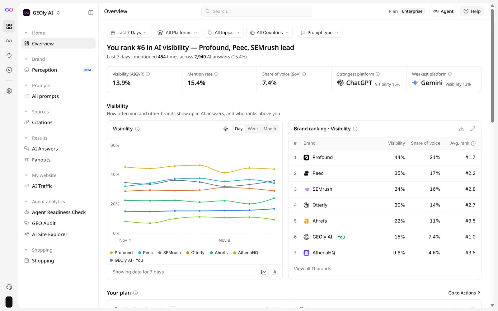
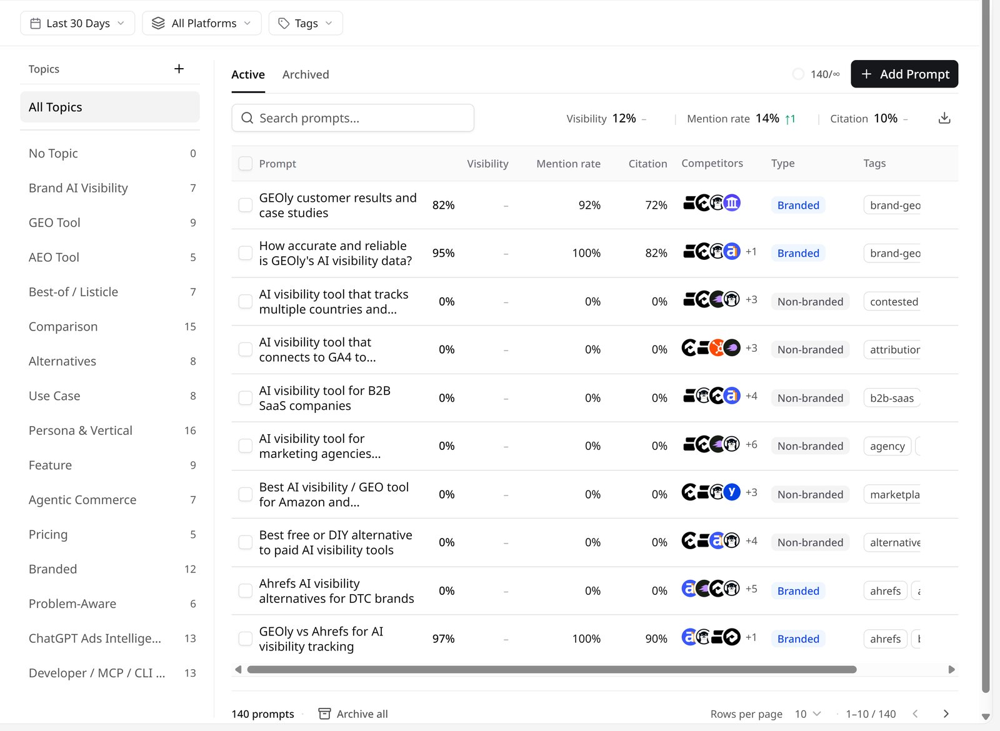
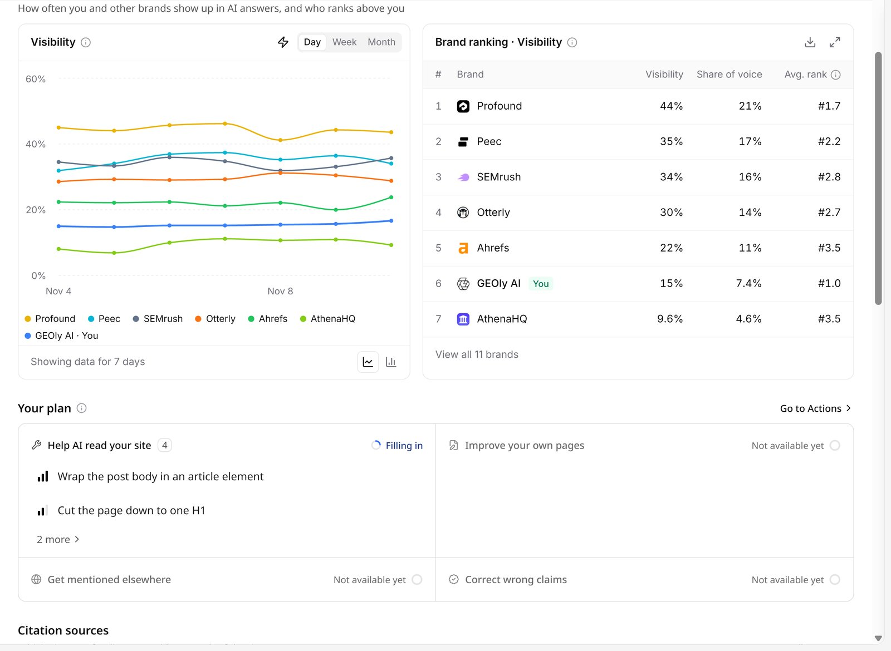
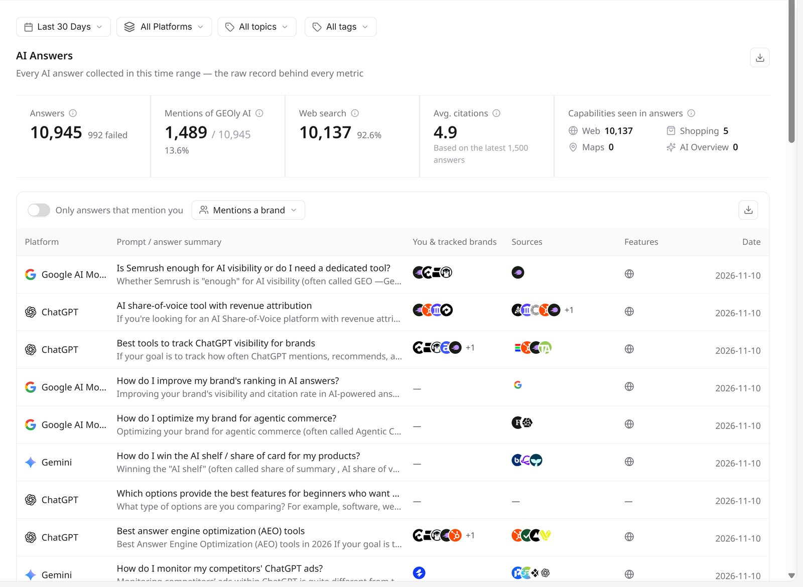
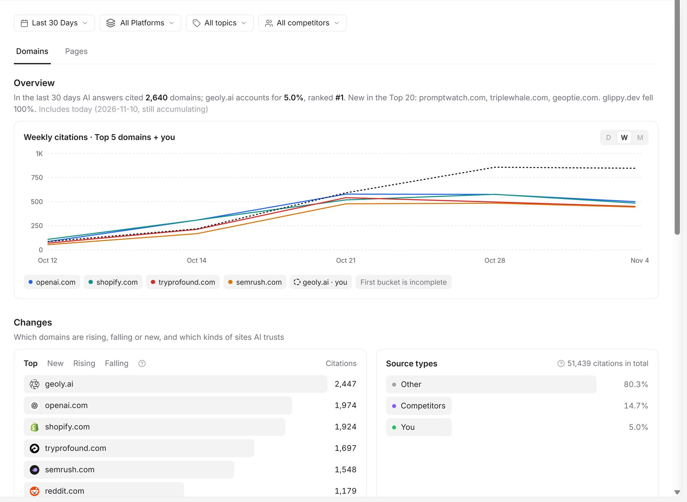
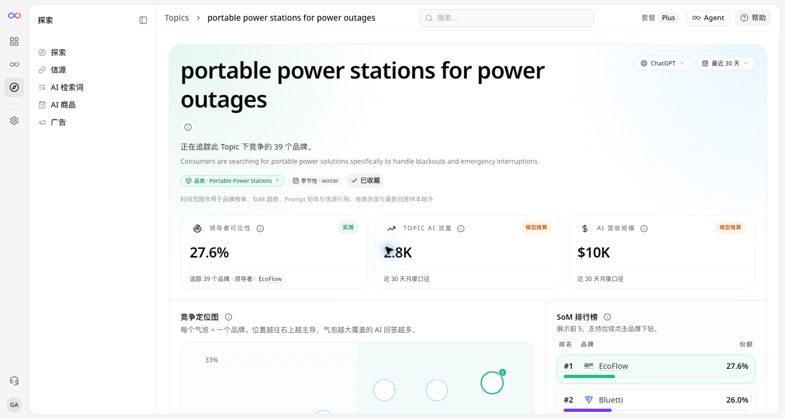

GEOly 帮助你了解 AI 平台如何描述、提及、引用和推荐你的品牌。

这篇指南会说明每个功能适合什么时候使用、应该从哪里进入，以及如何正确理解结果，避免把一次观测误认为流量、销量或收入结果。

## 新用户建议这样开始

如果你第一次使用 GEOly，可以按照下面的顺序操作：

1. 先在 **Explore**（探索）中了解品类、Topic、品牌、商品和信源。
2. 在 **Prompts → All prompts**（提示词 → 全部提示词）中添加客户可能向 AI 提出的问题。
3. 等待监测记录完成，再查看 **Home → Overview**（首页 → 总览）和 **Results → AI Answers**（结果 → AI 回答）。
4. 需要了解原因时，再查看 **引用来源**、AI 评价、Topic 或 AI Shopping。
5. 记录下一步优化动作，之后用相同范围重新检查。

你能看到的页面、平台、筛选项和操作按钮，会根据组织、套餐和账号权限有所不同。

本文中的两个常用词：

- **已完成记录**：一条 Prompt 已经完成执行并返回的 AI 回答。
- **数据范围**：影响结果的筛选条件，例如时间、平台、国家/地区、语言、品牌和 Prompt 集合。

## 先找到正确的页面

<Note>
本文截图均为 GEOly 英文界面。正文先写英文界面上的名称，括号里是中文界面的对应名称，方便用任一语言的界面对照操作。
</Note>

最左侧的图标栏用来切换空间：**Workspace**（工作台，品牌自己的监测页面）、**Agent**、**Actions**（行动）、**Explore**（探索，公共数据）和 **Settings**（设置）。旁边的侧栏列出当前空间里的页面。工作台的页面分组为 **Home**（首页）、**Brand**（品牌）、**Prompts**（提示词）、**Sources**（信源）、**Results**（结果）、**My website**（我的网站）、**Agent analytics**（Agent 分析）和 **Shopping**（购物）。

| 想做什么 | 从哪里进入 | 可以了解什么 |
| --- | --- | --- |
| 研究市场、品类、Topic 或商品 | 图标栏里的 **Explore**（探索） | GEOly 公共数据集中出现了什么 |
| 查看品牌在监测回答中的表现 | **Home → Overview**（首页 → 总览） | 选定范围内的可见度和提及情况 |
| 阅读 AI 的原始回答 | **Results → AI Answers**（结果 → AI 回答） | AI 说了什么、提到了哪些品牌、用了哪些来源 |
| 查看 AI 使用了哪些页面 | **Sources → Citations**（信源 → 引用来源） | 哪些域名和页面出现在监测回答中 |
| 添加和管理问题 | **Prompts → All prompts**（提示词 → 全部提示词） | GEOly 会为品牌监测哪些问题 |
| 比较同一 Topic 中的品牌 | 从 **Explore**（探索）打开 Topic | 该 Topic 下可用的竞争信号 |
| 连接 MCP 客户端或管理权限 | **Settings**（设置），例如 **Settings → Developers → MCP**（设置 → 开发者 → MCP 接入） | 可用的集成和工作区设置 |

公共研究和品牌监测不是同一种数据：

- **Explore**（探索）使用 GEOly 的公共数据集。
- 工作台里的页面使用所选品牌的 Prompt 与已完成记录。

## 1. 探索公共数据

当需要了解一个市场，或还不确定应该监测哪些问题时，从图标栏打开 **Explore**（探索）。

探索侧栏里有 **Explore**（探索）、**Sources**（信源）、**Fanouts**（AI 检索词）、**Shopping**（AI 商品）和 **Ads**（广告）几个页面，可以用来：

- 浏览品类、Topic、品牌和商品。
- 查看 AI 使用的公共信源和页面。
- 查看 AI 检索词和 Query Fan-out。
- 查看公共 AI Shopping 结果中出现的商品。
- 查看可用的公共 AI 广告观察数据。

搜索前先选择国家/地区、语言和 AI 平台。同一个 Topic 在不同范围下可能会得到不同结果。

### Explore 能告诉你什么，不能告诉你什么

Explore 可以帮助你发现趋势和研究方向，但它不是完整的市场报告，也不是所有用户搜索记录，更不是你自己的第一方分析数据。

例如“预估月度 AI 流量”属于模型估算。可以用它做方向比较，但重要的业务决策仍应结合自己的分析工具和实际研究。

## 2. 创建和监控 Prompts

**Prompt** 就是一条自然语言问题，GEOly 会将它发送给 AI 平台并持续监测。

好的 Prompt 应该像真实客户会问的问题，例如：

- 产品推荐
- 两个品牌的对比
- 购买决策
- 某个使用场景
- 产品是否值得购买

打开 **Prompts → All prompts**（提示词 → 全部提示词）后，可以：

- 添加新问题。
- 在功能可用时导入或整理问题。
- 在 **Active**（监控中）和 **Archived**（已归档）页签之间切换，并按 Topic 或标签筛选。
- 查看记录是否已经完成。

监控中的 Prompt 每天自动运行。列表显示每条 Prompt 的可见度、提及率、引用率、回答中出现的跟踪竞品、类型（Branded 带品牌名 / Non-branded 不带品牌名）和标签。

保存 Prompt 不代表已经产生了完成的 AI 回答。请等待记录生成后，再阅读它的指标。如果没有结果，先检查时间范围、平台、国家/地区、语言、Prompt 状态和记录是否可用。

## 3. 查看品牌总览

当 Prompt 已经产生完成记录后，打开 **Home → Overview**（首页 → 总览），查看品牌在当前监测范围内的整体表现。

比较两个结果前，请尽量保持以下条件一致：

- 时间范围
- AI 平台
- 国家/地区和语言
- 所选品牌与竞品
- Prompt 集合
- 已完成回答数量

页面顶部显示品牌在 AI 可见度中的排名和五个 KPI：

- **Visibility (AIGVR)**（可见度）：按出现位置、提及次数和是否引用品牌官网给每条回答打分，再对时间范围内的已完成回答求平均。
- **Mention rate**（提及率）：已完成的 AI 回答中提到品牌的比例。
- **Share of voice (SoV)**（提及份额）：品牌在所有被提到的品牌中所占的提及份额。
- **Strongest platform** / **Weakest platform**（最强平台 / 最弱平台）：时间范围内品牌可见度最高和最低的平台。

KPI 下方的 **Visibility**（可见度）区域有趋势图和 **Brand ranking**（品牌榜），列出品牌自己和跟踪的品牌；再往下是 **Your plan**（行动计划）、**Citation sources**（引用来源）和 **How AI answers your questions**（AI 怎么回答你的问题）。

这些指标描述的是当前 GEOly 数据范围内的观测结果，不能直接等同于网站流量、销售额、转化率、市场份额或收入。可见度提高只能说明监测回答中的表现发生变化，不能单独说明变化的原因。

## 4. 阅读 AI 原始回答

需要查看某个分数背后的具体证据时，打开 **Results → AI Answers**（结果 → AI 回答）。

一条回答记录可能包含：

- AI 平台和日期
- 提示词和回答摘要
- 回答中提到的本品牌和跟踪品牌
- 回答引用的来源
- 回答里出现的能力，例如联网搜索或购物卡片
- AI 返回的原始文字

不要只看分数，建议直接阅读原始回答，并思考：

- AI 是否真正回答了客户的问题？
- 品牌是否出现在合适的语境中？
- 哪些竞品被提到了？
- AI 是否提供了来源？
- 回答是否准确、有帮助？

AI 回答可能在不同执行中发生变化。每条记录都应放在具体 Prompt、平台、时间、国家/地区和语言范围内理解。

## 5. 查看引用来源

**引用**是 AI 回答中出现的来源页面或域名。打开 **Sources → Citations**（信源 → 引用来源），查看监测回答使用了哪些页面。

你可以用它来检查：

- AI 是否引用了自己的官网页面？
- 哪些第三方来源出现得最多？
- 哪些主题更常引用竞品？
- 被引用的页面是否准确、及时、有帮助？

引用只能说明某个来源出现在回答中，不能证明该来源被 AI 背书、一定准确、带来了高流量或造成了转化。修改内容前，请同时阅读原始回答和来源页面。

## 6. 理解 Topic 和 Shopping 结果

### Topic

从公共数据中打开一个 Topic，可以查看该主题下可用的品牌和竞争信号。

Topic 页面可能显示：

- **领先品牌可见度**：当前领先品牌被观察到的可见度。
- **Topic AI 流量**：预估的月度 AI 查询量。
- **AI 收入规模**：该 Topic 的模型估算值。
- **竞争格局**：品牌在该 Topic 中的相对位置。
- **Share-of-Model 榜单**：领先品牌的份额预览。

这些都是方向性信号，不是保证的流量、收入、排名或市场份额。使用结果前，请确认 Topic、国家/地区、语言、平台和时间范围。

### Shopping

GEOly 中可能有两种 Shopping 结果：

- **Explore → Shopping**（探索 → AI 商品）：查看公共数据集中观察到的商品。
- 工作台的 **Shopping → Shopping**（购物 → AI 商品）：查看所选品牌的监测 Prompt 和已完成记录。

这两个页面的数据来源和范围不同，不要把它们当成同一批用户或同一种统计结果。

## 7. 使用工具和管理工作区

要连接 Claude、Cursor、Codex 等 MCP 客户端，打开 **Settings → Developers → MCP**（设置 → 开发者 → MCP 接入）。网站类工具在工作台侧栏的 **Agent analytics**（Agent 分析）分组下：**Agent Readiness Check**（Agent 就绪度检测）、**GEO Audit**（GEO 诊断）和 **AI Site Explorer**（AI 网站探索）。

打开 **Settings**（设置），管理账号可用的设置，例如：

- 个人资料和安全（**Account** 账号）
- 品牌资料和跟踪的品牌（**Brand → Brand profile**、**Brand → Brands**，即品牌 → 资料、品牌 → 品牌列表）
- 账单、成员和组织信息（**Organization** 组织）
- API 密钥和 MCP（**Developers** 开发者）

具体操作取决于组织和账号权限。如果找不到某个页面或按钮，请先确认当前组织、品牌和权限，不要马上认为该功能不存在。

## 一个简单的使用示例

假设你想知道 AI 是否会为某个品类推荐你的品牌：

1. 在 **Explore**（探索）中了解这个品类，并找到常见 Topic。
2. 在 **Prompts → All prompts**（提示词 → 全部提示词）中添加一条客户可能会问的问题。
3. 等待记录完成。
4. 在 **Home → Overview**（首页 → 总览）中查看整体信号。
5. 在 **Results → AI Answers**（结果 → AI 回答）中阅读 AI 实际说了什么。
6. 在 **Sources → Citations**（信源 → 引用来源）中查看哪些页面支持了回答。
7. 优化相关内容后，用相同 Prompt 和相同范围重新运行并比较。

这样可以把问题从“发生了什么”推进到“为什么会这样”，再推进到“下一步应该检查什么”。

## 常见误区

- 使用不同时间范围或不同 Prompt 集合进行比较。
- 把公共 Explore 数据和品牌监测数据混在一起。
- 把预估 AI 流量或收入规模当成第一方数据。
- 把品牌提及当成品牌推荐。
- 把引用当成背书。
- 看到没有结果，就直接认定对象不存在；覆盖范围、筛选条件、权限和记录状态都可能影响结果。
- 只根据一次回答或一次执行做重大业务决策。

## 下一步

- 如果你还没有账号，请先查看[创建 GEOly 账号](/zh/get-started/register-account)。
- 阅读[探索：AI 市场与品牌研究](/zh/analytics/ai-engine-explore)，了解公共研究。
- 阅读[Prompts 监控](/zh/analytics/geoly-prompts)，学习如何扩展监测问题。
- 阅读[Topic 与平台分析](/zh/analytics/ai-engine-topic)，了解如何比较 Topic 和平台。

GEOly 帮助你观察 AI 系统如何理解你的品牌，并决定下一步应该研究什么。它不保证任何 AI 平台一定会提及、引用、推荐或排名某个品牌。
