## 一份面向业务增长的介绍手册

GEOly 是面向 AI 搜索与 Agentic Commerce 的品牌情报平台。它把公开行业情报、自有品牌监测、页面内 AI 分析助手和按授权开放的 MCP/CLI/Skills 能力连接起来，帮助团队看清：当消费者在 ChatGPT、Gemini、Perplexity、Google AI Mode、Microsoft Copilot 或 Google AI Overview 中提问、比较或购物时，AI 是否提到你的品牌、如何描述产品、引用了哪些来源、推荐了哪些 SKU，以及竞品在哪些问题中更容易出现。

传统 SEO 帮助用户在搜索结果页发现你；GEOly 帮助团队观察并改善品牌在 AI 答案中的描述、推荐与引用。它不替代 SEO，而是把内容、商品信息、可信来源、行业认知、广告机会和已开通的工作流能力接入 AI 决策链路。

## 当前工作区：从品牌监测到持续行动

GEOly 的工作区围绕“配置监测、解读结果、采取行动”展开。团队不需要孤立地理解每个菜单，而应把品牌自己的监测数据、公开行业情报、信源证据和站点诊断放在同一条工作链路中使用。

| 工作环节 | 当前入口与能力 | 主要回答的问题 |
|---|---|---|
| 配置品牌监测 | **监控 → Prompts**：设置客户可能向 AI 提出的真实问题，并按当前组织已启用的平台持续采集回答 | 哪些问题值得长期监测？品牌是否在目标场景中被 AI 看见？ |
| 解读品牌表现 | **表现 → 总览**：查看品牌可见度、趋势、主要引用域名和回答样本；**AI 评价**：分析品牌情感、同台竞品强弱、风险语境信源和逐字证据；**AI 商品**：查看当前监测样本中的商品卡表现 | AI 如何描述品牌？哪些竞品更强？商品是否进入 AI 推荐货架？ |
| 追踪信息来源 | **信源**：分别查看引用来源、AI 检索词，以及完成 GA4 集成后可识别的 AI 平台引荐访问 | AI 引用了谁、搜索了什么？哪些可识别的访问最终进入了网站？ |
| 研究公开市场 | **探索**：基于 GEOly 公共数据集中已收录的品类、Topic、品牌、商品与信源开展行业研究 | 整个品类中谁更容易被 AI 提及或推荐？哪些主题和渠道存在机会？ |
| 检查并连接行动 | **MCP & 工具**：运行 GEO 诊断、AI Site Explorer（AI 网站探索）和 Agent 就绪度检测；也可通过 MCP，在授权范围内让外部 AI 客户端调用 GEOly 数据 | 网站是否便于 AI 发现、理解和调用？如何把 GEOly 数据接入外部工作流？ |

**截图怎么读：** 这张 DJI 总览图展示品牌与竞品的每日可见度趋势、品牌榜，以及下方独立的公开行业库档案入口。趋势和榜单用于观察当前品牌监测样本的相对变化；行业库档案属于公共数据，不能与自有 Prompt 结果相加。截图数字只属于当时的品牌、时间范围、平台和已完成回答，不能当作行业固定值、销量或传统搜索排名。

这些模块的数据口径并不相同。探索使用公共数据集，不等同于围绕你的品牌、Prompts 和平台持续采集的私有监测数据；GA4 显示的是可识别的 AI 平台引荐访问，不代表 AI 爬虫流量或完整归因。

表现、信源和探索页面用于回答不同问题。下文分别说明 AI 检索、评价和商品卡的范围与分母；即使都围绕同一品牌，也不应把引用、购物展示、引荐访问和销量当作同一个指标。

可用平台、时间范围、Ads、导出和 MCP 工具会随套餐、组织权限与授权范围变化，以产品内实际显示为准。AI Site Explorer、GEO 诊断和 Agent 就绪度检测用于发现改进线索，不保证网站一定被索引、获得排名或被 AI 引用。

## 如何阅读这篇手册？

先从 **重点一** 建立自己品牌的监测基线，再用 **重点二至八** 对照行业、信源、商品和广告场景，最后在 **重点九至十** 把可核验的发现接入团队工作流。第一次阅读不必逐个记住菜单：品牌和增长团队优先看监控、竞品与行业；内容团队优先看引用与 AI 检索；电商和投放团队分别从商品、广告的证据开始。

本文沿用 GEOly 的四类能力来组织内容：公开行业情报、自有品牌监测与诊断、页面内 AI 助手和按需开通的自动化，以及 MCP/CLI/Skills 开放连接。各模块的数据范围不同，不能把公开行业统计与自有品牌监测指标相加。

## 当前版本速览：GEOly 现在包含什么？

当前官网将 GEOly 组织为四类能力。具体菜单、可用工具和数据范围会随账号、组织、套餐与授权变化；以下是产品定位，不代表每个账号都会显示全部入口。

| 能力层 | 当前包含的重点能力 | 适合回答的问题 |
|---|---|---|
| 行业情报洞察（核心） | Industry Intelligence、品牌榜单、Topic 集群、品类白空间、品牌势能、竞争难度、AI 检索需求、AI 信源和 AI Commerce Surface | 整个赛道在 AI 中如何分布？谁被推荐？哪些主题和渠道有机会？ |
| 自定义监测与诊断（标配） | 品牌可见性、Prompts/Query 分析、竞品分析、情感与品牌印象、GEO 审计、Query Fan-out 和站点诊断 | AI 是否提到我？如何描述我？为什么引用竞品？哪些页面需要修复？ |
| AI 助手与已开通的自动化 | 页面内 AI 分析助手；GEO Agent、报告及自动化按套餐与组织实际开通 | 如何让监控、诊断、报告和执行形成连续工作流？ |
| MCP 与开放能力 | GEO MCP Server、CLI、GEO Skills、GA4/Cloudflare/Notion/Shopify 等集成，以及按方案开通的 API/Webhooks（API/Webhooks 的接口范围和配额以定价页、账户权限与实际开通内容为准） | 如何让外部 AI、BI 或内部系统在授权范围内读取和使用 GEOly 数据？ |

官网首页的品牌数、品类数、AI 提及或购物卡数量属于持续变化的公开行业数据快照，不是某一个客户的监控结果；阅读时应以产品页面当前显示的范围、时间和权限为准。

## 先理解 GEO：为什么品牌需要新的可见度管理方式？

GEO 是 Generative Engine Optimization，也就是生成式引擎优化。它关注的不是单一网页排名，而是品牌在 AI 生成答案中的出现、位置、语义、引用和可信度。

在 AI 搜索和 AI 购物场景里，用户的决策路径正在变化：

1. 用户不一定先打开搜索结果列表，而是直接问 AI：“哪款产品更适合我？”“A 品牌和 B 品牌怎么选？”“有没有更高性价比的替代？”
2. AI 会综合官网、商品页、评测、论坛、媒体、结构化信息、历史语义和行业内容，生成一个更接近“购买建议”的答案。
3. 如果品牌没有被提到，或者被提到但描述不准确，用户可能在进入官网之前就已经被其他品牌影响。
4. 如果 AI 引用的不是你的官方页面，而是第三方页面、过时页面或竞品页面，品牌对信息解释权的掌控会变弱。

所以，GEO 的核心不是“多发内容”这么简单，而是让正确、清晰、可信、可引用的信息进入 AI 的证据池，让品牌在 AI 的回答里有更稳定的位置。

## GEOly 具体解决什么问题？

从客户解决方案的角度看，GEOly 主要帮助品牌回答六类问题。

| 客户关心的问题 | GEOly 帮你看到什么 | 对业务的意义 |
|---|---|---|
| AI 会不会提到我？ | 品牌在不同 Prompt、平台、国家和语言中的提及率与可见度 | 判断 AI 渠道里是否存在品牌空白 |
| AI 怎么描述我？ | 正面、中性、负面描述，以及 AI 常用的品牌关键词 | 发现认知偏差、误解和可强化卖点 |
| AI 引用了谁？ | AI 回答中引用的域名、页面、商品页和第三方信源 | 判断官网、内容页、评测页是否进入证据链 |
| 竞品为什么出现更多？ | 竞品在不同主题、平台、场景中的可见度差异 | 找到可争夺的主题和内容机会 |
| 哪些问题更接近购买？ | AI 查询、购物推荐、商品卡、价格和排名线索 | 连接内容优化、商品策略和转化机会 |
| 数据如何变成动作？ | 监控、洞察、Sidekick、集成和报告工作流 | 把 GEO 从“看数据”推进到“持续优化” |

GEOly 更适合被理解为一个“AI 品牌增长工作台”：先发现问题，再判断优先级，最后把优化动作沉淀成持续流程。

## GEOly 的数据与执行链路：从观测到动作

这条工作链路是使用顺序，不是套餐等级：

1. **先观察自有品牌**：用 Prompt、平台、市场和时间范围建立提及、引用、位置与情感的基线。
2. **再对照公开行业**：查看品类、竞品、Topic、商品和信源，找到当前样本之外的机会与风险；公开与私有数据保持各自口径。
3. **把证据拆成业务任务**：内容、商品、渠道和广告团队分别核对页面、SKU、购买入口及高意图问题，不能由单个观测指标推断收入。
4. **在授权范围内复测和协作**：页面内 AI 助手可整理核查步骤；报告、MCP 或 API 能否接入固定流程，以账户实际开通为准。

## 重点一：品牌可见度监控，先建立 AI 渠道基线

品牌可见度监控是 GEOly 的基础。你可以围绕核心业务、产品卖点、购物问题、竞品对比、地域语言等场景设置监控问题，系统会持续追踪 AI 回答中是否提到品牌、出现位置如何、是否引用你的页面、情绪倾向如何。

**截图怎么读：** 这张 Prompt 列表图对应品牌工作区中的监控入口。顶部的时间范围、平台、状态和 Tags 用于缩小当前查看范围；左侧 Topics 用于按主题组织问题；列表中的 Visibility 反映品牌在所选 Prompt 结果中的出现情况，Avg Visibility Level 反映出现位置强弱，Comp 用于观察同一回答中的竞品共现，Records 表示该范围内的记录数量。先确认工作区、市场/语言和平台，再同时比较多个字段；不要只看一个分数，也不要把列表排序当作传统搜索排名。

当前 Prompt 列表可按时间范围、平台、状态、Topic 和标签筛选，并查看 Visibility、Avg Visibility Level、Share、Citation、Records 等字段。这些字段和数字只用于说明列表如何阅读；数值会随工作区、筛选条件和已完成记录变化，不代表 GEOly 全平台基准、行业总量或客户结果。需要特别注意：Records 是所选范围内的记录数，可能包含待处理或失败记录；Visibility、提及率和引用率等质量指标主要基于已完成记录计算。因此 Records 多不等于有效样本多，Records 为 0 也不自动等于品牌未出现。

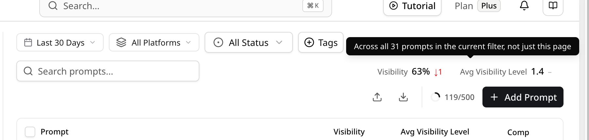

**截图怎么读：** 这张额度提示图显示的是当前筛选范围下的 Prompt 使用计数（截图示例为 119/500），黑色提示进一步说明统计覆盖当前筛选中的全部 Prompt，而不只是当前分页。它用于帮助团队判断还能否继续添加问题；具体上限由当前套餐、组织和工作区决定。已用数、剩余数和上限都会随账号与套餐变化，不能把截图数字当成 GEOly 的统一配额，也不能把 Prompt 上限直接换算成有效回答数或销售机会。

额度提示只说明当前工作区在当前筛选范围下的 Prompt 使用情况；不要把某个截图中的已用数、剩余数或上限理解为所有套餐、所有工作区的固定值，实际额度以当前套餐和工作区页面为准。

### Prompt 快速上手：从设置问题到复测

1. **先确认范围**：进入当前工作区的 **Monitoring → Prompts**，确认当前工作区及监测配置中的品牌、国家/语言、时间范围和平台范围；这些范围会影响结果，但不一定都显示为列表筛选项。
2. **添加或选择问题**：围绕品类推荐、购买决策、竞品对比、风险和信任等场景添加 Prompt，优先覆盖真实客户会问、且与业务目标相关的问题。
3. **看列表质量信号**：先看 Visibility、Avg Visibility Level、Share、Citation 和 Records，再决定是否进入单条详情。不要只按一个分数判断 Prompt 质量。
4. **进入详情看证据**：点击 Prompt 整行或更多菜单中的“查看”，在详情抽屉中切换时间范围和平台，查看 Executions、Mentioned、Mention Rank、Visibility Level、Sentiment、Sources、Response 等记录。
5. **检查引用和事实**：确认品牌是否被正确提及、位置是否合理、引用是否来自可信且相关的页面，AI 对产品的描述是否准确；如果没有出现，也先排查时间范围、平台覆盖、市场语言和记录是否完整。
6. **形成动作并复测**：把问题归因到 Prompt 覆盖、页面内容、商品信息或外部信源后，记录优化动作，在下一周期用相同范围复测。一次分数变化只能说明当前观测变化，不能单独证明流量、转化或收入因果。

#### 批量添加与 AI 建议

需要批量新增时，可在 **Prompts** 页面点击 **添加提示词 → 导入提示词**，上传 CSV、JSON 或 XLSX 文件，也可以下载 CSV/JSON 模板。导入前先检查列名、问题语言、国家/地区、主题归属和重复行，避免把不相关的问题带入监控。

**截图怎么读：** 这张图展示批量导入入口和格式限制。底部的剩余数量是当前工作区在当前套餐下可用的 Prompt 空间；已用数、剩余数和上限会随组织、套餐和筛选范围变化，不能把截图中的数字当成统一配额。导入后还要确认监测范围、等待执行，并检查记录是否完整。

不知道该问哪些问题时，可在 **Prompts → 添加提示词 → AI 建议** 中生成候选 Prompt。先在“监控方向”填写品牌、产品类别、目标人群或使用场景，也可以只输入几个关键词；留空时，系统会根据品牌资料生成建议。随后选择是否让 AI 建议主题，并确认国家/地区、语言和每个主题生成的数量；页面会显示当前设置下的剩余额度。

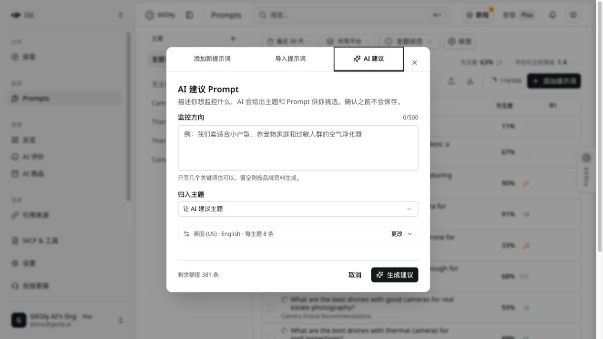

**截图怎么读：** 截图展示的是 DJI 工作区的 **AI 建议**页签：顶部可在“添加新提示词”“导入提示词”“AI 建议”之间切换；中间的“监控方向”用于描述要观察的业务，**归入主题**用于决定主题来源，下面的范围设置用于确认市场和语言，底部显示剩余额度。界面上的“每主题 8 条”和“剩余额度 381 条”只是该工作区当时的设置与余额，不代表所有套餐。

点击 **生成建议** 后，GEOly 先返回可供挑选的主题和 Prompt 草案。这个步骤不会自动保存或开始监测；请逐条检查问题是否属于你的业务、是否覆盖真实的购买或比较场景、国家/语言是否正确，并删除重复或不相关的问题。以 DJI 为例，可以输入“面向户外创作者和企业巡检的相机无人机”，再从候选结果中保留类似“Which are the best thermal camera drones for solar panel inspections?”这样的具体问题。确认并保存后，选中的问题才会加入 Prompts 监控。

AI 生成的内容是 Prompt 设计辅助，不是实时用户提问日志、搜索量统计、传统搜索排名或结果保证。生成数量、剩余额度和可用选项以当前账号、国家/地区、语言、套餐和页面显示为准；保存后仍需等待监测执行完成，才能在列表和详情中读取 Visibility、提及、引用等结果。界面和规则会随版本更新，操作时以 Prompts 页面当前可见选项为准。

**判断一个 Prompt 是否值得长期保留，可以用这 5 个检查项：**

| 检查项 | 重点看什么 | 不能直接推出什么 |
|---|---|---|
| 场景价值 | 是否对应高意图、真实业务问题 | 不能把 Prompt 数量当作真实需求量 |
| 品牌出现 | 是否提及、出现位置和竞品差距 | 不能直接等同搜索排名或销售份额 |
| 引用质量 | 是否有相关、可核验的官网或第三方来源 | 不能证明被引用页面带来了点击 |
| 跨范围稳定性 | 不同平台、市场和时间范围是否一致 | 单次结果不能代表长期趋势 |
| 证据完整度 | Executions、Sources 和 Response 是否足够复核 | 缺少记录不等于品牌一定不存在 |

客户通常会从这几类问题开始：

- 品类推荐：例如“适合小户型的空气净化器有哪些？”
- 购买决策：例如“预算 200 美元以内的办公椅推荐。”
- 竞品对比：例如“品牌 A 和品牌 B 哪个更适合敏感肌？”
- 风险问题：例如“某产品是否值得买？有哪些缺点？”
- 信任问题：例如“哪个品牌的售后更可靠？”

这一层的目标不是马上解释所有原因，而是先知道“有没有被看见”。如果品牌在高价值问题里完全没有出现，就说明 AI 渠道存在明显空白；如果被提到了但没有引用官方页面，就说明信源建设可能还不够。

下面以 DJI 工作区中的一个 Prompt 详情为例：从列表点击整行或更多菜单中的“查看”，进入详情抽屉，再切换执行记录与引用信息。具体数值只对应所选工作区、国家/语言、时间范围和平台，不代表 DJI 的销量、市场份额或 GEOly 全平台平均值。

## 重点二：行业洞察，看清 AI 如何理解整个市场

行业洞察是评估 GEOly 的重点模块。品牌起步时常只看“我有没有被提到”，成熟团队还会关注：在整个品类里，AI 把谁视为主流品牌？哪些主题更容易触发推荐？AI 引用媒体、论坛、零售商、官网还是竞品页面？购物模块更常出现在哪些价格带和渠道？

行业洞察通常可以按四步来读。

### 1. 先看行业和子品类格局

在行业层面，团队可以先判断某个大类和子品类中，哪些品牌被 AI 更频繁提到，哪些品牌虽然流量或营收不低，但在 AI 回答里的存在感偏弱。这个视角适合回答：

- 我的品牌在 AI 语境里属于头部、中腰部还是长尾？
- 竞品是整体领先，还是只在某些平台、国家或主题领先？
- 某个子品类是否已经有明确的 AI 推荐格局？
- 新进入一个市场时，哪些品牌是 AI 已经默认会提到的对象？

### 2. 再看品牌榜单和 AI 行为差异

行业洞察不只是榜单，更要看不同平台的 AI 行为：有的平台偏自然回答，有的平台更容易触发购物模块，有的平台对引用来源更敏感。借此可判断同一品类应优先优化内容、商品页、评测渠道，还是价格和 SKU 信息。

### 3. 接着看引用来源和主题覆盖

AI 是否提到一个品牌，往往取决于它能否找到足够清晰、可信、可引用的证据。行业洞察中的引用来源、Top Cited Domains 和主题覆盖，可以帮助团队回答：

- AI 经常引用哪些类型的网站？媒体、零售商、论坛、品牌官网还是评测站？
- 竞品在哪些主题上有更好的内容和外部背书？
- 自己的官网或商品页为什么没有进入引用链路？
- 哪些主题有商业价值，但行业内容还没有充分覆盖？

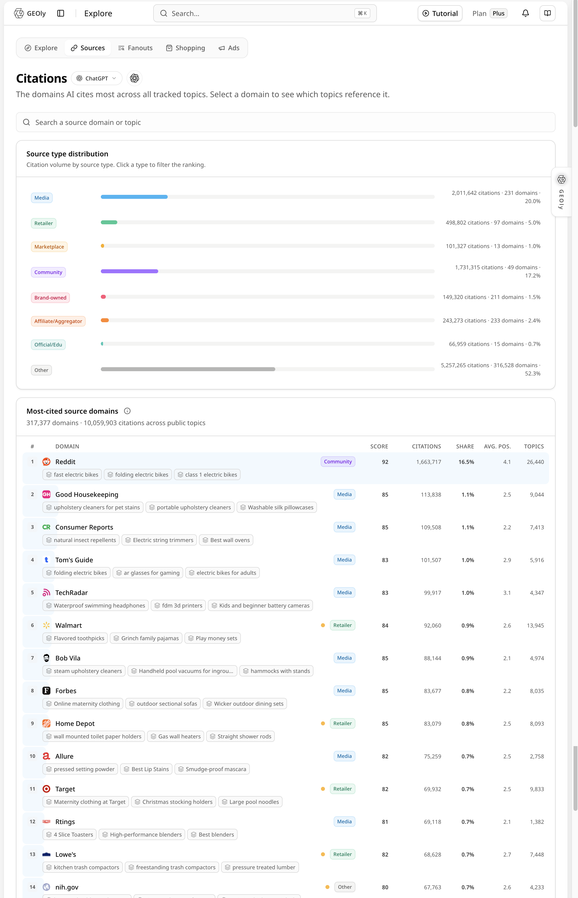

**截图怎么读：** 这张 Sources/Citations 图从公开 Topic 汇总信源类型：Media、Retailer、Marketplace、Community、Brand-owned、Affiliate/Aggregator、Official/Edu 和 Other。每一行的 citations、domains 和占比描述的是当前公开数据窗口内 AI 回答引用的来源构成，可用来判断一个行业更依赖媒体、社区、零售商还是品牌自有页面。它不是网站流量来源报告，也不等于这些域名给品牌带来的点击、转化或外链权重；应继续下钻到具体 Topic、域名和页面。

### 4. 最后看 AI Commerce Surface

对电商和 DTC 品牌，行业洞察还连接 AI Commerce Surface：AI 是否触发购物展示、推荐哪些零售渠道、集中在哪些价格带，以及哪些商品更容易展示。这让行业分析从“品牌声量”进一步走向“交易机会”。

更实用的做法是：先找出行业里 AI 最常推荐的商品和价格带，再对照自己的商品信息、库存、评价、价格、卖点和页面结构，判断是内容问题、渠道问题，还是商品数据质量问题。

### 行业洞察更适合哪些客户？

- 准备进入新品类或新市场的品牌。
- 想知道竞品为什么在 AI 中更常被推荐的团队。
- 代理商需要为客户做行业扫描和月度复盘。
- 管理层想用更宏观的方式理解 AI 搜索里的市场位置。
- 电商团队想把品类、商品、渠道和价格带放在一起看。

Basic 主要用于单品牌基础监控；Explore、Category、Sources 等行业数据页面对所有有效付费套餐开放，但公开行业 MCP 工具、ChatGPT Ads 和报告导出从 Grow 起，并需相应权限；具体仍以组织授权和账户显示为准。Grow 适合扩展到行业研究、ChatGPT Ads 和更多平台；Advanced 增加更完整的平台覆盖，Agent 能力以账户开通为准；Plus 适合多品牌、多市场协作；Enterprise 按方案提供定制配额、API、Webhooks、SLA 或私有部署等能力。代理商工作台需单独申请并开通。

## 重点三：引用和内容机会，把“为什么没出现”拆成可优化动作

只知道“有没有被提到”还不够。客户更需要知道下一步该改哪里。GEOly 会把 AI 回答拆解到主题、平台、品牌、引用来源、页面和商品层级，帮助团队判断优化优先级。

**截图怎么读：** 这张引用来源图展示所选时间、平台、主题和竞品范围，以及域名/页面入口和每周引用趋势。先看重点域名的变化，再进入页面和具体回答核对引用语境；图中的引用次数属于当前监测窗口，不等于网站访问、外链权重或收入贡献。

引用分析适合这样理解：AI 引用某个页面，说明它在当前回答样本中被用作来源，但不能据此确定 AI 对该来源的信任程度或品牌缺席的原因。如果竞品页面或第三方评测经常被引用，而你的官网很少出现，可把内容完整度、页面可访问性、相关性和外部证据作为待核查的假设，再回到具体 Prompt 与回答验证。

| 发现的问题 | 可能原因 | 对应动作 |
|---|---|---|
| 官网很少被引用 | 页面结构不清晰、信息不完整、缺少权威信号 | 优化产品页、FAQ、对比页、结构化信息和专题内容 |
| 第三方页面占主导 | 这些来源在当前问题样本中更常被引用，具体原因待核对 | 对照原始回答，补可验证的官网、评测或渠道资料 |
| 竞品引用更强 | 页面相关性、主题覆盖或外部证据可能存在差异 | 核对相同问题中的引用页面，再做内容与证据补位 |
| 商品页被引用，但第一方转化未改善 | 页面体验、价格、库存或受众匹配可能存在问题 | 结合 GA4、Shopify 和页面数据排查；引用本身不衡量转化 |

这部分特别适合 SEO、内容、PR 和站点运营团队，因为它把“AI 为什么这么回答”变成可以落地的页面和信源优化清单。

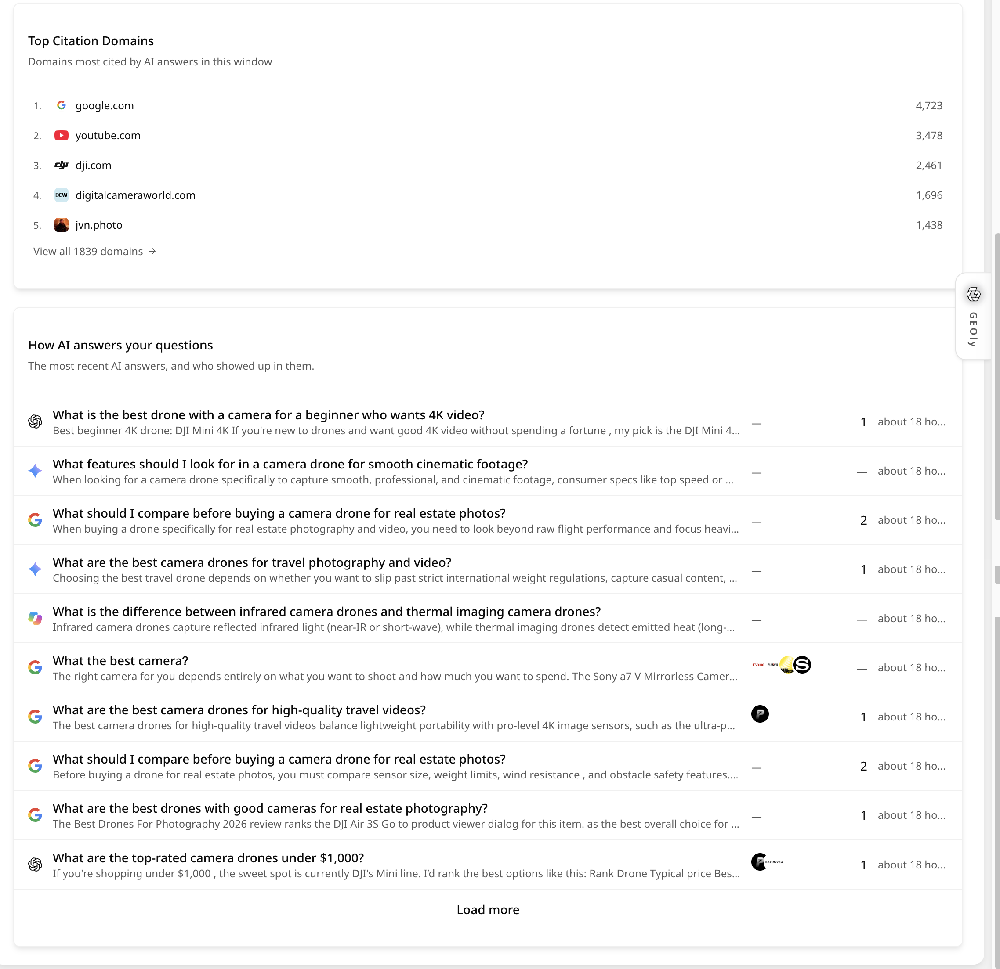

**截图怎么读：** 这张 DJI Top Citation Domains 与 AI Answers 图把两个层次放在一起：上方列出品牌在当前观察窗口中最常被 AI 引用的域名，下方列出最近的 AI 问题与回答摘要。团队可以先看哪些域名反复出现，再打开问题确认这些引用服务于哪类需求、品牌是否真的被提及、回答位置和描述是否准确。域名引用次数是观测窗口中的累计计数，不代表域名质量的绝对排名，更不能单独证明流量或收入贡献。

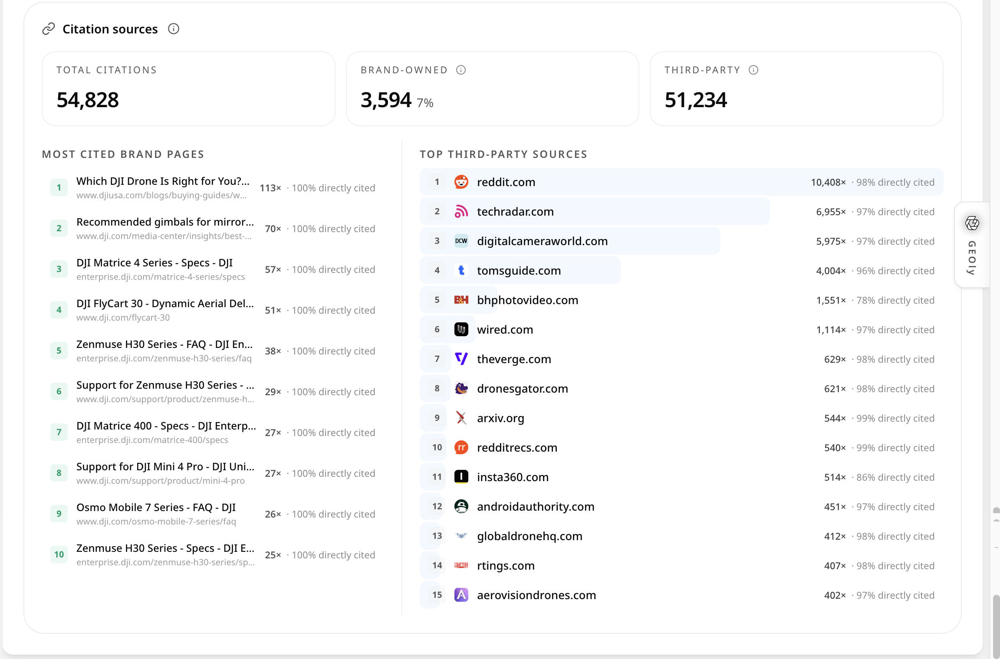

**截图怎么读：** 这张 DJI Citation Sources 图进一步拆分品牌自有页面和第三方页面：顶部的 Total Citations、Brand-owned、Third-party 用于判断引用结构；左侧 Most Cited Brand Pages 显示哪些官网页面被直接引用，右侧 Top Third-party Sources 显示哪些外部域名参与回答。优化时应把页面主题、被引用次数、直接引用比例和具体回答一起看；第三方引用多不等于品牌失去控制，而是提示需要补充可核验的官网内容、评测资料或渠道信息。

### 品牌监测中的 AI 检索词：核对 AI 为回答问题搜了什么

当前页面汇总最近 90 天 ChatGPT 为监测 Prompt 发出的 Web 检索词，并剔除对原问题的简单复述。它是自有品牌监测数据，不是重点六所述的公开行业词根研究，也不是完整的用户搜索日志。先从有价值却缺少品牌提及或官网引用的问题入手，进入原始回答核对检索词与引用页面，再形成内容或信源补位任务。

**截图怎么读：** 这张 AI 检索词图按 Prompt 汇总当前 ChatGPT 监测样本中发出的检索词。先看检索词与原问题、回答中的品牌提及和引用是否一致，再打开具体记录核对；词根和次数不能当作完整的真实用户搜索日志、精确搜索量或网站访问。

## 重点四：情感与品牌认知，判断 AI 说得是否符合定位

GEOly 不只看出现次数，也会分析 AI 对品牌的情绪和语义倾向。对于品牌方来说，这一层非常重要，因为 AI 的回答常常会把散落在互联网上的信息压缩成一句判断。

「AI 评价」中的风险语境信源表示当前回答样本中的共现，不代表因果；该板块固定统计最近 7 天全平台数据，不跟随页面其它板块的时间筛选。

**截图怎么读：** 这张 AI 评价图先概括当前回答样本如何讨论品牌，再用维度矩阵比较品牌与同台竞品。单元格表示当前样本中相关维度的讨论数量，不是消费者调研得分；要进一步解释比较和风险语境，还应下钻到原始回答核对，不能直接推断竞争因果。

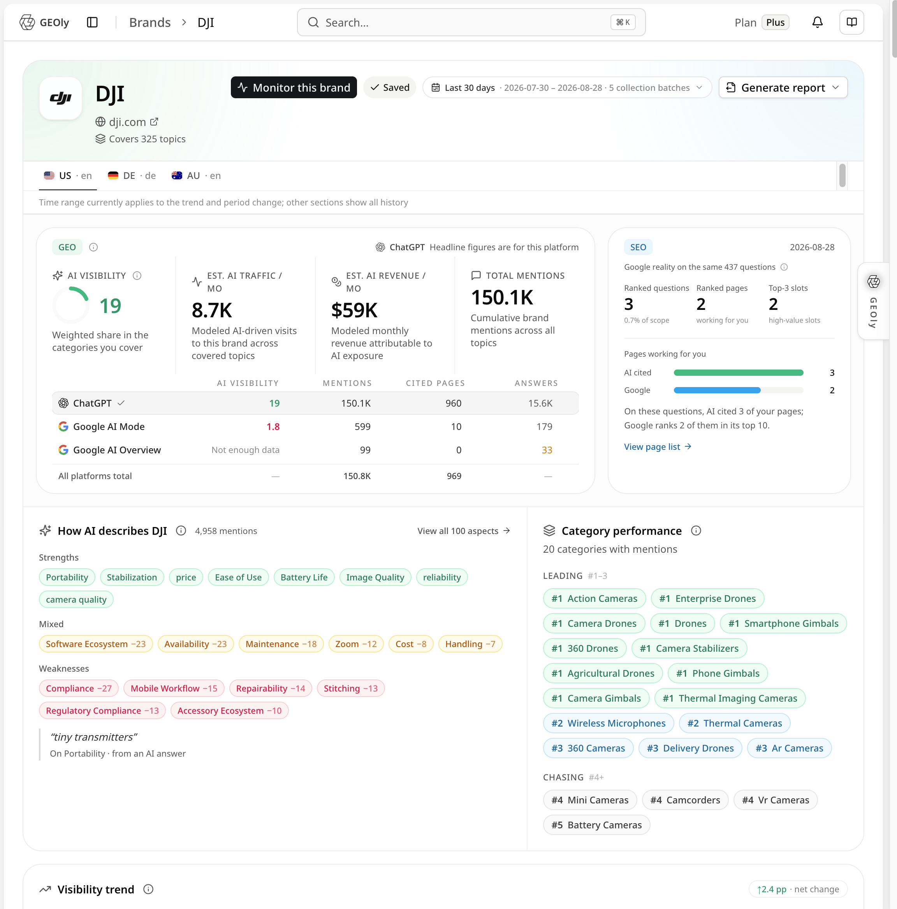

**截图怎么读：** 这张情感分析图展示所选平台和时间范围内的 Sentiment Score、情绪分布和趋势。左侧总分用于快速比较当前窗口，右侧 Positive/Neutral/Mixed/Negative 的数量和比例用于解释总分由什么构成，下方趋势图用于观察变化是否持续。它反映 AI 回答对品牌的语义倾向，不是消费者满意度调查、社交媒体舆情总量或法律意义上的声誉结论；发现负面信号后，应回到原始回答和引用页面核对原因。

你可以重点观察：

- AI 是否把品牌描述成你想要的定位。
- 正面评价集中在哪些卖点上，是否可以继续放大。
- 负面或中性描述是否来自产品缺陷、售后争议、信息不完整或过时内容。
- 竞品在哪些维度被描述得更好，例如“更适合新手”“价格更低”“更专业”“评价更多”。

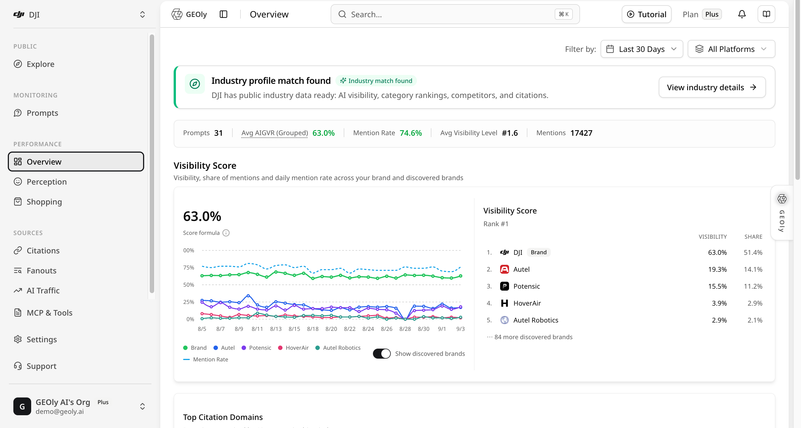

**截图怎么读：** 这张 DJI 品牌总览图是品牌级分析入口。顶部卡片汇总 Prompt 数量、AIGVR/可见度、Mention Rate、Visibility Level 和 Mentions；中间的 Visibility Score 区域按平台列出品牌与竞品的对比，下面的 How AI describes DJI 汇总 AI 常用的优势、混合评价和弱点标签，右侧 Category performance 展示品牌在各品类的相对位置。图中的 AI Traffic 和 AI Revenue 是模型估算，用于方向判断，不是 GA4、订单系统或平台广告后台的实测收入；平台、市场、时间范围变化后，数值也会变化。

情感分析不是给品牌贴简单的“正面/负面”标签，而是找出 AI 叙事中的关键词和证据来源。例如，AI 总说品牌“价格偏高”时，要继续查看引用页面、对比对象和用户问题，再决定调整商品信息、补充价值解释，还是优化价格带展示。

## 重点五：AI Shopping / 电商，让商品进入 AI 推荐链路

电商是 GEOly 的重点场景。AI 不只回答“哪个品牌好”，也越来越多地参与商品推荐、比价、筛选和购买前判断。对 DTC、Shopify、零售和消费品品牌，AI Shopping 关注：商品是否进入 AI 推荐或购物卡，价格、评分、标签、渠道和 SKU 信息是否被正确理解。

「AI 商品」当前覆盖 ChatGPT 与 Google AI Mode。货架触发率、品牌出现率和货架份额的分母不同，不能与 Merchant Center 曝光、销量或广告效果直接对账。

**截图怎么读：** 这张 AI 商品图展示货架触发率、品牌出现率、货架份额、DTC 占比，以及货架趋势和品牌榜入口。各指标分母不同，只反映当前监测 Prompt 中 ChatGPT 与 Google AI Mode 的商品卡样本；页面不是 Merchant Center、广告后台、库存或订单系统的数据。

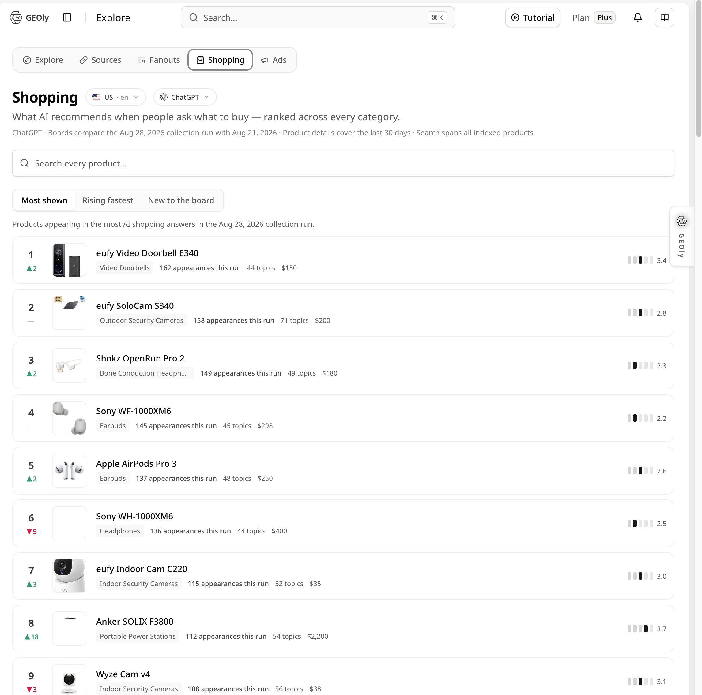

**截图怎么读：** 这张 AI Shopping 商品榜单图展示 AI 在购买型问题中推荐的商品：每行包含名次、商品名称、品类、近期出现次数、覆盖 Topic、价格和右侧的可见度/强度信号。它回答的是“哪些商品进入了 AI 推荐答案”，不是销量排行榜或官方销售排名。使用时应按同一时间范围和平台比较多个商品，并进一步检查商品详情、价格、评分、库存、渠道和原始回答，确认问题来自商品数据、页面证据还是竞争环境。

AI Shopping 可以分成三类信号来看。

### 1. Top Products：哪些商品被 AI 推荐

Top Products 帮助团队看清楚哪些 SKU 更常出现在 AI 回答和购物推荐中。它回答的不是“某个关键词排名第几”，而是：当用户用自然语言表达购买需求时，AI 更愿意推荐哪些商品。

对商品运营来说，这能帮助判断：

- 哪些 SKU 已经进入 AI 的推荐范围。
- 哪些主推商品没有被 AI 识别或推荐。
- 哪些竞品 SKU 在相同场景下更常出现。
- 商品标签、评分、价格、卖点是否支撑 AI 推荐。

### 2. Shopping Cards：是否触发购物卡，而不只是文字提及

文字提及和购物卡不是同一种价值。文字提及说明 AI 认识你，购物卡则更接近交易入口，因为它通常会包含商品名、价格、图片、渠道或跳转信息。

如果品牌在文字回答中出现，但很少进入购物卡，可能说明商品 Feed、结构化数据、渠道覆盖、价格信息或库存信号还不够完整。对于电商团队，这比单纯的品牌提及更接近转化问题。

### 3. Appearance History：用证据回看每次出现

Appearance History 可以帮助团队回看具体是哪一天、哪个模型、哪个 Prompt、哪个商品被展示。它的价值在于把“好像表现变好了”变成可复盘证据。

团队可以用它做三件事：

- 对比页面或 Catalog 修改前后的 AI 推荐变化。
- 判断某个 SKU 是稳定出现，还是偶然出现。
- 把 AI 推荐证据同步给商品、内容和投放团队。

### 电商团队应该如何使用 GEOly？

建议把 AI Shopping 和商品运营放在一起看，而不是只由 SEO 团队负责。比较完整的流程是：

1. 确定高意图购物问题，例如“best running shoes for flat feet”或“affordable skincare for sensitive skin”。
2. 查看自己的品牌和 SKU 是否出现在回答、购物卡和推荐列表中。
3. 对比竞品商品的价格、标签、评分、渠道和卖点。
4. 优化商品页、FAQ、图片、评价、价格带、Feed 和结构化信息。
5. 用 Appearance History 观察修改后是否提升了出现频率和展示质量。

套餐体验上，Basic 适合基础监控；AI Shopping 商品卡分析的具体可用范围以当前账号和页面权限为准，Grow 起可使用 ChatGPT Ads 和公开行业 MCP 等增长能力；Advanced 适合更完整的多平台、多 SKU 运营；Plus 适合多品牌、多市场协作；Enterprise 的商品、广告、API 和报告范围以企业方案实际开通为准。

## 重点六：Explore、AI 搜索与信源引用，把“行业洞察”变成可检索的市场机会库

行业洞察从确定的品类开始；最新的 **Explore（探索）**、**AI 搜索** 和 **信源引用** 能力，可从公开 AI 数据中更快找到值得研究的品类、Topic、品牌和来源。它们既能在建立自有品牌监控前做市场扫描，也能在监控发现问题后反向寻找行业证据。

### 1. Explore：从品类、Topic 和品牌发现 AI 市场机会

Explore 提供按市场、语言和 AI 平台查看与分析公开数据的入口。团队可先查看公开数据中的查询需求、Topic 规模和趋势指标，再进入 Topic 和品牌详情，判断哪些问题被持续讨论、哪些品牌已形成优势、哪些机会仍为空白；具体指标口径以页面定义为准。

它特别适合回答：

- 哪些品类和 Topic 在 AI 搜索中已经有明确的需求与品牌格局？
- 某个目标市场里，用户更常围绕哪些问题向 AI 提问？
- 哪些品牌在相近 Topic 中被反复提到，值得作为竞品或参考对象？
- 新市场或新品类里，应该先建立哪一批监控 Prompt？

不要只看“热门榜单”。先筛选与业务相关的品类，再把公开需求指标较高、商业意图明确、竞品强或品牌缺失的 Topic 转化为监控问题。这样，Explore 就成为 Prompt 策略和市场进入策略的起点。

### 关键词与竞争地图：从 Topic 看清 AI 在搜索什么、推荐谁、谁在抢占入口

除品类和 Topic 的总体规模外，Explore 还能把 Topic 拆成更具体的 **AI 搜索关键词、需求词根、品牌出现和竞品广告信号**，用于回答：AI 在该主题中检索什么？哪些需求已有竞争格局？品牌是自然出现，还是正被竞品广告抢占？

#### 1. AI 搜索关键词：先找最值得行动的需求

AI 搜索关键词展示 GEOly 在当前数据覆盖范围内采集或推导出的查询与需求证据，以及这些证据可以归纳出的需求词根；它不等同于完整的真实用户 AI 搜索日志，也不代表精确的 AI 搜索量。团队不需要把每条搜索都当成独立关键词，而应优先识别三类信号：

- **自身在场但份额偏低的词根**：品牌已经被 AI 识别，但还没有形成稳定优势，适合结合内容、商品信息和引用来源继续提升。
- **高频、竞品强、自己缺失的词根**：通常是最值得进入监控和内容规划的机会，应优先回看竞品品牌、引用页面和商品表现。
- **初步信号与新兴需求**：公开需求指标当前较低，但问题表达和购买意图清晰，适合先建立观察，不宜只因短期数据就大规模投入。

部分关键词还会标记 AI 主动检索、初步信号或社区来源等线索。这些标记用于帮助团队理解需求的来源和成熟度，而不是替代对原始问题与回答的核对。这些公开需求指标不等于真实 AI 查询次数、网站流量、点击或收入，具体口径以页面中的指标定义为准。

#### 2. 词根地图：把零散搜索变成需求格局

词根地图把相近搜索归并为需求主题，并展示页面定义的需求指标、相关品牌和相对表现。它不回答“某个词排第几”，而是呈现同一 Topic 中哪些需求正在形成规模、哪些品牌更常被 AI 一起比较，以及自己在哪些需求下存在明显空白。

例如，同一个珠宝 Topic 里，“购买指南”“趋势”“安全扣”“项链耳饰”等词根可能对应完全不同的购买意图和竞争对手。内容、商品和广告团队应按词根拆分任务：

| 发现 | 建议动作 |
| --- | --- |
| 公开需求指标较高的词根中自己不在场 | 加入监控 Prompt，分析领先品牌、引用来源和商品证据 |
| 自己出现但份额落后 | 复核 AI 如何描述产品，补足卖点、页面信息、评价和第三方信源 |
| 词根下竞品与自身商品直接重叠 | 进入商品详情、竞争货架和渠道分析，判断是价格、渠道还是信息质量差异 |
| 新兴词根出现初步信号 | 小范围测试内容或商品表达，并持续观察是否形成稳定需求 |

#### 3. AI 搜索时点的品牌：区分“行业很热”与“品牌真正出现”

品牌出现列表展示 AI 在相关搜索中实际提到的品牌及次数，避免把 Topic 的公开需求指标较高误判为自己的品牌已进入用户决策链路。应结合词根地图，确认品牌出现在哪些需求中、是稳定还是偶发，以及哪些竞品在相同场景下频次更高。

#### 4. 观察到的竞品广告：把自然机会和付费竞争分开核对

Topic 出现竞品广告信号时，广告区会展示当前公开数据中观察到的相关广告卡，帮助识别商业展示与自然回答是否同时出现；不能据此判断竞品的定向策略、广告预算或自然优势的原因。

复盘顺序建议为：先看词根和品牌出现，再看竞品广告信号，最后回到自然可见度、商品页和落地页策略。不要把“竞品投放广告”直接等同于“必须跟投”；应判断 Topic 是否具备稳定商业价值，以及自然内容、商品信息和广告补位如何配合。

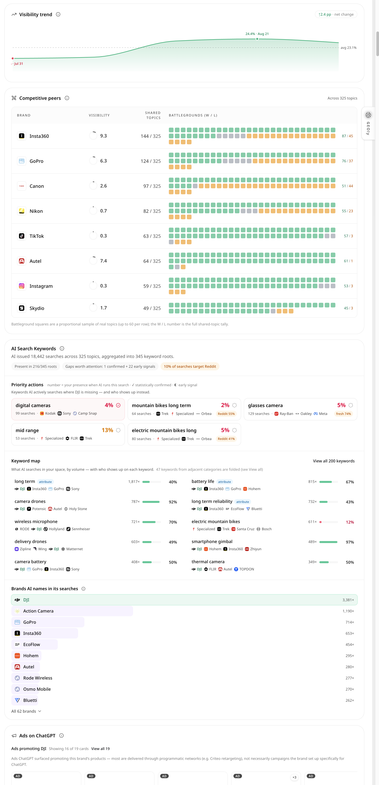

**截图怎么读：** 这张 DJI 趋势、竞品与 AI Search Keywords 图包含三组证据：Visibility trend 观察品牌可见度随时间的变化；Competitive peers 用共享 Topic 和 W/L 方格比较竞品在相同战场上的胜负；AI Search Keywords 展示 AI 检索词、词根、品牌共现和优先行动。关键词区的百分比是当前数据范围内的覆盖或出现信号，不是公开搜索引擎的精确搜索量；竞品方格是比例化样本。应先找出高价值且品牌缺席的词，再回到具体 Prompt、页面和引用制定动作。

### 2. AI 搜索：快速定位品牌、Topic、商品和可验证信号

AI 搜索提供统一的公开实体和洞察入口。收到新的竞品名称、商品机会、内容主题或客户问题时，可先搜索，再进入相应的品牌、Topic、品类或商品详情查看上下文，无需从多个菜单逐层查找。

这对代理商、增长团队和管理层尤其有价值：会议中出现的新机会可以被快速验证；月度复盘中发现的异常可以被追溯到具体实体；内容与电商团队也可以围绕同一个搜索结果协作，而不需要各自从零开始建立观察范围。

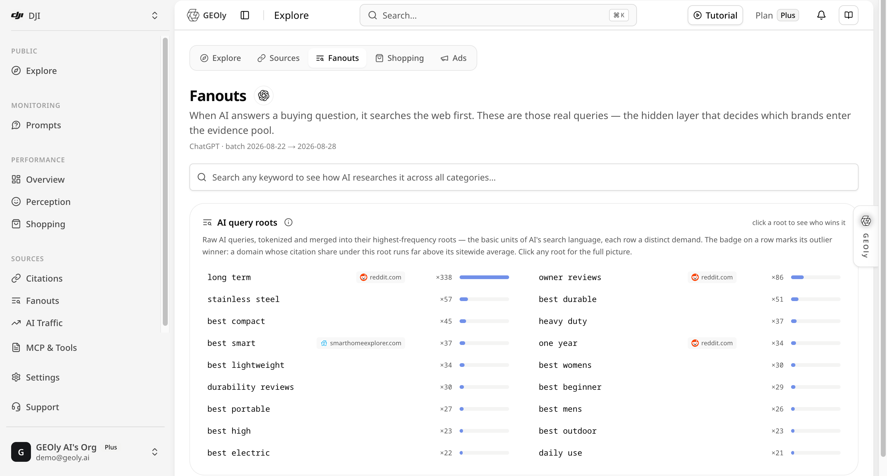

**截图怎么读：** 这张 Fanouts 图解释 AI 如何扩展购买问题：AI query roots 把原始查询归并成高频词根，每行显示一个需求方向、出现频次和代表性来源，标记项表示某个域名在该词根下的引用份额明显高于其站点平均水平。它帮助团队发现“best durable”“long term”等隐含需求和信源机会，但不是用户个人搜索记录，也不是某个平台提供的逐条真实查询日志；它是 GEOly 在所选公开数据范围内的聚合研究结果。

### 3. 信源引用：从域名进一步追到页面与影响范围

原有引用分析回答“AI 引用了谁”；最新的信源引用入口则从域名和 URL 研究来源覆盖范围、关联 Topic 及其在 AI 回答中的作用，把“要多做外链”转化为更具体的信源建设判断。

团队可以按以下顺序使用：

1. 找出高价值 Topic 中最常出现的引用域名和页面。
2. 区分自有官网、竞品官网、媒体、零售商、评测站、论坛等来源类型。
3. 进入重点来源，检查它覆盖哪些主题、支持哪些品牌叙事。
4. 决定下一步是补自有页面、改进页面结构、争取媒体评测，还是完善零售与商品渠道信息。

需要注意的是：被引用是一种重要证据，但不是唯一目标。真正有价值的是让正确、完整、可验证的信息在高意图问题里支持品牌被理解和被推荐。

## 重点七：商品详情、竞争货架与渠道分析，把 AI Shopping 从“有没有出现”推进到“为什么输赢”

AI Shopping 展示商品是否进入推荐和购物结果；最新的商品详情能力进一步把每个产品拆成可复盘的竞争、渠道、趋势和购买路径，适合商品运营、电商、DTC 和增长团队共同使用。

### 1. 商品概览：先确认商品在 AI 中的真实表现

进入商品详情后，先确认商品在回答中的出现、首位表现、可见度、关联 Topic 与趋势。目标不是制造单一排名，而是建立商品基线：哪些商品稳定出现、哪些只在少数问题中出现、哪些主推 SKU 尚未进入 AI 推荐范围。

### 2. 竞争货架与直接对比：看清楚被谁挤出推荐位

竞争货架和商品对比展示同类购买场景下哪些商品同时出现、谁更常靠前、谁是直接竞争对手。它比“品牌竞品”更贴近真实交易决策，因为用户最终比较的是具体价格、型号、评价、卖点和购买渠道。

可以重点追问：

- 哪些竞品 SKU 最常和我的商品出现在同一个问题里？
- 我们在哪些场景领先，又在哪些场景被某个特定商品替代？
- 竞争差异来自价格、卖点、评分、渠道、信息完整度，还是 AI 对产品定位的理解？

### 3. 渠道与购买路径：检查官方入口是否被正确呈现

商品被推荐不代表官方渠道一定受益。渠道分析可以帮助团队查看 AI 展示了哪些商家、链接和价格信号，进而判断官方站点、零售伙伴和第三方卖家在购买路径中的位置。

若官方商品页很少呈现、第三方渠道却频繁出现，应同时检查产品 Feed、库存与价格、结构化数据、商品页信息、渠道覆盖和落地页体验。目标不是排斥第三方，而是确保用户在 AI 做购买判断时获得准确、可用且符合品牌策略的信息。

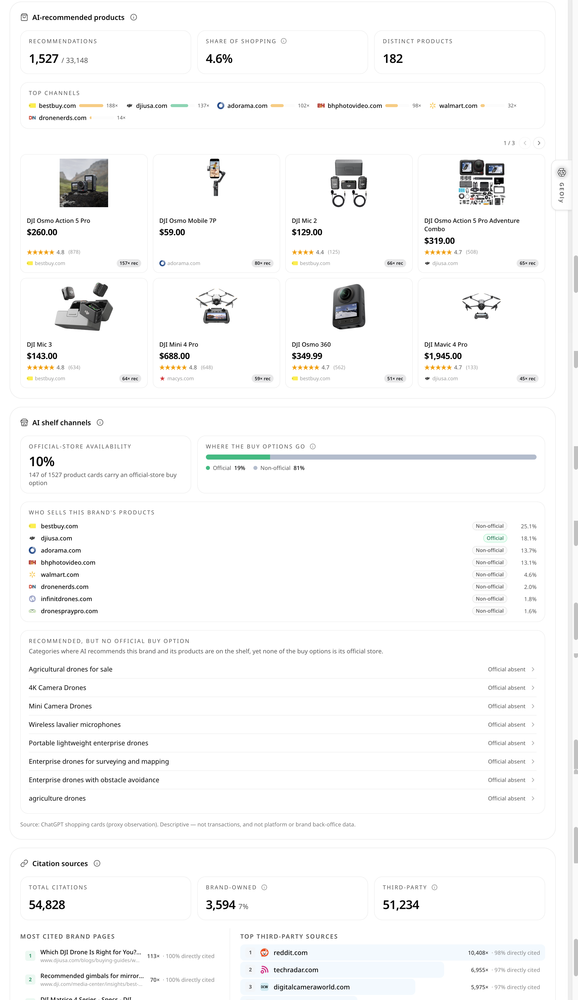

**截图怎么读：** 这张 DJI AI Shopping 与渠道图从商品推荐继续下钻到购买路径。AI-recommended products 区域展示被推荐商品、Share of Shopping 和 Distinct Products；AI shelf channels 区域区分官方与非官方购买入口，并列出哪些商家承接了品牌商品；Recommended, but no official buy option 列出已被推荐但当前没有官方购买入口的品类。底部声明它是 ChatGPT shopping cards 的代理观测，不是交易、订单、库存或品牌后台数据，因此应与 Shopify、Catalog、Feed 和一方订单数据交叉验证。

### 4. 趋势、下钻与原始回答：让每个结论都能回到证据

商品趋势和下钻视图展示变化发生的时间、驱动变化的 Topic 或问题，以及背后的原始 AI 回答。它支持页面、价格、Feed 或活动调整前后的复盘，也避免团队因短期波动过早判断“优化已经成功”或“商品已经失去机会”。

建议商品团队至少保留一组稳定的高意图问题，定期对比修改前后的出现、首位、渠道与引用变化；对于异常变化，必须回到原始回答和具体商品上下文判断原因。

## 重点八：ChatGPT Ads / 广告，把投放和 AI 可见度放在一起看

广告是 AI 搜索时代会越来越重要的部分。GEOly 中的 ChatGPT Ads 分析，更适合理解成“AI 场景里的广告机会识别和可见度补充”，而不是传统广告后台的替代品。

广告团队过去常看的指标是关键词、出价、点击、转化和受众；但在 AI 搜索中，用户的问题更像一段需求描述，AI 的回答可能同时包含自然推荐、引用、商品展示和广告触发机会。因此广告团队需要知道：

- 哪些高意图问题可能触发广告或商业展示。
- 品牌在自然回答里是否已经有优势，还是需要用广告补位。
- 竞品在哪些问题中更容易占据自然推荐和商业入口。
- 广告、内容、商品页和 AI 引用之间是否存在协同。

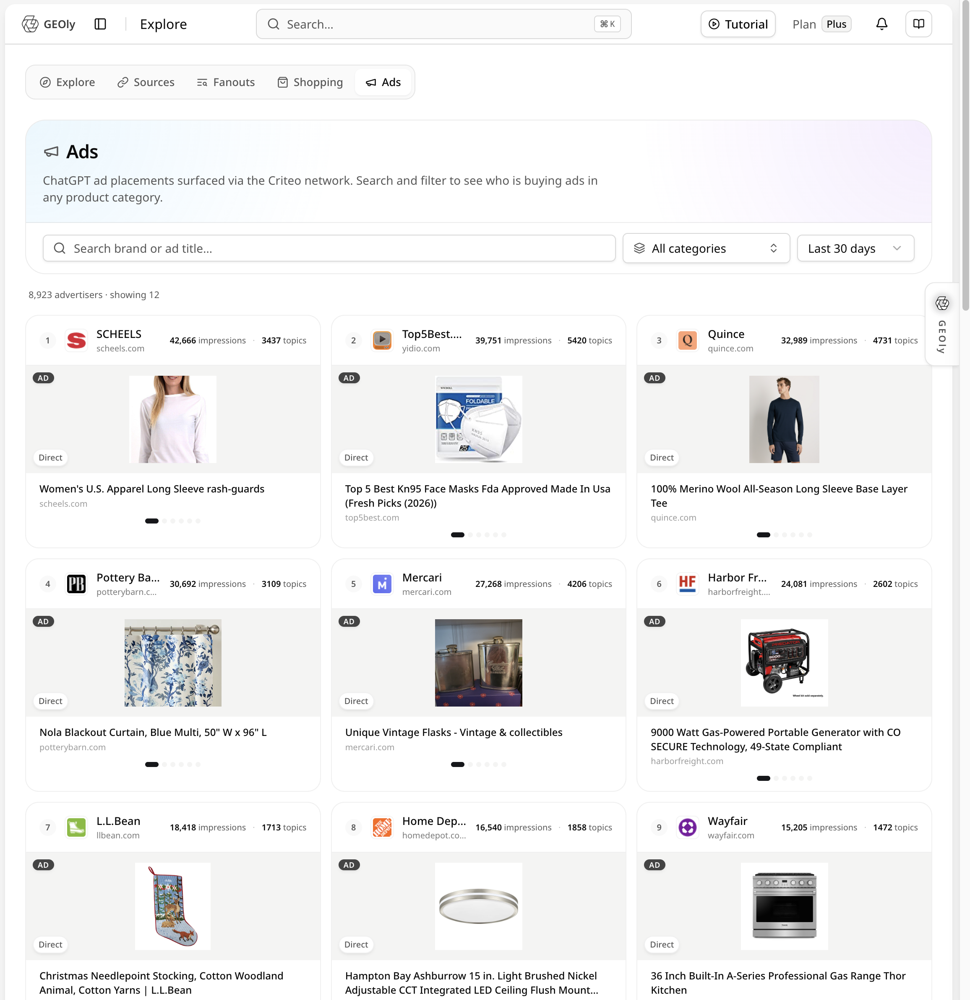

**截图怎么读：** 这张 Ads 总览图展示 GEOly 观察到的 ChatGPT 广告卡片：可以按品牌/广告标题、品类和时间范围筛选，并看到广告主、展示次数、关联 Topic 和广告创意。部分广告卡可能带有程序化网络的落地链接标记；这不代表品牌一定在 ChatGPT 后台单独创建了对应广告，也不提供广告花费、点击率或转化率。它更适合用来识别哪些购买场景存在商业竞争，再结合广告平台的一方数据决定是否投放。

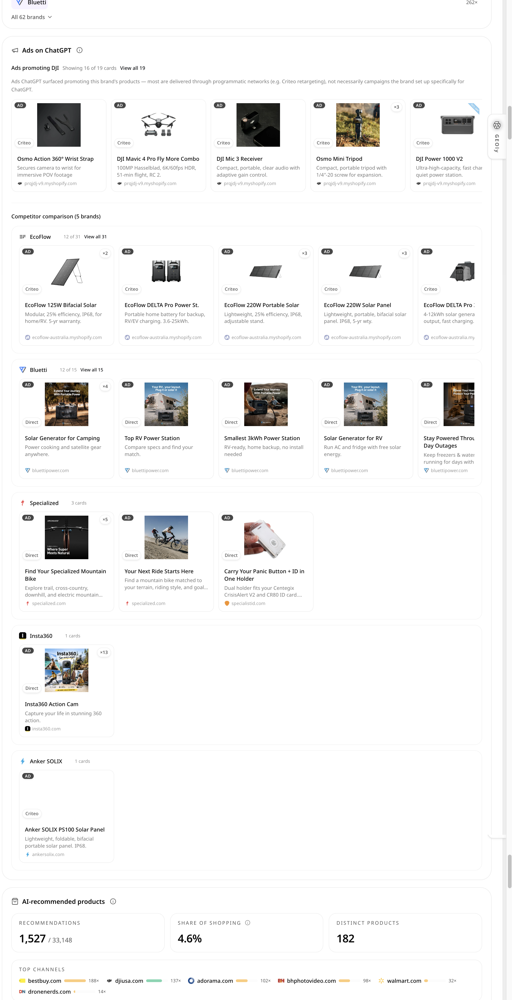

**截图怎么读：** 这张 DJI Ads 与竞品对比图把品牌广告卡片和 EcoFlow、Bluetti、Specialized、Insta360、Anker SOLIX 等竞品的广告卡片并列展示。团队可以比较创意主题、商品类型、落地域名、出现频次和竞品覆盖的场景，判断自然可见度不足时是否需要商业补位。这里的出现次数和卡片数量是 GEOly 的观测记录，不等于广告投放预算、实际曝光人数或销售结果；是否跟投仍需结合利润、受众、落地页和广告账户数据。

### 广告模块可以怎么用？

| 使用场景 | 你可以重点看什么 | 业务动作 |
|---|---|---|
| 投放前评估 | 哪些用户问题商业意图强，品牌自然可见度是否不足 | 决定优先投哪些问题和品类 |
| 投放中观察 | 观察到广告卡的相关问题下，品牌是否也有自然提及和引用 | 结合自有广告账户判断是否需要配合内容和页面优化 |
| 竞品对比 | 竞品在哪些 AI 场景中更常被推荐或占据注意力 | 找到防守和进攻问题集 |
| 页面协同 | 广告落地页是否也能被 AI 理解和引用 | 优化落地页、FAQ、商品信息和结构化数据 |

广告模块让投放从关键词扩展到 AI 场景中的真实购买问题、竞品关系和内容证据。Grow 及以上适合开始使用 AI Ads 分析；进行多平台投放和多 SKU 管理的团队，可用 Advanced、Plus 或 Enterprise 将广告洞察纳入固定增长流程。

## 重点九：AI 助手与已开通的自动化，把洞察推进到执行

当前 GEOly 页面可打开 AI 分析助手，结合当前页面信号继续追问、解释和梳理核查步骤。独立 GEO Agent、报告与自动化能力是否可用，以及任务、触发方式和配额，须以套餐、组织权限和账户内实际开通内容为准；不要把页面内助手理解成已可用的独立 Agent 工作台。

这几项能力要分开理解：

- **GEO Agent**：如账户已开通，可用于多步分析和工作流；具体入口、任务、触发器、连接器和配额以账户内实际显示为准。
- **Sidekick**：在当前 GEOly 页面上下文中继续解释和下钻，适合临时追问，不等同于独立的自动化 Agent。
- **MCP/CLI/Skills**：让外部 AI 客户端或终端按授权调用 GEOly；Skill 负责帮助 Agent 正确选工具和解释指标，不会扩大账户权限。
- **自动化报告**：如账户已开通并完成配置，可将已授权的数据整理成报告和行动清单；报告里的相关性不能直接当成流量、收入或因果证明。

建议先用自有品牌监控确认问题，再请页面内助手整理证据和行动草案；如组织已开通 Agent 或报告自动化，再按实际权限接入固定流程。写入、页面修改和预算调整仍需由负责人审核。

## 重点十：Sidekick、MCP 和 API，把洞察接进团队工作流

偶尔查看结果时，打开 GEOly 后台报表即可；需要在页面内快速解释数据、让外部 AI 助手读取授权信息或接入内部系统时，可分别使用 Sidekick、MCP 和 API。三者面向不同场景，不能混为一谈。

### Sidekick 是当前页面中的 GEO 分析助手

Sidekick 可从已支持页面右侧的入口或页面顶部按钮打开，并以侧边栏形式保持在当前页面中。它会结合当前页面及已注册区块的上下文，帮助团队解释可见信号、梳理证据、比较变化，并形成下一步可验证的问题。

Sidekick 更适合这些工作：

- 解释当前页面指标、时间范围和数据口径。
- 汇总品牌、品类、主题或商品页面中的关键信号。
- 把问题整理成核查清单、优化清单或后续分析问题。
- 在当前页面上下文中继续多轮分析。

需要注意：Sidekick 不是旧版的独立 Agent 工作区，也不代表系统已经证明了某个变化的因果关系。定时任务、导出和外部集成，应以实际开通的报告、MCP 或 API 能力为准。

### MCP 让外部 AI 助手能读取 GEOly 数据

MCP 可以理解为一种标准连接方式。对业务团队来说，不需要关注底层协议，只需要理解它解决的是“AI 助手如何安全、稳定地访问 GEOly 数据”的问题。

例如，团队可以在支持 MCP 的 AI 工具里，用自然语言询问：

- 最近 30 天品牌在 AI 回答中的整体表现如何？
- 哪些 Prompt 下竞品更容易出现？
- 哪些引用来源最常影响我们的可见度？
- 某个行业里有哪些主题值得优先补内容？
- 本周客户报告里应该重点呈现哪些变化？

客户只需要知道：MCP 让 GEOly 不再只是一个需要手动登录查看的后台，而是可以成为企业 AI 助手、客户报告系统、内部知识库和自动化流程的数据来源。

如需查看连接、授权、配置和常用调用流程，请参阅 [GEOly MCP 使用指南](/zh/developers/mcp)。

### MCP Credits 怎么理解？

GEOly MCP、GEOly CLI 及后续开放 API 共用同一个 MCP Credits 额度池和计费规则；具体 API 是否开放、接口范围和配额以套餐、实际授权和调用回执为准。MCP Credits 与用于产品内 AI 分析的 AI Credits 相互独立，使用其中一项不会直接扣减另一项。客户可以先记住下面四条：

- **读取自有品牌数据不消耗 MCP Credits**：包括品牌可见度、Prompt 记录、引用来源、竞品追踪、平台矩阵和网站审计等订阅内数据；添加 Prompt、管理竞品等写操作，以及查询额度、组织和品牌等基础能力也不扣 MCP Credits。
- **只有部分公开行业情报分析会消耗 MCP Credits**：计费工具包括跨品牌榜单、品类分析、品牌对比、公开查询需求指标和行业机会研究。获得“信源”读取权限后，三个公开信源工具不扣 MCP Credits；公开实体、Locale 和可用平台等发现工具本身也不扣 MCP Credits，但需 Grow 及以上套餐并获得“公开数据”读取权限。
- **按实际返回的数据量计费**：返回越少，消耗越少；失败、超时或预留额度释放等具体情况以调用回执为准。汇总概览通常按一次结果计费，列表和深度分析则根据实际返回条数及工具档位计算。
- **额度由整个组织共享**：同一组织的所有成员共用一个订阅周期额度池，多买席位不会增加额度；每次计费调用都会显示本次消耗和剩余额度，也可以随时查询重置时间。

| 套餐 | 每月 MCP Credits | 客户需要知道的重点 |
|---|---:|---|
| Basic | 3,000 | 自有品牌监控、写操作、额度查询和获授权的三个免费公开信源工具仍可使用；Explore、Category、Sources 等行业数据页面对有效付费套餐开放，公开行业 MCP 工具需 Grow 及以上 |
| Grow | 25,000 | 适合常规行业研究和单品牌增长分析 |
| Advanced | 75,000 | 适合更高频的多平台、深度行业分析 |
| Plus | 200,000 | 适合多品牌、多市场或较大规模自动化 |
| Enterprise | 不限量 / 按方案 | 适合代理机构批量分析和企业自动化管线 |

MCP Credits 按组织共享的月度额度周期重置，重置时间以 get_quota 返回的 resets_at 为准，未用额度不结转。额度用完后，自有品牌数据、写操作和当前套餐内的免费工具仍可使用；只有计费的公开行业工具暂停。定价页另列有每月 MCP tool calls 上限；它表示调用次数边界，不等同于按返回条数计算的 MCP Credits。升级套餐后，新额度档位即时生效；实际余额、单次消耗、调用次数和费率以产品内额度查询及调用回执为准。

### API 更适合需要系统集成的团队

Enterprise 提供定制配置、专属支持、API 访问和 SLA 保障。团队可通过 API 将 GEOly 数据接入报告、BI 或自动化平台；具体接口范围、配额和实施方式以企业方案实际开通内容为准。

### 套餐里的连接能力怎么理解？

| 阶段 | 更常见的需求 | 推荐理解 |
|---|---|---|
| Basic | 建立第一批监控；MCP 能力以账户中实际显示和授权为准 | 先跑出 AI 可见度基线，再决定是否接入外部 AI 助手 |
| Grow | 解锁公开行业工具、更多平台线索、ChatGPT Ads 和更高 MCP 使用额度 | 从品牌监控扩展到行业研究和增长分析 |
| Advanced | 4 个平台、100 个 Prompt、每月 12,000 条响应、每月 30,000 AI Credits（按月额度，周期以账户为准）、4 个席位和优先支持 | 在 Grow 的 MCP、报告等连接能力基础上，适合需要更完整多平台监控的单品牌团队 |
| Plus | 5 个品牌、全部 6 个平台、500 个 Prompt、每月 90,000 条响应、每月 100,000 AI Credits（按月额度，周期以账户为准）、10 个席位和优先支持 | 继承 MCP、报告等连接能力，适合多品牌团队规模化协作 |
| Enterprise | 定制配置、专属支持、API 访问和 SLA 保障 | 按企业实际需求确定配额、接口和服务范围 |

## 关键指标应该怎么理解？

GEOly 中有几个指标很重要，但它们回答的问题不同。客户在解读报告时，建议先区分“绝对表现”和“相对表现”。

| 指标 | 主要回答的问题 | 解读方式 |
|---|---|---|
| AIGVR | 品牌在 AI 回答中的综合可见度强不强 | 越高说明品牌被提到、位置、频次和引用等综合表现越好 |
| 提及率 | AI 回答里有没有提到品牌 | 适合判断覆盖面，尤其适合看 Prompt 和平台盲区 |
| 引用率 | AI 是否引用品牌相关页面或信源 | 适合判断官网、商品页、内容页是否进入 AI 的证据链 |
| SoM | 在同场景品牌中，我占多少相对份额 | 适合做竞品对比，但不能替代绝对可见度 |
| 情感倾向 | AI 对品牌描述是正面、中性还是负面 | 适合发现品牌认知偏差和卖点机会 |
| 购物推荐表现 | 商品是否进入 AI 推荐、价格和链接是否完整 | 适合电商团队判断 AI 购物链路机会 |
| 广告机会信号 | 哪些高意图问题可能适合商业展示或投放补位 | 适合广告团队判断自然可见度和付费动作的配合 |

常见误区是只看排名、不看分数。某品牌即使在一组竞品中排名第一，整体 AIGVR 仍可能不高；这只是“相对领先”，不代表 AI 渠道建设充分。复盘时应同时看绝对分数、竞品差距，以及具体 Prompt 和页面证据。

### 数据口径与边界

GEOly 各模块的数据范围不同：Industry Intelligence（行业情报）、Explore 等行业洞察用于研究公开行业数据；Analysis、Monitoring 等品牌分析基于当前账号配置的监控品牌、Prompt、平台、市场和时间范围。Industry Intelligence、Explore、AI Commerce Surface 主要呈现 GEOly 采集的公开行业数据快照；Monitoring、Prompts、Analysis、Shopping 主要呈现当前组织范围内的监测或产品数据。两类数据可互相参照，但不能视为同一口径；首页的行业计数、AI 提及和购物卡计数会随数据更新变化，也不能用来反推某个客户的流量、收入或市场份额。

部分公开品牌、品类和报告页面会展示“AI 流量/营收估算”。这些数值由 AI 查询需求、品牌在主题中的 SoM、商品价格等模型输入计算，并可能使用 GT、manual 或 fallback 校准；它们是方向性估算，不是 GEOly 直接读取的第一方访问或订单流水。提及、引用、位置、AIGVR、SoM、购物卡或广告机会信号，只代表当前数据范围内观察到的 AI 表现，不能单独证明真实流量、点击、转化、收入、广告支出或因果关系。品牌、商品或页面未出现，也可能受时间范围、平台覆盖、监控问题、市场语言或数据可用性影响。涉及预算、页面改版和商品策略等经营决策时，应结合网站分析、广告平台、CRM、Shopify 等第一方数据验证。

## 套餐不同，体验有什么不同？

GEOly 的套餐不是简单地把功能拆开，而是对应不同阶段的团队需求。可以把套餐理解成从“单品牌验证”到“多品牌、多平台、Sidekick 辅助和企业级协作”的逐级扩展。

具体价格和权益可能会根据官网更新调整，实际以 [GEOly Pricing 页面](https://www.geoly.ai/zh/pricing) 为准。下面用客户视角说明不同套餐更适合什么体验。

| 套餐 | 更适合的客户阶段 | 体验重点 | 典型使用方式 |
|---|---|---|---|
| Basic | 单品牌刚开始验证 AI 可见度 | 1 个品牌、ChatGPT、30 个 Prompt、每月 900 条响应、每月 3,000 AI Credits（按月额度，周期以账户为准）、1 个席位和 3 天免费试用；默认每月 3,000 个组织级 MCP Credits；公开行业工具需 Grow 及以上 | 建立第一批监控，确认品牌在 AI 中的基线 |
| Grow | 已经开始重视 AI 搜索渠道的增长团队 | 1 个品牌、2 个平台、50 个 Prompt、每月 3,000 条响应、每月 10,000 AI Credits（按月额度，周期以账户为准）、2 个席位，以及 ChatGPT Ads、在线客服和行业 MCP 工具；月度报告以账户实际开通为准 | 从品牌监控扩展到跨平台比较、广告洞察和行业研究 |
| Advanced | 需要更完整多平台监控的单品牌团队 | 1 个品牌、4 个平台、100 个 Prompt、每月 12,000 条响应、每月 30,000 AI Credits（按月额度，周期以账户为准）、4 个席位和优先支持；GEO Agent 以实际开通为准 | 扩大 Prompt 与平台覆盖，并在 Agent 功能已开通时将其纳入持续监控流程 |
| Plus | 多品牌或成熟增长团队 | 5 个品牌、全部 6 个平台、500 个 Prompt、每月 90,000 条响应、每月 100,000 AI Credits（按月额度，周期以账户为准）、10 个席位和优先支持 | 适合多品牌集团和跨团队规模化监控 |
| Enterprise | 企业级或复杂组织 | 定制配置、专属支持、API 访问和 SLA 保障 | 适合需要定制配额、系统集成和明确服务保障的团队 |

> **套餐快照（以当前定价页为准）**：月付页面当前显示 Basic $49、Grow $149、Advanced $399、Plus $999；Enterprise 为联系销售的定制方案。年付页面显示节省 10%。Basic 为单品牌起步，Grow 增加第二个平台、ChatGPT Ads 和行业 MCP，Advanced 增加四个平台，GEO Agent 以实际开通为准；Plus 支持五个品牌、六个平台，自动化以实际开通为准；API 能力以当前定价页、账户权限和实际开通内容为准；Enterprise 的品牌数、席位、响应量、Credits、API、Webhooks、SLA 和部署方式按合同确定。价格和权益会调整，实际以 [GEOly 定价页](https://www.geoly.ai/zh/pricing) 与账户内显示为准。

> **历史数据边界**：公开行业洞察页面当前提供 30 天、60 天和 90 天窗口；90 天窗口需要 Advanced 及以上套餐，Basic/Grow 可使用 30 天和 60 天。品牌 Prompt 监控、公开工具和 API 可能采用独立时间窗；Prompt 列表和详情可按页面提供的 2/7/30/90/180 天或自定义范围查看，公开行业 90 天窗口的套餐门槛不等同于 Prompt 详情的时间范围。定价页另列的“365 天历史”需按具体页面口径理解，不能直接视为所有模块都能查询 365 天；最终以页面实际可选范围、账户权限和调用回执为准。

> **AI Credits 说明**：定价页当前展示 Basic/Grow/Advanced/Plus 每月分别为 3,000/10,000/30,000/100,000 AI Credits；AI Credits 是产品内 AI 功能使用的独立额度池，具体消耗以账户和调用回执为准；额度按月归属，并与 MCP Credits 分开计量。不要把 AI Credits 直接等同于 API 或 MCP 配额；实际可用功能、余额和结算以账户页面与调用回执为准。

### 套餐差异详解：从验证到规模化运营

下面按“能监控什么、能分析多深、能否接入团队流程”说明各套餐的差异。固定数量是当前版本的套餐快照；价格、可用平台和功能开关可能调整，最终以定价页和账户内实际显示为准。

#### Basic：先验证单品牌是否被 AI 看见

- **监控范围**：1 个品牌、ChatGPT、30 个 Prompt、每月最多 900 条响应、1 个席位。
- **适合任务**：建立品牌在 AI 回答中的第一条基线，确认哪些核心问题没有提到品牌，检查官网和商品页是否被引用。
- **数据边界**：Basic 默认每月有 3,000 个组织级 MCP Credits，但公开行业发现与行业情报工具仍需 Grow 及以上及相应权限；Basic 主要用于自有品牌监控、获授权的免费信源能力和其他当前套餐内工具。AI Credits 是独立的按月额度池，Agent 推理等实际消耗、余额和结算以账户页面与调用回执为准。
- **适合升级的信号**：需要第二个平台、行业竞品对比、ChatGPT Ads、月度报告或多人协作时，进入 Grow 更合适。

#### Grow：把监控扩展到增长动作

- **监控范围**：1 个品牌、2 个平台、50 个 Prompt、每月最多 3,000 条响应、2 个席位。
- **新增能力**：ChatGPT Ads、在线客服和公开行业 MCP 工具；月度报告以账户实际开通为准，可开始做跨平台比较、行业研究和广告机会判断。
- **额度与历史**：每月 25,000 MCP Credits，由组织共享；计费的公开行业工具按返回行数扣减。公开行业洞察可使用 30 天和 60 天窗口；90 天窗口需要 Advanced 及以上，同时可以使用已开通的 Ads、MCP 和报告能力。
- **适合升级的信号**：需要 3 至 4 个平台、更大 Prompt 覆盖或更长历史趋势时，考虑 Advanced；超过 4 个平台应评估 Plus。Agent 能力以账户实际开通为准。

#### Advanced：做更完整的单品牌多平台分析

- **监控范围**：1 个品牌、4 个平台、100 个 Prompt、每月最多 12,000 条响应、4 个席位。
- **新增能力**：更完整的平台覆盖和更长的历史观察；GEO Agent 以账户实际开通为准，适合将 Prompt 质量、竞品差距和内容优化纳入持续流程。
- **额度与历史**：每月 75,000 MCP Credits，由组织共享；可查看近 90 天历史区间。AI Credits 仍以实际开通和调用回执为准。
- **适合升级的信号**：需要同时管理多个品牌、更多市场或更大规模团队协作时，考虑 Plus。

#### Plus：面向多品牌和规模化协作

- **监控范围**：5 个品牌、6 个平台、500 个 Prompt、每月最多 90,000 条响应、10 个席位。
- **新增能力**：在 Advanced 基础上扩大品牌、平台、Prompt 和响应规模，适合集团、多市场和跨团队统一监控。
- **额度与接口**：每月 200,000 MCP Credits，由组织共享；定价页另列“365 天历史”说明；当前公开页面的可查询窗口以实际页面为准，不能据此承诺所有模块都能查询 365 天。标准 API 是否可用、接口范围和配额以当前定价页、账户权限和实际开通内容为准，不要把 Plus 的 API 视为无需开通的固定权益。
- **适合升级的信号**：需要定制配额、Webhooks、私有部署、SLA 或复杂内部系统集成时，评估 Enterprise。

#### Enterprise：按组织需求定制

- **监控与协作**：品牌数、Prompt 数、响应量、席位和平台范围按合同或实际方案配置。
- **企业能力**：可按方案提供定制 API、Webhooks、SLA、私有部署、专属支持和定制数据服务。
- **额度与历史**：AI Credits、MCP Credits、调用次数和历史范围均以企业方案实际开通内容为准；组织成员仍应以账户内余额、权限和调用回执为准。
- **适合客户**：需要安全审查、系统集成、多个业务单元协作，或希望把 GEOly 纳入长期数据与增长流程的企业。

### 选档时最值得核对的边界

- **覆盖范围**：品牌数、平台数、Prompt 上限和每月响应量分别限制不同维度；Advanced 最多 4 个平台，超过 4 个应评估 Plus。
- **历史范围**：公开行业 90 天窗口需要 Advanced 及以上，但不意味着所有品牌监测页面共享该门槛。
- **连接能力**：行业 MCP 从 Grow 起；API、报告、Agent 与自动化的可用入口、权限和配额以账户实际开通为准。
- **两个额度池**：AI Credits 与 MCP Credits 分开，MCP Credits 的月度档位及计费边界见“重点十”。

### 配额与服务信息如何核对？

除套餐概览中的品牌、平台、Prompt 和响应量外，定价页还可能展示分析次数、AI Shopping、报告频率、MCP tool calls 和支持响应时间。这些是不同计量维度，不应把产品内分析次数、MCP 调用次数、按返回量扣减的 MCP Credits 和 Agent 推理使用的 AI Credits 混作同一个额度。具体余额、可用入口、历史范围和服务承诺以账户页面、调用回执与合同为准。

### 为什么套餐会影响使用体验？

套餐差异会直接影响四件事。

1. **看得有多广**：平台越多，越能发现不同 AI 引擎之间的差异。只看单一平台适合起步，但成熟团队通常需要跨平台判断。
2. **看得有多细**：Prompt 数、响应量和分析配额越高，越适合覆盖更多产品线、国家、语言、场景和竞品问题。
3. **能不能自动化**：MCP、Sidekick、API、报告和集成能力越完整，越适合把数据接入团队日常工作，而不是停留在手动查看。
4. **支持是否匹配组织复杂度**：从邮件支持到优先支持、专属客户成功和企业 SLA，本质上对应团队对响应速度、复盘深度和落地协作的要求。

因此，选套餐时不建议只问“哪个最便宜”或“哪个功能最多”，更建议先问：我们现在是想验证 AI 可见度，还是已经准备把 GEO 变成日常增长流程？

### 🧾 Invoice 获取提示

> 如需获取 Invoice，请查看订阅时填写的邮箱。发票是否自动发送及其获取方式，以账户账单页和订阅邮件为准；未收到时可联系支持。

## 角色画像：不同团队应该如何理解 GEOly？

为了让客户更快判断“GEOly 和我有什么关系”，可以先把使用者分成几类角色。不同角色看到的是同一套 AI 可见度数据，但关注点、判断方式和后续动作并不一样。

| 角色画像 | 最关心的问题 | 应重点看的 GEOly 能力 | 典型动作 | 常见套餐阶段 |
|---|---|---|---|---|
| 品牌负责人 / CMO | AI 是否正确理解品牌定位？竞品是否正在抢占心智？ | 品牌可见度、情感分析、行业洞察、竞品对比 | 判断品牌在 AI 时代的市场位置，制定内容、PR 和投放优先级 | Grow / Advanced / Plus |
| 增长负责人 | 哪些 AI 问题最接近转化？自然可见度和付费补位怎么配合？ | Prompt 监控、ChatGPT Ads、竞品矩阵、Sidekick 分析 | 把高意图问题拆成投放、内容和落地页优化任务 | Grow / Advanced |
| SEO / 内容负责人 | AI 为什么引用别人而不是我们？哪些主题需要补内容？ | 引用来源、页面级引用、主题覆盖、行业洞察 | 优化官网、FAQ、对比页、评测内容和结构化信息 | Basic / Grow / Advanced |
| 电商 / DTC 运营 | 商品有没有进入 AI 推荐？购物卡、SKU、价格和评价是否完整？ | AI Shopping、Top Products、Appearance History、商品页引用 | 优化 Catalog、商品页、价格带、Feed、评价和卖点表达 | Grow / Advanced / Plus |
| 广告 / 投放团队 | 哪些 AI 场景值得投？广告是否需要补自然可见度缺口？ | ChatGPT Ads、购物意图 Prompt、竞品曝光、落地页协同 | 从关键词投放扩展到 AI 问题场景投放，并与内容团队联动 | Grow / Advanced |
| 代理商 / 咨询团队 | 如何为多个客户稳定交付 GEO 诊断、月报和优化建议？ | 代理商工作台、行业洞察、多品牌管理、Sidekick、MCP、报告工作流；Enterprise 可扩展 API | 建立标准化客户诊断框架、月报模板和多品牌看板 | 需单独开通代理商权限 |
| 数据 / 技术 / AI Ops 团队 | GEOly 数据如何进入内部系统和 AI 助手？ | MCP、Sidekick；API 能力按套餐与实际开通情况提供 | 将 AI 可见度数据接入 AI 助手；通过已开通的 API 或 Enterprise 定制 API 接入 BI 或内部系统 | Basic 是否显示 MCP 及可用工具以账户实际授权为准；公开行业 MCP 需 Grow 及以上；API 接口、配额和级别以套餐与实际开通为准 |
| 创始人 / 管理层 | AI 搜索会不会影响未来增长？现在投入优先级高不高？ | AIGVR、行业位置、竞品差距、套餐路线 | 用少量核心指标判断机会、风险和团队投入方向 | Basic / Grow / Enterprise |

### 品牌负责人：关注“AI 如何讲述我”

品牌负责人不应只看单个 Prompt 得分，更要判断 AI 是否把品牌放在正确位置：描述为高端、性价比、专业、适合新手、可持续，还是与错误品类、过时信息或负面印象绑定。

这一类角色应该重点看品牌可见度、情感分析、行业洞察和竞品对比。真正有价值的输出，是知道哪些品牌叙事已经被 AI 接收，哪些定位还没有进入 AI 的证据池，以及哪些竞品正在占据更有利的心智位置。

### 增长负责人：关注“哪些问题能带来机会”

增长负责人不仅关心品牌是否出现，更关心哪些 AI 问题最接近转化。例如“best product for...”“A vs B”“is this worth it”“affordable alternative”等问题，通常比泛泛的品牌提及更有商业价值。

重点看 Prompt 监控、ChatGPT Ads、AI Shopping、竞品差距和 Sidekick 分析。把 AI 问题分成自然可见度、广告补位、内容补位和商品页优化机会，再交给对应团队执行。

### SEO / 内容负责人：关注“AI 信任哪些证据”

SEO 和内容团队可从引用来源入手。AI 回答引用谁，通常反映其对内容结构、权威信号和信息完整度的信任。如果 AI 常引用竞品、媒体或零售商，却很少引用品牌官网，说明内容和信源建设仍有空间。

这类角色应该重点看引用来源、页面级引用、主题覆盖和行业洞察。输出不应该只是“写更多文章”，而是明确哪些页面需要补 FAQ、对比表、参数说明、真实评价、结构化数据、外部评测或权威背书。

### 电商 / DTC 运营：关注“商品有没有进入 AI 货架”

电商团队需要把 GEOly 当成 AI 购物货架的观察工具。商品是否被推荐、是否进入购物卡、价格是否准确、SKU 是否完整、评价和标签是否被 AI 识别，都会影响用户在 AI 对话中的购买判断。

重点看 AI Shopping、Top Products、Appearance History 和商品页引用。行动通常落在 Catalog、Feed、商品页、评价、价格带、库存、图片和卖点表达上，而不只是内容文章。

### 广告 / 投放团队：关注“哪些 AI 场景需要付费补位”

广告团队在 GEOly 里看的不是传统关键词排名，而是 AI 场景里的商业问题。某些问题自然可见度已经很强，适合用内容和引用继续巩固；某些问题竞品强、自然覆盖弱、购买意图高，就可能需要广告补位。

这类角色应该重点看 ChatGPT Ads、购物意图 Prompt、竞品曝光和落地页协同。更成熟的做法，是让广告、内容和电商团队围绕同一批 AI 高意图问题协作，而不是各自看各自的数据。

### 代理商 / 咨询团队：关注“如何规模化交付客户价值”

代理商最需要的是可复用的方法论。GEOly 可以帮助代理商把客户诊断拆成固定步骤：品牌基线、行业位置、竞品差距、引用来源、内容机会、电商机会、广告机会、月度变化和下一步动作。

重点看代理商工作台、行业洞察、多品牌能力、Sidekick、MCP 和报告工作流；需要 API 或复杂集成时再评估 Enterprise。Plus 或 Enterprise 不会自动提供代理商工作台，代理商权限须单独申请并开通。

#### 代理商工作台能管理什么？

GEOly 为已开通代理商权限的账号提供独立的代理商工作台。代理商可以在品牌工作台与代理商工作台之间切换，用同一套账户管理多个已绑定的客户组织。

- **代理商总览**：查看已绑定组织、订阅组织、近 30 天新增、成员总数、近期绑定和当前余额。
- **邀请链接与注册线索**：生成带来源标签的商家注册链接、绑定链接或绑定码，并跟进客户注册、品牌创建和代理商绑定进度。
- **已绑定组织管理**：按组织、品牌、Owner 邮箱或套餐搜索客户，查看组织内的品牌、成员、套餐和绑定时间。
- **套餐分配与余额**：为已绑定组织选择套餐档位和计费周期，并使用代理商余额完成套餐分配。

代理商工作台只显示与当前代理商有效绑定的客户组织。绑定主体是客户组织，不是单个账号或品牌；只有客户组织的 Owner 或 Admin 可发起绑定。同一组织同时只能绑定一个代理商；已有有效自费订阅的组织须先处理订阅迁移，才能切换为代理商托管。

代理商绑定只影响后续的管理与结算归属，不会回溯改变历史数据。完整的邀请、绑定、套餐分配和权限说明，请参阅 [GEOly 代理商操作手册](/zh/platform/geo-agency)。

### 数据 / 技术 / AI Ops 团队：关注“如何接入系统”

当组织希望把 GEOly 数据放进内部 BI、自动报告、AI 助手、飞书/Slack/Notion、客户工作台或自有系统时，数据和技术团队就会成为关键角色。

重点看 MCP、Sidekick、权限能力和 API。MCP 让 AI 助手用自然语言读取 GEOly 数据；已开通的 API 可用于支持的系统接入，Enterprise 则根据方案提供定制 API、Webhooks、配额和服务保障；具体接口范围和实施方式以套餐与实际开通内容为准。Sidekick 用于在当前页面上下文中继续分析。

### 管理层：关注“这是不是值得投入的新增长层”

管理层不需要一开始就看所有细节，但需要快速判断三件事：品牌在 AI 搜索里有没有风险、竞品是否已经领先、投入 GEO 是否能影响内容、广告、电商和品牌认知。

重点看 AIGVR、提及率、引用率、行业位置、竞品差距和套餐路线。验证阶段可从 Basic 或 Grow 建立基线；若公司已将 AI 搜索作为长期渠道，应更早考虑 Advanced、Plus 或 Enterprise 的跨团队协作和自动化能力。

## 不同客户应该重点看哪些模块？

| 客户类型 | 优先模块 | 推荐关注点 |
|---|---|---|
| 单品牌起步团队 | 品牌可见度、引用、情感 | 先建立 AI 可见度基线，找到 0 覆盖问题和错误描述 |
| 电商/DTC 团队 | AI Shopping、引用、广告、品牌监控 | 看 SKU 是否被推荐，商品卡是否出现，价格和商品信息是否完整 |
| 成熟增长团队 | 行业洞察、竞品、广告、Sidekick | 把 AI 搜索纳入周报、投放、内容和竞品复盘 |
| SEO/内容团队 | 引用、主题覆盖、行业洞察 | 找到 AI 信任的页面类型和内容缺口 |
| 代理商 | 代理商工作台、行业洞察、多品牌、Sidekick、MCP 和报告 | 为多个客户建立标准化诊断、月报和服务交付；如需 API，评估 Enterprise |
| 企业客户 | Enterprise、MCP、API、定制配置、SLA | 接入内部系统，并按企业方案确定配额与服务保障 |

## 一条推荐的使用路径

如果你是第一次把 GEOly 纳入业务流程，可以按下面路径理解和推进。

### 第一步：建立品牌和业务范围

先明确要监控的品牌、官网、产品线、重点市场、语言和核心竞品。不要一开始就铺太广，优先覆盖最影响收入和认知的场景。

### 第二步：设计高价值 Prompt

Prompt 不只是关键词，而是用户真实会问 AI 的问题。建议覆盖五类：品牌认知、品类推荐、竞品对比、购买决策、售后信任。

### 第三步：查看监控结果和关键指标

先看总体 AIGVR、提及率、引用率和趋势，再进入具体 Prompt 查看 AI 原始回答。不要只看一个总分，要回到具体问题里理解原因。

### 第四步：进入行业洞察和竞品分析

当品牌基线建立后，再看行业、子品类、竞品榜单、AI 行为模式、引用来源和主题覆盖。这样团队不会只围绕自己做判断，而是能看到整个市场的机会和风险。

### 第五步：把电商、广告和内容动作拆开

如果问题出在商品推荐，就优先看 SKU、商品卡、价格带和 Catalog；如果问题出在品牌自然可见度，就优先看内容和引用来源；如果问题出在高意图问题的曝光不足，就让广告团队一起评估投放补位。

### 第六步：用 Sidekick、MCP 或 API 固化流程

当复盘变成固定节奏，就可以把 GEOly 数据接入报告、飞书/Slack/Notion、BI、内部智能体或客户交付系统。这个阶段的目标是减少人工整理，让团队更快从信号进入动作。

## 常见误区

### 误区一：只看 AI 有没有提到品牌

提到只是第一步。更关键的是：AI 把你放在什么位置、怎么描述你、有没有引用你、是否推荐竞品、回答是否接近购买决策。

### 误区二：把 GEO 当成传统 SEO 的换皮

GEO 和 SEO 有交集，但不完全一样。SEO 更关注搜索结果页，GEO 更关注 AI 答案里的语义、证据和推荐逻辑。一个页面排名高，不代表它一定会被 AI 引用。

### 误区三：只看排名，不看绝对分数

排名是相对概念。如果所有品牌的分数都很低，排名第一也可能说明整个品类在 AI 中还没有被充分建设。复盘时要同时看 AIGVR、提及率、引用率和具体回答证据。

### 误区四：以为套餐只是功能多少的差别

套餐差异会影响监控覆盖面、平台广度、分析深度、可连接的工作流、支持节奏和组织协作方式。一个刚起步的单品牌团队，和一个管理多品牌多市场的团队，需要的不是同一种 GEO 工作流。

### 误区五：把电商和广告交给单独团队孤立处理

AI Shopping、广告、内容和引用来源其实是同一条用户决策链路。商品没有进入购物卡，可能不只是商品运营问题；广告需要补位，也可能是自然可见度和页面证据不足导致的。

### 误区六：只做一次诊断

AI 平台、网页内容、竞品动作、商品信息和用户问题都会变化。GEO 更适合做持续监控，而不是一次性审计。

## 什么时候说明 GEOly 已经开始产生价值？

你可以从这些信号判断 GEOly 是否真正进入业务流程：

- 团队知道哪些高价值问题中品牌没有被 AI 提到。
- 团队能解释为什么某些竞品更容易被 AI 推荐。
- 团队知道哪些页面、域名和第三方信源正在影响 AI 回答。
- 电商团队能看到哪些 SKU 进入购物卡，哪些商品信息需要补齐。
- 广告团队能把高意图 AI 问题纳入投放和落地页评估。
- 内容、SEO、PR、电商和产品团队能围绕同一批 AI 证据做优化。
- 月报或周报不只展示分数，还能给出明确下一步动作。
- 随着套餐升级，团队可以从“看数据”逐步进入跨平台监控，并在对应报告、MCP 或 API 能力已开通和完成配置后，将洞察接入 Sidekick、外部 AI 助手或系统工作流。

## 总结

GEOly 的核心价值，是让品牌在 AI 搜索和 AI 商务时代重新掌握可见度、认知和信源的管理方式。

它帮助你回答：AI 是否知道我？是否正确描述我？是否引用我的页面？竞品为什么更容易出现？哪些内容、商品信息、广告场景和行业机会应该优先处理？我的团队应该从哪个套餐、哪个工作流开始？

对起步团队，GEOly 是 AI 可见度诊断工具；对增长团队，它是跨平台监控、行业洞察、电商和广告分析工作台；对成熟组织，它还能成为连接 Sidekick、MCP、API、报告、集成和客户成功流程的 GEO 运营层。

选择 GEOly 的重点，不只是选择一个工具，而是建立一套面向 AI 答案、AI 推荐、AI 购物和 AI 广告的新型品牌增长机制。
