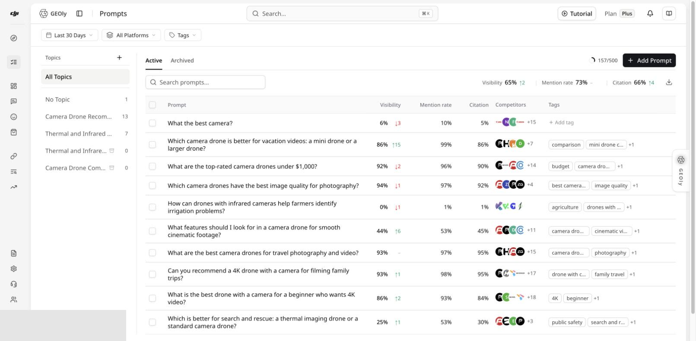
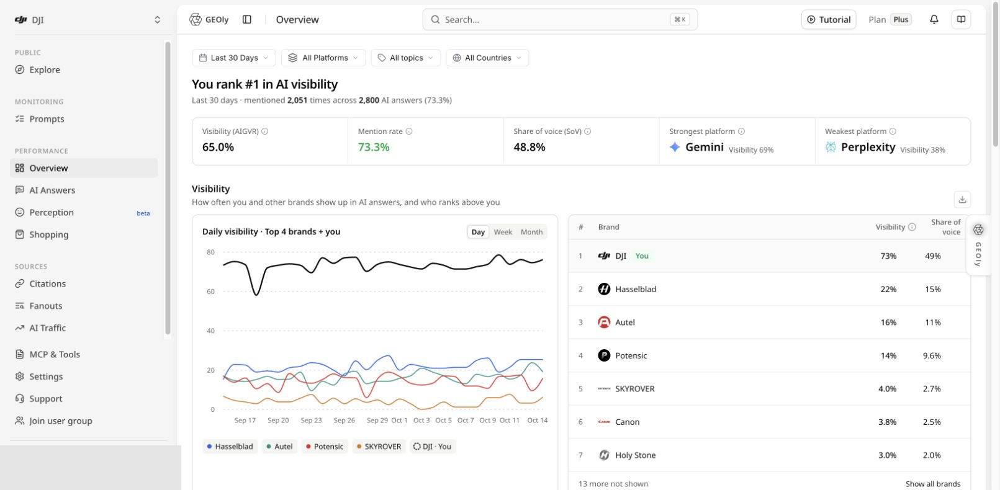

打开 [GEOly 注册页面](https://app.geoly.ai/auth/register)创建账号。GEOly 目前提供三种注册方式：

- **使用 Google 注册**
- **使用 GitHub 注册**
- **使用邮箱注册**，填写姓名、企业邮箱和密码

提交后显示的页面会根据注册方式、验证设置、邀请链接和账号状态有所不同。

## 注册前准备

请提前准备：

- 用于邮箱注册的**企业邮箱**。GEOly 的邮箱注册不接受个人消费类邮箱域名。
- 如果使用社交账号注册，请准备好要连接的 Google 或 GitHub 账号。
- 如果同事或代理商邀请你加入组织，请准备好邀请链接。
- 只有在他人提供邀请码时才填写邀请码。邀请码用于记录注册来源，不会授予你访问组织、品牌或私有数据的权限。

## 创建账号

1. 打开 [GEOly 注册页面](https://app.geoly.ai/auth/register)。
2. 选择注册方式：
   - **Google 或 GitHub**：选择对应账号并完成授权。
   - **邮箱**：填写姓名、企业邮箱和密码。邀请码为选填项。
3. 提交注册表单。
4. 如果 GEOly 要求验证邮箱，请打开验证邮件并点击其中的链接。如果没有收到，请检查垃圾邮件或广告邮件文件夹。
5. 如果验证后没有自动跳转，请返回 GEOly 并登录。

验证邮件还在发送过程中时，不要反复提交注册表单。如果重新请求验证邮件，请使用最新的一封邮件。

## 如果你收到了组织邀请

请先打开原始邀请链接，再注册或登录。组织邀请链接会携带组织上下文，与普通邀请码不同。

加入组织后：

1. 在组织切换器中确认当前组织。
2. 确认当前选择的品牌。
3. 修改品牌设置或监测配置前，先确认自己的角色权限。
4. 如果邀请打开了错误的账号或组织，请返回原始邀请链接，或联系邀请人重新发送。不要用普通邀请码代替组织邀请。

## 完成首次设置

如果你没有通过邀请注册，请按照账号页面显示的设置流程操作。如果你是受邀加入，组织和品牌可能已经准备好。

登录后：

1. 确认当前组织和品牌。
2. 打开 **设置 → 品牌**，确认网站地址和品牌匹配词。
3. 进入 **监控 → 提示词**，添加客户可能向 AI 提问的问题，按主题整理，并等待监测完成。
4. 打开 **表现 → 总览**，查看品牌可见度、提及、引用、竞品、平台和原始回答证据。

新添加的 Prompt 不等于已经完成的一条 AI 回答。请等待完成记录后，再解读分数或趋势。

## 登录后的后续流程

下面的截图展示的是登录后的后续操作，不是注册表单截图。截图中的数据仅用于说明界面，你的工作区和记录会有所不同。

如需继续了解，可以阅读[什么是 GEOly？](/zh/get-started/geoly-platform)、[提示词](/zh/analytics/geoly-prompts)和[总览](/zh/analytics/performance)。

## 常见问题

### 邮箱注册不接受我的邮箱

请使用公司或企业邮箱。如果你需要使用 Google 或 GitHub 账号，请返回注册页面并选择对应的注册方式。

### 没有收到验证邮件

检查垃圾邮件或广告邮件文件夹，确认邮箱地址填写正确，等待几分钟后再请求新的验证邮件。重新发送后，请使用最新的验证邮件。

### 我已经有账号

请使用注册页面上的登录入口，不要重复创建账号。如果你最初使用 Google 或 GitHub 注册，尽量使用同一个账号提供商登录。

### 我加入了错误的组织

如果账号可以访问多个组织，请切换到正确的组织。否则，请联系邀请人或组织管理员检查邀请链接和成员关系。

### 工作区没有 Prompt 记录

确认当前组织、品牌、Prompt 状态、平台和时间范围。已保存的 Prompt 可能还在等待监测，暂无结果不代表品牌没有被 AI 提及。

## 需要帮助？

如果遇到账号或组织邀请问题，请联系 [hello@geoly.ai](mailto:hello@geoly.ai)。请说明出问题的页面或步骤，但不要发送密码、访问令牌或验证链接内容。
