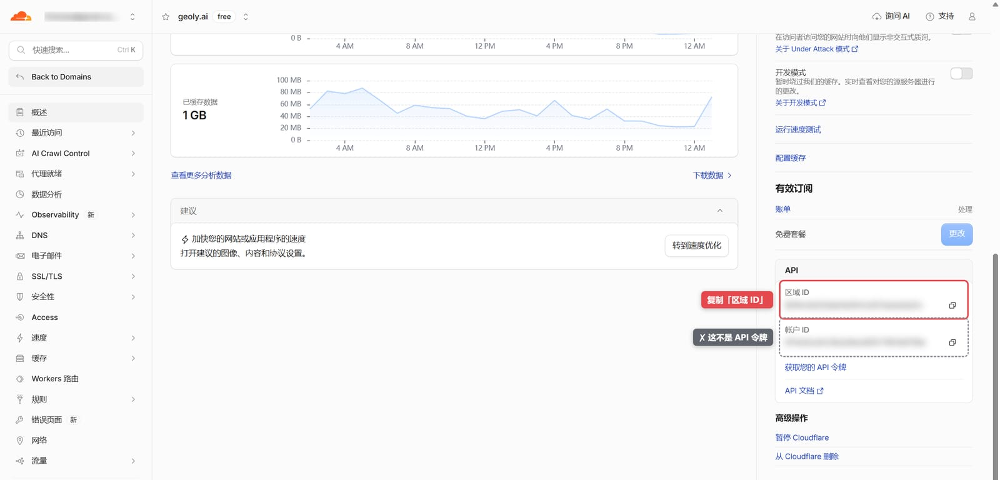
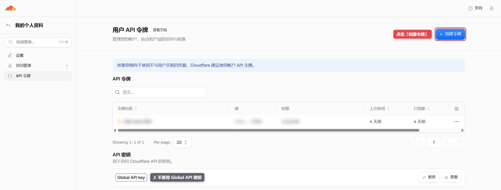
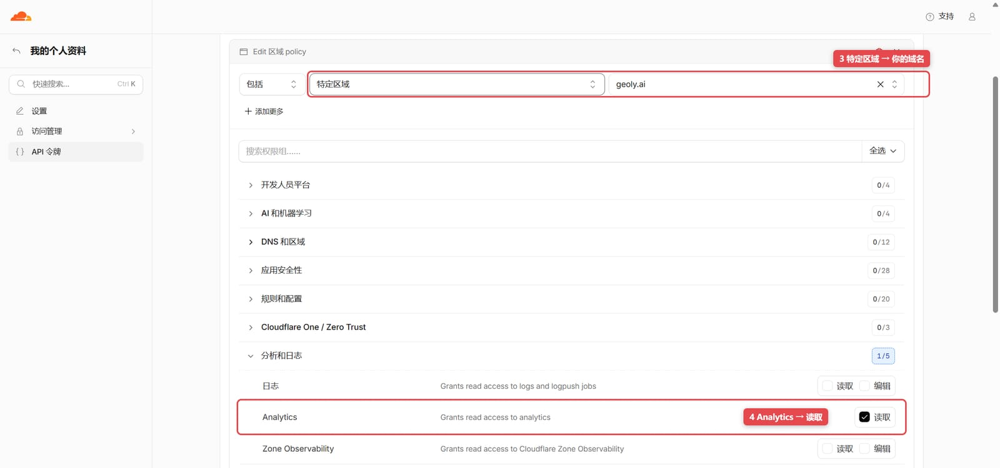

Cloudflare 集成用于回答“AI 爬虫是否来到网站、访问了哪些页面、是否被拦截”这类服务端问题。连接后，GEOly 会通过 Cloudflare API 读取指定域名区域（Zone）的请求与安全事件数据，不会向网站注入前端脚本。

> 可结合 GA4 与 GEOly 监控数据分别观察爬虫请求、AI 答案中的提及或引用，以及用户会话。三者样本和口径不同，不能仅凭时间先后推断因果。

## 一、连接前准备

开始前请确认：

- 你是当前品牌所属组织的所有者或管理员；
- 网站域名已经接入 Cloudflare，并且你能登录该域名所在的 Cloudflare 帐户。

连接只需要填两项：

| GEOly 里的输入框 | 是什么 | 在 Cloudflare 哪里拿 |
| --- | --- | --- |
| **Zone ID** | 域名的「区域 ID」，32 位字母数字 | 域名 **概述** 页右侧的 **API** 卡片 |
| **API Token** | 你为 GEOly 新建的只读「API 令牌」 | **我的个人资料 → API 令牌** 里新建 |

<Warning>
**API** 卡片里有两串长得很像的 32 位 ID：**区域 ID** 和 **帐户 ID**。帐户 ID 不是 API 令牌，填进 API Token 框一定会连接失败。API 令牌必须按下面第三步单独新建；也不要使用 Global API Key。
</Warning>

## 二、复制区域 ID（Zone ID）

1. 登录 [Cloudflare 控制台](https://dash.cloudflare.com/)，在域名列表里点开要连接的域名；
2. 停留在该域名的 **概述** 页，在页面右侧栏往下滚动，找到 **API** 卡片；
3. 点击 **区域 ID** 右侧的复制按钮。下面的 **帐户 ID** 不用复制。

区域 ID 必须来自你要分析的那个域名。多个域名各有自己的区域 ID，不能混用。

## 三、创建 API 令牌（API Token）

1. 打开 [我的个人资料 → API 令牌](https://dash.cloudflare.com/profile/api-tokens)（也可以点上一步 **API** 卡片里的 **获取您的 API 令牌**），点击 **创建令牌**。

   

2. 页面列出了很多模板。拉到最下方，在 **创建自定义令牌** 处点击 **开始使用**。

   

3. 按下表填写，然后点击页面底部的 **继续以显示摘要**：

   | 配置项 | 填写 |
   | --- | --- |
   | 令牌名称 | 例如 `GEOly Cloudflare Analytics` |
   | 权限 | **区域** → **Analytics** → **读取** |
   | 区域资源 | **包括** → **特定区域** → 选择要连接的域名 |
   | 客户端 IP 地址筛选、TTL | 保持默认 |

   

4. 在摘要页确认权限只有 Analytics 读取、范围是你的域名，点击 **创建令牌**。

5. 复制页面上显示的令牌。**令牌只显示这一次**，离开页面后无法再查看；如果没来得及复制，删掉它重新创建一个即可。

   

只需要 **区域 → Analytics → 读取** 这一项权限：GEOly 连接时的校验，以及之后读取的请求数据和安全事件，都在这个权限范围内。不需要把令牌开放给全部区域，也不要把令牌发到聊天、截图或工单里。

## 四、在 GEOly 完成连接

1. 确认左上角当前品牌正确。Cloudflare 连接绑定到当前品牌，多个品牌需要分别连接；
2. 打开 **我的网站 → AI 流量**，在 Cloudflare 卡片上点击 **立即连接**（也可以直接打开 **集成 → Cloudflare** 页面）；
3. 把第二步复制的区域 ID 粘贴到 **Zone ID**，把第三步复制的令牌粘贴到 **API Token**；
4. 点击 **连接 Cloudflare**。校验通过后会自动跳到 **AI 流量** 的 Cloudflare 视图。

如果提示连接失败，按提示文字对照下文「常见问题与排错」检查。

## 五、Cloudflare 数据看什么

### 1. AI 爬虫与页面关系

页面顶部的关系图把“哪一种 AI 爬虫访问了哪一条页面路径”放在同一张图中：

- **左侧 AI 爬虫**：显示当前已识别的爬虫名称、请求数，以及它在关系图所展示请求中的占比；
- **右侧页面路径**：显示所有已识别 AI 爬虫访问该路径的合计请求数；
- **中间连线**：连接具体爬虫与页面，连线越粗，代表这组“爬虫 → 路径”的请求越多；
- **悬停信息**：将鼠标停在连线上，可查看该爬虫访问该路径的准确请求数。

右侧优先展示所选周期内请求量最高的 10 条路径，其余路径会合并为“其他”。顶部的平台筛选可缩小关系图中的爬虫范围，适合回答“某个 AI 平台主要在抓哪些页面”。

请求数是服务器收到的 HTTP 请求次数，不是用户数、会话数、AI 答案曝光或引用次数。同一爬虫重复访问同一路径会重复计数。

### 2. AI 流量趋势

趋势图按日期展示各 AI 爬虫的请求变化，并以不同颜色区分爬虫。它适合判断：

- 发布新内容后是否出现新的抓取活动；
- 某一爬虫的访问是否持续增长或突然中断；
- 抓取高峰是否与发布、迁移、缓存或安全规则调整时间一致。

趋势上升只能说明抓取请求增加，不能直接证明品牌在 AI 答案中的曝光、引用或排名已经提升。需要到 **信源 → 引用来源** 和 **提示词 → 全部提示词** 的实际 AI 回答中继续验证。

### 3. Top 被爬页面

该板块汇总所有已识别 AI 爬虫的请求，并按路径展示请求量最高的页面。每条路径同时显示请求数和在当前 Top 路径中的占比，可用于：

- 找到最频繁被 AI 爬虫访问的产品页、文章或帮助文档；
- 检查核心页面是否几乎没有被抓取；
- 发现参数页、重复页或低价值路径是否消耗大量抓取请求；
- 对照关系图，确认某条路径主要由哪些爬虫访问。

这里展示的是抓取热度，不是引用排行。路径被频繁抓取后仍可能没有进入 AI 答案。

### 4. AI 爬虫来源地区

地区板块汇总 AI 爬虫请求的来源国家或地区。地图覆盖请求量最高的 10 个来源地区，右侧排行榜展示其中前 8 个。它反映请求出口网络的位置，不代表真实用户市场，也不代表该地区用户对品牌的需求。

AI 爬虫可能通过云计算或代理基础设施发送请求，因此地区分布更适合用于异常排查、网络策略检查和访问模式比较。

### 5. 被拦截爬虫排行与事件明细

Cloudflare 安全数据分为两个相互补充的板块：

- **被拦截爬虫排行**：按 AI 爬虫汇总被安全规则处理的次数，用于识别受影响最明显的平台；
- **被拦截的爬虫事件**：展示时间、爬虫、路径、拦截动作和安全模块，帮助定位具体事件。

拦截动作可能包括禁止访问、人机验证或 JS 验证，安全模块可能来自 WAF、自定义规则、速率限制或 Bot 识别。重点检查核心爬虫是否持续被拦截、哪些路径受影响，以及事件是否与 Cloudflare 规则变更同时出现。

拦截数据的完整度受 Cloudflare 套餐、数据保留范围和 Token 可访问数据影响。修改 WAF、Bot 或速率限制规则属于高影响操作，应先由安全或运维负责人评估。若页面没有拦截事件，只能说明当前可查询范围内没有返回匹配事件，不能证明历史上从未发生拦截。

## 六、当前可识别的 AI 爬虫

GEOly 当前按 User-Agent 识别以下规则：

| 平台 | 识别标识 |
| --- | --- |
| ChatGPT / OpenAI | GPTBot、ChatGPT-User、OAI-SearchBot |
| Claude / Anthropic | ClaudeBot、Claude-Web、anthropic-ai |
| Perplexity | PerplexityBot |
| Gemini / Google | Google-Extended、Googlebot-Extended |
| Cohere | cohere-ai |
| Grok | GrokBot |

该列表表示 GEOly 当前的识别规则，不等于 Cloudflare 能看到的全部机器人。未知或改名的 User-Agent 可能暂时不会被归类为 AI 爬虫。

## 七、时间范围与数据边界

Cloudflare 分析支持最近 7 天、30 天、90 天和自定义日期。实际可查询的最长范围会受到 Cloudflare 套餐与数据保留策略限制，页面会按当前可用范围进行约束。

GEOly 在打开或刷新分析页时向 Cloudflare 查询数据，不采用固定“同步 1–2 小时后入库”的流程。Cloudflare 自身的数据可用性或延迟仍可能随套餐和接口变化。

## 八、推荐分析流程

### 内容团队

1. 在热门爬取页面中找到高频页面；
2. 到 **信源 → 引用来源** 查看这些页面是否被 AI 引用；
3. 到 **提示词 → 全部提示词** 查看相关问题和原始 AI 回答；
4. 优化未被引用但已被频繁抓取的页面结构、实体信息和证据内容。

### 技术与安全团队

1. 观察 AI 爬虫趋势是否突然下降；
2. 检查拦截事件与受影响路径；
3. 对照 Cloudflare WAF/Bot 规则变更时间；
4. 验证 robots.txt、缓存和源站响应是否正常。

### 增长团队

1. 用 Cloudflare 判断 AI 爬虫是否持续访问；
2. 用 GEOly 监控判断品牌是否被提及、引用；
3. 用 GA4 判断这些 AI 平台是否带来真实会话、互动与转化。

## 九、常见问题与排错

### 提示「这是一串 32 位的帐户 ID 或区域 ID，不是 API 令牌」

API Token 框里填的是 ID，不是令牌。最常见的情况是复制了 **API** 卡片里的 **帐户 ID**。按上文第三步新建一个 API 令牌，再粘贴进来。

旧版页面遇到这种情况会提示「Cloudflare API 错误，请稍后重试」，原因相同，重试不会成功。

### 提示 API Token 无效，或没有这个域名的读取权限

依次检查：

- 粘贴的是新建的 API 令牌，而不是帐户 ID、区域 ID 或 Global API Key；
- 令牌复制完整、前后没有多余空格，也没有被删除或过期；
- 权限包含 **区域 → Analytics → 读取**；
- **区域资源** 包含你要连接的这个域名（只授权了别的域名也会报这个错）。

### 提示找不到这个 Zone ID

Zone ID 填错了，或者把域名、网址填进了 Zone ID 框。回到该域名 **概述** 页的 **API** 卡片，重新复制 **区域 ID**。

### 连接成功但没有 AI 爬虫数据

可能原因包括：

- 所选时间范围内没有命中当前识别规则的 AI 爬虫；
- Cloudflare 套餐的保留时间短于所选范围；
- 该域名最近才接入 Cloudflare；
- 当前品牌连接了错误的 Zone；
- 相关请求使用了尚未被识别的 User-Agent。

先缩短到最近 7 天并刷新，再核对 Cloudflare 控制台中的请求数据。

### 为什么 Cloudflare 与 GA4 数字不同

两者测量对象不同：

- **Cloudflare**：服务器收到的 HTTP 请求，包括 AI 爬虫；
- **GA4**：浏览器端用户会话、页面浏览、互动和转化。

AI 爬虫请求通常不会执行 GA4 脚本，因此不应把 Cloudflare 请求数与 GA4 会话数直接相减或比较。

### 会影响网站性能吗

不会。GEOly 通过 Cloudflare 后端 API 读取数据，不向页面注入脚本，也不会进入网站请求链路。

## 十、安全与断开连接

- 使用仅限目标 Zone 的只读 Token；
- 不要在聊天、截图或工单中暴露 Token；
- 人员或供应商变更时及时轮换 Token；
- 如需停止访问，可在 **集成 → Cloudflare** 的连接管理页断开连接，并在 Cloudflare 中撤销对应 Token。

断开连接会停止后续读取，但不会修改 Cloudflare 配置，也不会删除 Cloudflare 原始数据。
