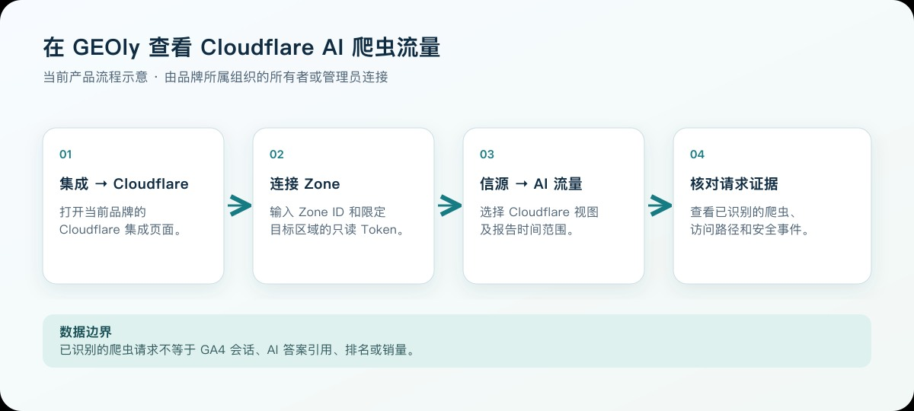

Cloudflare 集成用于回答“AI 爬虫是否来到网站、访问了哪些页面、是否被拦截”这类服务端问题。连接后，Geoly 会通过 Cloudflare API 读取指定域名区域（Zone）的请求与安全事件数据，不会向网站注入前端脚本。

> 可结合 GA4 与 GEOly 监控数据分别观察爬虫请求、AI 答案中的提及或引用，以及用户会话。三者样本和口径不同，不能仅凭时间先后推断因果。

## 一、连接前准备

开始前请确认：

- 当前账号是所选品牌所属组织的所有者或管理员；
- 目标域名已经接入 Cloudflare；
- 你能进入该域名的 Cloudflare 控制台；
- 你准备为 Geoly 创建一个仅限目标 Zone、只读权限的 API Token。

连接所需信息只有两项：

1. **Zone ID**：目标域名在 Cloudflare 中的区域标识；
2. **API Token**：允许 Geoly 读取该 Zone 分析数据的只读令牌。

## 二、在 Geoly 打开 Cloudflare 集成

先选择要分析的品牌，打开 **集成 → Cloudflare**。也可以从 **信源 → AI 流量** 的 Cloudflare 数据源入口进入连接页。连接完成后返回 **信源 → AI 流量**，选择 Cloudflare 视图和报告时间范围。

这张图说明当前操作路径与数据边界，是示意图，不是应用界面截图。

> 页面当前提示 Zone Analytics Read；实际连接校验还会读取目标 Zone 基本信息，因此 Token 必须同时包含 **Zone → Zone → Read** 与 **Zone → Analytics → Read**。

Geoly 会在提交时验证 Zone ID 与 Token 是否匹配。验证成功后，返回 **信源 → AI 流量** 查看 Cloudflare 数据。

## 三、获取 Zone ID

1. 登录 [Cloudflare 控制台](https://dash.cloudflare.com/)；
2. 进入 **Websites**，选择需要连接的域名；
3. 在域名 **Overview** 页面找到 **API** 区域；
4. 复制 **Zone ID**。

注意：Zone ID 必须来自你准备分析的同一个域名。多个域名分别属于不同 Zone，不能混用。

## 四、创建最小权限 API Token

在 Cloudflare 的个人资料中进入 **API Tokens**，创建一个自定义 Token。建议使用以下配置：

| 配置项 | 建议值 |
| --- | --- |
| Token 名称 | Geoly Cloudflare Analytics |
| Zone → Zone | Read |
| Zone → Analytics | Read |
| Zone Resources | Include → Specific zone → 选择目标域名 |

当前 Geoly 的连接校验会读取目标 Zone 基本信息，因此除了 **Zone Analytics Read**，还需要 **Zone Read**。没有必要把令牌开放给全部 Zone，也不要使用 Global API Key。

创建后请立即复制 Token。Cloudflare 通常只在创建时完整展示一次；请把它当作敏感凭据保存。

## 五、在 Geoly 完成连接

1. 将 Cloudflare 的 **Zone ID** 粘贴到对应输入框；
2. 将新建的 **API Token** 粘贴到 Token 输入框；
3. 点击 **连接 Cloudflare**；
4. 验证成功后进入 **信源 → AI 流量**，切换到 Cloudflare 数据。

如果组织中有多个品牌，请先确认左侧当前品牌是否正确；Cloudflare 连接会绑定到当前品牌。

## 六、Cloudflare 数据看什么

### 1. AI 爬虫与页面关系

页面顶部的关系图把“哪一种 AI 爬虫访问了哪一条页面路径”放在同一张图中：

- **左侧 AI 爬虫**：显示当前已识别的爬虫名称、请求数，以及它在关系图所展示请求中的占比；
- **右侧页面路径**：显示所有已识别 AI 爬虫访问该路径的合计请求数；
- **中间连线**：连接具体爬虫与页面，连线越粗，代表这组“爬虫 → 路径”的请求越多；
- **悬停信息**：将鼠标停在连线上，可查看该爬虫访问该路径的准确请求数。

右侧优先展示所选周期内请求量最高的 10 条路径，其余路径会合并为“其他”。顶部的平台筛选可缩小关系图中的爬虫范围，适合回答“某个 AI 平台主要在抓哪些页面”。

请求数是服务器收到的 HTTP 请求次数，不是用户数、会话数、AI 答案曝光或引用次数。同一爬虫重复访问同一路径会重复计数。

### 2. AI 流量趋势

趋势图按日期展示各 AI 爬虫的请求变化，并以不同颜色区分爬虫。它适合判断：

- 发布新内容后是否出现新的抓取活动；
- 某一爬虫的访问是否持续增长或突然中断；
- 抓取高峰是否与发布、迁移、缓存或安全规则调整时间一致。

趋势上升只能说明抓取请求增加，不能直接证明品牌在 AI 答案中的曝光、引用或排名已经提升。需要到 **信源 → 引用** 和 **监控 → 提示词** 的实际 AI 回答中继续验证。

### 3. Top 被爬页面

该板块汇总所有已识别 AI 爬虫的请求，并按路径展示请求量最高的页面。每条路径同时显示请求数和在当前 Top 路径中的占比，可用于：

- 找到最频繁被 AI 爬虫访问的产品页、文章或帮助文档；
- 检查核心页面是否几乎没有被抓取；
- 发现参数页、重复页或低价值路径是否消耗大量抓取请求；
- 对照关系图，确认某条路径主要由哪些爬虫访问。

这里展示的是抓取热度，不是引用排行。路径被频繁抓取后仍可能没有进入 AI 答案。

### 4. AI 爬虫来源地区

地区板块汇总 AI 爬虫请求的来源国家或地区。地图覆盖请求量最高的 10 个来源地区，右侧排行榜展示其中前 8 个。它反映请求出口网络的位置，不代表真实用户市场，也不代表该地区用户对品牌的需求。

AI 爬虫可能通过云计算或代理基础设施发送请求，因此地区分布更适合用于异常排查、网络策略检查和访问模式比较。

### 5. 被拦截爬虫排行与事件明细

Cloudflare 安全数据分为两个相互补充的板块：

- **被拦截爬虫排行**：按 AI 爬虫汇总被安全规则处理的次数，用于识别受影响最明显的平台；
- **被拦截的爬虫事件**：展示时间、爬虫、路径、拦截动作和安全模块，帮助定位具体事件。

拦截动作可能包括禁止访问、人机验证或 JS 验证，安全模块可能来自 WAF、自定义规则、速率限制或 Bot 识别。重点检查核心爬虫是否持续被拦截、哪些路径受影响，以及事件是否与 Cloudflare 规则变更同时出现。

拦截数据的完整度受 Cloudflare 套餐、数据保留范围和 Token 可访问数据影响。修改 WAF、Bot 或速率限制规则属于高影响操作，应先由安全或运维负责人评估。若页面没有拦截事件，只能说明当前可查询范围内没有返回匹配事件，不能证明历史上从未发生拦截。

## 七、当前可识别的 AI 爬虫

Geoly 当前按 User-Agent 识别以下规则：

| 平台 | 识别标识 |
| --- | --- |
| ChatGPT / OpenAI | GPTBot、ChatGPT-User、OAI-SearchBot |
| Claude / Anthropic | ClaudeBot、Claude-Web、anthropic-ai |
| Perplexity | PerplexityBot |
| Gemini / Google | Google-Extended、Googlebot-Extended |
| Cohere | cohere-ai |
| Grok | GrokBot |

该列表表示 Geoly 当前的识别规则，不等于 Cloudflare 能看到的全部机器人。未知或改名的 User-Agent 可能暂时不会被归类为 AI 爬虫。

## 八、时间范围与数据边界

Cloudflare 分析支持最近 7 天、30 天、90 天和自定义日期。实际可查询的最长范围会受到 Cloudflare 套餐与数据保留策略限制，页面会按当前可用范围进行约束。

Geoly 在打开或刷新分析页时向 Cloudflare 查询数据，不采用固定“同步 1–2 小时后入库”的流程。Cloudflare 自身的数据可用性或延迟仍可能随套餐和接口变化。

## 九、推荐分析流程

### 内容团队

1. 在热门爬取页面中找到高频页面；
2. 到 **信源 → 引用** 查看这些页面是否被 AI 引用；
3. 到 **监控 → 提示词** 查看相关问题和原始 AI 回答；
4. 优化未被引用但已被频繁抓取的页面结构、实体信息和证据内容。

### 技术与安全团队

1. 观察 AI 爬虫趋势是否突然下降；
2. 检查拦截事件与受影响路径；
3. 对照 Cloudflare WAF/Bot 规则变更时间；
4. 验证 robots.txt、缓存和源站响应是否正常。

### 增长团队

1. 用 Cloudflare 判断 AI 爬虫是否持续访问；
2. 用 Geoly 监控判断品牌是否被提及、引用；
3. 用 GA4 判断这些 AI 平台是否带来真实会话、互动与转化。

## 十、常见问题与排错

### 连接时提示 Zone 或 Token 无效

依次检查：

- Zone ID 是否完整、是否来自目标域名；
- Token 是否包含 **Zone Read** 与 **Zone Analytics Read**；
- Token 的资源范围是否包含该 Zone；
- Token 是否已被撤销、过期或复制不完整。

### 连接成功但没有 AI 爬虫数据

可能原因包括：

- 所选时间范围内没有命中当前识别规则的 AI 爬虫；
- Cloudflare 套餐的保留时间短于所选范围；
- 该域名最近才接入 Cloudflare；
- 当前品牌连接了错误的 Zone；
- 相关请求使用了尚未被识别的 User-Agent。

先缩短到最近 7 天并刷新，再核对 Cloudflare 控制台中的请求数据。

### 为什么 Cloudflare 与 GA4 数字不同

两者测量对象不同：

- **Cloudflare**：服务器收到的 HTTP 请求，包括 AI 爬虫；
- **GA4**：浏览器端用户会话、页面浏览、互动和转化。

AI 爬虫请求通常不会执行 GA4 脚本，因此不应把 Cloudflare 请求数与 GA4 会话数直接相减或比较。

### 会影响网站性能吗

不会。Geoly 通过 Cloudflare 后端 API 读取数据，不向页面注入脚本，也不会进入网站请求链路。

## 十一、安全与断开连接

- 使用仅限目标 Zone 的只读 Token；
- 不要在聊天、截图或工单中暴露 Token；
- 人员或供应商变更时及时轮换 Token；
- 如需停止访问，可在 **集成 → Cloudflare** 的连接管理页断开连接，并在 Cloudflare 中撤销对应 Token。

断开连接会停止后续读取，但不会修改 Cloudflare 配置，也不会删除 Cloudflare 原始数据。
