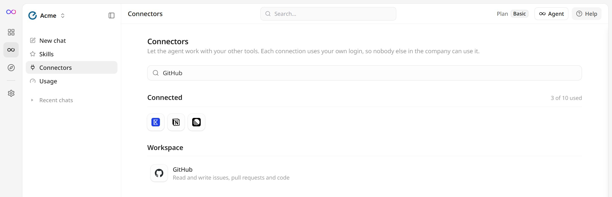
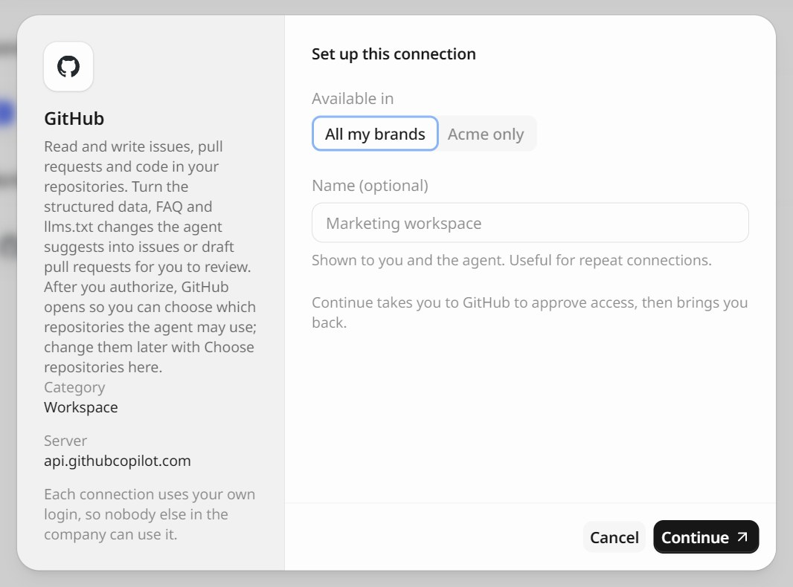
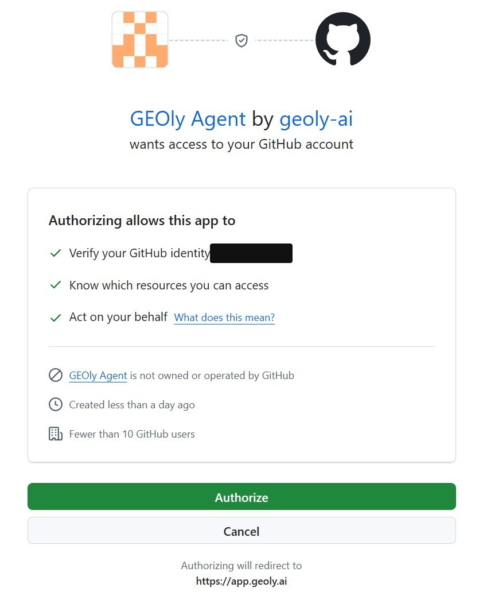
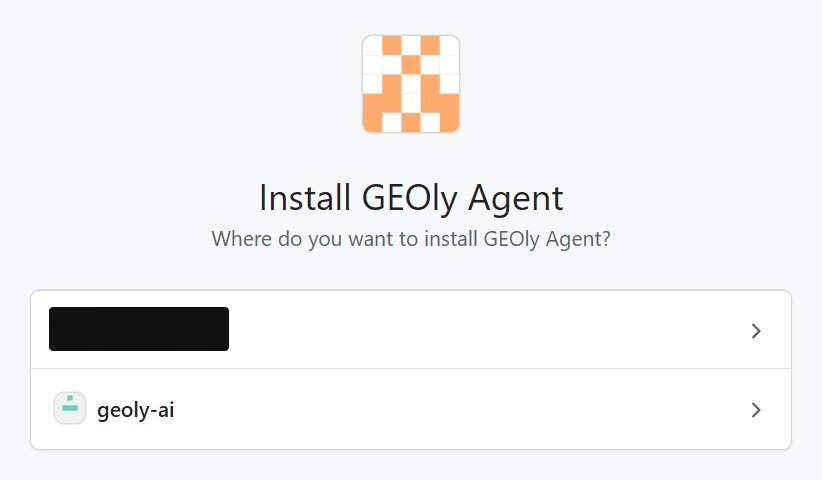
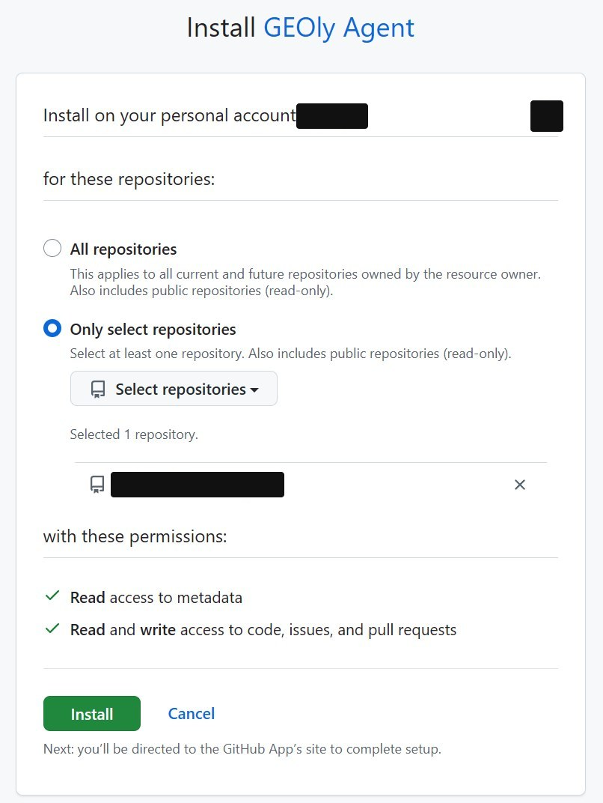
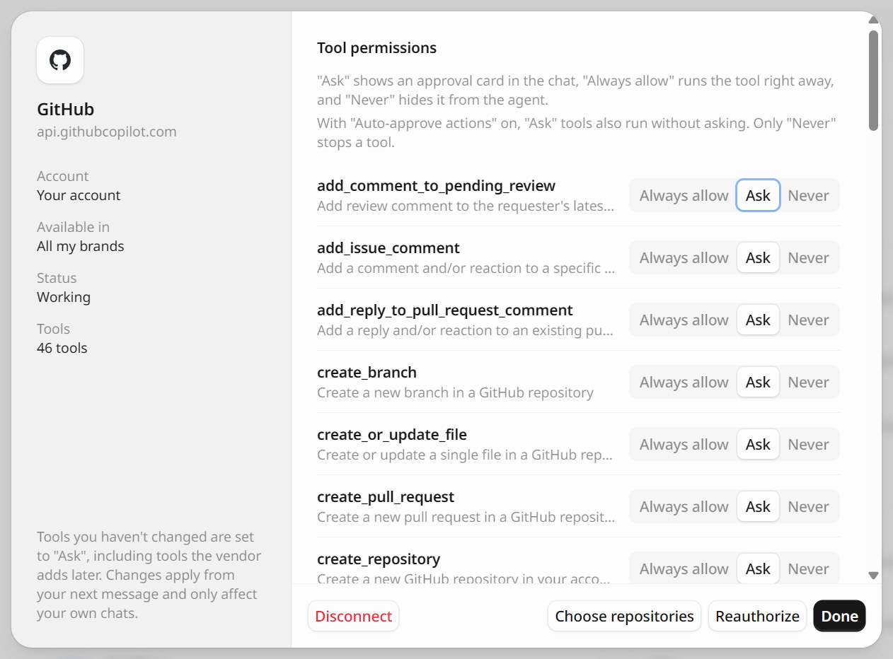

GitHub 连接器让 GEOly Agent 能在你的仓库里干活：读 issue、PR 和代码，并把它建议的结构化数据、FAQ、`llms.txt` 改动开成 issue 或 PR 草稿，由你审核合并。

连接在 GitHub 上要走两步：先**授权**GEOly Agent 这个应用，再**选择仓库**，也就是它能用哪些仓库。两个页面都由 GEOly 依次帮你打开。

<Note>
下面的截图都是 GEOly 和 GitHub 的英文界面。正文先写英文界面上的名称，括号里是中文界面的对应名称，方便你用任一语言的界面对照操作。GitHub 本身只有英文界面。
</Note>

## 一、连接前准备

开始前请确认：

- 你在 GEOly 里能打开 **Agent**。连接器在 Agent 的 **Connectors**（连接器）页；
- 你能登录要连接的 GitHub 帐户；
- 如果要用某个 GitHub 组织（Organization）下的仓库，你是这个组织的所有者（Owner），或者有所有者帮你批准安装。

每个连接都用你自己的 GitHub 登录，GEOly 组织里的其他人用不了。公开仓库 Agent 都能读；但要写入，或者读私有仓库的代码，仓库必须同时满足两个条件：你的 GitHub 帐户有权限，并且你给这个应用选了它。

## 二、在连接器页找到 GitHub

1. 在 GEOly 里打开 **Agent**，点左侧栏的 **Connectors**（连接器）。也可以直接打开 `app.geoly.ai/agent/connectors`；
2. 在 **Workspace**（协作）分组里找到 **GitHub**，或者在搜索框里输入 `GitHub`，然后点它。

## 三、设置这个连接

1. 在 **Available in**（可用范围）里选 **All my brands**（我的全部品牌），或者只给当前品牌用；
2. **Name**（名称）可以不填，也可以填一个好认的，比如 `公司 GitHub`。连了多个 GitHub 帐户时用来区分；
3. 点 **Continue**（继续），GEOly 会带你去 GitHub。

## 四、授权 GEOly Agent

GitHub 会打开 **Authorize GEOly Agent** 页面。先确认页面上显示的是你要连接的那个帐户，再点 **Authorize**。

授权的意思是：GEOly 可以以你的身份操作 GitHub。除了读公开仓库，它只能在你下一步选的那些仓库里干活。GEOly 拿不到你的 GitHub 密码。

## 五、选择仓库

授权完成后，GitHub 会马上打开 **Install GEOly Agent** 页面：

1. 选择装到哪里：你的个人帐户，或者某个组织。如果列出了多个帐户，选拥有目标仓库的那个；

   

2. 在 **Repository access** 里选 **Only select repositories**，勾上允许 Agent 使用的仓库。我们建议这样选，不要选 **All repositories**；
3. 核对权限：**Read access to metadata**（元数据只读），以及 **Read and write access to code, issues, and pull requests**（代码、issue、PR 读写）。确认后点 **Install**。

   

装好后 GitHub 会把你带回 GEOly 的 **Connectors**（连接器）页，GitHub 出现在 **Connected**（已连接）里。

如果你不是该组织的所有者，GitHub 页面上的按钮会是 **Request** 而不是 **Install**，申请会发给组织所有者，GEOly 这边会提示「已发出安装申请，组织所有者批准后 Agent 才能用」。所有者一批准，这些仓库就能用了，不用重新连接。

<Warning>
这一步不能跳过。应用装到仓库之前，Agent 只能读公开仓库，私有仓库在它看来就像不存在一样。如果你提前关掉了 GitHub 页面，在 GEOly 里打开这个连接，点 **Choose repositories**（选择仓库）补上，做法见下一节。
</Warning>

## 六、以后增减仓库

在 **Connectors**（连接器）页的 **Connected**（已连接）里点你的 GitHub 连接，再点弹窗底部的 **Choose repositories**（选择仓库）。GitHub 会打开和第五步相同的页面，在那里增减仓库，改完会自动回到 GEOly。

也可以直接在 GitHub 上改：打开 **Settings → Applications → Installed GitHub Apps**，点 **GEOly Agent** 旁边的 **Configure**。如果是组织，就去该组织的设置里做同样的操作。

## 七、在对话里使用

新开一个 Agent 对话，说清楚是哪个仓库，例如：

- 「列出 `acme/website` 里跟结构化数据有关的未关闭 issue。」
- 「在 `acme/website` 开一个 PR 草稿，把我们刚写的 FAQ schema 加到配送说明页。」
- 「给 `acme/website` 里每个缺 meta description 的页面各建一个 issue。」

GitHub 的每个工具默认都是 **Ask**（询问）：Agent 调用前，对话里会弹出审批卡，写明它要做什么，你批准之后才会执行。想按工具调整，就在连接弹窗里把它设成 **Always allow**（始终允许）、**Ask**（询问）或 **Never**（从不）。打开了 **Auto-approve actions**（自动批准改动）时，「询问」的工具也会直接执行，只有「从不」拦得住。

## 八、断开连接

打开连接弹窗，点 **Disconnect**（断开连接）。这只会删掉 GEOly 保存的那份授权。想把应用从 GitHub 那边也去掉：

- **Settings → Applications → Authorized GitHub Apps**：点 **GEOly Agent** 旁边的 **Revoke**；
- **Settings → Applications → Installed GitHub Apps**：点 **GEOly Agent** 旁边的 **Configure**，再点 **Uninstall**。装过的每个组织都要各做一次。

## 九、常见问题

- **Agent 说找不到某个仓库**（比如提示「Could not resolve to a Repository」）：应用没装到这个仓库，或者仓库的所有者或名称写错了。在连接弹窗里点 **Choose repositories**（选择仓库）把它加上；
- **看不到某个组织的仓库**：应用还没装到这个组织，或者在等组织所有者批准。请所有者在 GitHub 上批准；
- **连接显示「Needs reauthorization」（需要重新授权）**：GitHub 的访问凭据每 8 小时过期一次，GEOly 会自动续期。如果你在 GitHub 上撤销了授权，或者大约 6 个月没用过这个连接，续期就会失败。这时在连接弹窗里点 **Reauthorize**（重新授权）即可，不用重新选仓库；
- **提示「你在 GitHub 那边取消了授权」**：你在 GitHub 的授权页点了 **Cancel**。从第二步重新开始即可。
